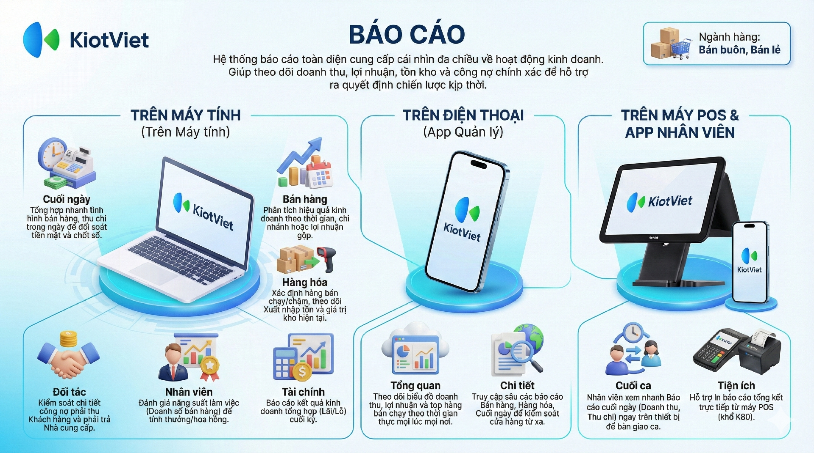
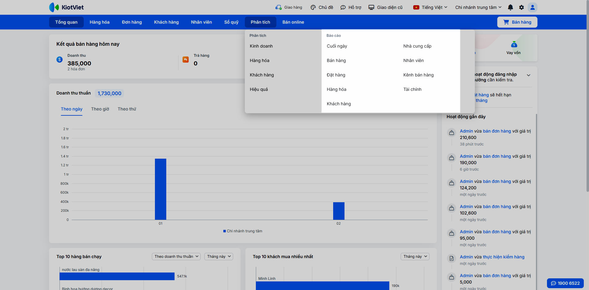
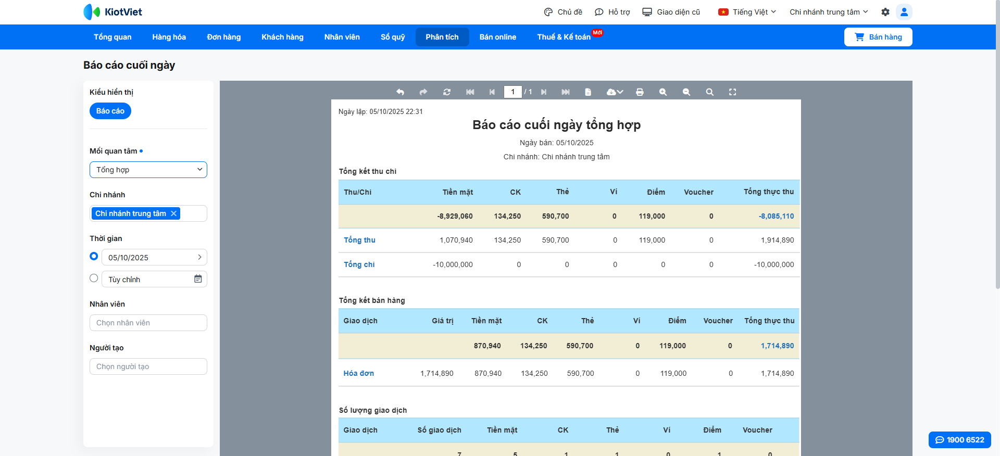
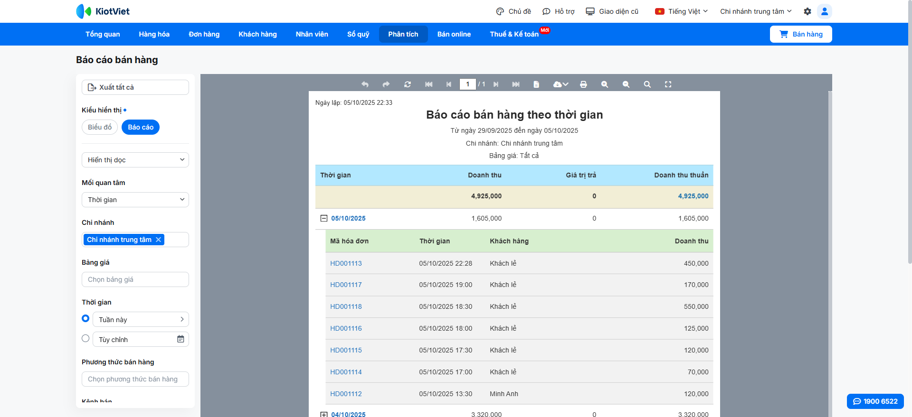
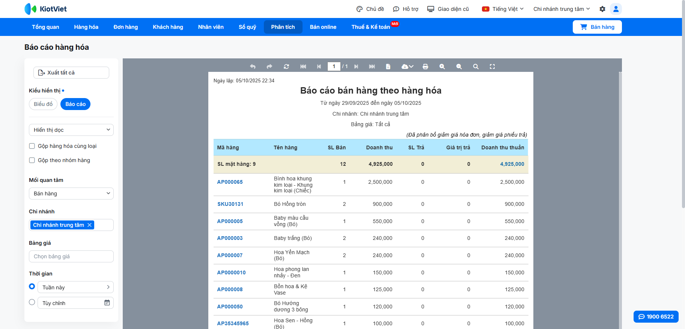
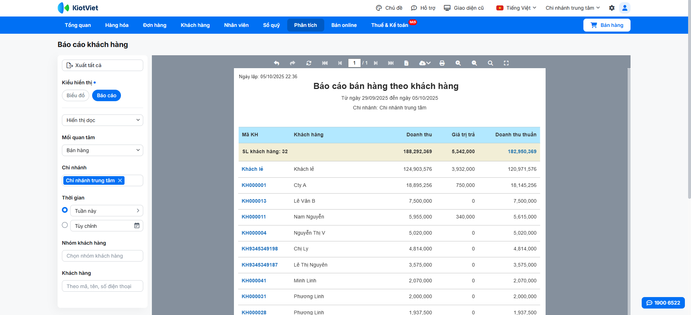
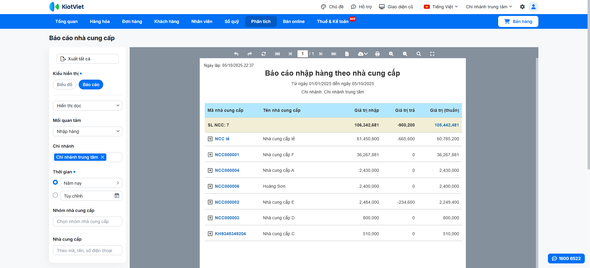
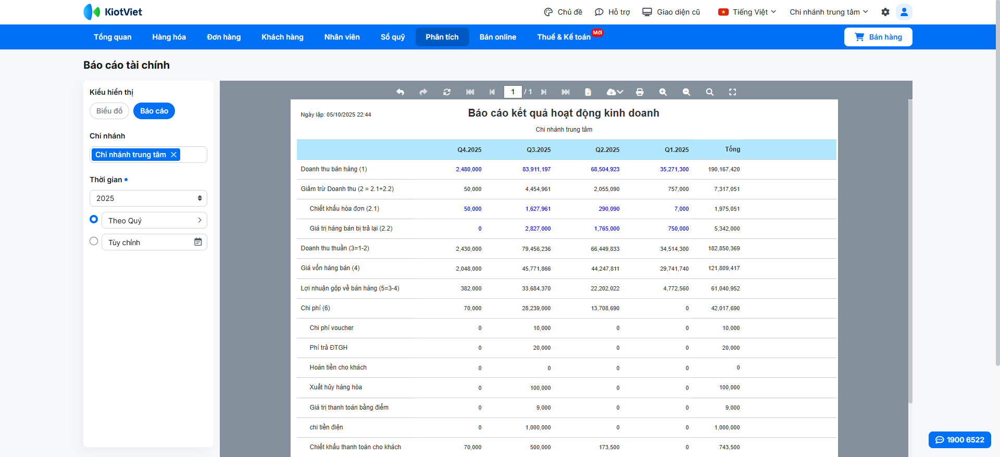

# KiotViet Retail – Báo cáo

Nguồn: https://www.kiotviet.vn/huong-dan-su-dung-kiotviet/retail-bao-cao/bao-cao/

---

# **Báo cáo**

*(Ngành Bán buôn, Bán lẻ)*

## **I. Giới thiệu chung**

Hệ thống báo cáo của KiotViet được thiết kế để cung cấp cho chủ cửa hàng những thông tin giá trị và trực quan nhất.

**Lợi ích nổi bật của tính năng Báo cáo trên KiotViet**:

- **Cung cấp cái nhìn toàn cảnh về hoạt động kinh doanh**: Từ báo cáo cuối ngày, báo cáo bán hàng đến báo cáo tài chính, bạn có thể dễ dàng nắm bắt các chỉ số kinh doanh quan trọng như doanh thu, lợi nhuận, giá trị kho, công nợ... một cách nhanh chóng và chính xác.
- **Phân tích dữ liệu đa chiều, chi tiết**: Hệ thống cho phép bạn xem xét hoạt động kinh doanh dưới nhiều góc độ khác nhau như theo chi nhánh, nhân viên, khách hàng, kênh bán hàng hay từng nhóm hàng hóa cụ thể, giúp xác định những yếu tố hiệu quả và những điểm cần cải thiện.
- **Hỗ trợ ra quyết định kinh doanh chính xác và kịp thời**: Dữ liệu từ các báo cáo là cơ sở vững chắc để bạn đưa ra các quyết định chiến lược, từ việc lên kế hoạch nhập hàng, điều chỉnh giá bán, xây dựng chương trình khuyến mại đến việc quản lý dòng tiền và chi phí.

**Lưu ý:** Hệ thống **Báo cáo** có vị trí hiển thị khác nhau khi cửa hàng đăng ký sử dụng **Gói dịch vụ** khác nhau:

- **Với gian hàng Gói Dùng thử, Hỗ trợ**: Hệ thống Báo cáo nằm trong mục **Báo cáo**trên thanh Menu tại Màn hình quản lý
- **Với gian hàng thuộc Gói Chuyên nghiệp, Cao cấp**: Hệ thống Báo cáo nằm trong mục **Phân tích**trên thanh Menu tại Màn hình quản lý

*Tài liệu này sử dụng giao diện Hệ thống Báo cáo nằm trong mục **Phân tích** để minh họa các tính năng.*

## **II. Các thao tác cơ bản**

Trên máy tính, bạn có thể truy cập và tùy chỉnh hệ thống báo cáo một cách toàn diện và chi tiết nhất. Để truy cập, bạn vào menu **Phân tích** -> **Báo cáo** trên màn hình **Quản lý**.

### **1. Báo cáo Cuối ngày**

- **Tình huống**: Cuối ngày làm việc, bạn muốn có một cái nhìn tổng quan nhanh chóng về các hoạt động kinh doanh đã diễn ra.
- **Mục đích**: Thống kê các giao dịch bán hàng, thu chi trong ngày, giúp bạn nắm bắt nhanh doanh thu, số lượng hóa đơn, và các khoản thu chi phát sinh.
- **Thao tác thực hiện**:

1. Vào **Phân tích** -> **Báo cáo** -> **Cuối ngày**.
2. Sử dụng bộ lọc để xem theo ngày và các tiêu chí khác như phương thức thanh toán.

### **2. Báo cáo Bán hàng**

- **Tình huống**: Bạn muốn phân tích sâu hơn về hiệu quả bán hàng của cửa hàng trong tháng vừa qua.
- **Mục đích**: Cung cấp các chỉ số chi tiết như Doanh thu, Giá trị trả, Doanh thu thuần, Số lượng đơn bán.
- **Thao tác thực hiện**:

1. Vào **Phân tích** -> **Báo cáo** -> **Bán hàng**.
2. Sử dụng các bộ lọc theo thời gian, chi nhánh để phân tích. Bạn có thể xem dữ liệu dưới dạng biểu đồ trực quan hoặc bảng số liệu chi tiết.

### **3. Báo cáo Hàng hóa**

- **Tình huống**: Bạn cần xác định sản phẩm nào đang bán chạy nhất và sản phẩm nào đang tồn kho quá lâu để lên kế hoạch kinh doanh.
- **Mục đích**: Cung cấp thông tin chi tiết về tình hình kinh doanh của từng sản phẩm, bao gồm các mối quan tâm như Bán hàng, Lợi nhuận, Giá trị kho, Xuất nhập tồn, Hạn sử dụng.
- **Thao tác thực hiện**:

1. Vào **Phân tích** -> **Báo cáo** -> **Hàng hóa**.
2. Chọn mối quan tâm bạn muốn xem (ví dụ: Lợi nhuận).
3. Sử dụng tính năng **"Gộp hàng hóa cùng loại"** hoặc **"Gộp theo nhóm hàng"** để xem báo cáo tổng quan hơn.

### **4. Báo cáo Khách hàng**

- **Tình huống**: Bạn muốn biết khách hàng nào đang mua sắm nhiều nhất và theo dõi công nợ của những khách hàng mua nợ.
- **Mục đích**: Phân tích hành vi mua sắm và tình hình công nợ của từng khách hàng hoặc nhóm khách hàng.
- **Thao tác thực hiện**:

1. Vào **Phân tích** -> **Báo cáo** -> **Khách hàng**.
2. Chọn các báo cáo như **Hàng bán theo khách** hoặc **Công nợ** để xem chi tiết.

### **5. Báo cáo Nhà cung cấp**

- **Tình huống**: Bạn cần đối soát các giao dịch nhập hàng và công nợ với một đối tác cung cấp cụ thể.
- **Mục đích**: Quản lý và đối soát các giao dịch với nhà cung cấp.
- **Thao tác thực hiện**:

1. Vào **Phân tích** -> **Báo cáo** -> **Nhà cung cấp**.
2. Xem các báo cáo về **Hàng nhập theo nhà cung cấp**, **Công nợ**, và **Thuế VAT nhập hàng**.

### **6. Báo cáo Tài chính**

- **Tình huống**: Cuối kỳ, bạn cần một báo cáo kết quả kinh doanh tổng thể để biết lợi nhuận thực tế của cửa hàng.
- **Mục đích**: Cung cấp báo cáo kết quả hoạt động kinh doanh tổng thể, thể hiện rõ các khoản doanh thu và chi phí.
- **Thao tác thực hiện**:

1. Vào **Phân tích** -> **Báo cáo** -> **Tài chính**.
2. Báo cáo sẽ hạch toán các khoản mục như Doanh thu, Giá vốn, Chi phí (voucher, lương, điểm thưởng...) để tính ra lợi nhuận cuối cùng.

***Cảm ơn bạn đã theo dõi bài viết!***

- Để tìm hiểu thêm về các nghiệp vụ quản lý bán hàng, mời bạn xem bài viết:  
  [**Tổng quan Các nhóm Giải pháp của KiotViet**](https://www.kiotviet.vn/huong-dan-su-dung-kiotviet/retail-lam-quen-voi-kiotviet/tong-quan-cac-nhom-giai-phap-kiotviet/)
- Để tham khảo thêm các video hướng dẫn sử dụng, mời bạn theo dõi kênh YouTube:  
  [**HDSD - Phần mềm KiotViet**](https://www.youtube.com/@HDSDPhanmemKiotViet)

***Chúc bạn kinh doanh hiệu quả cùng KiotViet!***
