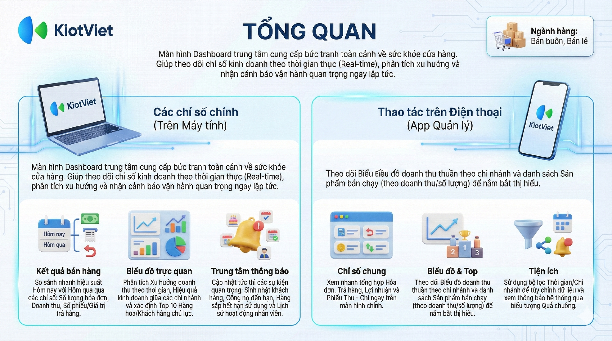
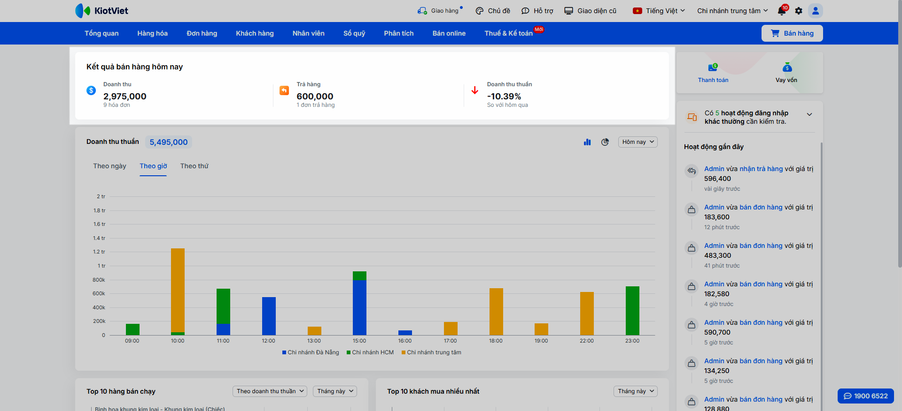
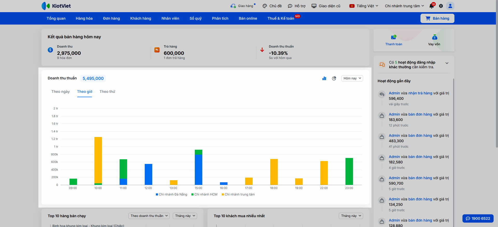
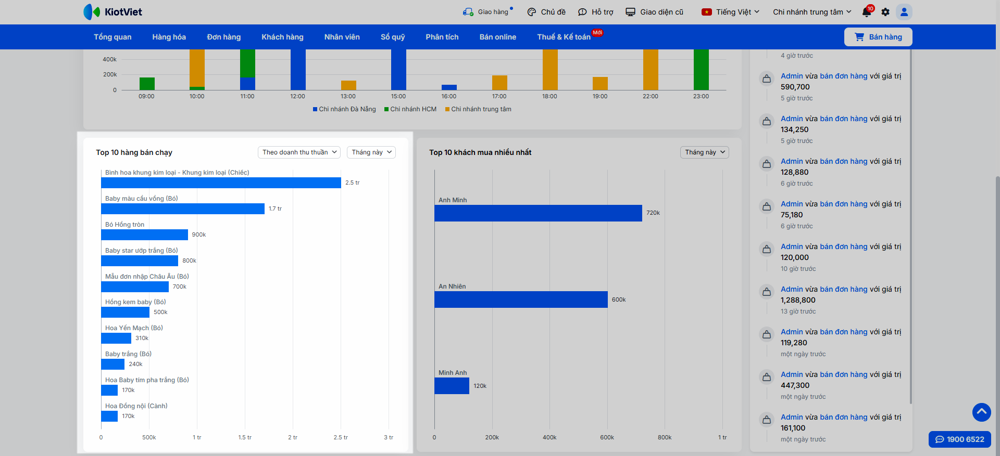
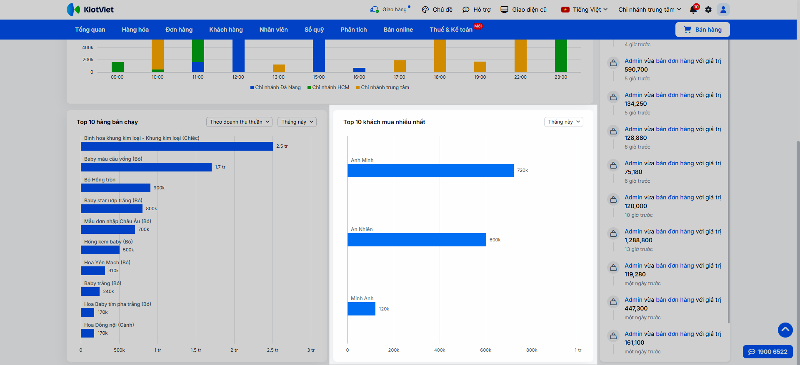
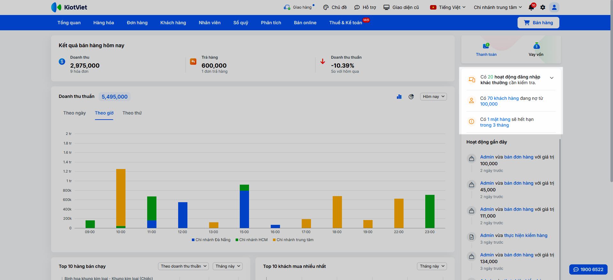
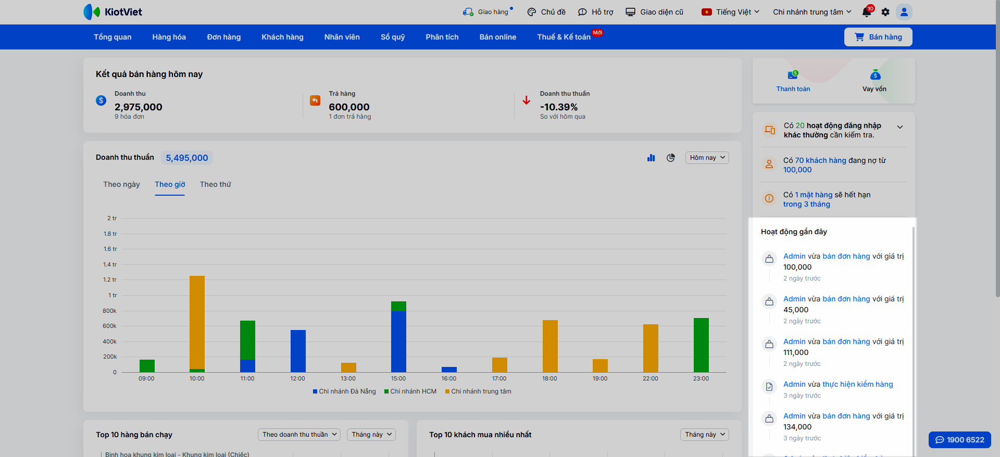

# KiotViet Retail – Tổng quan

Nguồn: https://www.kiotviet.vn/huong-dan-su-dung-kiotviet/retail-bao-cao/tong-quan/

---

# **Tổng quan**

*(Ngành Bán buôn, Bán lẻ)*

## **I. Giới thiệu chung**

Màn hình **Tổng quan** là trung tâm điều hành của cửa hàng trên KiotViet, cung cấp một bức tranh toàn cảnh về hoạt động kinh doanh. Việc theo dõi thường xuyên màn hình này sẽ mang lại những lợi ích thiết thực:

**Lợi ích nổi bật của tính năng Tổng quan trên KiotViet**:

- **Nắm bắt toàn cảnh kinh doanh**: Dễ dàng theo dõi các chỉ số cốt lõi (doanh thu, hóa đơn, trả hàng) theo thời gian thực và so sánh hiệu suất bán hàng hàng ngày, giúp bạn đánh giá nhanh chóng sức khỏe của cửa hàng.
- **Phân tích trực quan, nhanh chóng**: Các biểu đồ về doanh thu, hiệu quả chi nhánh, và top sản phẩm bán chạy giúp bạn dễ dàng nhận diện xu hướng kinh doanh và xác định các mặt hàng chủ lực cần tập trung.
- **Chủ động trong vận hành**: Trung tâm thông báo là nơi cảnh báo các thông tin quan trọng như sinh nhật khách hàng, công nợ sắp đến hạn, hàng sắp hết hạn sử dụng... giúp bạn chủ động trong việc chăm sóc khách hàng và quản lý vận hành.

## **II. Các thao tác cơ bản**

Trên phiên bản website, trang **Tổng quan** được hiển thị đầy đủ và chi tiết nhất. Đây là màn hình mặc định sau khi bạn đăng nhập vào KiotViet.

### **1. Phân tích Kết quả bán hàng hôm nay**

- **Tình huống**: Bạn muốn xem nhanh hiệu suất bán hàng trong ngày so với ngày hôm qua để đánh giá tình hình.
- **Thao tác thực hiện như sau**:

1. Tại màn hình **Tổng quan**, nhìn vào khu vực **Kết quả bán hàng hôm nay**.
2. Xem các chỉ số kinh doanh cốt lõi: số lượng hóa đơn, doanh thu, số phiếu trả hàng và giá trị hàng trả. So sánh trực tiếp với kết quả của ngày hôm qua được hiển thị bên cạnh.

### **2. Phân tích các biểu đồ trực quan**

- **Tình huống**: Bạn cần xác định xu hướng doanh thu, so sánh hiệu quả giữa các chi nhánh và biết được sản phẩm nào đang bán chạy nhất.
- **Thao tác thực hiện như sau**: Tại màn hình **Tổng quan**, xem các biểu đồ:
  1. **Biểu đồ Doanh thu**:

- Theo dõi sự biến động doanh thu theo thời gian để nhận diện các xu hướng tăng trưởng hoặc suy giảm.
- So sánh hiệu quả hoạt động giữa các chi nhánh, xác định chi nhánh nào đang mang lại doanh thu tốt nhất.

1. **Top 10 hàng hóa bán chạy**: Liệt kê danh sách các sản phẩm bán chạy nhất theo doanh thu hoặc số lượng, giúp bạn xác định các mặt hàng chủ lực.

1. **Top 10 khách mua nhiều nhất**: Liệt kê danh sách khách hàng mua nhiều nhất theo doanh thu, giúp bạn chủ động chăm sóc khách hàng tốt hơn.

### **3. Theo dõi các thông báo và hoạt động gần đây**

- **Tình huống**: Bạn muốn nắm bắt các thông tin vận hành quan trọng như sinh nhật khách hàng, công nợ đến hạn và kiểm soát các hoạt động của nhân viên trên phần mềm.
- **Thao tác thực hiện như sau**: Tại màn hình **Tổng quan**, xem khu vực bên phải:
  - **Thông báo**: Kiểm tra các cảnh báo về sinh nhật khách hàng, công nợ sắp đến hạn, hàng hóa sắp hết hạn sử dụng, lịch bảo hành/bảo trì cần thực hiện.

- **Hoạt động gần đây**: Ghi nhận lại các thao tác gần nhất của người dùng trên gian hàng, giúp bạn kiểm soát và quản lý hoạt động của nhân viên.

***Cảm ơn bạn đã theo dõi bài viết!***

- Để tìm hiểu thêm về các nghiệp vụ quản lý bán hàng, mời bạn xem bài viết:  
  [**Tổng quan Các nhóm Giải pháp của KiotViet**](https://www.kiotviet.vn/huong-dan-su-dung-kiotviet/retail-lam-quen-voi-kiotviet/tong-quan-cac-nhom-giai-phap-kiotviet/)
- Để tham khảo thêm các video hướng dẫn sử dụng, mời bạn theo dõi kênh YouTube:  
  [**HDSD - Phần mềm KiotViet**](https://www.youtube.com/@HDSDPhanmemKiotViet)

***Chúc bạn kinh doanh hiệu quả cùng KiotViet!***
