# KiotViet Retail – Khởi tạo dữ liệu quản lý nhân viên

Nguồn: https://www.kiotviet.vn/huong-dan-su-dung-kiotviet/retail-nhan-vien/khoi-tao-du-lieu-quan-ly-nhan-vien/

---

# **Khởi tạo dữ liệu Quản lý Nhân viên**

*(Ngành Bán buôn, Bán lẻ)*

## **I. Giới thiệu chung**

Tính năng Khởi tạo dữ liệu Quản lý Nhân viên đóng vai trò như một luồng dẫn dắt thông minh dành riêng cho các gian hàng mới bắt đầu sử dụng phần mềm Quản lý nhân sự. Thay vì phải tự tìm kiếm các thiết lập rải rác, tính năng này cung cấp một lộ trình 5 bước tuần tự, giúp bạn nhanh chóng thiết lập hệ thống từ những bước cơ bản nhất: thêm nhân viên, chọn chế độ chấm công phù hợp, cài đặt hình thức chấm công, thiết lập lương cho đến khi tạo thành công bảng lương tự động.

**Lợi ích nổi bật của tính năng:**

- **Lộ trình trực quan, xóa bỏ sự bỡ ngỡ**: Giải quyết triệt để bài toán "không biết bắt đầu từ đâu" của người dùng mới. Thanh tiến độ hiển thị rõ số bước đã hoàn thành (0/5 → 5/5), giúp bạn biết chính xác mình cần làm gì tiếp theo.
- **Linh hoạt chọn chế độ chấm công theo cách vận hành**: Cửa hàng có thể chọn ***Chấm công theo ca làm việc*** (nhân viên làm theo ca cố định, cần tạo ca và xếp lịch) hoặc ***Chấm công theo khung giờ làm việc*** (nhân viên chấm vào/ra tự do trong khung giờ quy định, không cần tạo ca hay xếp lịch).
- **Thiết lập siêu tốc nhờ dữ liệu gợi ý thông minh**: Hệ thống gợi ý sẵn các ca làm việc phổ biến (Ca sáng, Ca chiều, Ca tối) kèm khung giờ mặc định và tự tính tổng giờ làm, giúp rút ngắn tối đa thời gian thao tác.
- **Đảm bảo vận hành chuẩn xác ngay từ đầu**: Luồng khởi tạo được thiết kế khóa chiều: các bước Thiết lập chế độ chấm công, Hình thức chấm công, Thiết lập lương và Bảng tính lương chỉ được mở khóa sau khi bạn đã Thêm nhân viên thành công. Điều này giúp dữ liệu đồng bộ, chặt chẽ và không bị bỏ sót.

Nội dung hướng dẫn trong bài viết này được áp dụng cho các gian hàng khởi tạo kể từ ngày 16/09/2026. Với các gian hàng trước đó, vui lòng truy cập [tại đây](https://www.kiotviet.vn/huong-dan-su-dung-kiotviet/retail-nhan-vien/khoi-tao-du-lieu-quan-ly-nhan-vien-v1/).

## **II. Các thao tác cơ bản**

### **1. Khởi tạo**

**Tình huống:** Khi mới bắt đầu sử dụng tính năng quản lý nhân viên, bạn cần tìm và mở màn hình thiết lập nhân viên ban đầu để có thể thực hiện chuỗi thao tác cấu hình hệ thống một cách tuần tự.

**Thao tác thực hiện như sau:**

- **Bước 1:** Từ màn hình **Quản lý**, bạn nhấn vào menu **Nhân viên**
- **Bước 2:**  Chọn **Thiết lập nhân viên**.

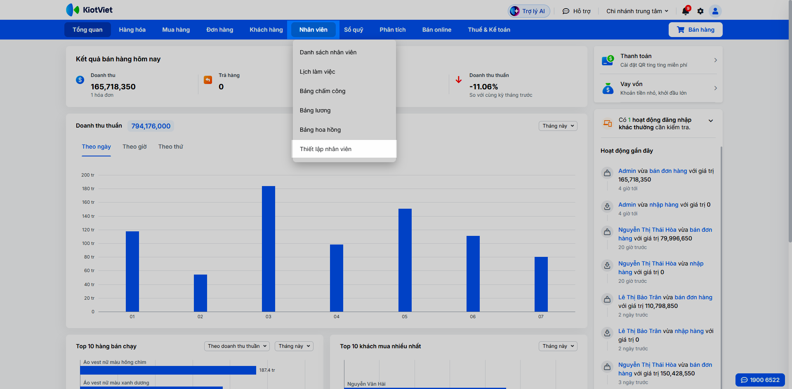

- Hoặc nhấn vào 1 trong các mục bất kỳ: **Danh sách nhân viên**, **Lịch làm việc**, **Bảng chấm công**, **Bảng lương**, **Bảng hoa hồng**.

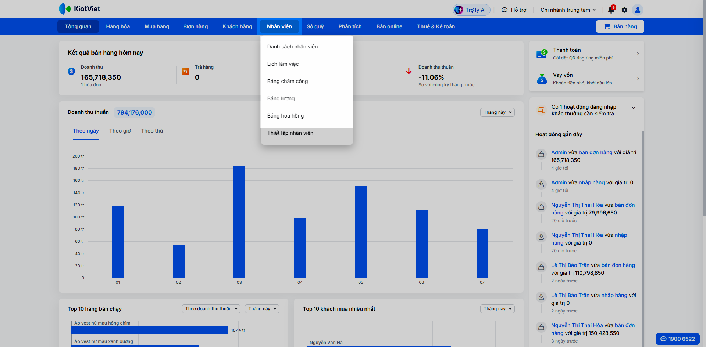

- Bạn nhấn ***Trải nghiệm ngay*** hoặc nhấn ***Khởi tạo*** (góc dưới màn hình).

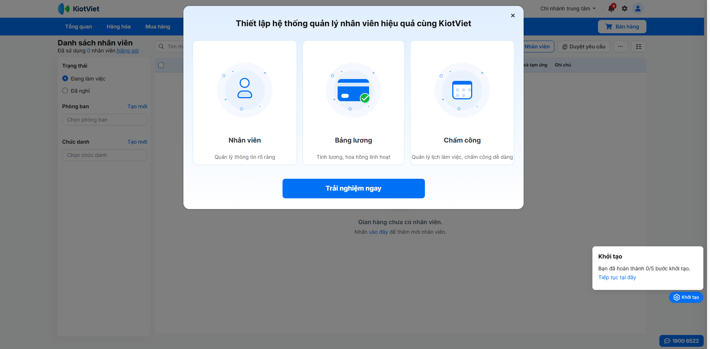

- Hệ thống sẽ tự động điều hướng đến màn hình **Thiết lập nhân viên** để bạn bắt đầu các bước khởi tạo.

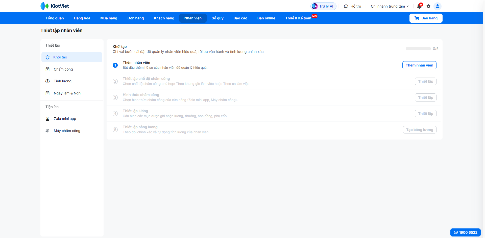

### **2. Thêm nhân viên**

**Tình huống:** Bạn cần tạo hồ sơ nhân viên trên hệ thống kèm tài khoản đăng nhập để bắt đầu quy trình thiết lập.

**Thao tác thực hiện như sau:**

- **Bước 1:** Từ màn hình **Khởi tạo** (0/5 bước), nhấn ***Thêm nhân viên***.

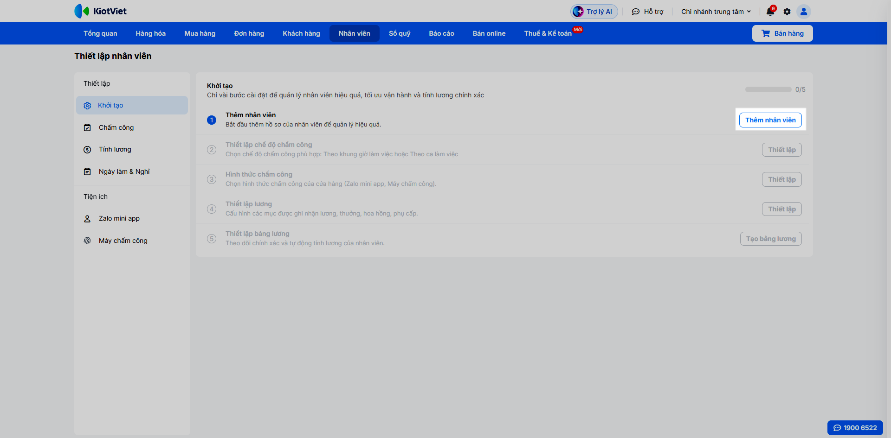

- **Bước 2:** Hệ thống hiển thị màn hình **Thêm nhân viên**.
  - Nhập các thông tin bắt buộc: ***Tên nhân viên***, ***Số điện thoại***.
  - Chọn ***Chi nhánh trả lương***:
    - Mặc định là chi nhánh đăng nhập, bạn có thể chọn lại.
    - 1 nhân viên chỉ được trả lương trên 1 chi nhánh.
  - Chọn ***Chi nhánh làm việc***: Mặc định là chi nhánh đăng nhập, bạn có thể chọn nhiều chi nhánh.
  - Chọn hoặc thêm Tài khoản đăng nhập (với nhân viên có quyền thao tác trên phần mềm)
- **Bước 3:** (Tùy chọn) Nhấn ***+ Thêm nhân viên*** ngay trong màn hình này nếu bạn muốn khai báo nhiều người cùng lúc.
- **Bước 4:** Nhấn ***Lưu và Tiếp tục*** để chuyển sang bước **Thiết lập chế độ chấm công**.

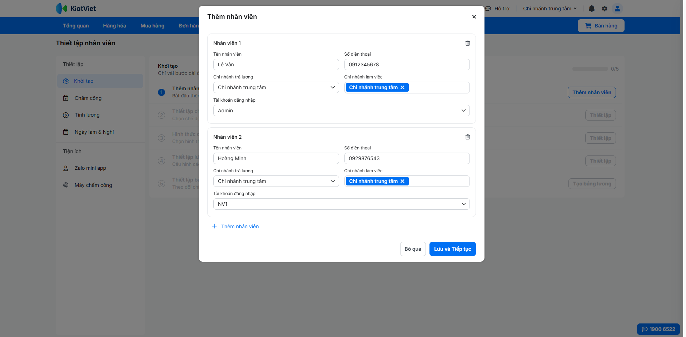

### **3. Thiết lập chế độ chấm công**

**Tình huống:** Bạn cần chọn chế độ chấm công phù hợp với cách vận hành của cửa hàng: nhân viên làm theo ca cố định hoặc nhân viên chấm vào/ra tự do trong một khung giờ quy định.

**Thao tác thực hiện như sau:**

- **Bước 1:** Hệ thống hiển thị popup **Thiết lập chế độ chấm công**. Bạn chọn 1 trong 2 chế độ:
  - ***Chấm công theo ca làm việc***: Nhân viên làm việc theo ca cố định. Cần thiết lập ca và xếp lịch cho từng nhân viên.
  - ***Chấm công theo khung giờ làm việc***: Nhân viên chấm vào/ra tự do trong khung giờ quy định. Không cần tạo ca hay xếp lịch.
- **Bước 3:** Nhấn ***Lưu và tiếp tục***. Tùy theo chế độ đã chọn, bạn thực hiện tiếp theo hướng dẫn tại mục **3.1** hoặc **3.2** bên dưới.

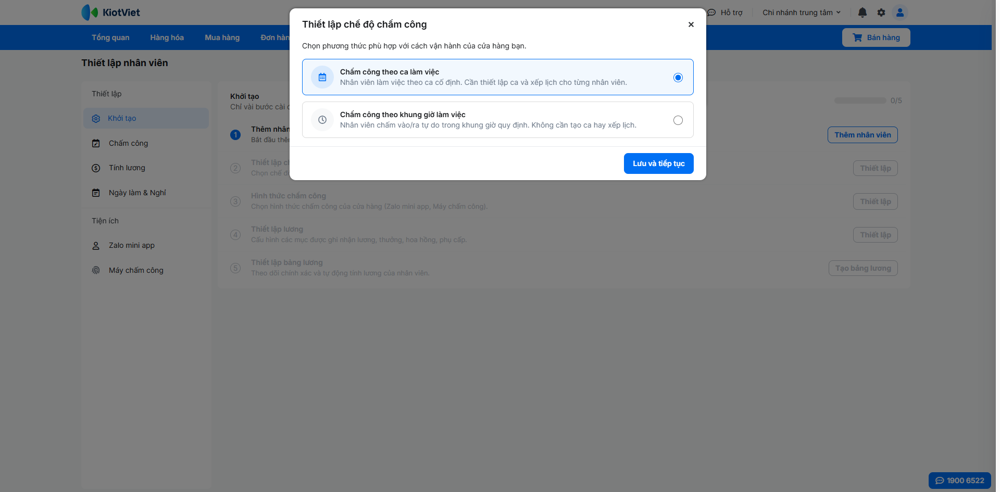

#### **3.1. Chấm công theo ca làm việc**

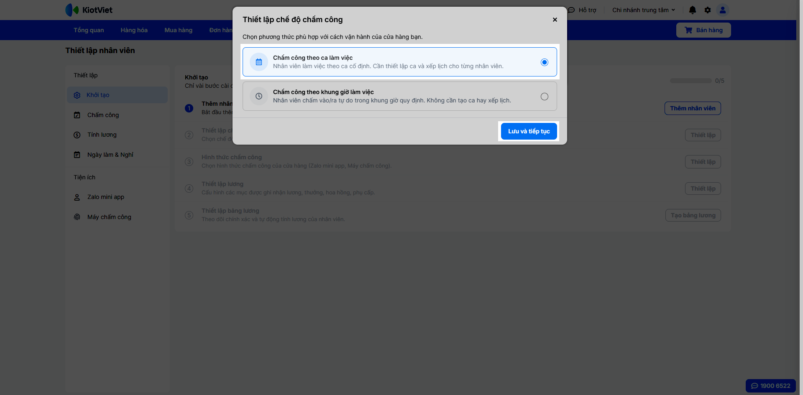

Khi chọn chế độ này, hệ thống hiển thị popup **Chấm công theo ca làm việc** gồm 2 bước: ***Tạo ca làm việc*** và ***Xếp lịch làm việc***. Thanh tiến độ phía trên popup cho biết bạn đang ở bước nào.

- **Bước 1:** **Tạo ca làm việc**
  - Hệ thống hiển thị danh sách ca được gợi ý sẵn (Ca sáng, Ca chiều, Ca tối) kèm ***Giờ vào***, ***Giờ ra***. Cột ***Tổng giờ làm*** được hệ thống tự động tính.
  - Bạn có thể giữ nguyên cấu hình này hoặc tùy chỉnh tên ca, giờ vào/ra, nhấn biểu tượng thùng rác để xóa ca không cần thiết hoặc nhấn ***+ Thêm ca*** để tạo ca mới.
  - Nhấn ***Lưu và tiếp tục*** để chuyển sang bước **Xếp lịch làm việc**.

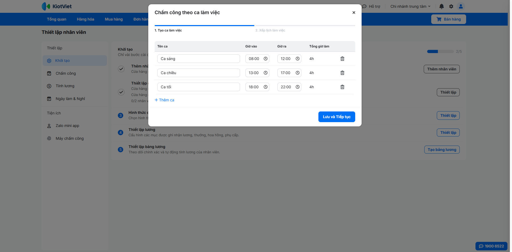

- **Bước 2:** **Xếp lịch làm việc**
  - Ở lần đầu tiên truy cập, hệ thống sẽ có một hướng dẫn nhỏ nhắc nhở thao tác di chuột vào các ô. Bạn cần nhấn ***Đã hiểu*** để bắt đầu xếp lịch.

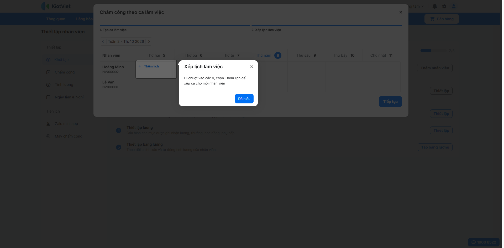

- Trên màn hình **Xếp lịch làm việc** dạng lưới theo tuần (mỗi hàng là một nhân viên, mỗi cột là một ngày từ Thứ hai đến Chủ nhật), rê chuột vào ô trống tương ứng với ngày và nhân viên cần xếp lịch, chọn ***+ Thêm lịch***. Bạn có thể nhấn mũi tên **<** **>** để chuyển tuần.

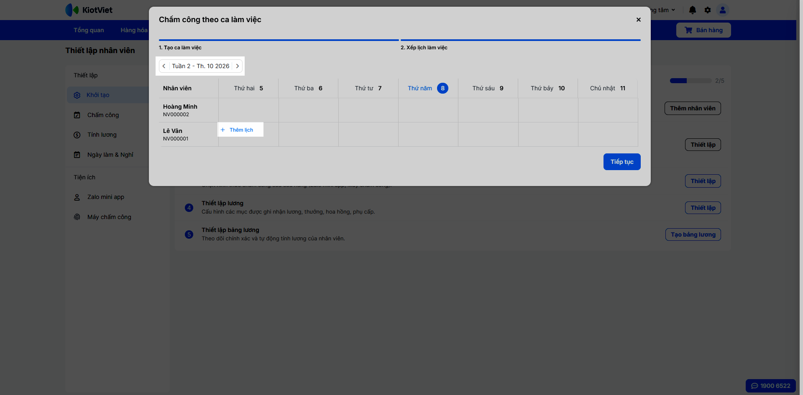

- Trên màn hình **Thêm lịch làm việc**:
  - Tích chọn ca làm việc mong muốn (Ví dụ: Ca sáng, Ca chiều).
  - Bật xanh ***Lặp lại hàng tuần***: Chọn các thứ trong tuần lặp lại, tùy chọn ngày ***Kết thúc*** và ***Làm việc cả ngày lễ tết***.
  - Bật xanh ***Thêm lịch tương tự cho nhân viên khác***: Chọn nhân viên áp dụng lịch làm việc tương tự.
  - Nhấn ***Lưu***.

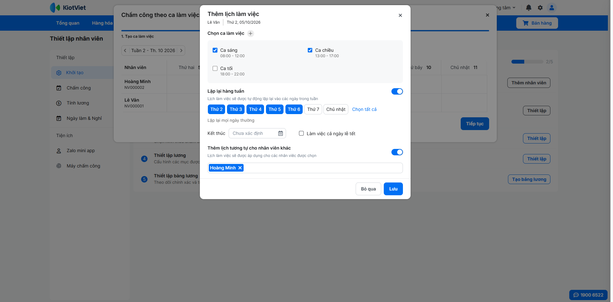

- Hệ thống báo cập nhật thành công, nhấn ***Đóng*** → Các ca đã xếp hiển thị trong lưới và được phân biệt bằng màu sắc → nhấn ***Tiếp tục*** ở góc phải dưới của bảng xếp lịch để hoàn tất bước thiết lập chế độ chấm công.

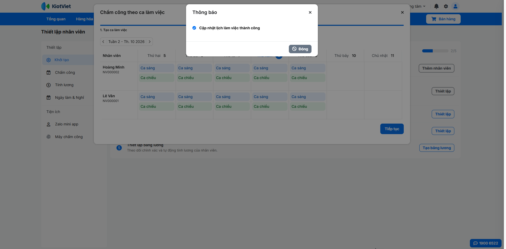

#### **3.2. Chấm công theo khung giờ làm việc**

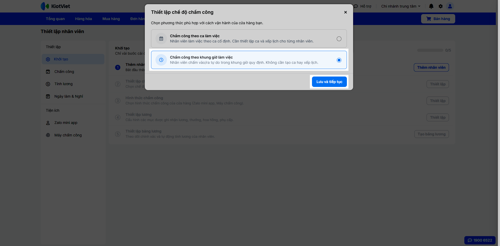

Khi chọn chế độ này, hệ thống hiển thị popup **Chấm công theo khung giờ làm việc** với các gợi ý sẵn. Bạn không cần tạo ca hay xếp lịch cho nhân viên.

- **Bước 1:** Chỉnh sửa ***Giờ làm việc*** (Từ – Đến) nếu cần → hệ thống tự động hiển thị tổng thời gian làm việc.
- **Bước 2:** Chỉnh sửa ***Giờ cho phép chấm công*** (Từ – Đến) nếu cần. Đây là khoảng thời gian nhân viên được phép chấm công vào/ra.
- **Bước 3:** (Tùy chọn) Tích chọn ***Nghỉ giữa giờ*** và nhập khoảng thời gian nghỉ (Từ – Đến) → hệ thống tự động hiển thị tổng thời gian nghỉ. Khoảng thời gian nghỉ giữa giờ làm việc (VD: nghỉ trưa). Thời gian này sẽ được tự động trừ khỏi tổng giờ làm khi tính lương.
- **Bước 4:** Nhấn ***Lưu và tiếp tục*** để hoàn tất bước thiết lập chế độ chấm công.

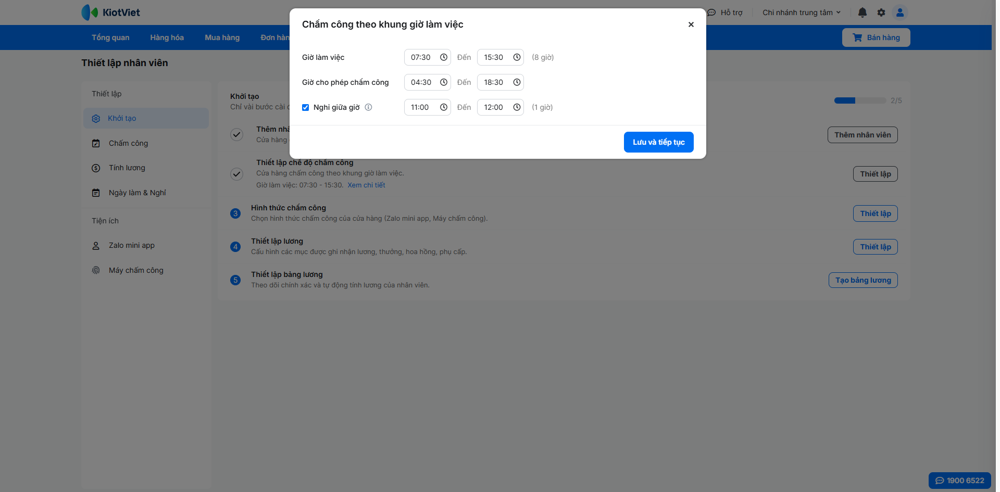

**Lưu ý:** Sau khi hoàn tất khởi tạo, bạn vẫn có thể thay đổi chế độ chấm công tại **Thiết lập nhân viên** → **Chấm công**. Khi chuyển đổi chế độ, hệ thống sẽ hiển thị popup xác nhận để bạn kiểm tra trước khi áp dụng.

### **4. Hình thức chấm công**

**Tình huống:** Bạn cần lựa chọn phương thức ghi nhận giờ làm việc phù hợp cho nhân viên tại cửa hàng.

**Thao tác thực hiện như sau:**

- Tại màn hình **Hình thức chấm công** → tích chọn các hình thức mà cửa hàng muốn áp dụng. Bạn có thể chọn nhiều hình thức cùng lúc, bao gồm:

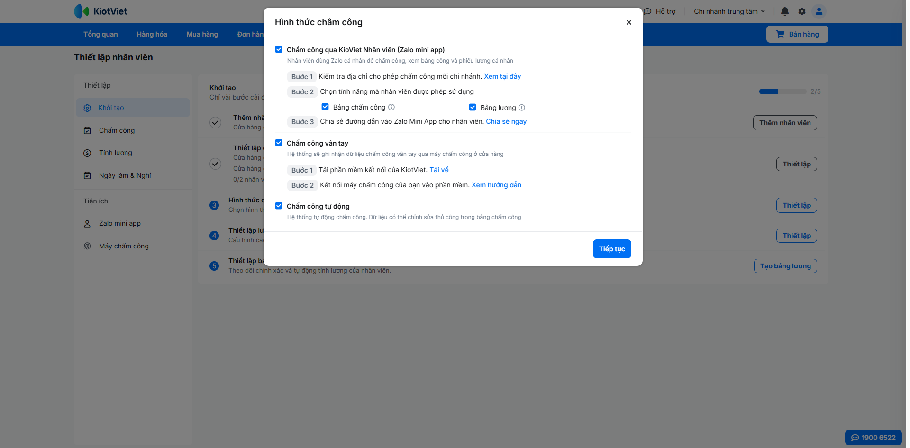

- ***Chấm công qua KiotViet Nhân viên (Zalo mini app)***: Với hình thức này, nhân viên dùng Zalo cá nhân để chấm công và được xem bảng công và phiếu lương cá nhân tùy thuộc vào phân quyền tương ứng. Để sử dụng hình thức này, bạn thực hiện theo 3 bước hướng dẫn bên dưới:
  - **Bước 1:** Kiểm tra địa chỉ cho phép chấm công tại mỗi chi nhánh.
    - Bạn nhấn ***Xem tại đây***

- Nhấn ***Thêm địa chỉ chấm công***.

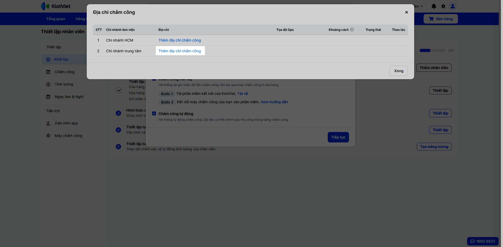

- **Xác nhận GPS** vị trí chấm công: Bạn chọn chi nhánh, Tỉnh/Thành phố, Xã/Phường/Đặc khu và điền Địa chỉ, Phạm vi (m) được phép chấm công → nhấn ***Lưu***.

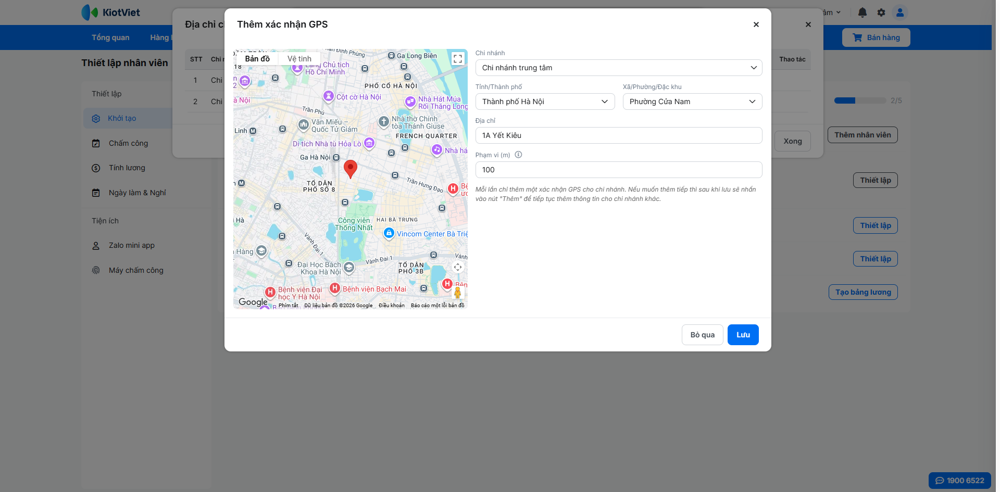

- Tiếp tục nhấn ***Xong***.

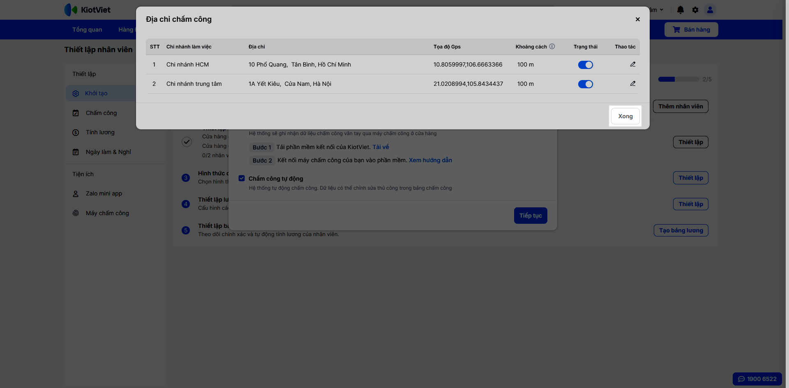

- **Bước 2:** Chọn tính năng mà nhân viên được phép sử dụng, gồm:
  - Bảng chấm công
  - Bảng lương
- **Bước 3:** Chia sẻ đường dẫn vào Zalo Mini App cho nhân viên.
  - Bạn nhấn ***Chia sẻ ngay***

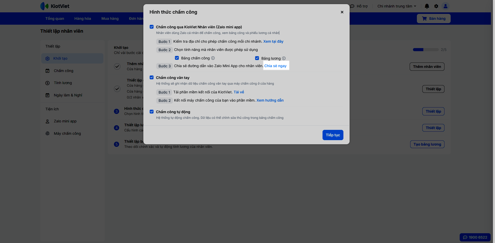

- Hệ thống hiển thị đường dẫn và mã QR để nhân viên quét mã vào Zalo Mini App. Tại đây, bạn có thể ***Tải mã*** hoặc ***In mã***.

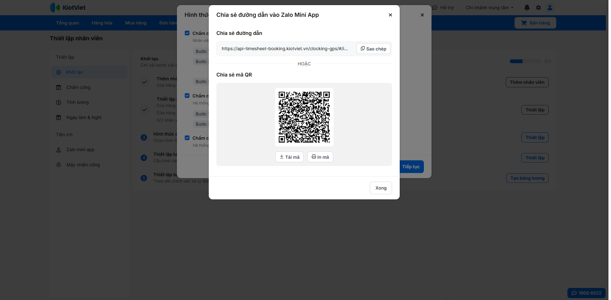

- ***Chấm công vân tay***: Với hình thức này, hệ thống sẽ ghi nhận dữ liệu chấm công vân tay qua máy chấm công ở cửa hàng.  Để sử dụng hình thức này, bạn thực hiện theo 2 bước hướng dẫn bên dưới:
  - **Bước 1:** Tải phần mềm kết nối của KiotViet. Nhấn ***Tải về*** để thực hiện cài đặt
  - **Bước 2:** Kết nối máy chấm công của bạn vào phần mềm.
- ***Chấm công tự động***:  Với hình thức này, hệ thống tự động chấm công. Dữ liệu có thể chỉnh sửa thủ công trong bảng chấm công.

- Nhấn ***Tiếp tục*** để chuyển sang Thiết lập lương.

### **5. Thiết lập lương**

**Tình huống:** Bạn cần khai báo mức lương cơ sở và quy tắc tính lương cho nhân viên để phục vụ việc tạo bảng lương tự động sau này.

**Thao tác thực hiện như sau:**

- **Bước 1:** Màn hình hiển thị danh sách nhân viên vừa tạo. Tại cột ***Lương chính***, bấm vào biểu tượng dấu ***+***.

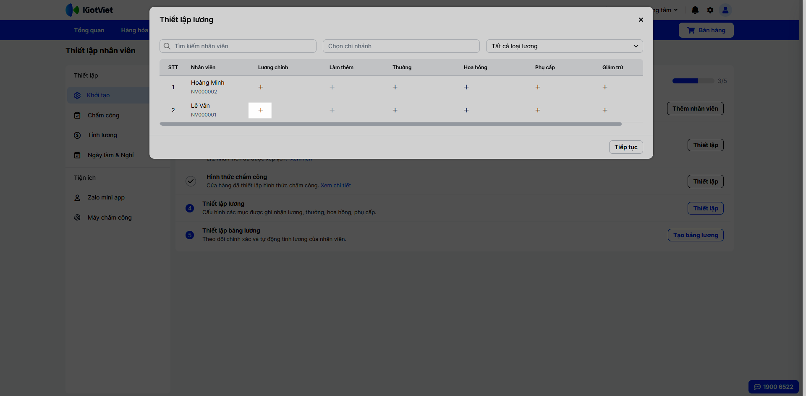

- **Bước 2:** Trên màn hình **Lương chính**, chọn **Loại lương** (Theo ca làm việc, Theo giờ làm việc, Theo ngày công chuẩn, Cố định).

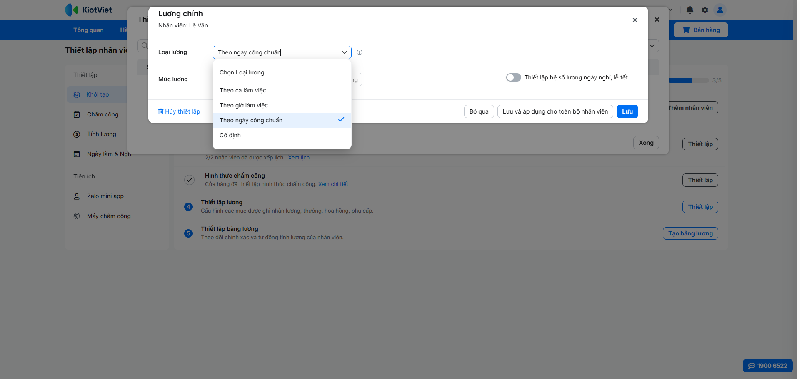

- **Bước 3:** Nhập số tiền vào ô **Mức lương** (Ví dụ: 10,000,000).

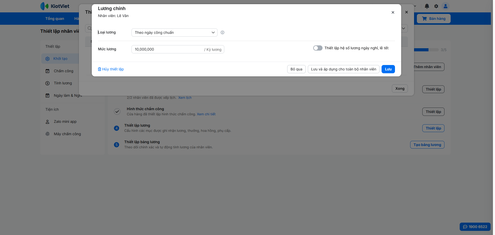

- **Bước 4:** Tùy chọn ***Thiết lập hệ số lương ngày nghỉ, lễ tết*** (không áp dụng với lương ***Cố định***). Nếu bật xanh → điền hệ số tương ứng cho ngày nghỉ, ngày lễ tết (mặc định 100%) theo giá trị ***VND*** hoặc theo ***%*** → nhấn ***Xong***.

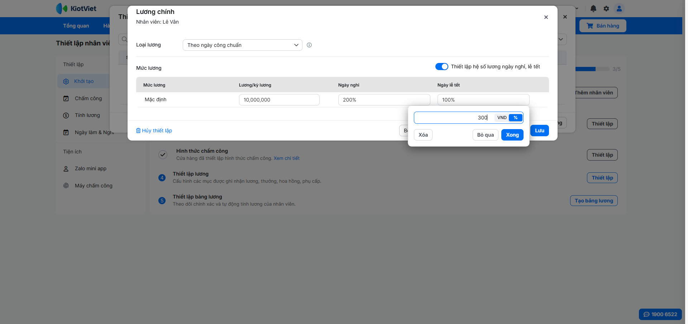

- **Bước 5:** Nhấn ***Lưu*** hoặc ***Lưu và áp dụng cho toàn bộ nhân viên***.

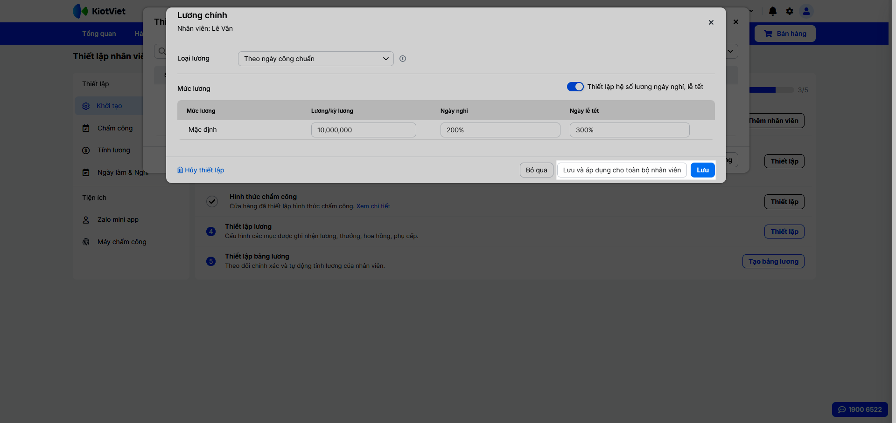

- **Bước 6:** Thiết lập các loại ***Làm thêm***, ***Thưởng***, ***Hoa hồng***, ***Phụ cấp***, ***Giảm trừ*** (nếu có) → nhấn ***Tiếp tục***.

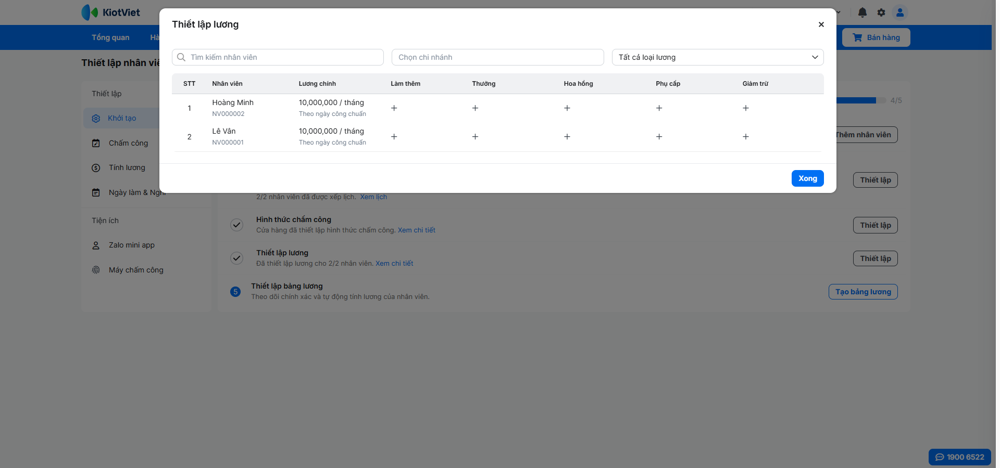

### **6. Tạo bảng lương**

**Tình huống:** Đây là bước cuối cùng để hoàn tất quy trình thiết lập. Bạn cần khởi tạo kỳ lương đầu tiên để hệ thống bắt đầu tự động tổng hợp công chuẩn và tính toán lương, thưởng, phụ cấp cho nhân viên trong tháng.

**Thao tác thực hiện như sau:**

- **Bước 1:** Màn hình hiển thị popup **Tạo bảng lương**.
- **Bước 2:** Kiểm tra và cấu hình các thông số cơ bản cho kỳ lương bao gồm:
  - **Ngày bắt đầu kỳ lương hàng tháng**: Chọn ngày bắt đầu chốt công, ví dụ: Ngày 1.
  - **Kỳ hạn trả lương**: Chọn chu kỳ thanh toán, ví dụ: Hàng tháng.
  - **Kỳ làm việc**: Hệ thống sẽ tự động gợi ý kỳ làm việc hiện tại tương ứng với thời gian thực tế, ví dụ: 01/10/2026 - 31/10/2026.
- **Bước 3:** Nhấn ***Tạo bảng lương***.

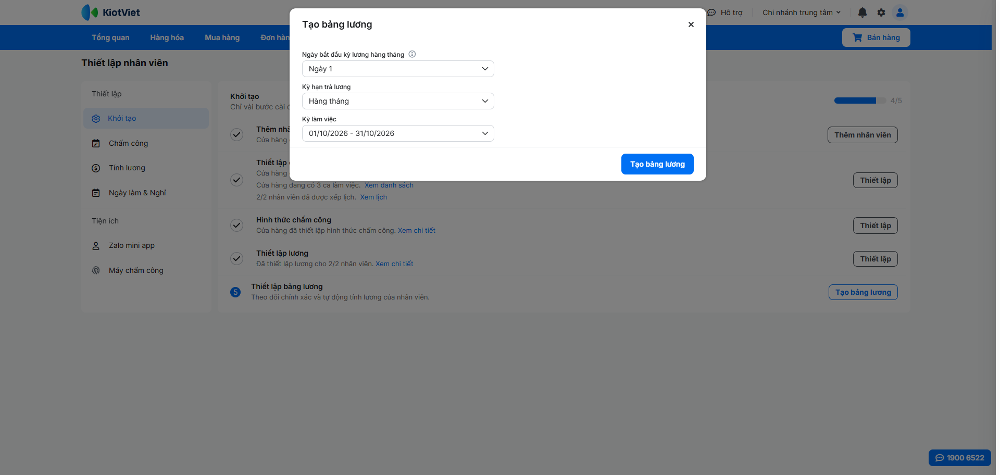

- **Bước 4:** Hệ thống sẽ hiển thị thông báo tạo bảng lương thành công. Bạn có thể nhấn ***tại đây*** để xem chi tiết bảng lương vừa tạo hoặc nhấn ***Hoàn thành*** để đóng màn hình và chính thức kết thúc toàn bộ quy trình khởi tạo ban đầu.

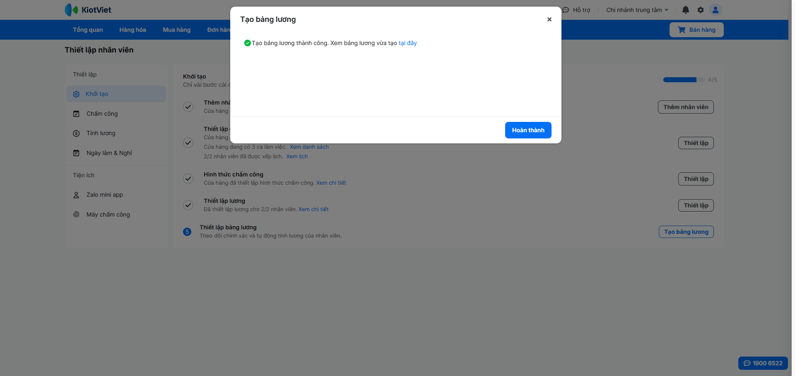

### **7. Xem và chỉnh sửa sau khi hoàn tất**

**Tình huống:** Sau khi hoàn thành cả 5 bước, bạn muốn xem lại hoặc điều chỉnh các thiết lập đã làm.

**Thao tác thực hiện như sau:**

- **Bước 1:** Vào **Thiết lập nhân viên** → **Khởi tạo**. Màn hình chuyển thành **Thiết lập nhanh**, tất cả các bước đều được đánh dấu hoàn thành và hiển thị tóm tắt.
- **Bước 2:** Nhấn các liên kết ***Xem danh sách***, ***Xem lịch***, ***Xem chi tiết*** để xem nhanh dữ liệu hoặc nhấn ***Thiết lập*** tại bước tương ứng để chỉnh sửa.

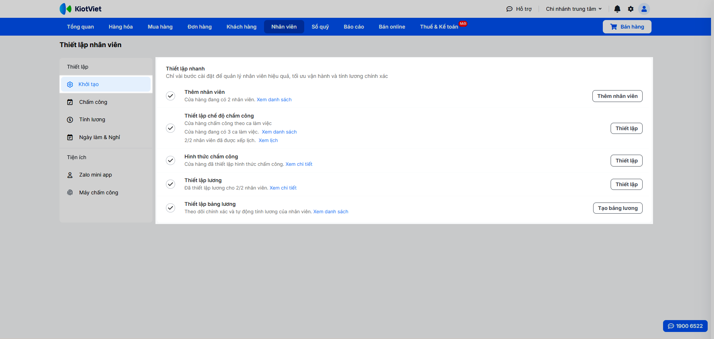

***Cảm ơn bạn đã theo dõi bài viết!***

- Để tìm hiểu thêm về các nghiệp vụ quản lý bán hàng, mời bạn xem bài viết:  
  [**Tổng quan Các nhóm Giải pháp của KiotViet**](https://www.kiotviet.vn/huong-dan-su-dung-kiotviet/retail-lam-quen-voi-kiotviet/tong-quan-cac-nhom-giai-phap-kiotviet/)
- Để tham khảo thêm các video hướng dẫn sử dụng, mời bạn theo dõi kênh YouTube:  
  [**HDSD - Phần mềm KiotViet**](https://www.youtube.com/@HDSDPhanmemKiotViet)

***Chúc bạn kinh doanh hiệu quả cùng KiotViet!***
