# KiotViet Retail – Quản lý nhân viên

Nguồn: https://www.kiotviet.vn/huong-dan-su-dung-kiotviet/retail-nhan-vien/quan-ly-nhan-vien/

---

# **Quản lý Nhân viên**

*(Ngành Bán buôn, Bán lẻ)*

## **I. Giới thiệu chung**

Tính năng Quản lý Nhân viên trên KiotViet giúp chủ cửa hàng quản lý danh sách nhân viên một cách khoa học và chính xác. Việc ghi nhận đầy đủ thông tin nhân viên, bao gồm phòng ban và chức danh, là nền tảng quan trọng cho các nghiệp vụ quản lý nhân sự khác như xếp lịch làm việc, chấm công và tính lương.

**Lợi ích nổi bật của tính năng Quản lý Nhân viên trên KiotViet:**

- **Quản lý thông tin tập trung:** Lưu trữ đầy đủ thông tin cá nhân, chi nhánh làm việc, phòng ban, chức danh của nhân viên tại một nơi duy nhất.
- **Tổ chức khoa học:** Dễ dàng phân loại và tìm kiếm nhân viên theo phòng ban, chức danh, chi nhánh làm việc.
- **Nền tảng cho các nghiệp vụ khác:** Cung cấp dữ liệu nhân viên chính xác làm cơ sở cho việc thiết lập chấm công, tính lương và phân quyền sử dụng phần mềm.

## **II. Các thao tác cơ bản**

Để dễ hình dung, các ví dụ dưới đây sẽ minh họa những tình huống thực tế trong ngành Bán buôn, Bán lẻ.

### **1. Xem danh sách nhân viên**

**Tình huống:** Bạn cần xem lại danh sách tất cả nhân viên đang làm việc tại cửa hàng.

**Thao tác thực hiện như sau:**

- **Bước 1:** Trên màn hình **Quản lý**, bạn chọn **Nhân viên**  → **Danh sách nhân viên** để hệ thống mở ra danh sách nhân viên.

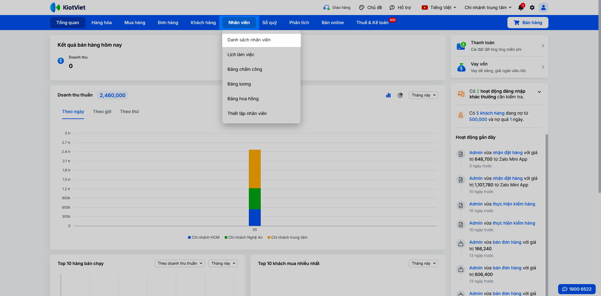

- **Bước 2:** Để tìm kiếm thông tin nhân viên, bạn nhập thông tin vào các ô lọc (Mã nhân viên, Tên nhân viên, Số điện thoại, Trạng thái, Chi nhánh, Phòng ban, Chức danh) và nhấn Enter hoặc đợi hệ thống tự lọc.

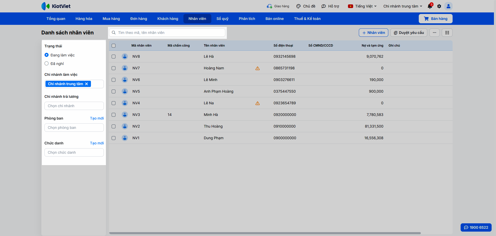

- **Bước 3:** Để xem thông tin chi tiết của nhân viên, bạn kích vào dòng nhân viên đó. Tại đây, bạn có thể chọn ***Cập nhật*** thông tin hoặc cho ***Ngừng làm việc*** (nếu cần).

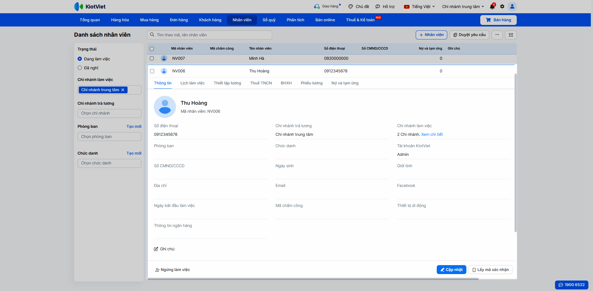

### **2. Thêm nhân viên**

**Tình huống:** Cửa hàng có nhân viên mới và bạn cần thêm thông tin của họ vào hệ thống.

**Thao tác thực hiện như sau:**

- **Cách 1: Thêm mới trên màn hình Nhân viên**
  - **Bước 1:** Tại màn hình **Nhân viên**, bạn nhấn vào ***+ Nhân viên***.

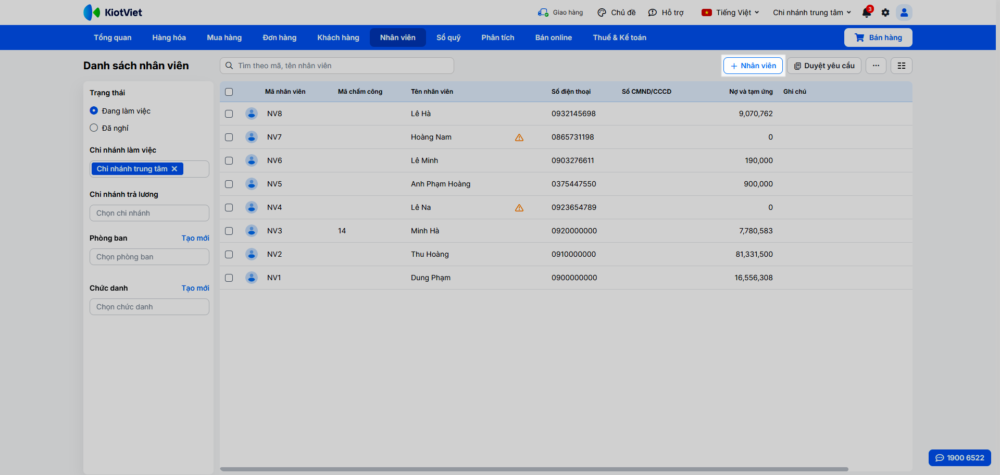

- **Bước 2:** Màn hình **Thêm mới nhân viên** hiện ra. Trên tab **Thông tin**, bạn điền/ chọn các thông tin bắt buộc như: ***Tên nhân viên***, ***Số điện thoại***, ***Chi nhánh trả lương***, ***Chi nhánh làm việc***. Bạn có thể bỏ trống ***Mã nhân viên*** để hệ thống tự sinh.

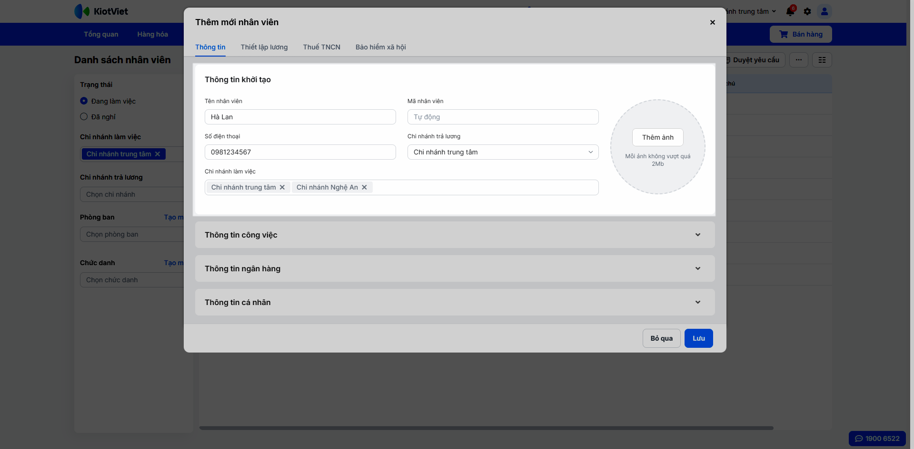

- **Bước 3:** Thêm thông tin khác như ***Thông tin công việc***, ***Thông tin ngân hàng***,***Thông tin cá nhân***.

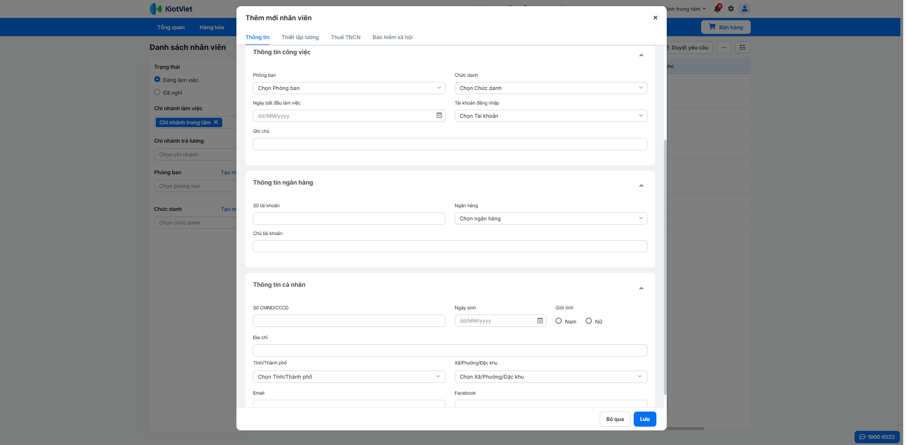

- **Bước 4:** Tại trường thông tin ***Tài khoản đăng nhập*** → chọn hoặc ***Thêm tài khoản*** nếu muốn cấp quyền truy cập phần mềm cho nhân viên này.

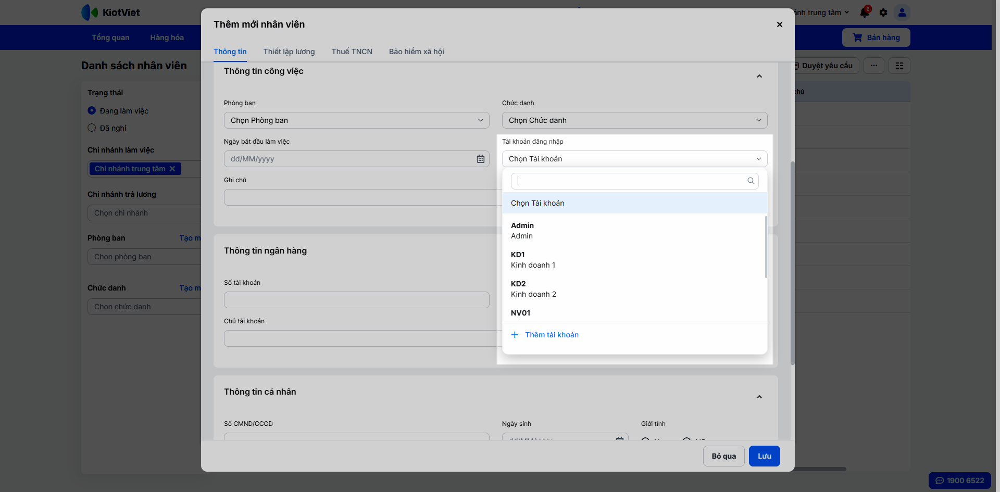

- **Bước 5:** Nhấn ***Lưu*** để ghi nhận thông tin.
- **Lưu ý:**
  - Bạn có thể chọn thông tin ***Phòng ban***, ***Chức danh*** có sẵn hoặc thêm mới trực tiếp bằng cách nhấn dấu + trong pop-up này.
  - ***Chi nhánh làm việc***: Bạn có thể chọn một hoặc nhiều chi nhánh mà nhân viên làm việc.

- **Cách 2: Thêm mới trên màn hình Bảng chấm công**
  - **Bước 1:** Tại màn hình **Bảng chấm công** (truy cập từ menu **Nhân viên** → **Bảng chấm công**), bạn nhấn vào biểu tượng **+** bên cạnh **Nhân viên**.

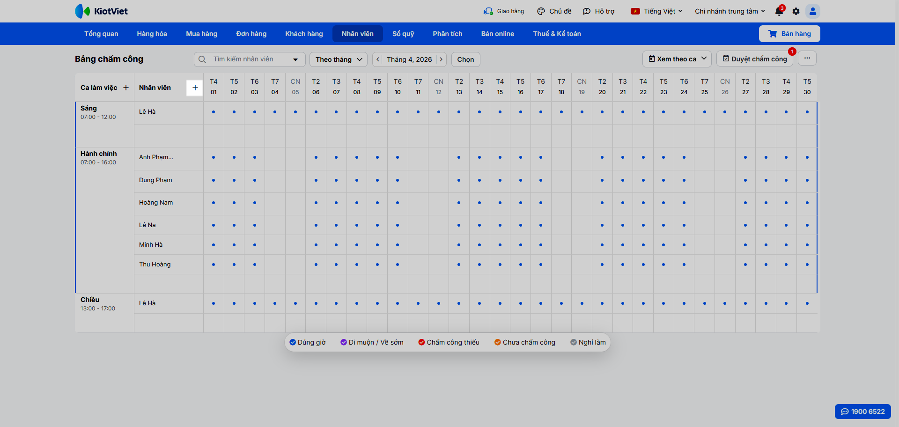

- **Bước 2:** Điền/chọn các thông tin bắt buộc như: ***Tên nhân viên***, ***Số điện thoại***, ***Chi nhánh trả lương***, ***Chi nhánh làm việc***.
- **Bước 3:** Nhấn ***Lưu*** để thêm nhanh nhân viên và chọn vào bảng chấm công.

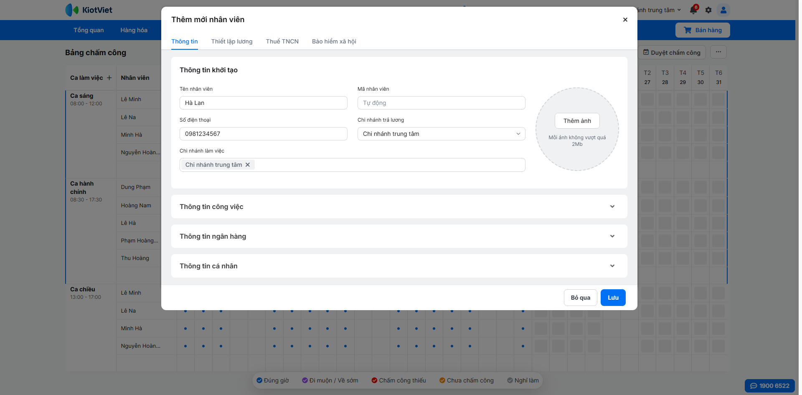

### **3. Cập nhật nhân viên**

**Tình huống:** Bạn cần thay đổi thông tin của một nhân viên (ví dụ: chuyển phòng ban, cập nhật số điện thoại).

**Thao tác thực hiện như sau:**

- **Bước 1:** Tại màn hình **Nhân viên**, nhấn vào thông tin của nhân viên → nhấn ***Cập nhật***.

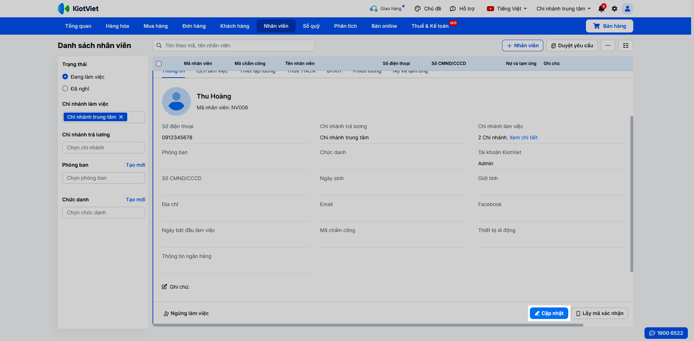

- **Bước 2:** Thay đổi thông tin.
- **Bước 3:** Nhấn ***Lưu***.

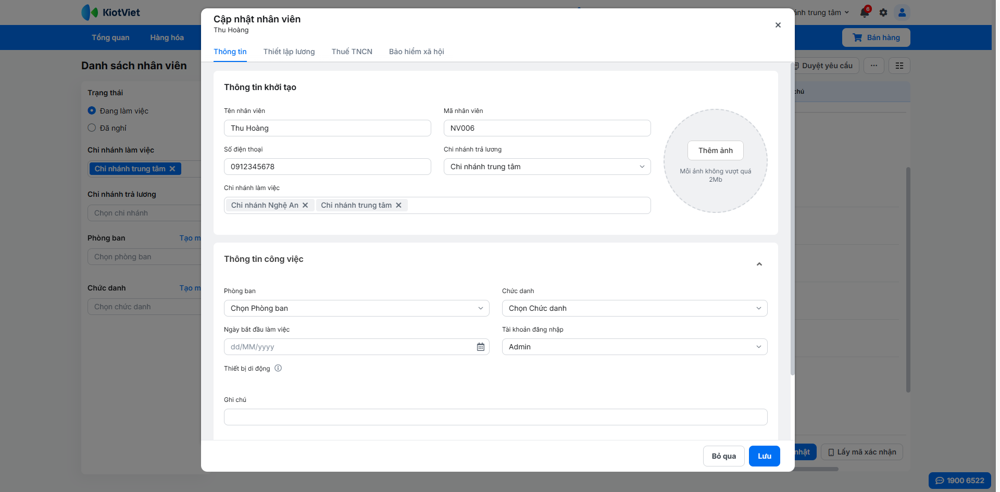

- **Lưu ý:** Khi bạn bỏ chọn một hoặc nhiều chi nhánh làm việc của nhân viên đã có lịch làm việc tại chi nhánh đó, hệ thống sẽ hỏi xác nhận để xóa các lịch làm việc (chưa chấm công) tương lai tại chi nhánh bị bỏ chọn.

### **4. Quản lý Phòng ban**

**Tình huống:** Bạn cần tạo thêm phòng ban mới hoặc chỉnh sửa/xóa phòng ban hiện có.

**Thao tác thực hiện như sau:**

- **Xem danh sách phòng ban**: Danh sách các phòng ban hiển thị trong bộ lọc tại màn hình **Nhân viên**.

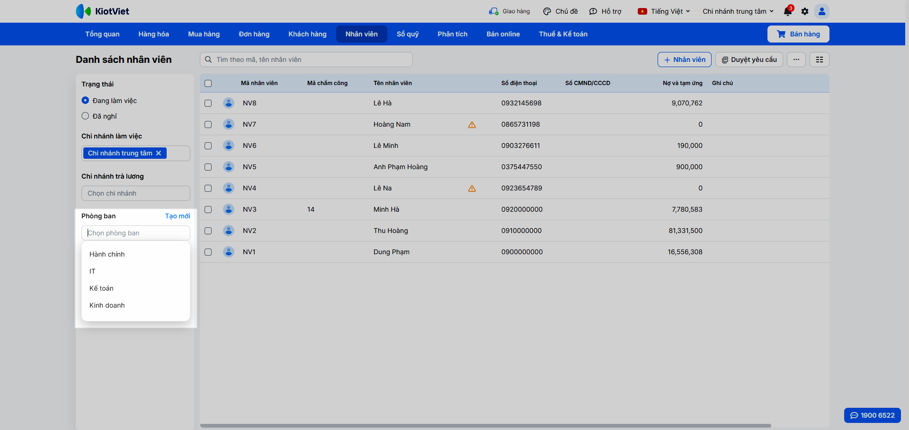

- **Thêm phòng ban mới**:
  - **Bước 1:** Tại màn hình **Nhân viên**, trong bộ lọc **Phòng ban**, nhấn ***Tạo mới***. Hoặc khi ***Thêm mới/Cập nhật*** nhân viên → tại trường thông tin ***Phòng ban*** →  nhấn + ***Thêm phòng ban***.
  - **Bước 2:** Nhập thông tin phòng ban.
  - **Bước 3:** Kích ***Lưu***.

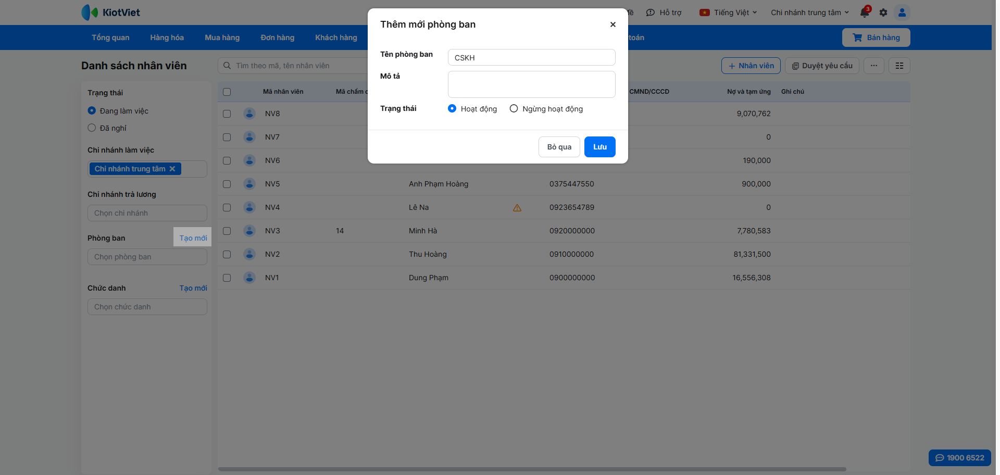

- **Cập nhật thông tin phòng ban**:
  - **Bước 1:** Trong bộ lọc **Phòng ban** (hoặc trong pop-up **Thêm mới/Cập nhật nhân viên**), tìm đến phòng ban cần sửa và kích vào biểu tượng chỉnh sửa (hình cây bút) bên cạnh tên phòng ban.

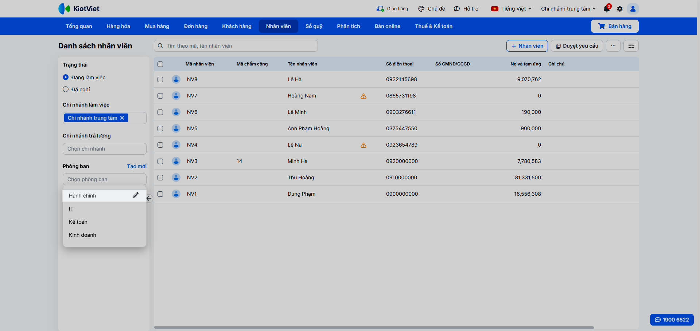

- **Bước 2:** Thay đổi thông tin.
- **Bước 3:** Nhấn ***Lưu***.

- **Xóa thông tin phòng ban**:
  - **Bước 1:** Trong bộ lọc **Phòng ban** (hoặc trong pop-up **Thêm mới/Cập nhật nhân viên**), tìm đến phòng ban cần sửa và kích vào biểu tượng chỉnh sửa (hình cây bút) bên cạnh tên phòng ban.

- **Bước 2:** Nhấn ***Xóa***.
- **Bước 3:** Chọn ***Đồng ý*** để xác nhận xóa.

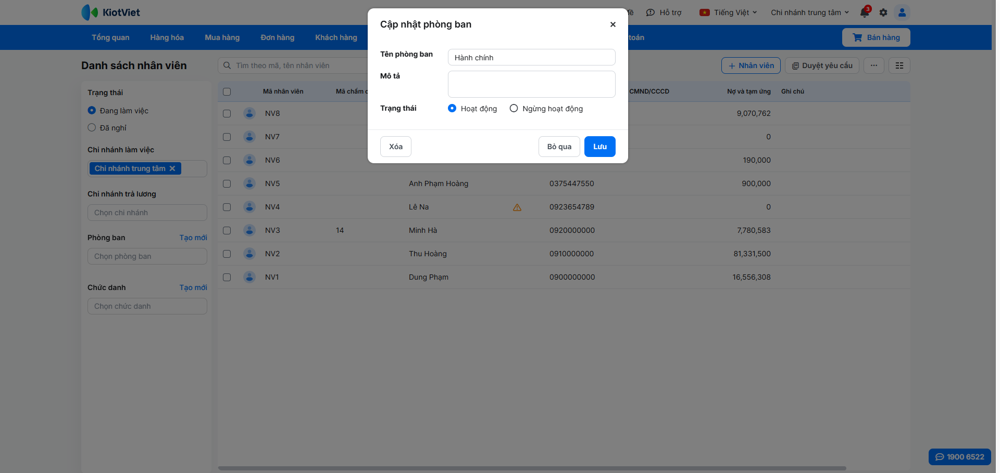

### **5. Quản lý Chức danh**

**Tình huống:** Bạn cần tạo thêm chức danh mới hoặc chỉnh sửa/xóa chức danh hiện có.

**Thao tác thực hiện như sau:**

- **Xem danh sách chức danh**: Danh sách các chức danh hiển thị trong bộ lọc tại màn hình **Nhân viên**.

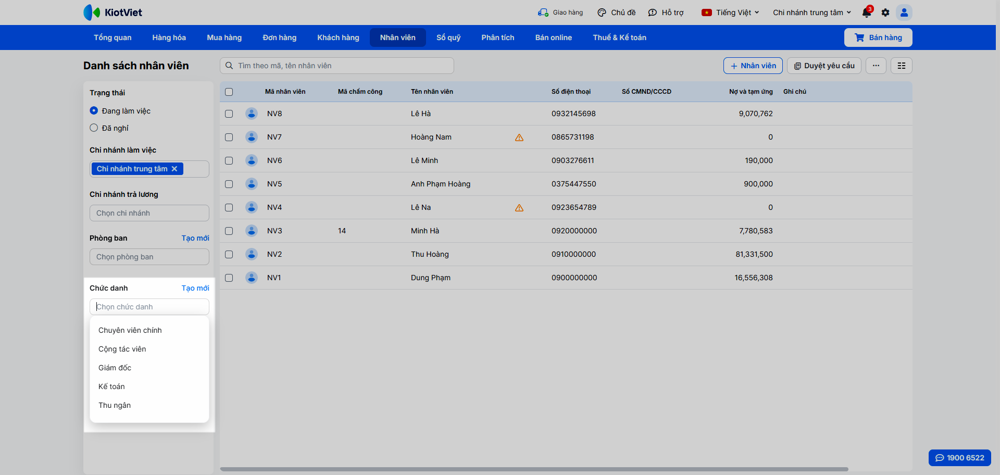

- **Thêm chức danh mới**:
  - **Bước 1:** Tại màn hình **Nhân viên**, trong bộ lọc **Chức danh**, nhấn ***Tạo mớ***i. Hoặc khi ***Thêm mới/Cập nhật*** nhân viên → tại trường thông tin ***Chức danh*** → nhấn ***+ Thêm chức danh***.
  - **Bước 2:** Nhập thông tin chức danh.
  - **Bước 3:** Nhấn ***Lưu***.

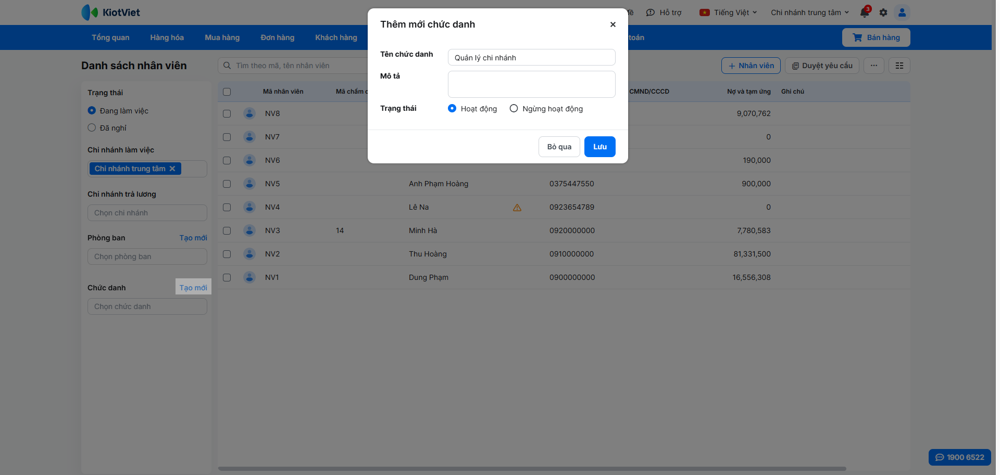

- **Cập nhật thông tin chức danh**:
  - **Bước 1:** Trong bộ lọc **Chức danh** (hoặc trong pop-up **Thêm mới/Cập nhật nhân viên**), tìm đến chức danh cần sửa và nhấn vào biểu tượng chỉnh sửa (hình cây bút) bên cạnh tên chức danh.

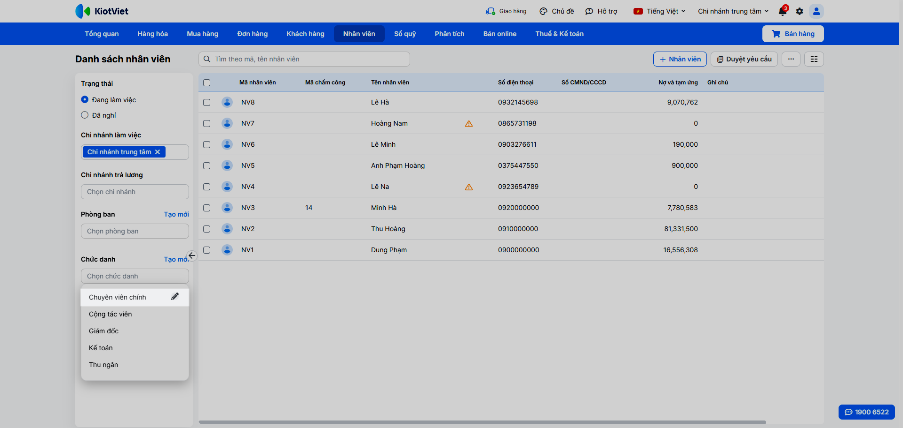

- **Bước 2:** Thay đổi thông tin.
- **Bước 3:** Nhấn ***Lưu***.

- **Xóa thông tin chức danh**:
  - **Bước 1:** Trong bộ lọc **Chức danh** (hoặc trong pop-up **Thêm mới/Cập nhật nhân viên**), tìm đến chức danh cần xóa và nhấn vào biểu tượng chỉnh sửa (hình cây bút).

- **Bước 2:** Nhấn ***Xóa***.
- **Bước 3:** Chọn ***Đồng ý*** để xác nhận xóa.

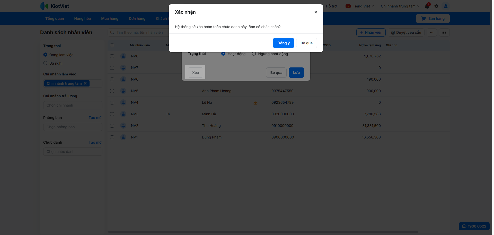

## **III. Các tính năng nâng cao**

### **1. Duyệt yêu cầu**

**Tình huống:** Bạn là quản lý cửa hàng, khi nhân viên gửi các yêu cầu chờ duyệt như: tạo hồ sơ mới, cập nhật số điện thoại, đổi thiết bị chấm công, chấm công ngoài phạm vi cho phép,... bạn cần kiểm tra và phê duyệt cho nhân viên.

**Thao tác thực hiện như sau:**

- **Bước 1:** Khi có yêu cầu chờ duyệt mới, hệ thống hiển thị báo đỏ số lượng yêu cầu chờ duyệt tại nút ***Duyệt yêu cầu***.

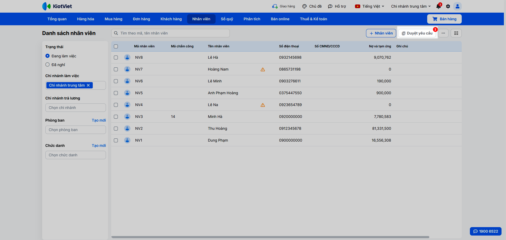

- **Bước 2:** Bạn nhấn vào ***Duyệt yêu cầu*** → hệ thống hiển thị danh sách yêu cầu gồm 2 tab: **Nhân viên** và **Chấm công**. Tại đây ghi nhận cụ thể thời gian gửi yêu cầu, tên nhân viên, loại yêu cầu và nội dung chi tiết. Bạn có thể sử dụng thanh tìm kiếm (theo từ khóa tên nhân viên) hoặc kết hợp bộ lọc chi nhánh để tìm nhanh.

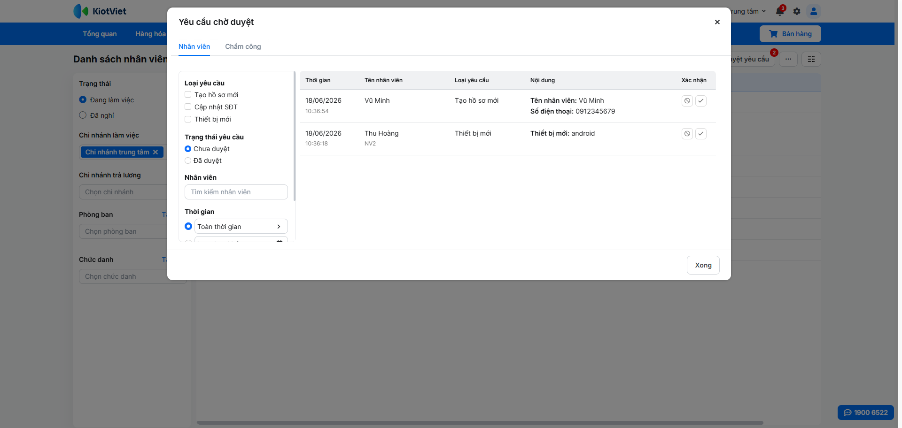

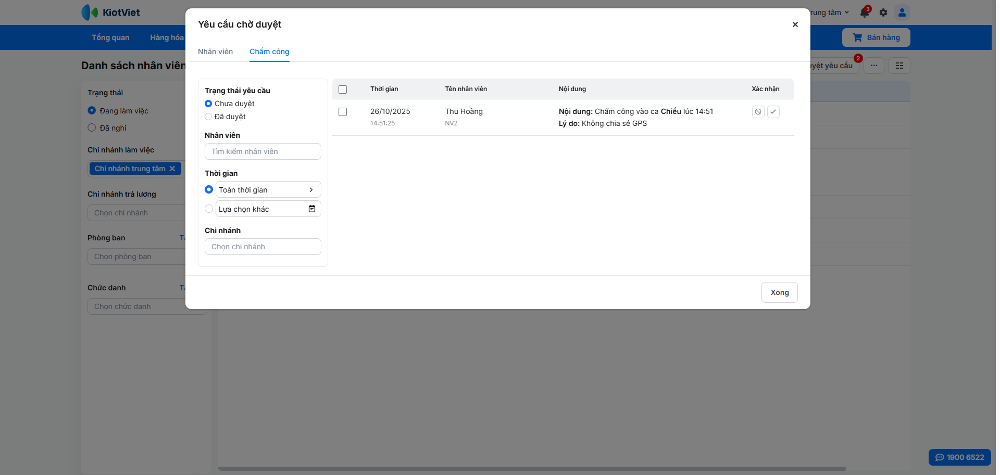

- **Bước 3:** Nhấn biểu tượng v  để xác nhận đồng ý phê duyệt cho nhân viên hoặc biểu tượng tròn gạch chéo nếu từ chối phê duyệt. Với các yêu cầu tại tab Chấm công, bạn có thể tích chọn để xác nhận/ từ chối hàng loạt.

### **2. Nhập file**

**Tình huống:** Bạn có một danh sách số lượng lớn nhân viên trên file Excel và muốn đưa toàn bộ lên hệ thống cùng lúc để tiết kiệm thời gian nhập liệu thủ công.

**Thao tác thực hiện như sau:**

- **Bước 1:** Tại màn hình **Nhân viên**, bạn nhấn 3 chấm → chọn **Nhập file**.

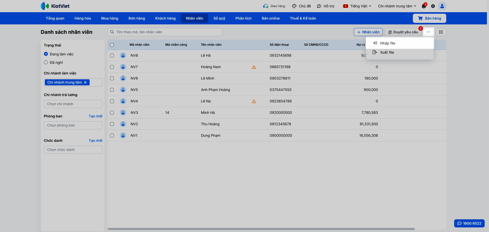

- **Bước 2:** Nhấn Excel file để tải về file mẫu của hệ thống.

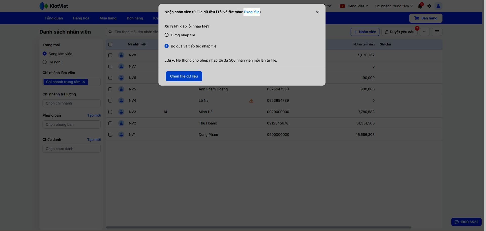

- **Bước 3:** Mở file Excel vừa tải, điền đầy đủ thông tin nhân viên theo đúng định dạng các cột (lưu ý không bỏ trống các cột thông tin bắt buộc).

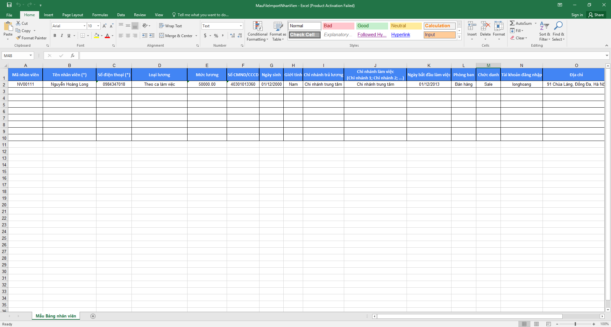

- **Bước 4:** Quay lại phần mềm, nhấn ***Chọn file dữ liệu*** để tải file đã điền lên hệ thống.
- **Bước 5:** Lựa chọn 1 trong 2 cách xử lý khi gặp lỗi nhập file:
  - ***Dừng nhập file***.
  - ***Bỏ qua và tiếp tục nhập file***.
- **Bước 6:** Nhấn ***Thực hiện*** và kiểm tra thông báo kết quả nhập thành công hoặc danh sách lỗi (nếu có) từ hệ thống.

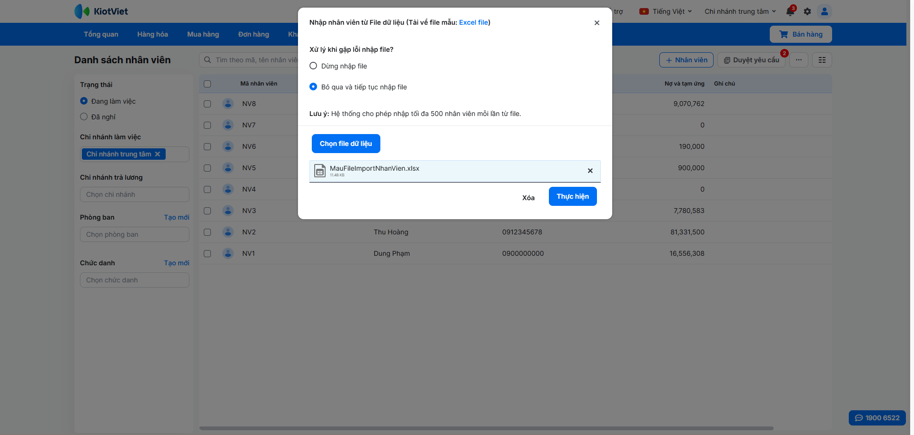

- **Lưu ý**: Hệ thống cho phép nhập tối đa 500 nhân viên mỗi lần từ file.

### **3. Xuất file**

**Tình huống:** Bạn cần tải danh sách nhân viên hiện tại về máy tính dưới dạng file Excel để lưu trữ, quản lý hoặc phục vụ cho các báo cáo nội bộ khác.

**Thao tác thực hiện như sau:**

- **Bước 1:** Tại màn hình **Nhân viên**, bạn tìm kiếm và lọc danh sách nhân viên cần xuất hoặc tích chọn trên danh sách. Nếu muốn xuất toàn bộ danh sách hiển thị trên màn hình, bạn bỏ qua bước tích chọn.
- **Bước 2:** Nhấn 3 chấm → chọn ***Xuất file***.

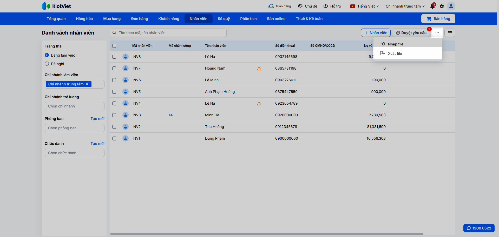

- **Bước 3:** Hệ thống sẽ tự động xuất dữ liệu và tải file Excel chứa danh sách nhân viên tương ứng về máy tính của bạn.

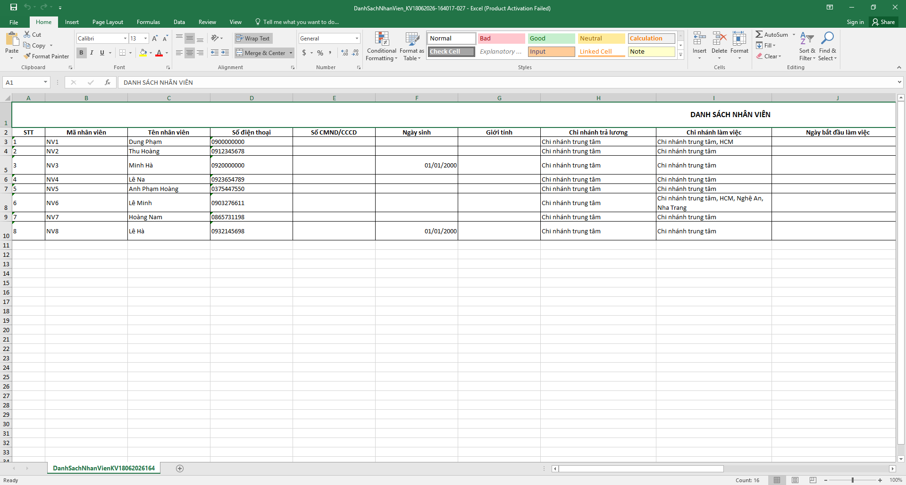

### **4. Lịch làm việc**

**Tình huống:** Bạn muốn biết lịch làm việc cụ thể của nhân viên khi đang xem thông tin chi tiết của họ.

**Thao tác thực hiện như sau:**

- **Bước 1:** Trong thông tin chi tiết nhân viên, bạn chọn tab **Lịch làm việc**
- **Bước 2:** Hệ thống hiển thị lịch làm việc của nhân viên.
  - Mặc định ***Xem theo bảng*** và theo tuần hiện tại.

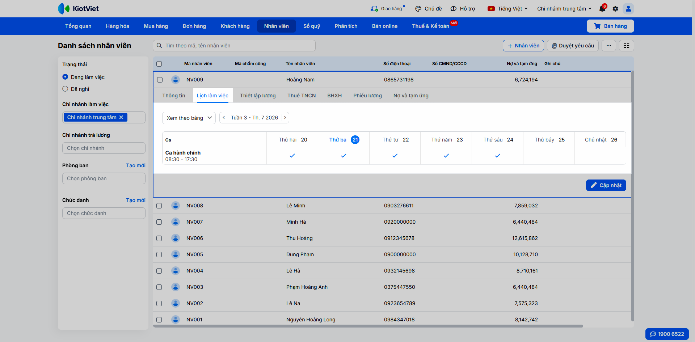

- Bạn có thể chọn ***Xem theo danh sách***.

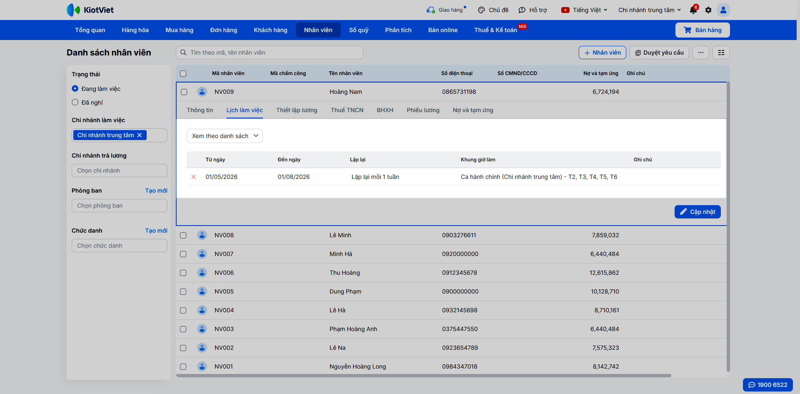

- **Bước 3:** Để thêm/cập nhật lịch làm việc cho nhân viên, bạn nhấn ***Cập nhật***.

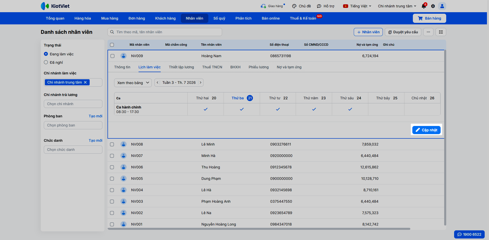

- **Bước 4:** Hệ thống chuyển tới màn hình **Lịch làm việc** để bạn thực hiện thao tác. (Chi tiết tham khảo hướng dẫn [tại đây](https://www.kiotviet.vn/huong-dan-su-dung-kiotviet/retail-nhan-vien/quan-ly-cham-cong/#2-dat-lich-lam-viec-4-2))

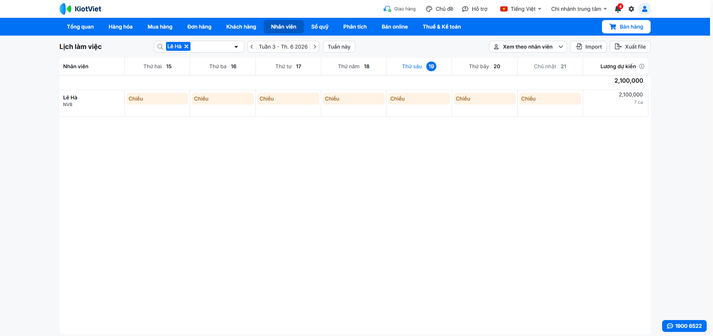

### **5. Thiết lập mức lương**

**Tình huống:** Bạn cần cài đặt các quy tắc tính lương chính, lương tăng ca, hoa hồng và các khoản phụ cấp/giảm trừ cho từng nhân viên.

**Thao tác thực hiện như sau:**

- **Bước 1:** Bạn có thể thiết lập lương ngay khi ***Thêm mới***/***Cập nhật*** nhân viên bằng cách chuyển sang tab **Thiết lập lương**.

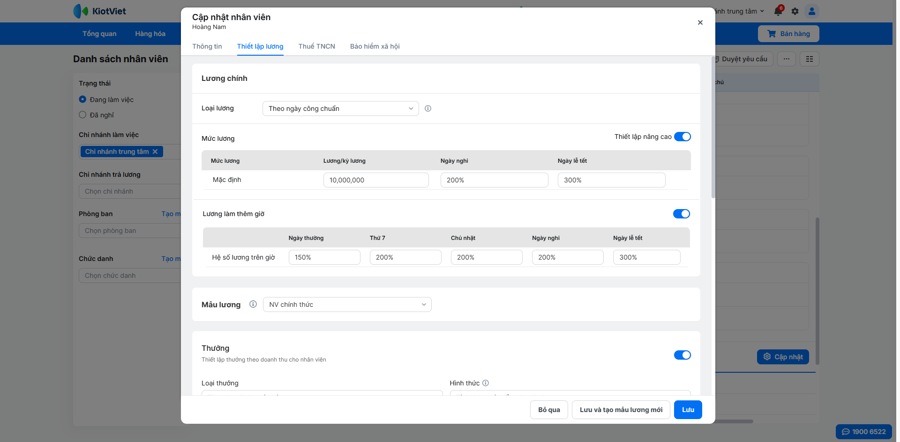

Hoặc trong màn hình chi tiết nhân viên, chọn tab **Thiết lập lương** nhấn ***Thiết lập lương*** (nếu nhân viên chưa được thiết lập lương) hoặc ***Cập nhật*** (nếu nhân viên đã được thiết lập lương trước đó) để hệ thống mở popup **Cập nhật nhân viên** → **Thiết lập lương**.

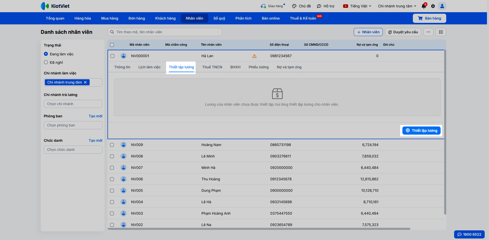

- **Bước 2:** Tại đây, bạn có thể thiết lập tối đa 6 mục lương bao gồm: Lương chính, Lương làm thêm giờ, Thưởng, Hoa hồng, Phụ cấp, Giảm trừ. (Chi tiết tham khảo hướng dẫn [tại đây](https://www.kiotviet.vn/huong-dan-su-dung-kiotviet/retail-nhan-vien/quan-ly-tinh-luong/#2-thiet-lap-muc-luong-cho-nhan-vien-4-2))

### **6. Thiết lập Bảo hiểm xã hội**

**Tình huống:** Khi bạn cần thiết lập mức lương đóng bảo hiểm xã hội (BHXH) cho từng nhân viên để hệ thống tự động tính toán trên bảng lương.

**Thao tác thực hiện như sau:**

- **Bước 1:** Tại màn hình **Quản lý** → truy cập menu **Nhân viên** → **Thiết lập nhân viên** → **Tính lương** → bật xanh tùy chọn ***Bảo hiểm xã hội nhân viên***.

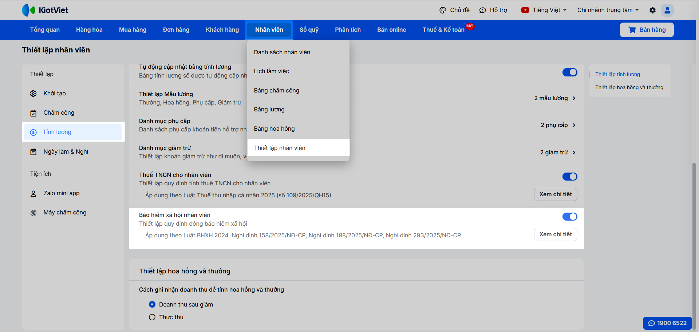

- **Bước 2:** Tại màn hình **Thêm mới**/**Cập nhật nhân viên**, bạn chọn tab **Bảo hiểm xã hội**.
  - ​Nhập mức lương dùng làm căn cứ đóng bảo hiểm cho nhân viên vào ô ***Lương đóng bảo hiểm (/tháng)***
  - Tùy chọn ***Nhân viên có tham gia công đoàn***.
    - Hệ thống mặc định tích chọn. Bạn có thể bỏ tích nếu nhân viên không tham gia công đoàn.
    - **Lưu ý:** Thiết lập này chỉ ảnh hưởng đến việc tính ***Đoàn phí*** của người lao động khi tính lương, KHÔNG ảnh hưởng đến phí công đoàn mà doanh nghiệp bắt buộc phải đóng theo quy định.
  - Nhấn ***Lưu***.

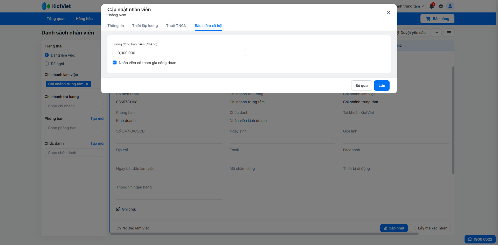

**Lưu ý:**

- Tab **Bảo hiểm xã hội** chỉ hiển thị khi bạn có quyền xem lương.
- Trường hợp không thiết lập mức lương đóng bảo hiểm khi thêm mới/cập nhật nhân viên → trên bảng lương trường ***Bảo hiểm bắt buộc*** và ***Lương đóng BH*** hiển thị giá trị 0. Bạn có thể chỉnh sửa ***Lương đóng BH*** trực tiếp trên bảng lương để hệ thống tự tính lại mức đóng bằng cách nhấn dấu + trên cột ***Bảo hiểm bắt buộc*** → nhập mức ***Lương đóng BH***.

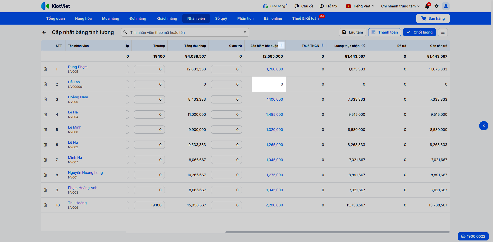

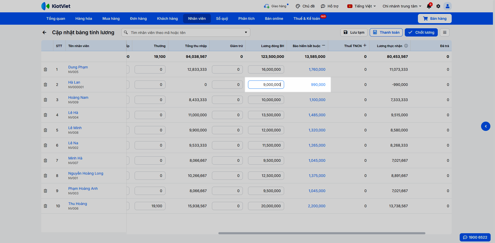

### **7. Thiết lập Thuế TNCN**

**Tình huống:** Khi bạn cần khai báo thông tin cư trú, loại hợp đồng và người phụ thuộc để hệ thống làm căn cứ tính Thuế Thu nhập cá nhân (TNCN) cho nhân viên.

**Thao tác thực hiện như sau:**

- **Bước 1:** Tại màn hình **Quản lý** → truy cập menu **Nhân viên** → **Thiết lập nhân viên** → **Tính lương** → bật xanh tùy chọn ***Thuế TNCN cho nhân viên***.

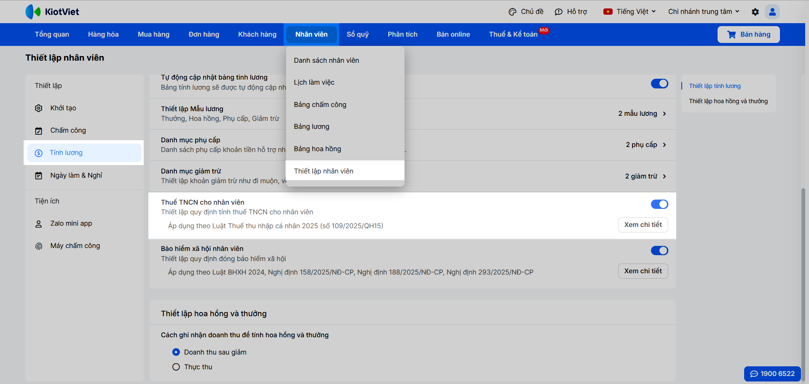

- **Bước 2:** Tại màn hình **Thêm mới/Cập nhật nhân viên**, bạn chọn tab **Thuế TNCN**.
- **Bước 3:** Khai báo các thông tin cần thiết:
  - **Mã số thuế cá nhân:** Nhập mã số thuế cá nhân của nhân viên.
  - **Tình trạng cư trú:** Chọn 1 trong 2 hình thức:
    - ***Cư trú tại Việt Nam***.
    - Hoặc ***Không cư trú tại Việt Nam***.
  - **Loại hợp đồng:** Chọn 1 trong 2 loại:
    - ***Hợp đồng lao động từ 3 tháng trở lên***.
    - Hoặc ***Hợp đồng lao động dưới 3 tháng***.
  - **Số người phụ thuộc:** Nhập số người phụ thuộc để hệ thống dùng làm căn cứ tính giảm trừ gia cảnh.

- **Bước 4:** Nhấn ***Lưu***.

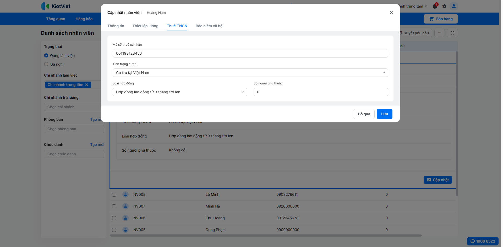

**Lưu ý:**

- Khi bạn chọn loại ***Hợp đồng lao động dưới 3 tháng*** → hệ thống hiển thị thêm trường ***Cam kết thu nhập chưa đến mức nộp thuế (Mẫu 08/CK-TNCN)*** để bạn chọn trạng thái ***Nhân viên có*** hoặc ***không cam kết thu nhập***. Lựa chọn này ảnh hưởng trực tiếp đến việc có khấu trừ thuế hay không.

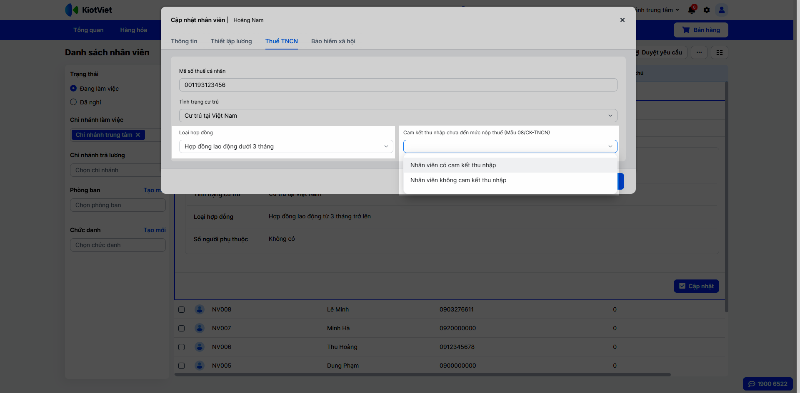

- Khi chọn ***Không cư trú tại Việt Nam***:
  - Hệ thống chỉ hiển thị ***Mã số thuế cá nhân*** và ***Tình trạng cư trú***.
  - Các thông tin khác sẽ tự động ẩn do nhóm đối tượng này áp dụng mức khấu trừ cố định 20% và không được giảm trừ gia cảnh.

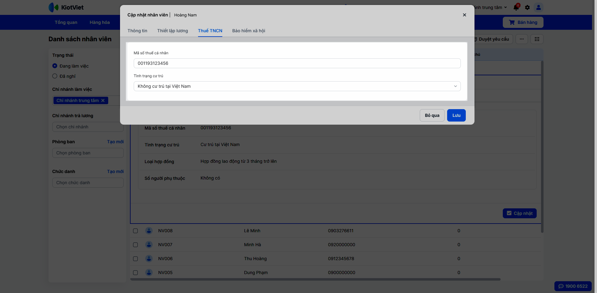

- Tab **Thuế TNCN** chỉ hiển thị khi bạn có quyền xem lương. Nếu không ghi nhận thông tin tại tab này → các trường dữ liệu liên quan đến ***Thuế TNCN*** trên bảng lương sẽ hiển thị giá trị bằng 0 và không cho phép chỉnh sửa.

### **8. Xem danh sách Phiếu lương**

**Tình huống:** Bạn cần xem lại chi tiết một phiếu lương đã chốt, hoặc muốn in/xuất file bảng kê hoa hồng cho nhân viên đối chiếu.

**Thao tác thực hiện như sau:**

- **Bước 1:** Trong thông tin chi tiết nhân viên, bạn chọn tab **Phiếu lương**. Tại đây, bạn có thể ***Xuất file*** toàn bộ danh sách hoặc kích vào từng mã phiếu lương để xem chi tiết.

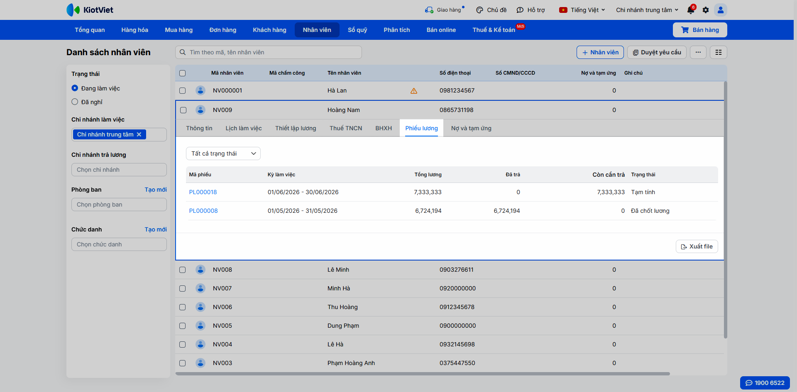

- **Bước 2:** Khi xem chi tiết một phiếu lương, hệ thống hỗ trợ các tính năng ***In***, ***Xuất file*** và ***Hủy*** trên cả hai tab **Thanh toán** và **Chấm công chi tiết**.

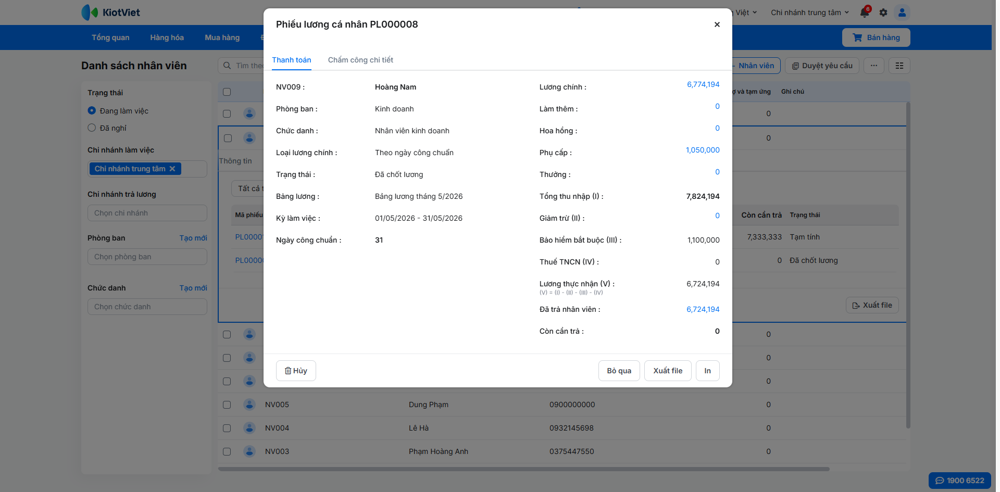

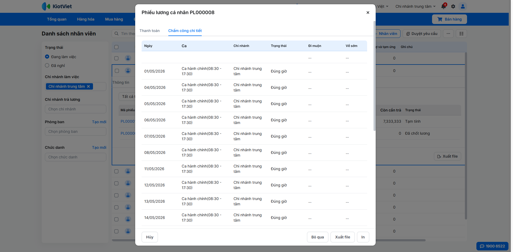

- **Bước 3:** Tại tab **Thanh toán**
  - Nếu bạn chọn ***In***, hệ thống cung cấp 3 lựa chọn:
    - ***In thông tin chung*** (Mẫu Phiếu lương nhân viên).
    - ***In kèm bảng kê hoa hồng theo hóa đơn***.
    - ***In kèm bảng kê hoa hồng theo sản phẩm***.
    - **Lưu ý**: Hai lựa chọn in kèm bảng kê chỉ hiển thị với phiếu lương có phát sinh hoa hồng. Khi chọn, hệ thống sẽ in đồng thời Phiếu lương và Bảng kê hoa hồng.

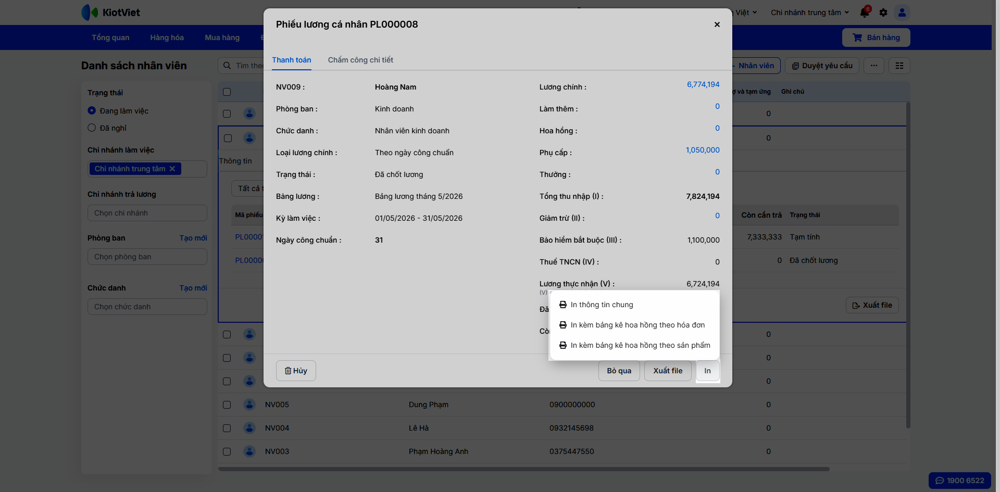

- Nếu bạn chọn ***Xuất file***, hệ thống cung cấp 3 lựa chọn tương tự:
  - ***Xuất file phiếu lương***.
  - ***Xuất file hoa hồng theo hóa đơn***.
  - ***Xuất file hoa hồng theo sản phẩm*** (chỉ hiển thị khi có hoa hồng).

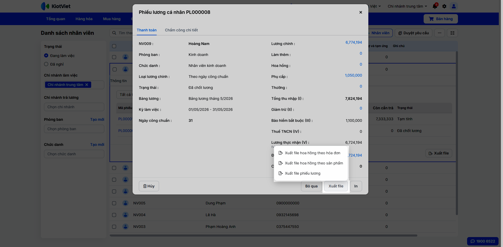

- **Bước 4:** Tại tab **Chấm công chi tiết**, bạn có thể nhấn ***Xuất file*** hoặc ***In*** để lưu trữ/in **Chi tiết chấm công** của nhân viên đó.

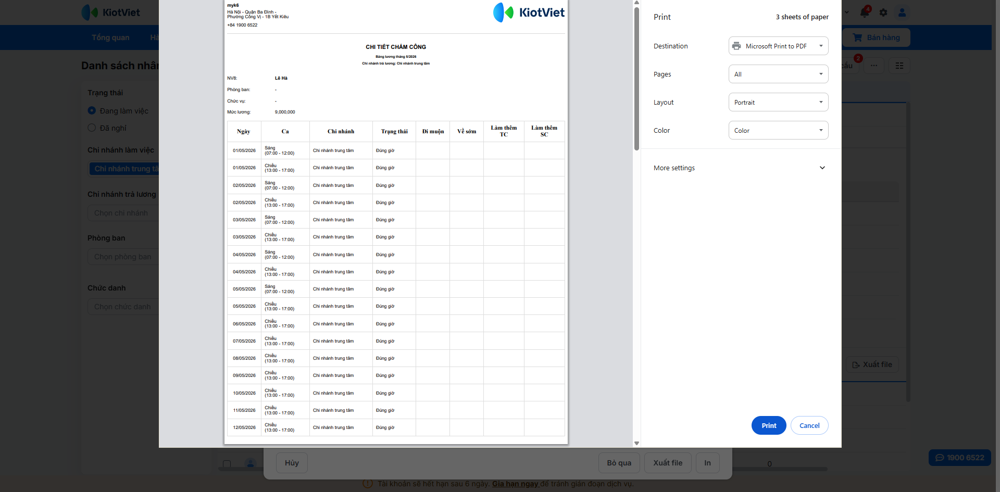

- **Bước 5:** Nếu bạn chọn ***Hủy***, hệ thống sẽ hủy phiếu lương đang xem và cả phiếu thanh toán liên quan (nếu có).

### **9. Quản lý Nợ và Tạm ứng (Thanh toán lương)**

**Tình huống:** Đến kỳ trả lương, bạn cần thanh toán tiền lương cho nhân viên hoặc ghi nhận một khoản nhân viên tạm ứng trước. Bạn cũng muốn xem lại lịch sử các lần trả lương trước đó.

**Thao tác thực hiện như sau:**

- Trong thông tin chi tiết nhân viên, chọn tab **Nợ và tạm ứng**. Tại đây, bạn có thể xem lịch sử tất cả các Phiếu lương đã chốt và các lần thanh toán lương của nhân viên này.

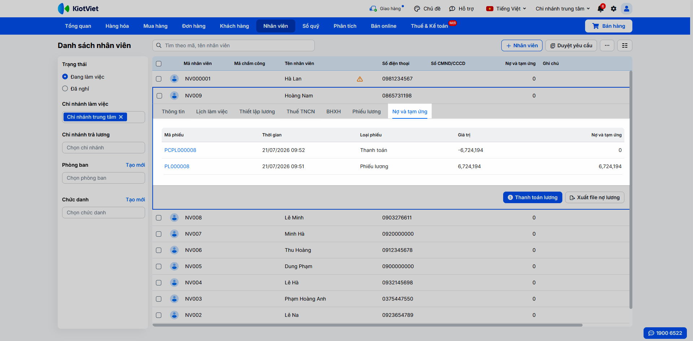

- Để thực hiện chi trả, nhấn ***Thanh toán lương***.
  - Nhập ***Số tiền*** chi lương cho nhân viên. Bạn có thể chỉnh sửa Thời gian, Phương thức và Ghi chú nếu cần.
  - Nhấn ***Tạo phiếu chi*** hoặc ***Tạo phiếu chi & In*** để hoàn tất.
  - **Lưu ý:** Trường hợp nhân viên không còn phiếu lương nào cần thanh toán (công nợ bằng 0) mà bạn vẫn thực hiện thao tác này, hệ thống sẽ tự động ghi nhận đây là một phiếu tạm ứng lương cho nhân viên.

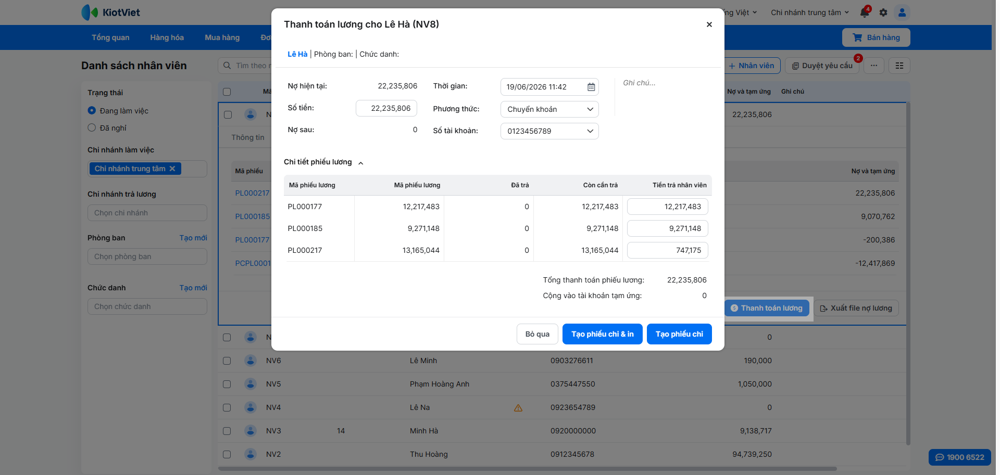

- Để lưu trữ phiếu nợ lương nhân viên theo định dạng excel, bạn nhấn ***Xuất file nợ lương*** → chọn thời gian → nhấn ***Thực hiện***.

***Cảm ơn bạn đã theo dõi bài viết!***

- Để tìm hiểu thêm về các nghiệp vụ quản lý bán hàng, mời bạn xem bài viết:  
  [**Tổng quan Các nhóm Giải pháp của KiotViet**](https://www.kiotviet.vn/huong-dan-su-dung-kiotviet/retail-lam-quen-voi-kiotviet/tong-quan-cac-nhom-giai-phap-kiotviet/)
- Để tham khảo thêm các video hướng dẫn sử dụng, mời bạn theo dõi kênh YouTube:  
  [**HDSD - Phần mềm KiotViet**](https://www.youtube.com/@HDSDPhanmemKiotViet)

***Chúc bạn kinh doanh hiệu quả cùng KiotViet!***
