# KiotViet Retail – Quản lý chấm công

Nguồn: https://www.kiotviet.vn/huong-dan-su-dung-kiotviet/retail-nhan-vien/quan-ly-cham-cong/

---

# **Quản lý Chấm công**

*(Ngành Bán buôn, Bán lẻ)*

## **I. Giới thiệu chung**

Tính năng Quản lý Chấm công trên KiotViet giúp cửa hàng theo dõi và quản lý thời gian làm việc của nhân viên một cách chính xác và hiệu quả. Từ việc thiết lập ca làm việc, đặt lịch, ghi nhận giờ vào/ra, đến quản lý phạt vi phạm và tích hợp với máy chấm công, tính năng này là công cụ không thể thiếu để đảm bảo tính công bằng và là cơ sở cho việc tính lương chính xác.

**Lợi ích nổi bật của tính năng:**

- **Quản lý lịch làm việc linh hoạt**: Dễ dàng tạo ca làm việc, đặt lịch cho từng nhân viên hoặc phòng ban, hỗ trợ đặt lịch lặp lại hàng ngày, hàng tuần.
- **Ghi nhận chấm công đa dạng**: Hỗ trợ chấm công thủ công trên phần mềm, chấm công tự động, chấm công qua ứng dụng di động (quét mã QR) và tích hợp với máy chấm công vân tay.
- **Tự động hóa và chính xác**: Tự động tính toán thời gian đi muộn, về sớm, làm thêm giờ dựa trên thiết lập ca và dữ liệu chấm công thực tế.
- **Minh bạch và tiện lợi**: Nhân viên có thể tự chấm công qua điện thoại (nếu được thiết lập), quản lý dễ dàng theo dõi và xác nhận chấm công, giảm thiểu sai sót và tranh chấp.
- **Quản lý vi phạm hiệu quả**: Ghi nhận và quản lý các lỗi vi phạm của nhân viên, tự động tổng hợp vào bảng lương.

## **II. Các thao tác cơ bản**

Để dễ hình dung, các ví dụ dưới đây sẽ minh họa những tình huống thực tế trong ngành Bán buôn, Bán lẻ.

### **1. Thiết lập Ca làm việc**

**Tình huống:** Bạn cần định nghĩa các khung giờ làm việc chuẩn cho cửa hàng (ví dụ: Ca sáng, Ca chiều, Ca tối) để nhân viên có cơ sở thực hiện chấm công đúng quy định.

**Thao tác thực hiện như sau:**

- **Thêm ca làm việc:**
  - **Bước 1:** Trên màn hình **Quản lý**, vào menu **Nhân viên** → **Thiết lập nhân viên** → **Chấm công**.

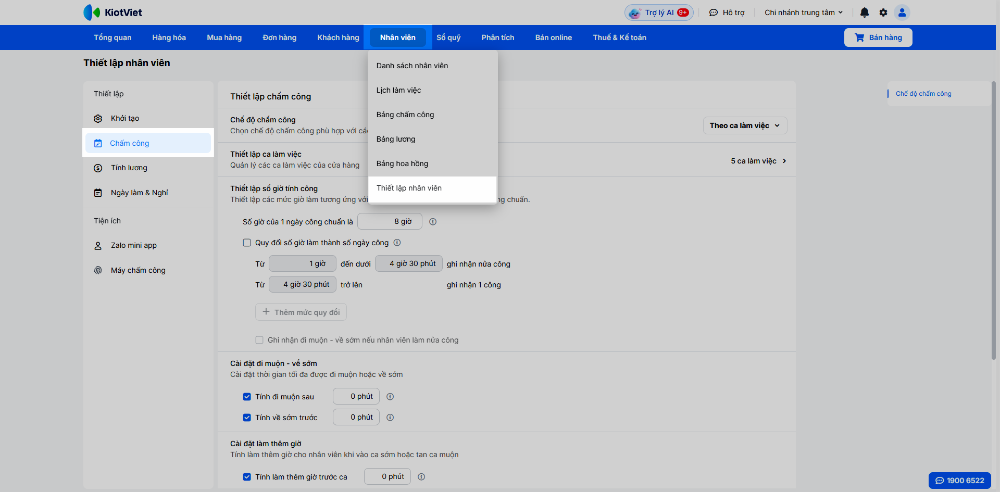

- **Bước 2:** Trên thông tin **Thiết lập ca làm việc** (áp dụng với ***Chế độ chấm công Theo ca làm việc***) → nhấn ***Ca làm việc***.

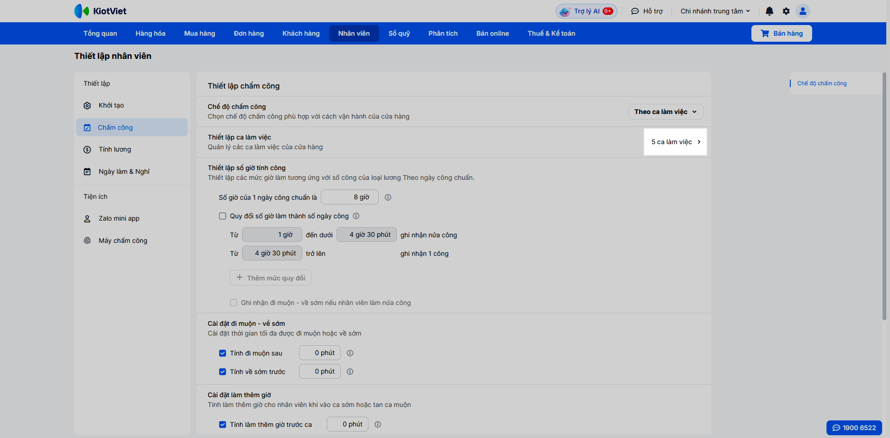

- **Bước 3:** Hệ thống hiển thị danh sách ca làm việc hiện có. Nhấn ***+ Thêm ca làm việc***.

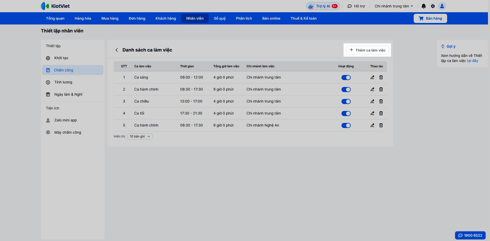

- **Bước 4:** Nhập thông tin ca: ***Tên*** ca (bắt buộc), ***Giờ làm việc***, ***Giờ cho phép chấm công*** (khoảng thời gian linh động trước/sau giờ ca chính thức để hệ thống tự ghi nhận đúng ca), ***Phạm vi áp dụng***.
- **Bước 5:** Nhấn ***Lưu*** để hoàn tất.

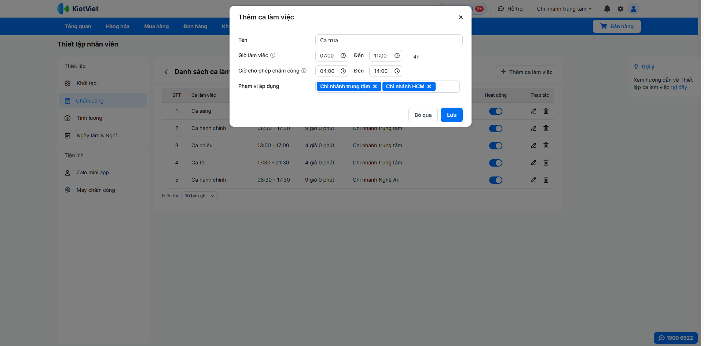

**Lưu ý:** Bạn cũng có thể thêm mới hoặc cập nhật ca làm việc nhanh chóng tại màn hình **Bảng chấm công** bằng cách nhấn vào dấu + cạnh ***Ca làm việc***.

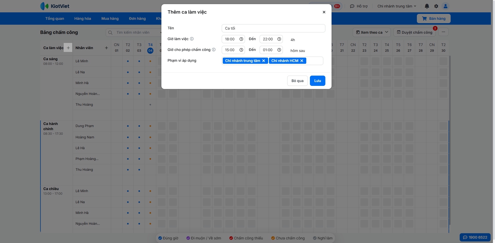

- Cập nhật / Ngừng hoạt động / Xóa ca làm việc:
  - Để ***Cập nhật*** hoặc ***Ngừng hoạt động*** một ca, nhấn vào biểu tượng chỉnh sửa (hình cây bút)  trên dòng tên ca, thay đổi thông tin hoặc trạng thái và nhấn ***Lưu***. Ca ngừng hoạt động sẽ không thể chọn khi đặt lịch mới.

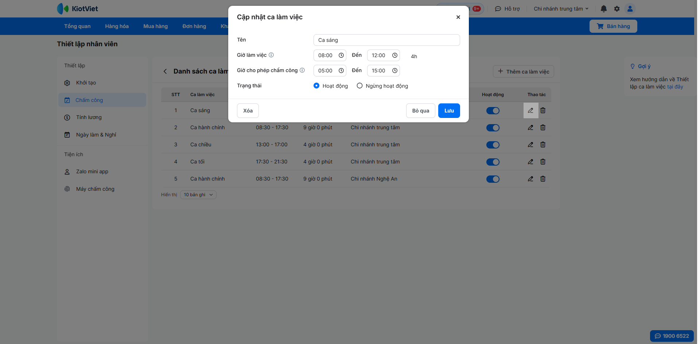

- Để ***Xóa*** ca, nhấn vào biểu tượng thùng rác trên dòng tên ca → chọn ***Đồng ý*** (chỉ xóa được khi ca đó không còn gắn với dữ liệu chấm công nào).

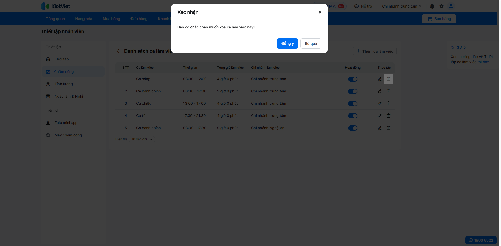

### **2. Đặt lịch làm việc**

**Tình huống:** Sau khi có ca làm việc, bạn cần xếp lịch cho nhân viên (ví dụ: làm 2 ca sáng, chiều các ngày từ thứ 2 đến thứ 6) để hệ thống ghi nhận lịch trình làm việc chuẩn.

**Thao tác thực hiện như sau:**

- **Cách 1:** Trên màn hình **Lịch làm việc**
  - **Bước 1:** Trên màn hình **Quản lý**, vào menu **Nhân viên** → **Lịch làm việc**.
  - **Bước 2:** Chọn kiểu hiển thị: ***Xem theo nhân viên*** hoặc ***Xem theo ca***.

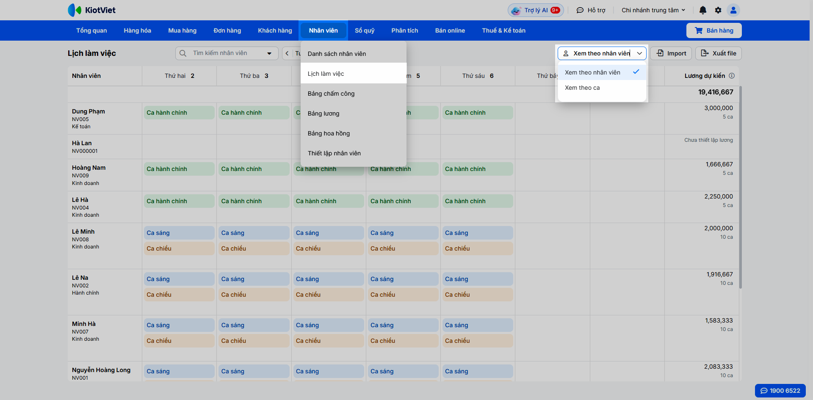

- Với kiểu hiển thị ***Xem theo nhân viên***:
  - Bạn nhấn nút ***Thêm lịch*** trên lịch của nhân viên.

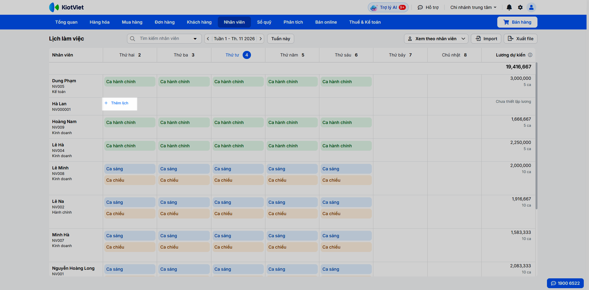

- Tích chọn ***Ca làm việc***.
- Bật xanh ***Lặp lại hàng tuần****:* Chọn các thứ trong tuần lặp lại, tùy chọn ngày ***Kết thúc*** và ***Làm việc cả ngày lễ tết***.
- Bật xanh ***Thêm lịch tương tự cho nhân viên khác***: chọn nhân viên áp dụng lịch làm việc tương tự.
- Nhấn ***Lưu***.

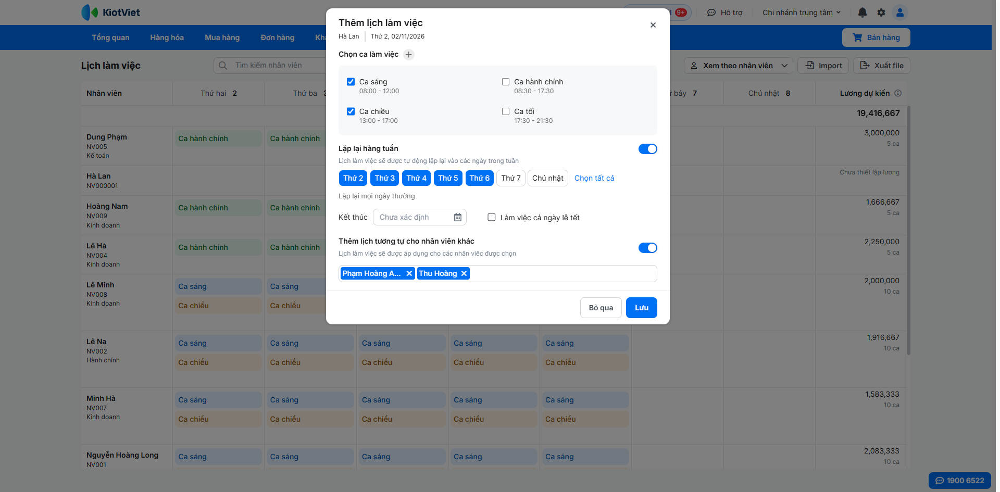

- Với kiểu hiển thị ***Xem theo ca***:
  - Bạn nhấn nút ***Thêm nhân viên*** trên dòng ca làm việc.

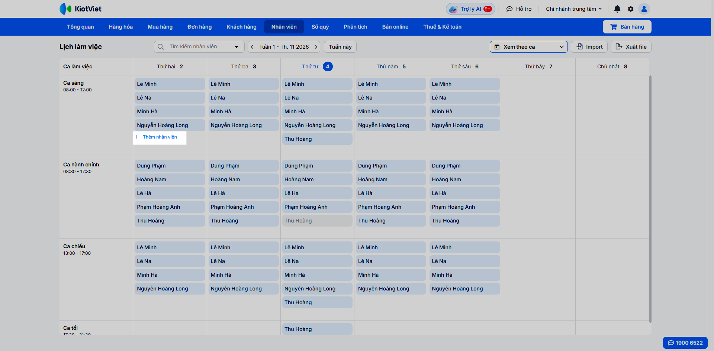

- Tích chọn ***Nhân viên***.
- Bật xanh ***Lặp lại hàng tuần****:* Chọn các thứ trong tuần lặp lại, tùy chọn ngày ***Kết thúc*** và ***Làm việc cả ngày lễ tết***.
- Nhấn ***Lưu***.

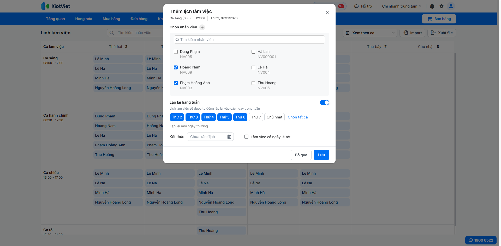

- **Cách 2:** Trên màn hình **Bảng chấm công**
  - **Bước 1:** Trên màn hình **Quản lý**, vào menu **Nhân viên** → **Bảng chấm công**.
  - **Bước 2:** Bạn chọn kiểu hiển thị ***Xem theo ca***.
  - **Bước 3:** Nhấn vào phần trống trên dòng ca làm việc cần đặt lịch làm việc.
  - **Bước 4:** Chọn nhân viên muốn đặt lịch và nhấn ***Đồng ý***.

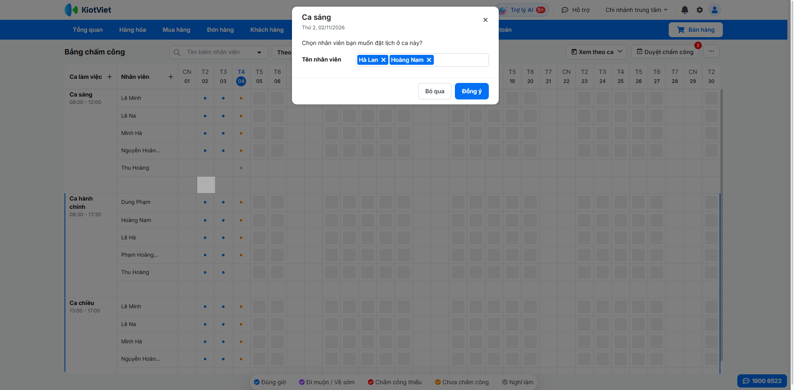

**Lưu ý:**

- Hệ thống hỗ trợ đặt lịch cho nhân viên làm nhiều ca trong ngày (miễn là thời gian trùng không quá 12 giờ).
- Khi đặt lịch lặp lại không kết thúc, hệ thống sẽ tự động tạo lịch trước tối đa 93 ngày và gia hạn tự động. Trong vòng 10 ngày trước ngày kết thúc (hiển thị trên pop-up), hệ thống sẽ tự động tạo tiếp lịch cho 30 ngày sau đó nếu nhân viên có dữ liệu chấm công trong 15 ngày liền trước và ngày kết thúc sau ngày hiện tại.
- Nếu bạn tích chọn "Kết thúc": Hệ thống sẽ ngừng tạo lịch sau thời gian này (tối đa 93 ngày).

### **3. Chấm công thủ công**

**Tình huống:** Khi nhân viên quên chấm công hoặc máy chấm công gặp sự cố, bạn cần ghi nhận giờ làm việc thủ công cho họ để đảm bảo quyền lợi và tính lương chính xác.

**Thao tác thực hiện như sau:**

- **Chấm công chi tiết từng ca:**
  - **Bước 1:** Tại màn hình **Bảng chấm công**, chọn kiểu hiển thị ***Xem theo ca***.
  - **Bước 2:** Nhấn vào ô lịch của nhân viên đó.
  - **Bước 3:** Chọn loại ***Chấm công***: ***Đi làm***.
  - **Bước 4:** Tích vào ***Vào***, ***Ra*** và nhập Giờ vào và Giờ ra thực tế (hệ thống sẽ gợi ý theo giờ ca, bạn có thể sửa).
  - **Bước 5:** Nhấn ***Lưu***.

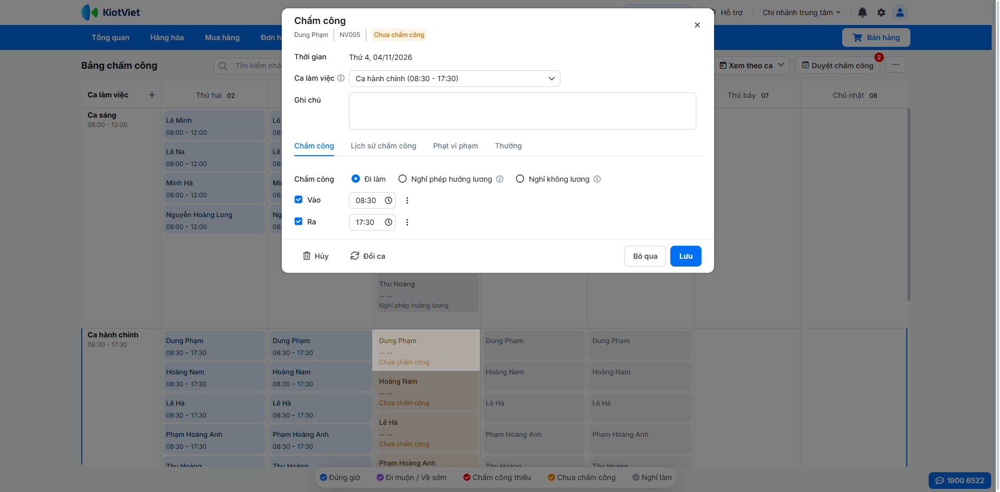

- Nếu nhân viên đổi ca làm, bạn nhấn ***Đổi ca*** → chọn thông tin của nhân viên đổi → nhấn ***Lưu***.

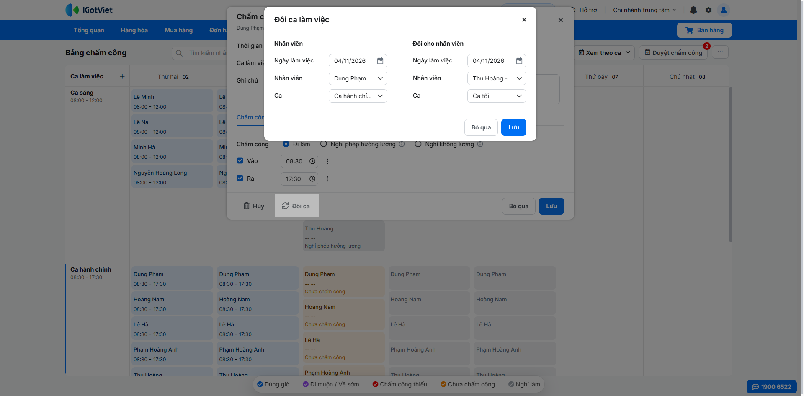

**Lưu ý:** Nếu bạn đang xem nhiều chi nhánh, hệ thống sẽ ẩn chức năng **Đổi ca**.

- **Chấm công hàng loạt:**
  - **Bước 1:** Bạn có thể chọn nhiều lịch làm việc trên cùng 1 ca để chấm công cùng lúc bằng cách nhấn vào nút ***Chọn***.

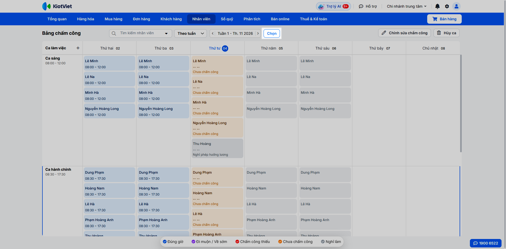

- **Bước 2:** Chọn lịch làm việc cần chấm công.
- **Bước 3:** Nhấn ***Chỉnh sửa chấm công*** và thực hiện chấm công.
- **Bước 4:** Nhấn ***Lưu***.

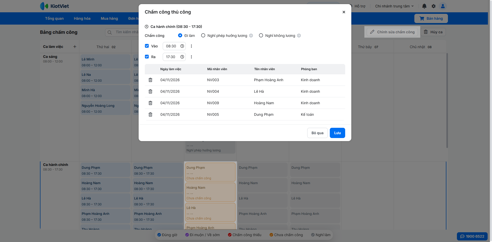

- **Ghi nhận nghỉ làm:**
  - **Bước 1:** Chọn 1 lịch làm việc hoặc các lịch làm việc cùng 1 ca làm như trên.
  - **Bước 2:** Chọn loại ***Chấm công***: ***Nghỉ phép hưởng lương*** hoặc ***Nghỉ không lương***.
  - **Bước 3:** Nếu chọn 1 lịch làm việc có thêm tùy chọn: ***Nhân viên làm thay ca*** (nếu có).
  - **Bước 4:** Nhấn ***Lưu***.

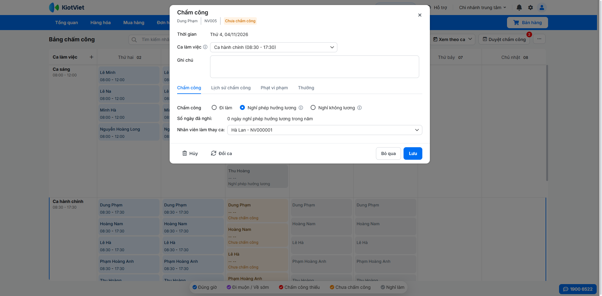

- Hệ thống ghi nhận **Lịch sử chấm công** cho chi tiết ca làm việc.

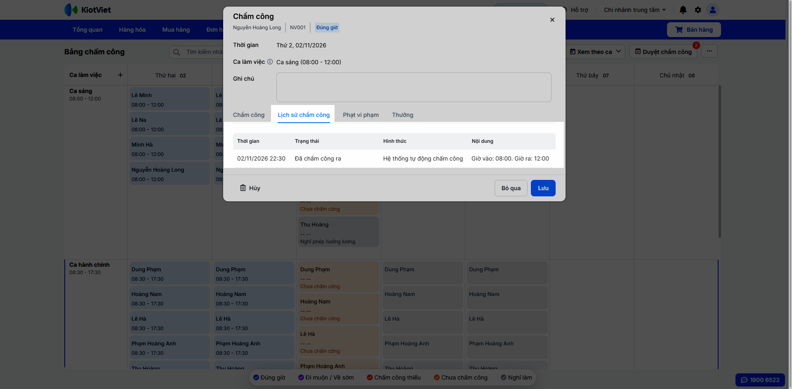

## **III. Các tính năng nâng cao**

### **1. Thiết lập chấm công nâng cao**

**Tình huống:** Bạn muốn tùy chỉnh các quy tắc chấm công để phù hợp với quy định của cửa hàng (ví dụ: hệ thống tự động tính giờ đi muộn nếu nhân viên vào trễ hơn 5 phút, hoặc tính giờ làm thêm nếu nhân viên ở lại sau ca 15 phút).

**Thao tác thực hiện như sau:** Vào menu **Nhân viên** → **Thiết lập nhân viên**

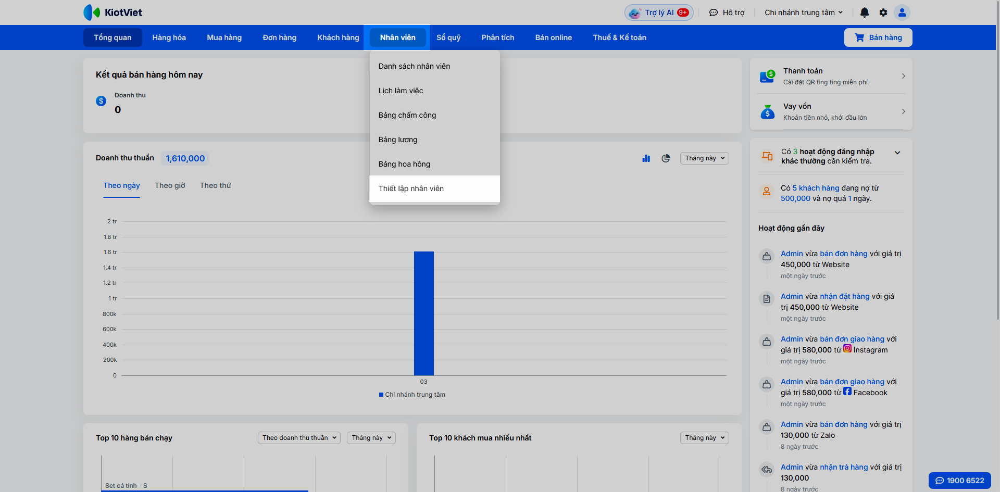

- Chọn menu **Chấm công** để thực hiện các thiết lập sau:

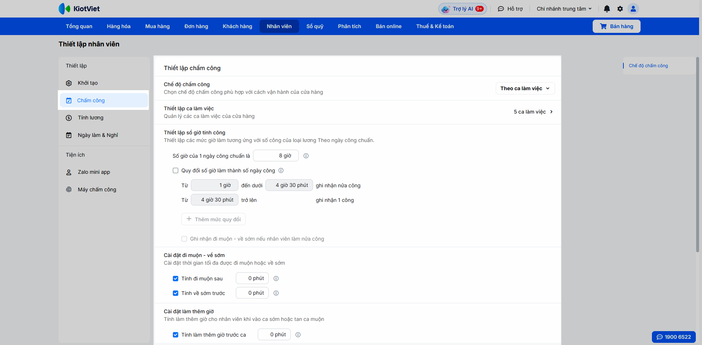

- **Chế độ chấm công** (áp dụng cho các gian hàng khởi tạo kể từ ngày 16/09/2026): Bạn chọn 1 trong 2 chế độ:
  - ***Chấm công theo ca làm việc***: Nhân viên làm việc theo ca cố định. Cần ***Thiết lập ca làm việc*** và xếp lịch cho từng nhân viên.

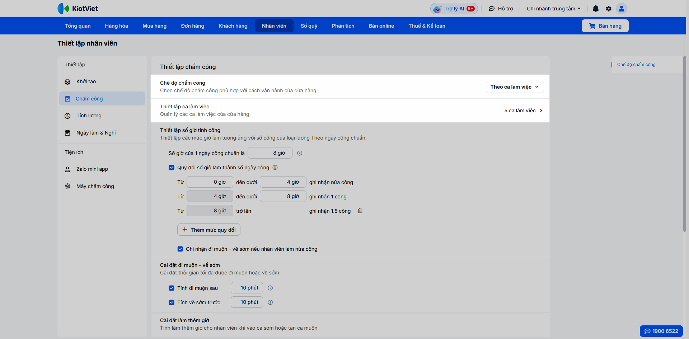

- ***Chấm công theo khung giờ làm việc***: Nhân viên chấm vào/ra tự do trong khung giờ quy định. Không cần tạo ca hay xếp lịch.
  - Bạn thiết lập ***Khung giờ làm việc*** → điền ***Giờ làm việc***, ***Giờ cho phép chấm công***.
  - Tùy chọn ***Nghỉ giữa giờ***.
    - Tích chọn nếu muốn hệ thống tự động trừ khoảng thời gian này khỏi tổng giờ làm khi tính lương → nhập giờ bắt đầu và giờ kết thúc thời gian nghỉ.
    - ***Số giờ của 1 ngày công chuẩn*** được hệ thống tự tính bằng số giờ làm việc trừ số giờ nghỉ giữa giờ.
    - Hệ thống không tính đi muộn/về sớm cho phần thời gian nằm trong giờ nghỉ. Ví dụ: khung giờ 08:00 - 17:30, nghỉ 12:00 - 13:30, nhân viên chấm ra lúc 12:30 → thời gian về sớm được tính từ 13:30 đến 17:30.
    - **Lưu ý:** Giờ nghỉ phải nằm trong khung giờ làm việc. Dữ liệu đã chấm công trước khi thay đổi thiết lập vẫn được tính theo thiết lập cũ.

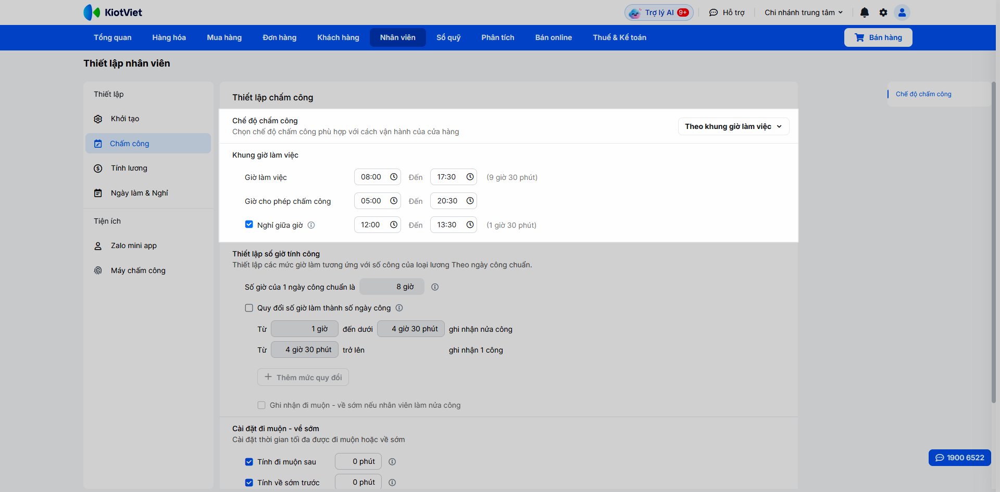

- **Thiết lập số giờ tính công:** 
  - Điền ***Số giờ của 1 ngày công chuẩn***. Dữ liệu này sẽ dùng để tính lương cho nhân viên áp dụng tính lương theo công tháng.
  - Tùy chọn ***Quy đổi số giờ làm thành số ngày công*** (áp dụng cho nhân viên có loại lương ***Theo ngày công chuẩn***). Bạn tích chọn nếu muốn ghi nhận nhiều mức công trong ngày (0.5, 1, 1.5, 2 công,...) theo tổng số giờ làm thực tế, thay vì tối đa 1 công/ngày.
    - Hệ thống hiển thị sẵn 2 mức quy đổi. Bạn nhập giờ ***đến dưới*** cho từng mức. Giờ ***Từ*** và ***số công*** được hệ thống tự điền (mỗi mức tăng 0.5 công).
    - Nhấn ***+ Thêm mức quy đổi*** để thêm mức mới. Mức cuối cùng luôn là ***trở lên***.
    - Nhấn biểu tượng thùng rác ở mức cuối cùng để xóa (không xóa được 2 mức đầu tiên).

- Tùy chọn ***Ghi nhận đi muộn - về sớm nếu nhân viên làm nửa công***
- **Lưu ý**: Với ngày làm việc ghi nhận nửa công, hệ thống vẫn tính giờ làm thêm (nếu chấm công ngoài khoảng thời gian của ca làm việc).

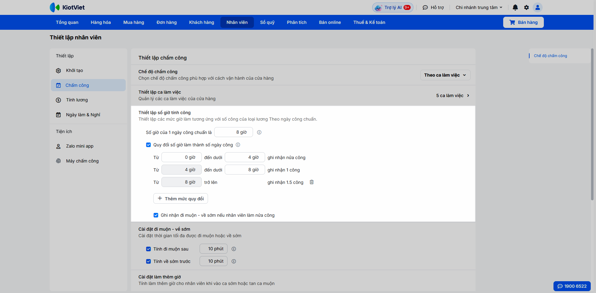

- **Cài đặt đi muộn – về sớm:** Bạn tích chọn và nhập số phút cho phép đi muộn/về sớm trước khi hệ thống bắt đầu tính phạt.

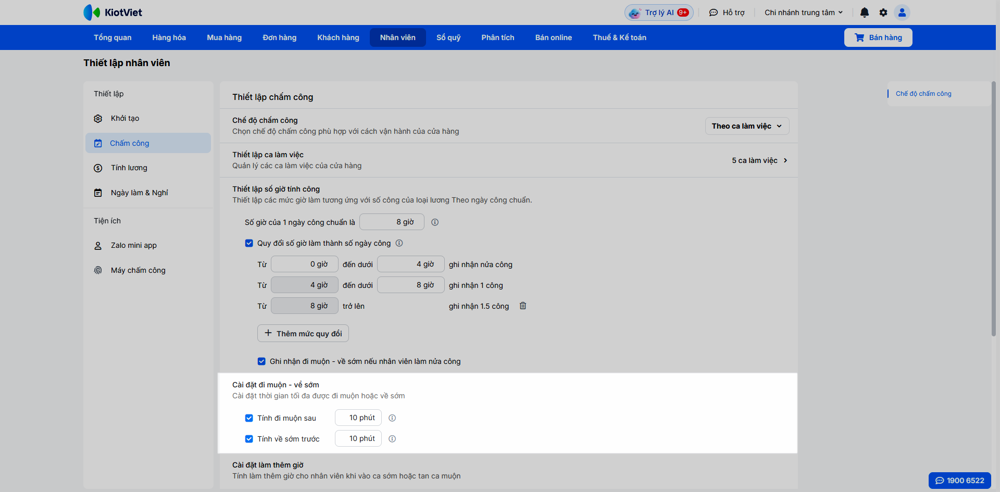

- **Cài đặt làm thêm giờ:** Tích chọn và nhập số phút làm thêm tối thiểu trước ca/sau ca để hệ thống ghi nhận là làm thêm giờ.

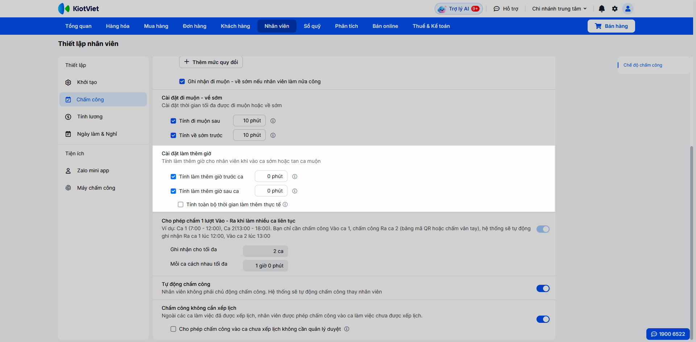

- **Cho phép chấm 1 lượt Vào – Ra khi làm nhiều ca liên tục:**
  - Nếu bật xanh → nhân viên làm nhiều ca liền nhau chỉ cần chấm vào ca đầu và ra ca cuối, hệ thống tự điền giờ ra/vào giữa các ca.
  - Bạn thiết lập số ca tối đa và thời gian nghỉ tối đa giữa 2 ca.

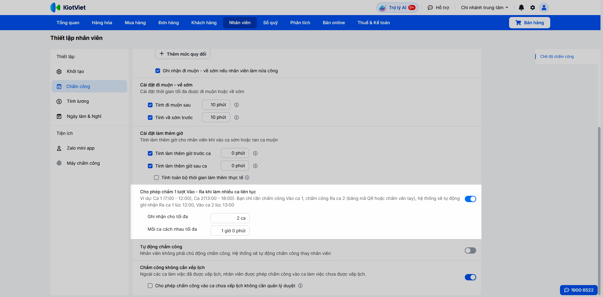

- **Tự động chấm công:** Nếu bật xanh, hệ thống tự động chấm công đủ giờ cho nhân viên theo lịch.

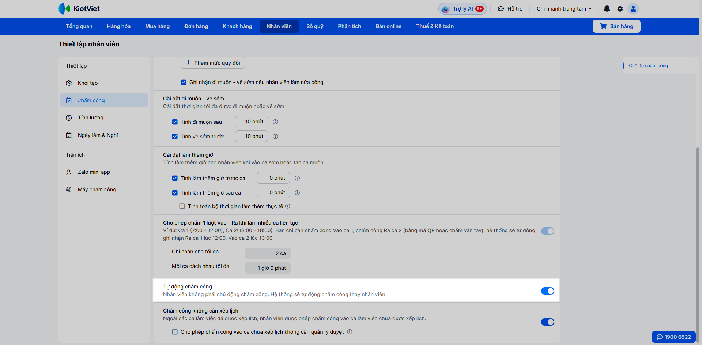

- **Chấm công không cần xếp lịch:** Hệ thống cho phép chấm công vào các ca mà chưa cần xếp ca làm việc trước.

Tùy chọn ***Cho phép chấm công vào ca chưa xếp lịch không cần quản lý duyệt***. Nếu tích chọn → nhân viên chấm công vào ca chưa xếp lịch được ghi nhận ngay, không cần quản lý duyệt.​

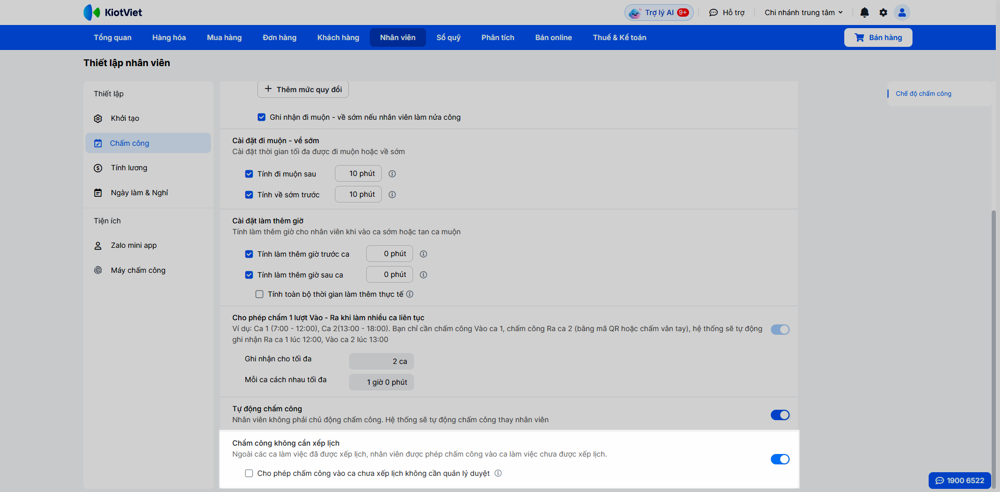

- **Chấm công qua Zalo**: Tại màn hình **Thiết lập nhân viên** → chọn **Zalo mini app:**

- Bạn bật xanh tính năng
- Tích chọn **Cho phép nhân viên xem** các thông tin:
  - **Bảng chấm công**
  - **Bảng lương**

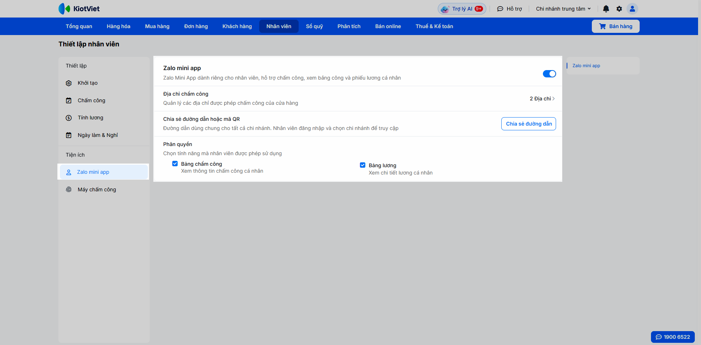

- Hệ thống tự động tạo mã QR chấm công cho gian hàng, bạn nhấn ***Chia sẻ đường dẫn*** để ***Sao chép*** đường dẫn, ***Tải mã*** QR, ***In mã*** QR gửi nhân viên thực hiện chấm công.

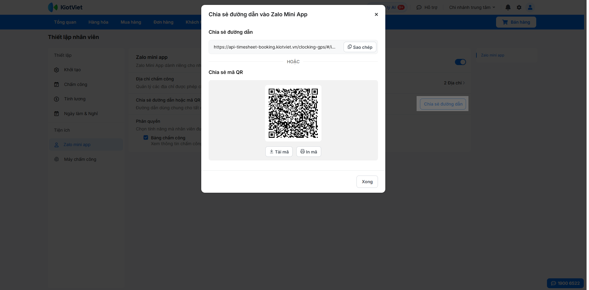

- Để thay đổi địa chỉ, phạm vi chấm công, bạn nhấn Địa chỉ → nhấn biểu tượng cây bút → xác nhận vị trí chấm công cho chi nhánh.

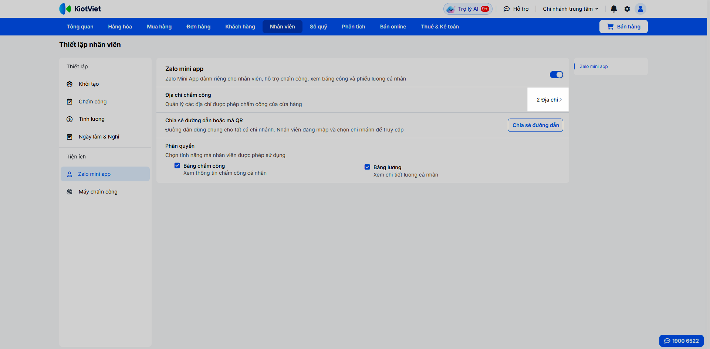

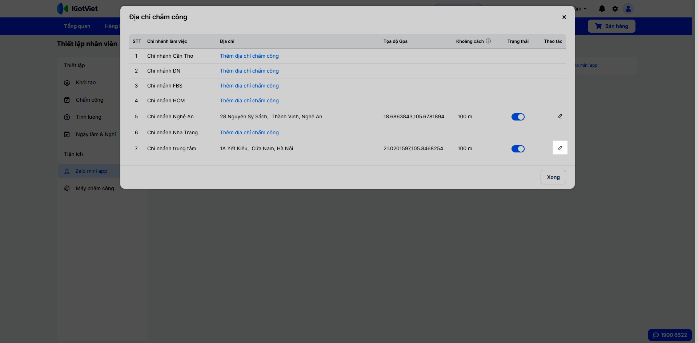

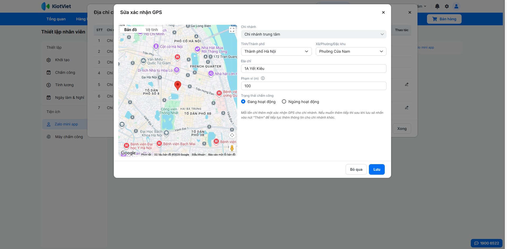

- **Chấm công bằng máy chấm công**: Nhấn ***Xem hướng dẫn*** và ***Tải về*** phần mềm **KiotViet chấm công vân tay**.

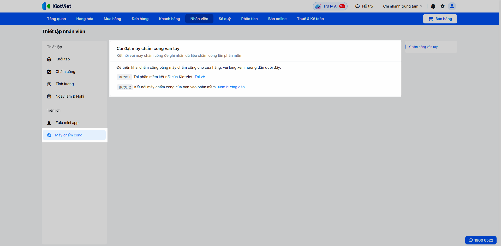

### **2. Quản lý Phạt vi phạm**

**Tình huống:** Khi nhân viên đi muộn không lý do hoặc vi phạm nội quy, bạn cần ghi nhận lỗi vi phạm và mức phạt trên hệ thống để trừ vào lương cuối kỳ một cách minh bạch.

**Thao tác thực hiện như sau:**

- **Tạo Loại vi phạm:**
  - **Bước 1:** Trong pop-up chấm công chi tiết của một ca làm việc, chuyển sang tab **Phạt vi phạm.**
  - **Bước 2:** Trên ô ***Loại vi phạm***, nhấn ***+ Thêm loại vi phạm***.

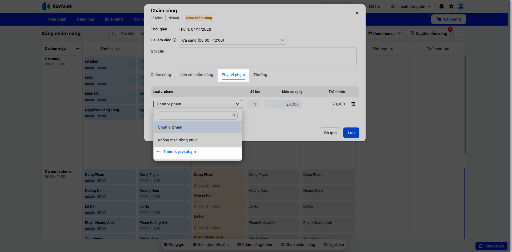

- **Bước 3:** Nhập ***Tên vi phạm***, ***Mức áp dụng*** và nhấn ***Lưu***.

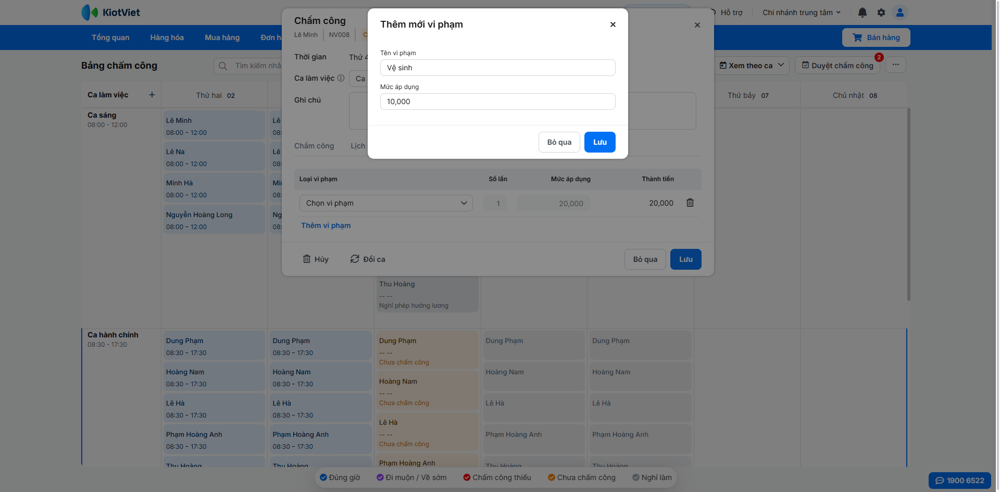

- Bạn cũng có thể sửa/xóa loại vi phạm tại đây bằng cách nhấn vào biểu tượng cây bút trên dòng tên loại vi phạm.

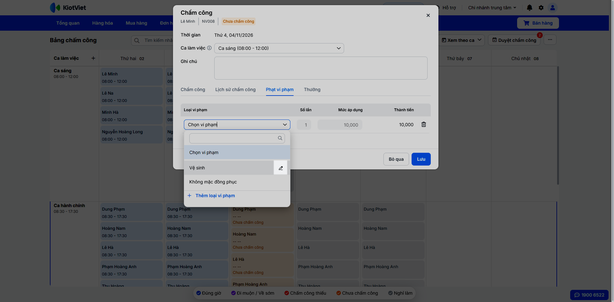

- **Ghi nhận phạt vi phạm:**
  - **Bước 1:** Trong pop-up chấm công chi tiết, nhấn **Thêm vi phạm**.
  - **Bước 2:** Chọn ***Loại vi phạm*** từ danh sách.
  - **Bước 3:** Nhập ***Số lần*** vi phạm và ***Mức áp dụng*** (số tiền phạt cho mỗi lần).
  - **Bước 4:** Nhấn ***Lưu*** → số tiền phạt sẽ tự động tổng hợp vào bảng lương.

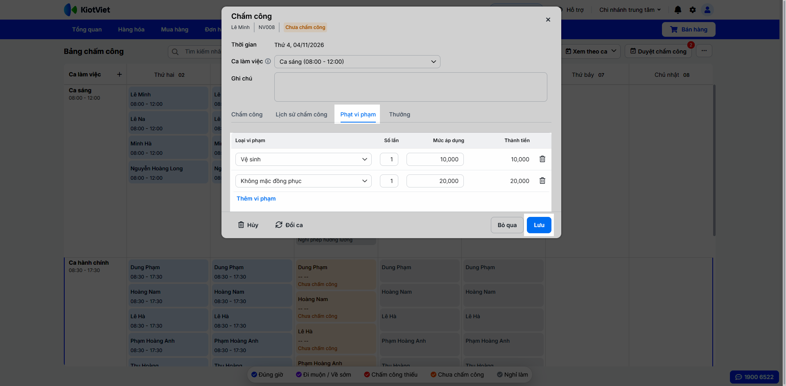

- **Xuất file tổng số phạt vi phạm:**
  - **Bước 1:** Tại màn hình **Bảng chấm công**, nhấn ***Xuất file*** → ***Tổng số phạt vi phạm/ thưởng ngày***.

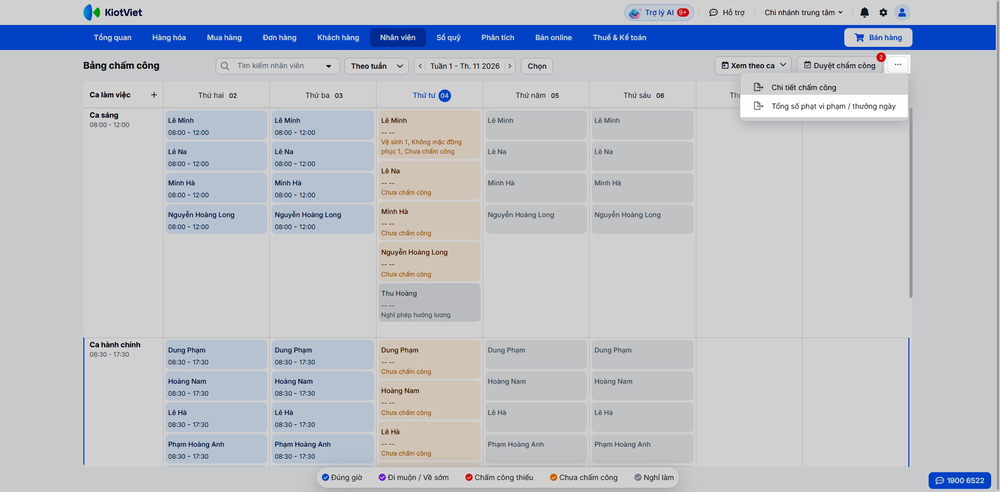

- **Bước 2:** Chọn khoảng thời gian và nhấn ***Thực hiện***.

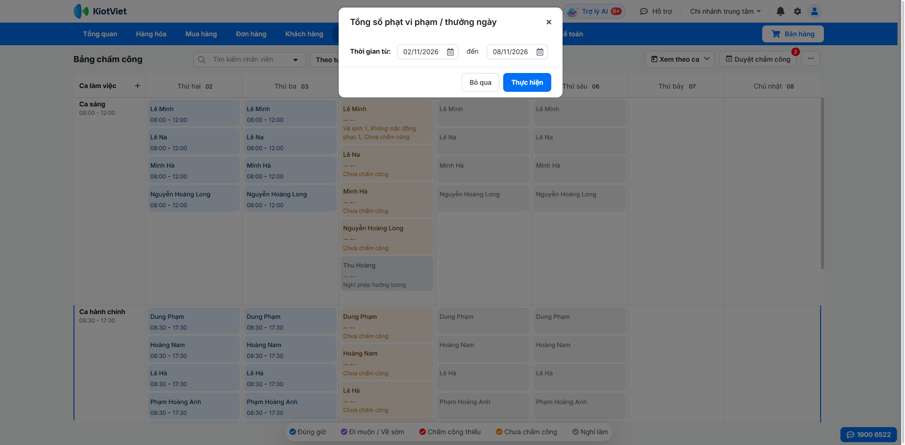

### **3. Kết nối Máy chấm công vân tay**

**Tình huống:** Cửa hàng đang sử dụng máy chấm công vân tay vật lý và bạn muốn tích hợp đồng bộ dữ liệu tự động vào hệ thống KiotViet để giảm tải công việc đối soát.

**Thao tác thực hiện như sau:**

- **Bước 1:** Cài đặt Ứng dụng KiotViet chấm công vân tay:
  - Tại màn hình **Quản lý**, vào menu **Hỗ trợ** → chọn **KiotViet chấm công vân tay**.

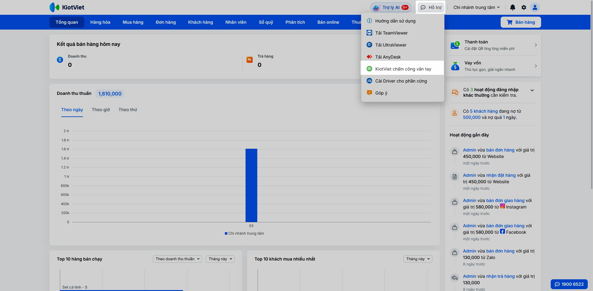

- Chạy file cài đặt KiotViet\_Ketnoi.exe trên máy tính (cần quyền admin).

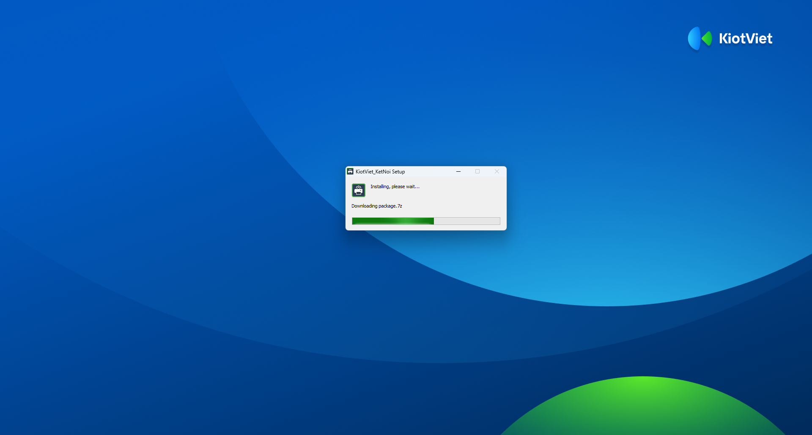

- Sau khi cài đặt, mở ứng dụng và Đăng nhập bằng tài khoản KiotViet của bạn.

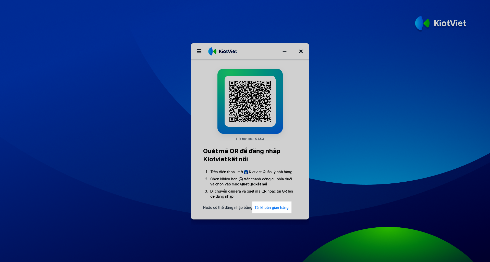

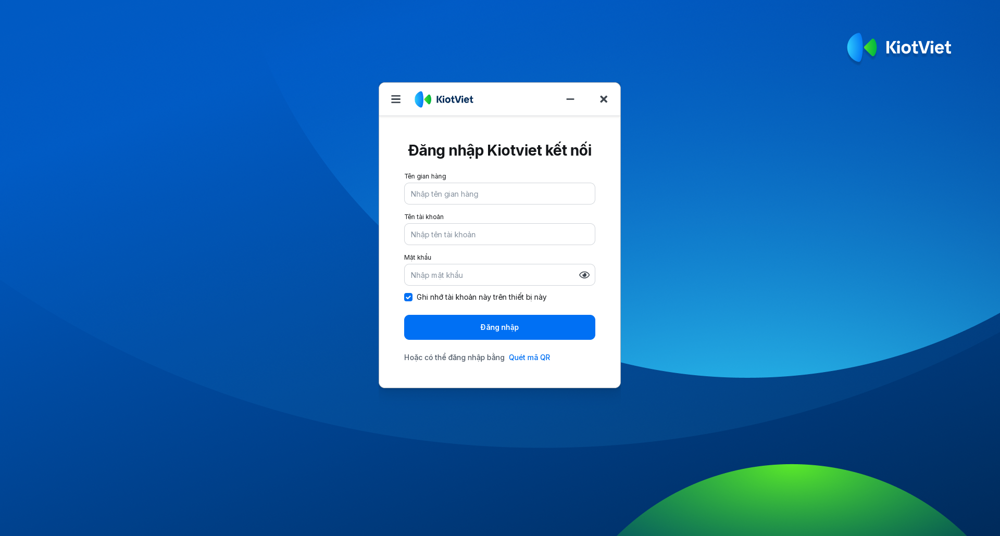

- **Bước 2:** **Kết nối máy chấm công:**
  - Nếu kết nối qua cổng USB: Cắm máy chấm công vào máy tính đã cài ứng dụng. Trên ứng dụng, tại danh sách **Máy chấm công đang tìm thấy**, nhấn ***+ Kết nối***.

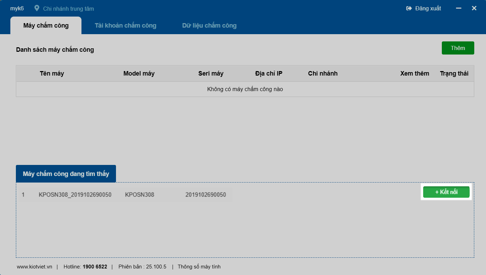

- Nếu kết nối qua mạng LAN (TCP/IP):
  - Đảm bảo máy chấm công và máy tính cài ứng dụng đang ở cùng mạng LAN.
  - Trên ứng dụng, nhấn ***Thêm***.
  - Nhập các thông tin: ***Tên máy****, **Model máy**, **Địa chỉ IP**, **Cổng liên kết TCP**, **Mã kết nối*** (nếu có) của máy chấm công.
  - Nhấn ***Lưu***. Máy chấm công sẽ xuất hiện trong **Danh sách máy chấm công**.

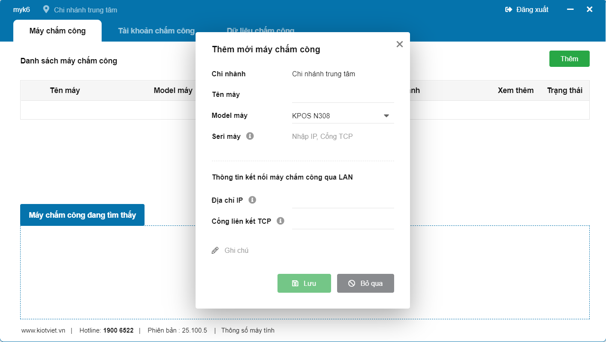

- **Bước 3: Quản lý tài khoản chấm công:**
  - Trên ứng dụng, tại **Danh sách máy chấm công**, nhấn vào biểu tượng vân tay của máy cần quản lý.

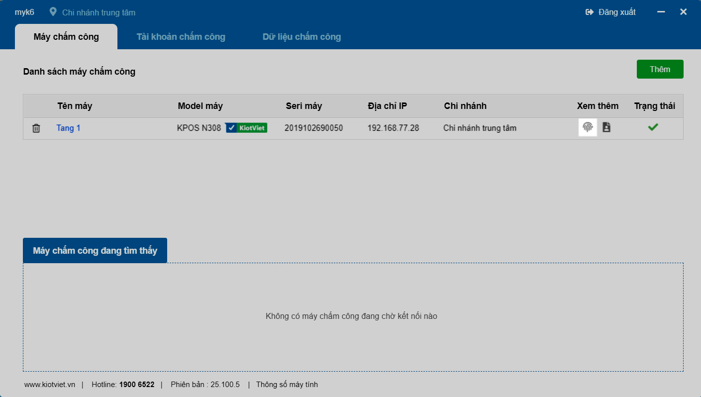

- Hoặc vào tab **Tài khoản chấm công** và chọn **Máy chấm công**.

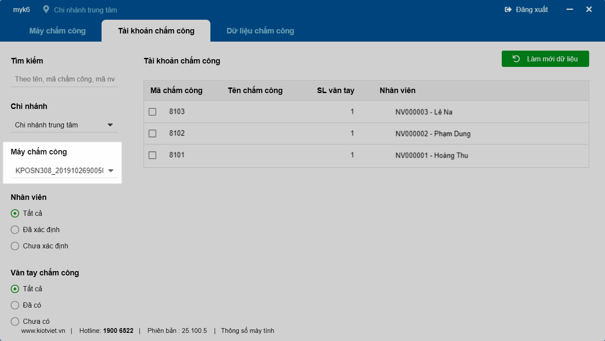

- Danh sách các tài khoản (vân tay/thẻ...) trên máy sẽ hiển thị. Tại cột **Nhân viên**, bạn cần chọn đúng nhân viên KiotViet tương ứng với từng **Mã chấm công** trên máy. Nhấn **Làm mới dữ liệu** nếu cần cập nhật.

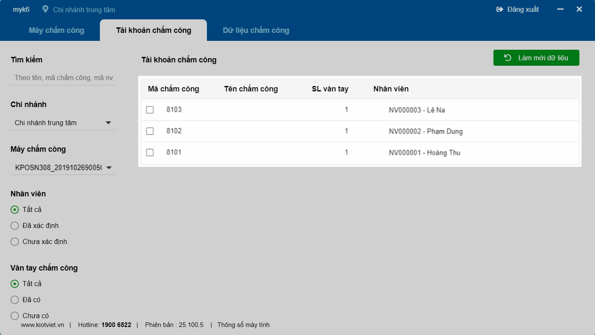

- **Bước 4: Đồng bộ dữ liệu chấm công:**
  - Sau khi kết nối và gán nhân viên, ứng dụng sẽ tự động đồng bộ dữ liệu chấm công từ máy về KiotViet.
  - Bạn có thể vào tab **Dữ liệu chấm công** và chọn **Máy chấm công** để xem lịch sử các lượt chấm công đã đồng bộ.
  - Nếu có lỗi (ví dụ: không xác định được nhân viên hoặc ca làm việc), hệ thống sẽ báo lỗi. Bạn cần sửa thông tin (ví dụ: gán nhân viên) và nhấn nút ***Đồng bộ*** (hình mũi tên xoay tròn) để cập nhật.

### **4. Xem bảng chấm công theo khung giờ làm việc**

**Tình huống:** Cửa hàng của bạn đã chuyển sang chế độ chấm công **Theo khung giờ làm việc** và bạn cần kiểm tra, cập nhật dữ liệu chấm công của nhân viên.

**Thao tác thực hiện như sau:**

- **Bước 1:** Trên màn hình **Quản lý**, vào menu **Nhân viên** → **Bảng chấm công**.
- **Bước 2:** Chọn chế độ xem ***Theo khung giờ làm việc***.

- **Bước 3:** Với tháng có cả dữ liệu cũ (theo ca) và dữ liệu mới (theo khung giờ),
  - Bạn có thể chuyển giữa 2 chế độ xem

- Chế độ xem theo nhân viên hiển thị tổng dữ liệu của cả 2 chế độ.

- **Bước 4:** Nhấn vào ngày làm việc để xem chi tiết. Hệ thống ghi nhận lần chấm đầu tiên trong ngày là giờ vào, các lần sau là giờ ra.

Với chấm công qua KiotViet Nhân viên (Zalo Mini App) → hệ thống hiển thị thêm chi nhánh chấm công.

- **Bước 5:** (Nếu cần) Nhấn ***Vào*** / ***Ra*** để bổ sung chấm công thủ công → nhấn ***Lưu***.
- **Lưu ý:**
  - Dữ liệu chấm công trước ngày chuyển chế độ vẫn được sửa, đồng bộ và xét duyệt nhưng không thêm chấm công mới được.
  - Loại lương **Theo ca làm việc** không áp dụng cho chế độ này. Bạn cần cập nhật loại lương khác cho nhân viên để bảng lương được tính đúng.

***Cảm ơn bạn đã theo dõi bài viết!***

- Để tìm hiểu thêm về các nghiệp vụ quản lý bán hàng, mời bạn xem bài viết:  
  [**Tổng quan Các nhóm Giải pháp của KiotViet**](https://www.kiotviet.vn/huong-dan-su-dung-kiotviet/retail-lam-quen-voi-kiotviet/tong-quan-cac-nhom-giai-phap-kiotviet/)
- Để tham khảo thêm các video hướng dẫn sử dụng, mời bạn theo dõi kênh YouTube:  
  [**HDSD - Phần mềm KiotViet**](https://www.youtube.com/@HDSDPhanmemKiotViet)

***Chúc bạn kinh doanh hiệu quả cùng KiotViet!***

*Tài liệu được cập nhật mới nhất ngày 15/11/2026*
