# KiotViet Retail – Quản lý tính lương

Nguồn: https://www.kiotviet.vn/huong-dan-su-dung-kiotviet/retail-nhan-vien/quan-ly-tinh-luong/

---

# **Quản lý tính lương**

*(Ngành Bán buôn, Bán lẻ)*

## **I. Giới thiệu chung**

Tính năng Quản lý tính lương trên KiotViet giúp cửa hàng tự động hóa và quản lý quy trình tính lương cho nhân viên một cách chính xác và minh bạch. Từ việc thiết lập các quy tắc tính lương, quản lý ngày nghỉ lễ, đến việc tạo bảng lương, chốt lương và thanh toán, tính năng này giúp tiết kiệm thời gian, giảm thiểu sai sót và đảm bảo quyền lợi cho nhân viên.

**Lợi ích nổi bật của tính năng:**

- **Thiết lập linh hoạt:** Cho phép cài đặt ngày tính lương, giờ công chuẩn, quy tắc tính nửa công, tự động tạo bảng lương và quản lý các ngày lễ tết, ngày làm việc của chi nhánh.
- **Đa dạng cách tính lương:** Hỗ trợ nhiều hình thức tính lương chính (theo ca, giờ, ngày công chuẩn, cố định), lương làm thêm giờ, hoa hồng, thưởng (theo doanh thu cá nhân/chi nhánh, lợi nhuận gộp), phụ cấp và các khoản giảm trừ.
- **Quản lý bảng lương hiệu quả:** Dễ dàng tạo mới, xem, cập nhật, chốt lương, hủy bỏ và xuất file bảng lương. Hệ thống tự động tổng hợp dữ liệu chấm công và các thiết lập lương.
- **Thanh toán lương tiện lợi:** Hỗ trợ thanh toán lương, ứng lương trực tiếp từ bảng lương hoặc thông tin nhân viên, tự động tạo phiếu chi và ghi nhận lịch sử thanh toán.
- **Minh bạch và chi tiết:** Cung cấp chi tiết phiếu lương cho từng nhân viên, bao gồm cả bảng kê hoa hồng (nếu có) và chi tiết chấm công trong kỳ. Chi phí lương được tự động hạch toán vào báo cáo tài chính.
- **Mẫu lương tiện dụng:** Cho phép tạo các mẫu lương (bao gồm hoa hồng, thưởng, phụ cấp, giảm trừ) để áp dụng nhanh chóng cho nhiều nhân viên.
- **Tự động hóa Bảo hiểm và Thuế:** Hỗ trợ tự động tính Bảo hiểm xã hội (BHXH) và Thuế thu nhập cá nhân (TNCN) thay thế việc nhập tay thủ công.

## **II. Các thao tác cơ bản**

### **1. Thiết lập Tính lương Chung**

Đây là các cài đặt nền tảng ảnh hưởng đến toàn bộ quy trình tính lương trên hệ thống.

**Tình huống:** Bạn cần thiết lập các quy tắc tính lương chung cho cửa hàng, từ cách tính giờ làm, các khoản thu nhập, giảm trừ đến bảo hiểm, thuế TNCN và cấu hình tự động tạo, cập nhật bảng lương.

**Thao tác thực hiện như sau:**

- Trên màn hình **Quản lý**, vào menu **Nhân viên** → **Thiết lập nhân viên** → **Tính lương**.

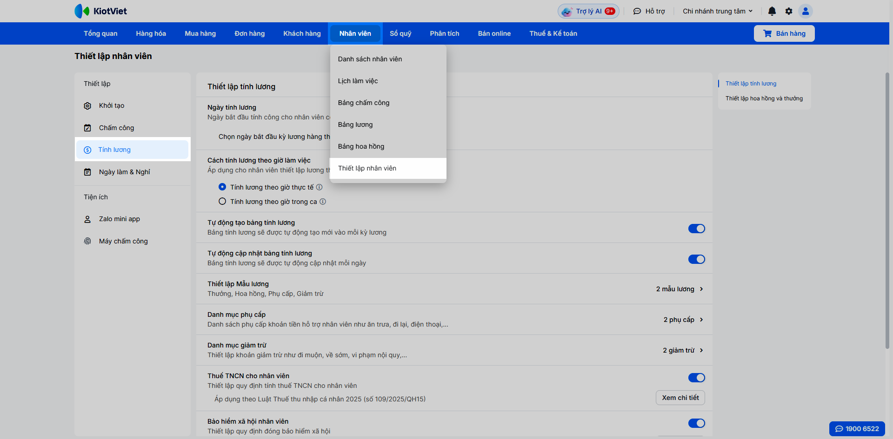

- **Ngày tính lương**: Bạn chọn ngày bắt đầu kỳ lương hàng tháng (ví dụ: Ngày 1).

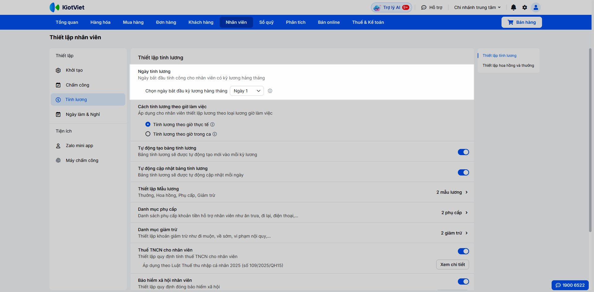

- **Cách tính lương theo giờ làm việc**: Bạn chọn tính lương theo 1 trong 2 cách:
  - ***Tính lương theo giờ thực tế*** (mặc định):
    - Thời gian làm việc được tính từ lúc nhân viên chấm công vào đến lúc chấm công ra.
    - Số giờ chấm công = Số giờ làm thực tế.
    - Số giờ tính lương = Số giờ chấm công + Số giờ nghỉ phép (nếu có).
    - **Ví dụ:** Ca sáng theo thiết lập cửa hàng tổng 4 giờ từ 6:00 - 10:00.

Nhân viên chấm công vào lúc 5:50, ra lúc 10:10 → Số giờ ghi nhận và tính lương = 4h20p = 4.33 giờ.

- ***Tính lương theo giờ trong ca***:
  - Thời gian làm việc nằm trong khoảng thời gian của ca làm việc.
  - Số giờ chấm công = Số giờ làm trong ca.
  - Giờ làm trong ca = Min(Giờ chấm ra, Giờ kết thúc ca) − Max(Giờ chấm vào, Giờ bắt đầu ca).
  - Số giờ tính lương = Số giờ chấm công + Số giờ nghỉ phép (nếu có).
  - **Ví dụ:** Ca sáng theo thiết lập cửa hàng tổng 4 giờ từ 6:00 - 10:00.

Nhân viên chấm công vào lúc 5:50, ra lúc 10:10 → Số giờ ghi nhận và tính lương = 4 giờ.

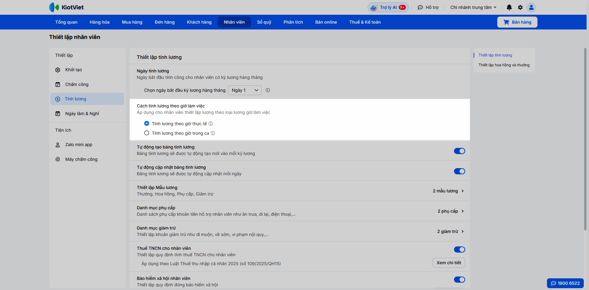

- **Tự động tạo bảng lương**: Bật xanh tính năng để hệ thống tự động tạo bảng lương mới vào ngày bắt đầu kỳ lương.

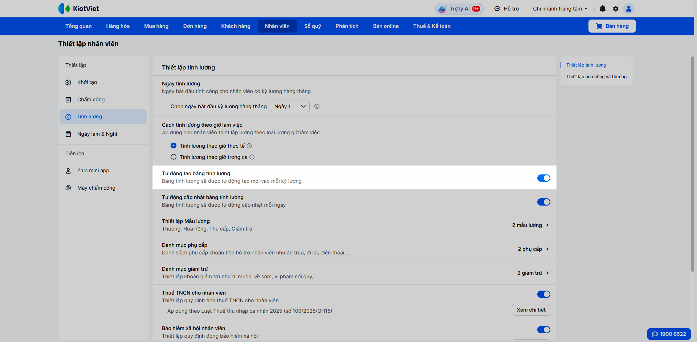

- **Tự động cập nhật bảng tính lương**: Bật xanh tính năng để hệ thống tự động cập nhật số liệu bảng lương mỗi ngày.

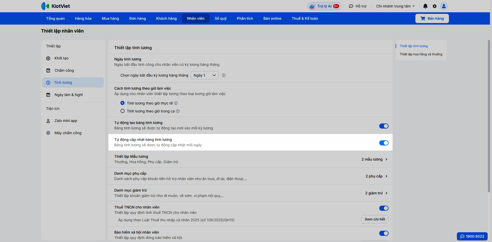

- **Thiết lập Mẫu lương**: Hệ thống hỗ trợ áp dụng nhanh cùng 1 cách tính lương cho nhiều nhân viên theo mẫu lương có sẵn (bao gồm các thông tin về thưởng, hoa hồng, phụ cấp, giảm trừ). Bạn nhấn ***mẫu lương*** để xem danh sách, thêm, sửa, xóa mẫu lương.

**Lưu ý**: Các mẫu lương được thêm mới khi thiết lập lương cho nhân viên cũng được ghi nhận tại **Danh sách mẫu lương**.

- **Danh mục phụ cấp**: Hệ thống hỗ trợ tạo sẵn danh sách các khoản phụ cấp ngoài tiền lương cho nhân viên như phụ cấp ăn trưa, đi lại, điện thoại,...
  - Bạn nhấn ***phụ cấp*** để xem danh sách, thêm, sửa, xóa (nếu đã có phụ cấp) hoặc ***Thêm phụ cấp*** (nếu chưa có khoản phụ cấp nào).
  - Tại mỗi khoản phụ cấp, bạn bật xanh/tắt xám ***Miễn thuế TNCN***. Khi tính thuế TNCN, hệ thống tự loại các khoản bật xanh ***Miễn thuế TNCN*** ra khỏi thu nhập chịu thuế: **Thu nhập chịu thuế = Tổng thu nhập - Tổng giảm trừ - Các khoản được miễn thuế**.
  - **Lưu ý**: Các khoản phụ cấp được thêm mới khi thiết lập mẫu lương/lương cho nhân viên cũng được ghi nhận tại **Danh mục phụ cấp**.

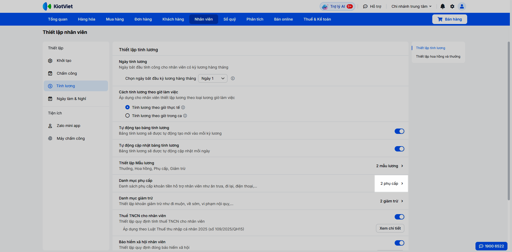

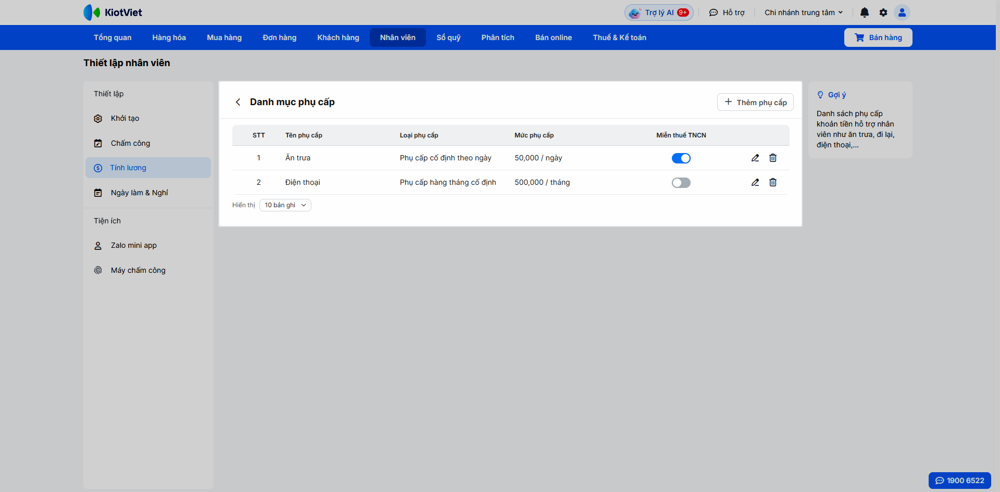

- **Danh mục giảm trừ**: Hệ thống hỗ trợ tạo sẵn danh sách các loại giảm trừ như đi muộn, về sớm, vi phạm nội quy,... Bạn nhấn ***giảm trừ*** để xem danh sách, thêm, sửa, xóa (nếu đã có giảm trừ) hoặc ***Thêm giảm trừ*** (nếu chưa có loại giảm trừ nào).

**Lưu ý**: Các giảm trừ được thêm mới khi thiết lập mẫu lương/lương cho nhân viên cũng được ghi nhận tại **Danh mục giảm trừ**.

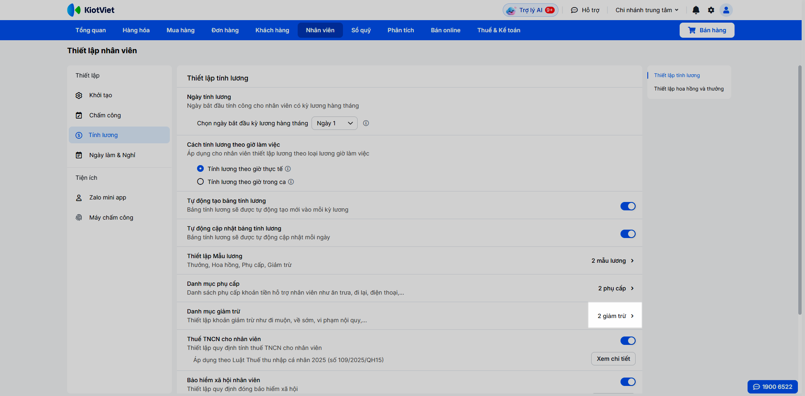

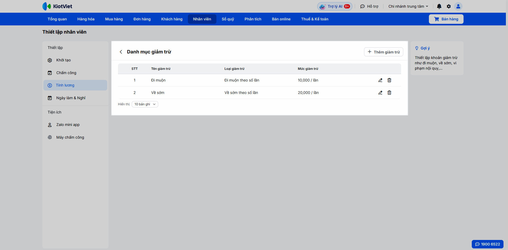

- **Thuế TNCN cho nhân viên**:
  - Bật xanh tính năng để hệ thống tự động xác định phương pháp tính thuế và khấu trừ Thuế TNCN của nhân viên dựa trên thu nhập trong kỳ, đảm bảo tính chính xác và tuân thủ pháp luật.
  - Sau khi bật tính năng → hệ thống hiển thị văn bản pháp luật áp dụng → bạn nhấn ***Xong***.
  - **Lưu ý:**
    - Khi bật/tắt tính năng → các bảng lương đã tạo trước thời điểm thay đổi phải được tải lại để cập nhật theo thiết lập mới (ẩn/hiện các trường thông tin tương ứng). Các bảng lương tạo mới sau thời điểm thay đổi sẽ tự động áp dụng thiết lập mới nhất.
    - Tính năng chỉ áp dụng cho:
      - Nhân viên tại Việt Nam, múi giờ +7.
      - Bảng lương có kỳ hạn trả lương hàng tháng.

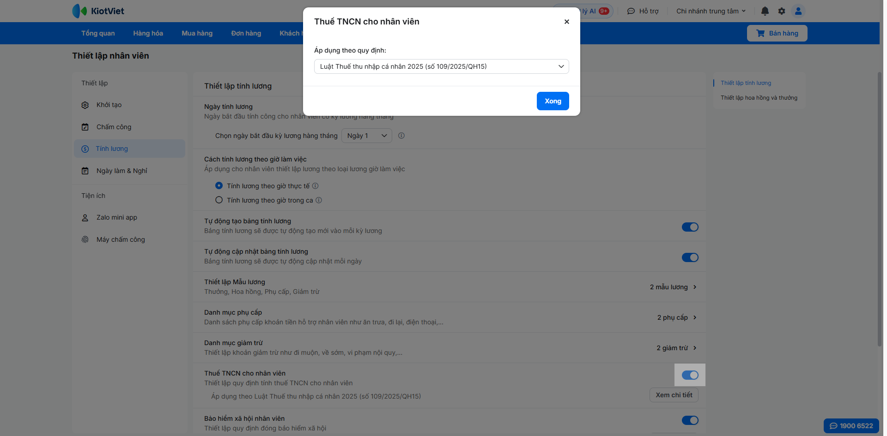

- **Bảo hiểm xã hội nhân viên**:
  - Bật xanh tính năng để hệ thống tự động tính toán các khoản trích nộp bảo hiểm (BHXH, BHYT, BHTN) tương ứng với mức lương đóng bảo hiểm của từng nhân viên.
  - Sau khi bật tính năng → hệ thống hiển thị văn bản pháp luật áp dụng → bạn chọn ***Vùng lương*** áp dụng → nhấn ***Xong***.
  - **Lưu ý:**
    - Khi bật/tắt tính năng → các bảng lương đã tạo trước thời điểm thay đổi phải được tải lại để cập nhật theo thiết lập mới (ẩn/hiện các trường thông tin tương ứng). Các bảng lương tạo mới sau thời điểm thay đổi sẽ tự động áp dụng thiết lập mới nhất.
    - Tính năng chỉ áp dụng cho:
      - Nhân viên tại Việt Nam, múi giờ +7.
      - Bảng lương có kỳ hạn trả lương hàng tháng.
    - ***Vùng lương*** dùng làm căn cứ xác định mức trần đóng Bảo hiểm thất nghiệp.

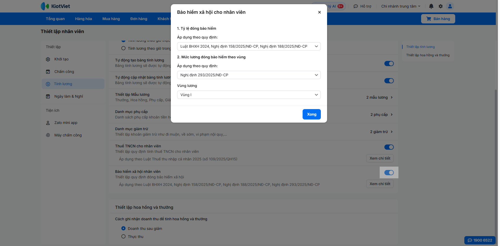

**Lưu ý:** Hai tính năng ***Thuế TNCN cho nhân viên*** và ***Bảo hiểm xã hội nhân viên*** được cấu hình độc lập nhưng có liên hệ với nhau (Khoản bảo hiểm nhân viên đóng là biến đầu vào để tính Thuế TNCN).

- **Thiết lập hoa hồng và thưởng**: Bạn lựa chọn **Cách ghi nhận doanh thu để tính hoa hồng và thưởng** theo 1 trong 2 hình thức:
  - Doanh thu sau giảm
  - Thực thu

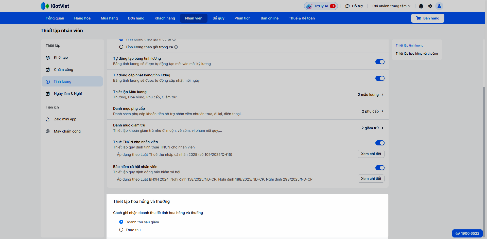

### **2. Thiết lập Mức lương cho Nhân viên**

**Tình huống:** Khi bạn cần cài đặt chi tiết mức lương chính (theo giờ, theo ca, cố định) cùng với các khoản phụ cấp, hoa hồng, giảm trừ cho một nhân viên cụ thể trong cửa hàng.

**Thao tác thực hiện như sau:**

- **Bước 1:** Vào menu **Nhân viên** → **Danh sách nhân viên**.

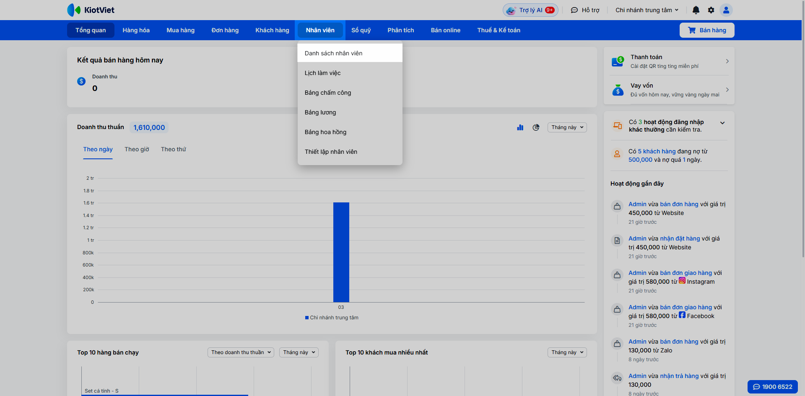

- **Bước 2:** Bạn có thể thiết lập lương ngay khi ***Thêm mới***/***Cập nhật*** nhân viên bằng cách chuyển sang tab **Thiết lập lương**.

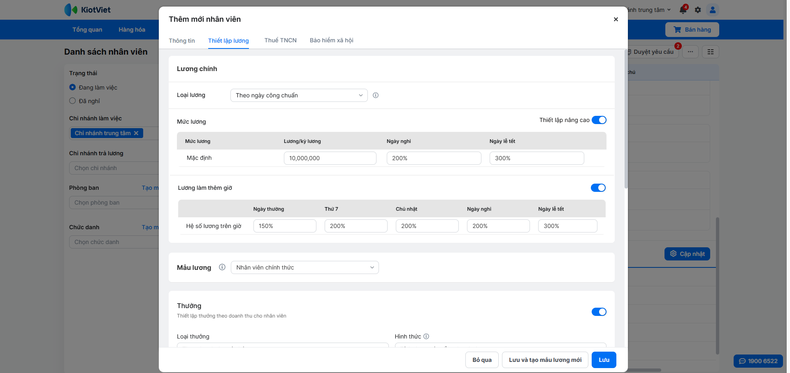

Hoặc trong màn hình chi tiết nhân viên, chọn tab **Thiết lập lương** nhấn ***Thiết lập lương*** (nếu nhân viên chưa được thiết lập lương) hoặc ***Cập nhật*** (nếu nhân viên đã được thiết lập lương trước đó) để hệ thống mở popup **Cập nhật nhân viên** → **Thiết lập lương**.

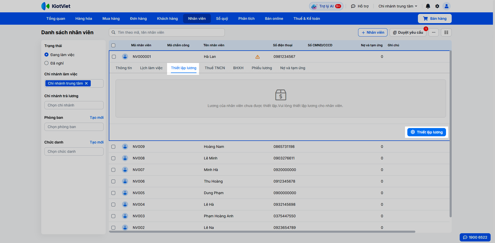

- **Bước 3:** Tại mục **Lương chính**, chọn loại tính lương phù hợp với nhân viên:
  - **Theo ca làm việc:** Nhập mức lương cho mỗi ca. Bạn có thể tùy chỉnh lương khác nhau cho từng ca cụ thể hoặc thiết lập lương riêng cho Thứ 7, Chủ nhật, Ngày nghỉ, Lễ tết.

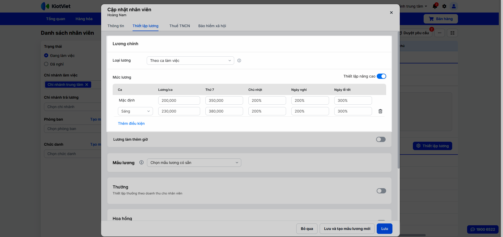

- **Theo giờ làm việc:** Nhập mức lương cho mỗi giờ làm việc. Tương tự như theo ca, bạn có thể thiết lập lương riêng cho các ngày đặc biệt.

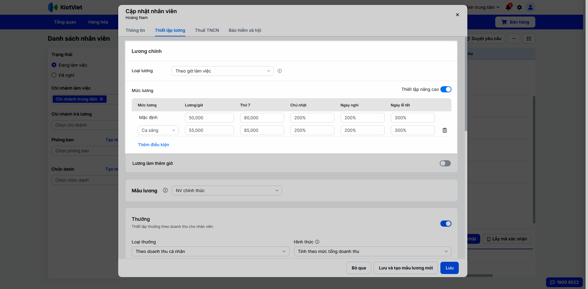

- **Theo ngày công chuẩn:** Nhập mức lương tháng. Lương thực nhận sẽ dựa trên tỷ lệ ngày công thực tế chia cho ngày công chuẩn của kỳ lương. Có thể thiết lập lương riêng cho các ngày đặc biệt.

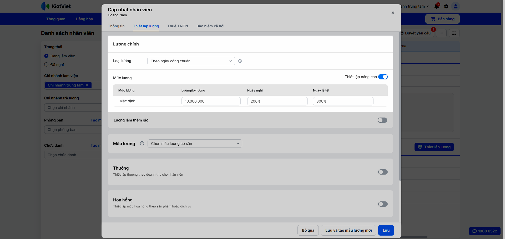

- **Cố định:** Nhập mức lương cố định cho mỗi kỳ, không phụ thuộc vào dữ liệu chấm công.

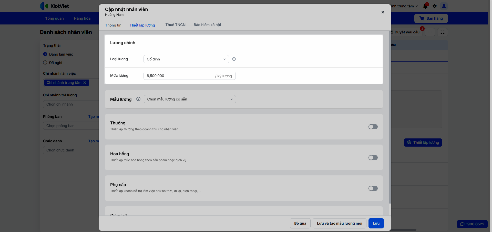

- **Bước 4:** Thiết lập **Lương làm thêm giờ** (áp dụng nếu lương chính tính theo Ca, theo Ngày công chuẩn hoặc theo giờ làm việc):
  - Bạn bật xanh tính năng và thiết lập hệ số lương làm thêm giờ (ví dụ: 150%, 200%).
  - Bạn có thể thiết lập hệ số riêng cho các ngày Thứ 7, Chủ nhật, Ngày nghỉ, Lễ tết.

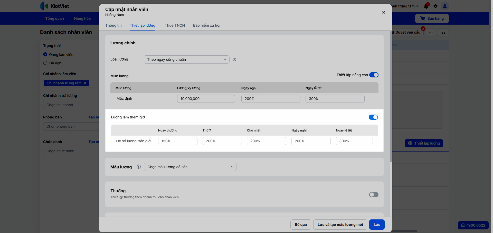

- **Bước 5:** Cài đặt **Thưởng**:
  - Bạn bật xanh tính năng.
  - Chọn ***Loại thưởng***: Theo doanh thu cá nhân, Theo doanh thu chi nhánh/Cửa hàng, Theo lợi nhuận gộp cá nhân.

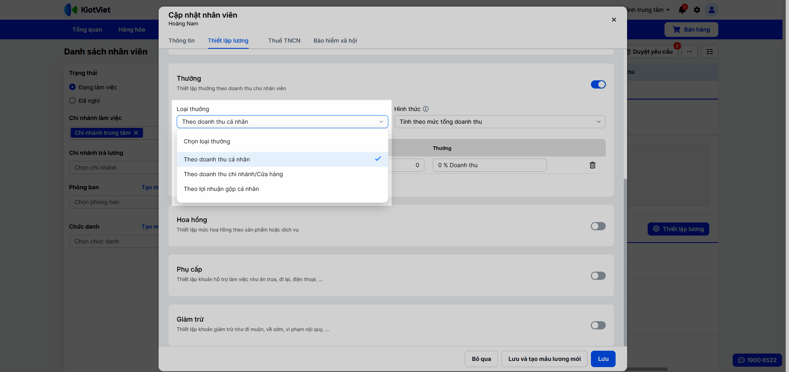

- Chọn ***Hình thức*** tương ứng với ***Loại thưởng***: Theo mức tổng doanh thu, Theo nấc bậc thang, Theo mức vượt tối thiểu.

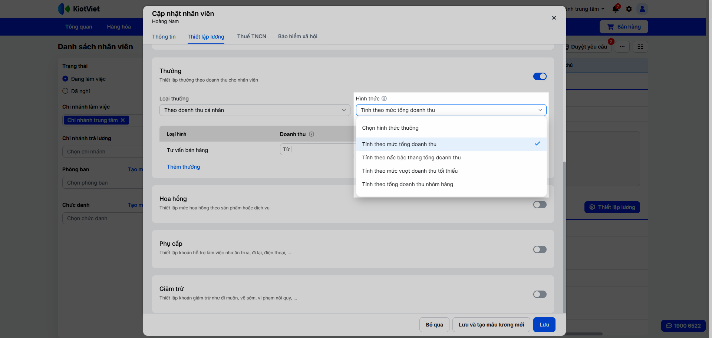

- Nhập mức doanh thu/lợi nhuận và chọn cách tính thưởng (% hoặc VNĐ).
- Có thể thêm nhiều mức bằng cách nhấn ***Thêm thưởng***.

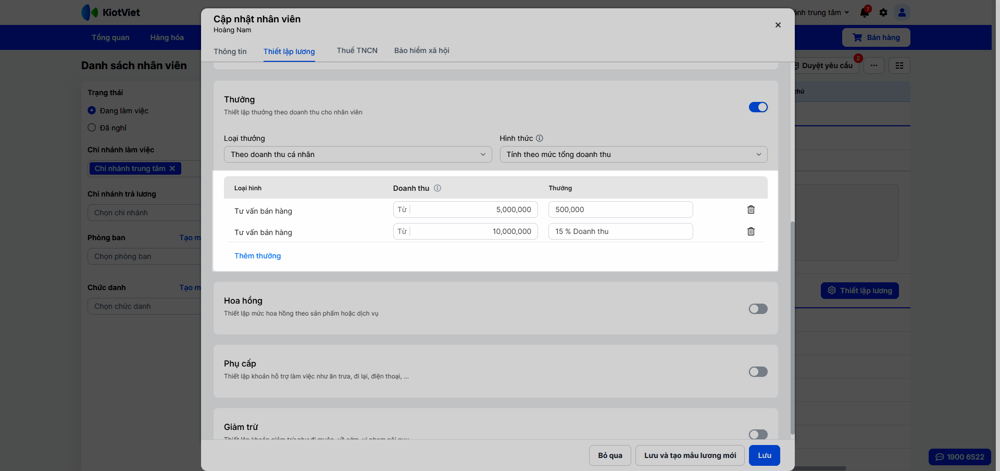

- **Bước 6:** Cài đặt **Hoa hồng**:
  - Bạn bật xanh tính năng → nhập ***Doanh thu***.
  - Chọn **Bảng hoa hồng** tương ứng.
  - Có thể thêm nhiều mức bằng cách nhấn ***Thêm hoa hồng***.

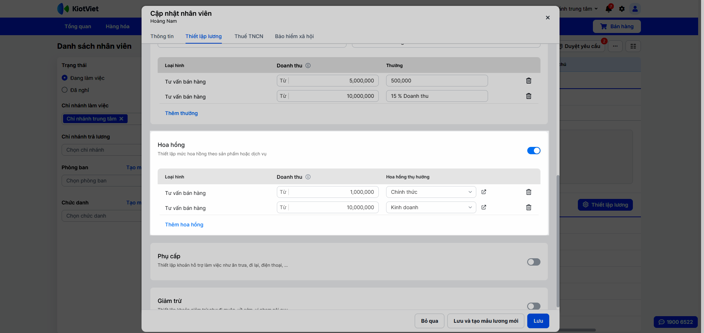

- **Bước 7:** Cài đặt **Phụ cấp**:
  - Bạn bật xanh tính năng.
  - Chọn ***Tên phụ cấp*** trong danh sách.

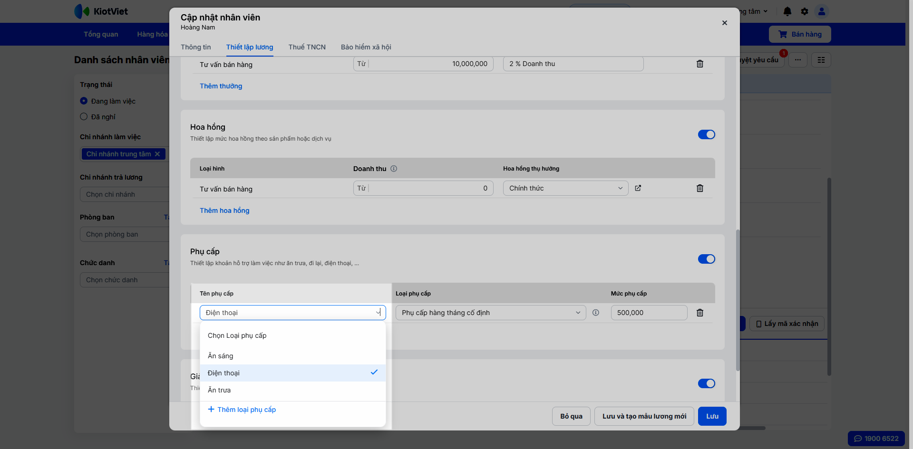

- Nếu muốn tạo mới, nhấn **Thêm loại phụ cấp**:
  - Nhập ***Tên phụ cấp***.
  - Chọn 1 trong các ***Loại phụ cấp***:

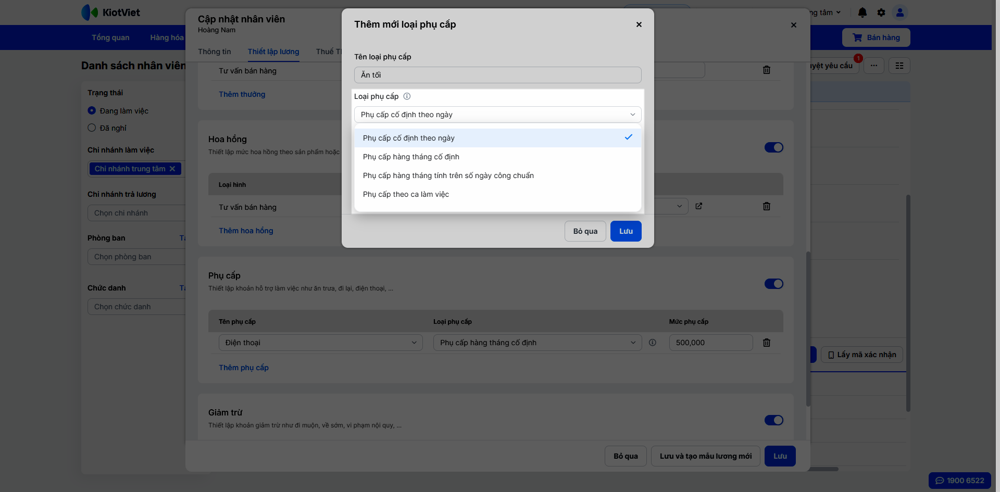

- ***Phụ cấp cố định theo ngày***.
- ***Phụ cấp hàng tháng cố định***.
- ***Phụ cấp theo ca làm việc***.
- Với loại lương chính ***Theo ngày công chuẩn*** → hệ thống hiển thị thêm lựa chọn: ***Phụ cấp hàng tháng tính trên số ngày công chuẩn***. Khi chọn loại phụ cấp này → bạn chọn thêm ***Cách tính phụ cấp khi làm nửa ngày công*** với 3 lựa chọn sau:
  - ***Tính đủ phụ cấp***: Nhân viên làm nửa ngày công vẫn được hưởng 100% phụ cấp ngày công đó.
  - ***Tính 50% phụ cấp***: Nhân viên làm nửa ngày công được hưởng 50% phụ cấp ngày công đó.
  - ***Không tính phụ cấp***: Nhân viên làm nửa ngày công không được hưởng phụ cấp ngày công đó.

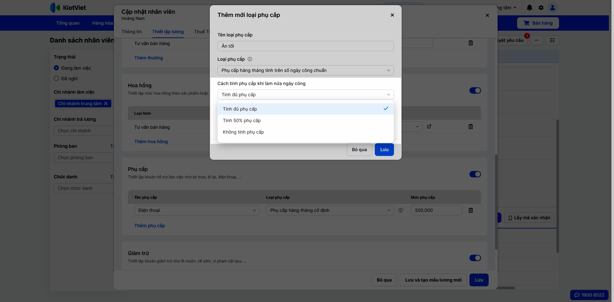

- Nhập ***Mức phụ cấp***.
- Với loại ***Phụ cấp cố định theo ngày***, bạn có thể tích chọn ***Tính phụ cấp khi làm tối thiểu*** (mặc định không chọn) → nhập số giờ làm việc tối thiểu (giờ/ngày). Nhân viên cần làm đủ số giờ tối thiểu trong ngày để hưởng phụ cấp. Ví dụ: Mức phụ cấp 50.000 đ/ngày, số giờ làm việc tối thiểu 5 giờ/ngày → nhân viên làm việc 4 giờ 59 phút/ngày → không được hưởng phụ cấp.

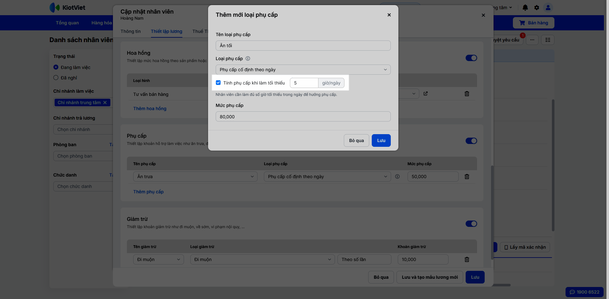​.

- Nhấn ***Lưu***.

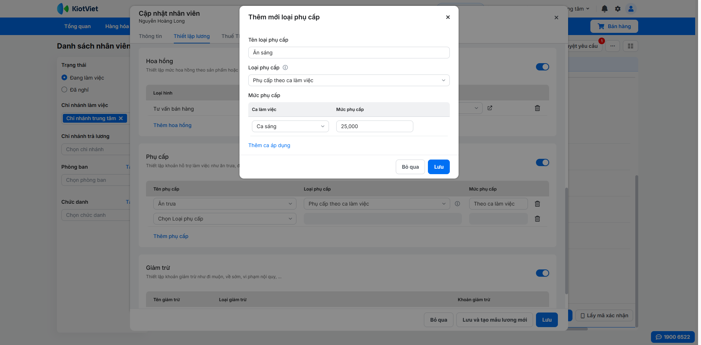​

- Bạn có thể thiết lập nhiều khoản phụ cấp cho nhân viên bằng cách nhấn ***Thêm phụ cấp***.

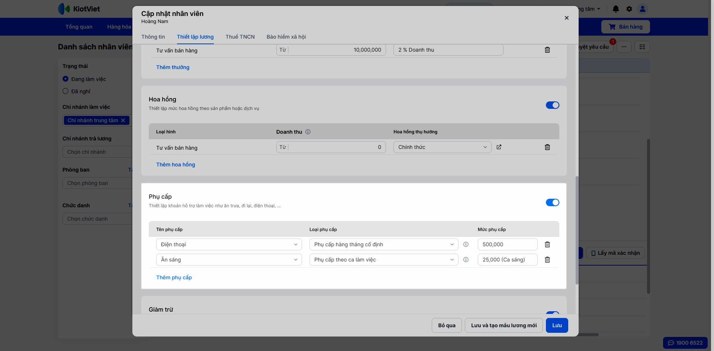

- **Bước 8:** Cài đặt **Giảm trừ**:
  - Bạn bật xanh tính năng
  - Chọn ***Tên giảm trừ*** trong danh sách.

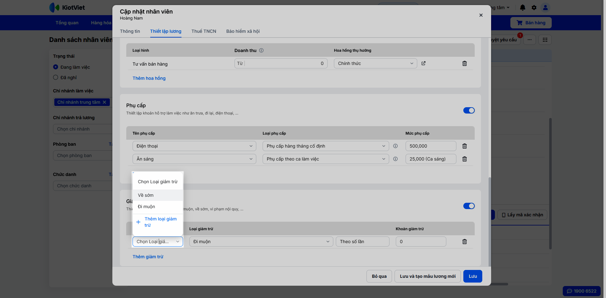

- Hoặc ***Thêm loại giảm trừ*** mới:
  - Nhập ***Tên loại giảm trừ***.
  - Chọn ***Loại giảm trừ*** (Đi muộn, Về sớm, Cố định).
  - Chọn ***Điều kiện*** (Theo số lần, Theo block).
  - Nhập ***Khoản giảm trừ***.
  - Nhấn ***Lưu***.

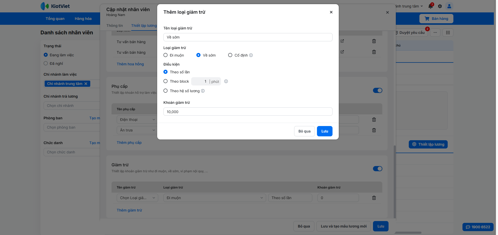

- Bạn có thể thiết lập nhiều khoản giảm trừ cho nhân viên bằng cách nhấn ***Thêm giảm trừ***.

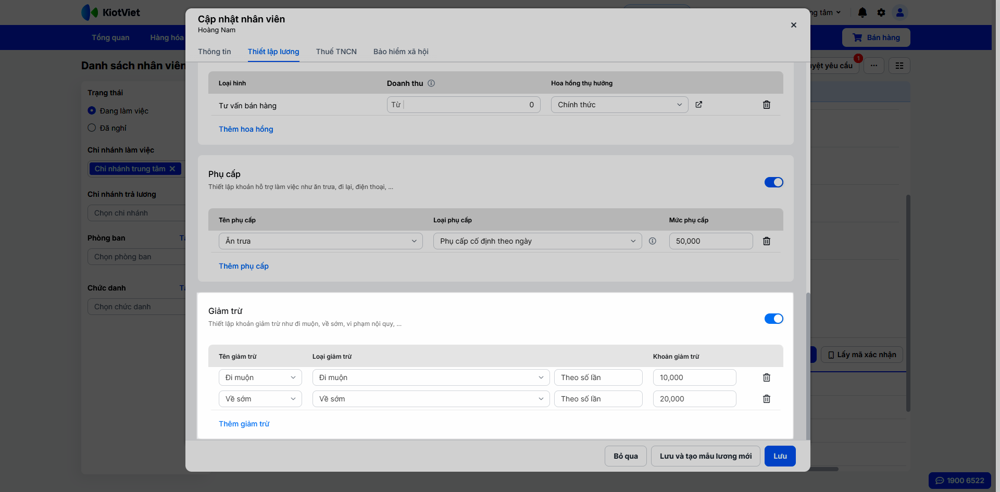

- **Bước 9:** Nhấn ***Lưu*** để ghi nhận thiết lập lương cho nhân viên hoặc ***Lưu và tạo mẫu lương mới*** để có thể áp dụng cho nhiều nhân viên ở vị trí tương đương.

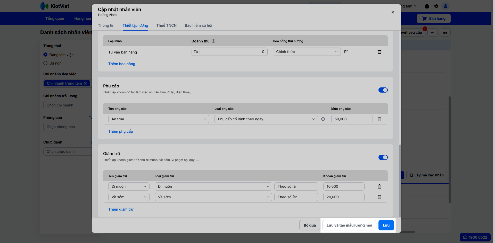

### **3. Thiết lập Bảo hiểm xã hội cho nhân viên**

**Tình huống:** Khi bạn cần hệ thống tự động tính toán các khoản trích nộp bảo hiểm (BHXH, BHYT, BHTN) cho nhân viên vào bảng lương hàng tháng thay vì nhập tay thủ công.

Tính năng này chỉ áp dụng cho nhân viên có quốc gia làm việc là Việt Nam (múi giờ +7) và bảng lương có kỳ hạn trả hàng tháng. Hai tính năng BHXH và Thuế TNCN được cấu hình độc lập nhưng có liên hệ với nhau (Khoản bảo hiểm nhân viên đóng là biến đầu vào để tính Thuế TNCN).

**Thao tác thực hiện như sau:**

- **Bước 1:** Tại màn hình **Thêm mới**/**Cập nhật nhân viên**, bạn chọn tab **Bảo hiểm xã hội**
- **Bước 2:**  Nhập mức lương dùng làm căn cứ đóng bảo hiểm cho nhân viên vào ô ***Lương đóng bảo hiểm (/tháng)***
- **Bước 3:** Tùy chọn ***Nhân viên có tham gia công đoàn***.
  - Hệ thống mặc định tích chọn. Bạn có thể bỏ tích nếu nhân viên không tham gia công đoàn.
  - **Lưu ý:** Thiết lập này chỉ ảnh hưởng đến việc tính ***Đoàn phí*** của người lao động khi tính lương, KHÔNG ảnh hưởng đến phí công đoàn mà doanh nghiệp bắt buộc phải đóng theo quy định.
- **Bước 4:** Nhấn ***Lưu***.

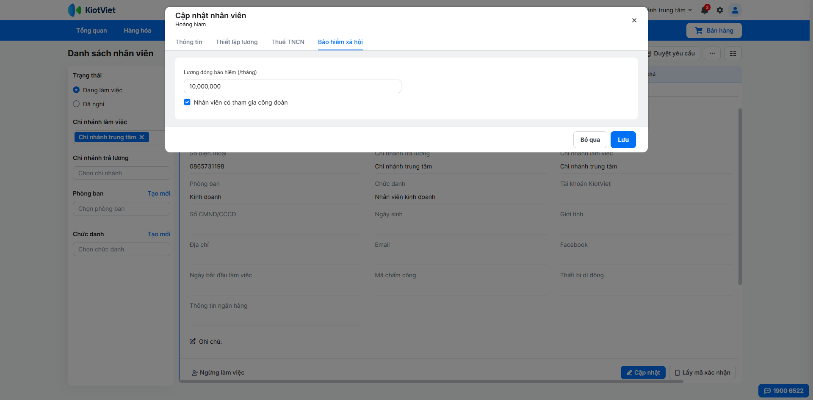

**Lưu ý:**

- Tab **Bảo hiểm xã hội** chỉ hiển thị khi bạn có quyền xem lương.
- Trường hợp không thiết lập mức lương đóng bảo hiểm khi thêm mới/cập nhật nhân viên → trên bảng lương trường ***Bảo hiểm bắt buộc*** và ***Lương đóng BH*** hiển thị giá trị 0. Bạn có thể chỉnh sửa ***Lương đóng BH*** trực tiếp trên bảng lương để hệ thống tự tính lại mức đóng bằng cách nhấn dấu + trên cột ***Bảo hiểm bắt buộc*** → nhập mức ***Lương đóng BH***.

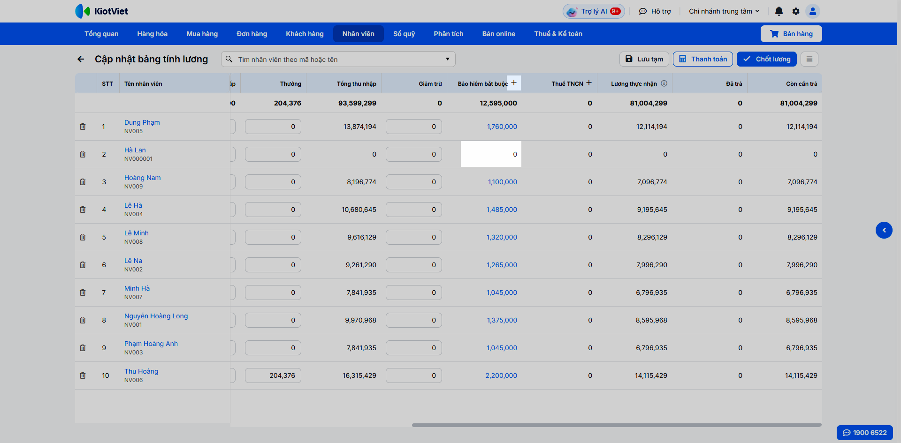

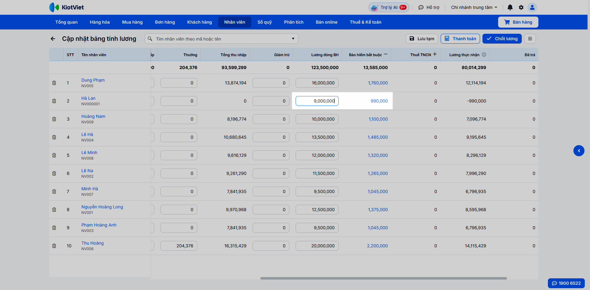

### **4. Thiết lập Thuế TNCN cho nhân viên**

**Tình huống:** Khi bạn muốn hệ thống tự động xác định phương pháp tính thuế và khấu trừ Thuế TNCN của nhân viên dựa trên thu nhập trong kỳ, giúp đảm bảo tính chính xác và tuân thủ pháp luật.

**Thao tác thực hiện như sau:**

- **Bước 1:** Tại màn hình **Thêm mới/Cập nhật nhân viên**, bạn chọn tab **Thuế TNCN**.
- **Bước 2:** Khai báo các thông tin cần thiết:
  - **Mã số thuế cá nhân:** Nhập mã số thuế cá nhân của nhân viên.
  - **Tình trạng cư trú:** Chọn 1 trong 2 hình thức:
    - ***Cư trú tại Việt Nam***.
    - Hoặc ***Không cư trú tại Việt Nam***.
  - **Loại hợp đồng:** Chọn 1 trong 2 loại:
    - ***Hợp đồng lao động từ 3 tháng trở lên***.
    - Hoặc ***Hợp đồng lao động dưới 3 tháng***.
  - **Số người phụ thuộc:** Nhập số người phụ thuộc để hệ thống dùng làm căn cứ tính giảm trừ gia cảnh.

- **Bước 3:** Nhấn ***Lưu***.

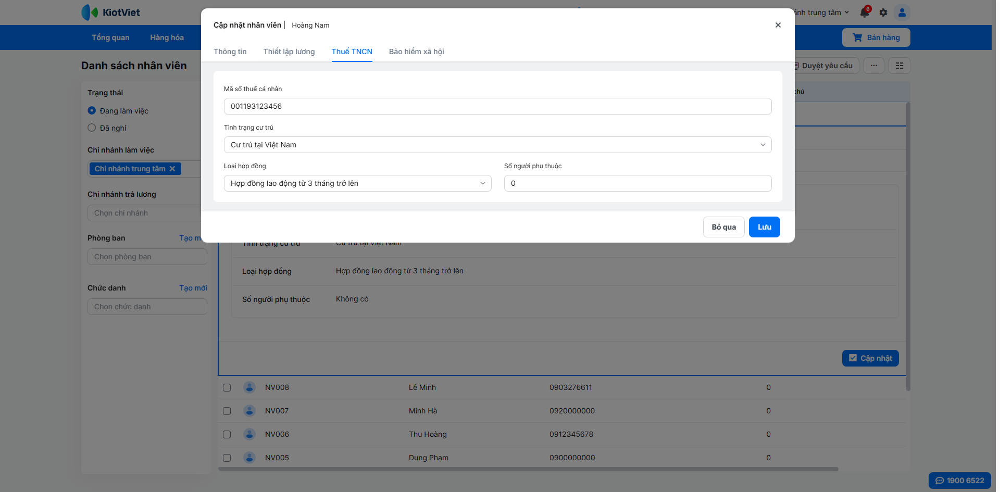

**Lưu ý:**

- Khi bạn chọn loại ***Hợp đồng lao động dưới 3 tháng*** → hệ thống hiển thị thêm trường ***Cam kết thu nhập chưa đến mức nộp thuế (Mẫu 08/CK-TNCN)*** để bạn chọn trạng thái ***Nhân viên có*** hoặc ***không cam kết thu nhập***. Lựa chọn này ảnh hưởng trực tiếp đến việc có khấu trừ thuế hay không.

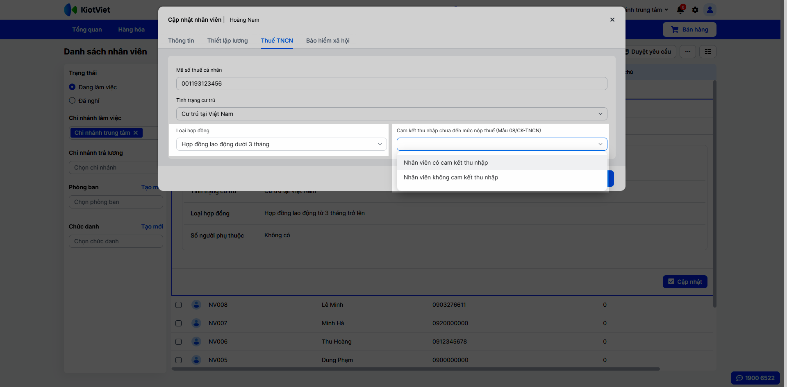

- Khi chọn ***Không cư trú tại Việt Nam***:
  - Hệ thống chỉ hiển thị ***Mã số thuế cá nhân*** và ***Tình trạng cư trú***.
  - Các thông tin khác sẽ tự động ẩn do nhóm đối tượng này áp dụng mức khấu trừ cố định 20% và không được giảm trừ gia cảnh.

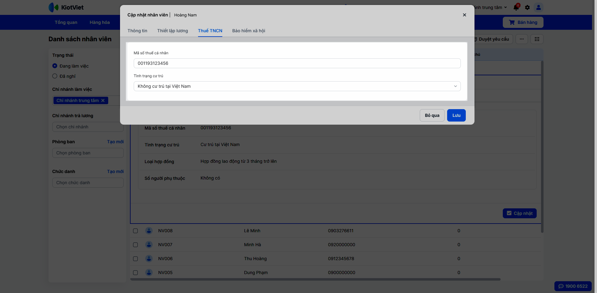

- Tab **Thuế TNCN** chỉ hiển thị khi bạn có quyền xem lương. Nếu không ghi nhận thông tin tại tab này → các trường dữ liệu liên quan đến ***Thuế TNCN*** trên bảng lương sẽ hiển thị giá trị bằng 0 và không cho phép chỉnh sửa.

### **5. Quản lý Bảng lương**

**Tình huống:** Khi đến kỳ tính lương, bạn cần tạo bảng lương mới trên hệ thống, kiểm tra lại toàn bộ số liệu công chuẩn, thu nhập của nhân viên và thực hiện chốt lương.

**Thao tác thực hiện như sau:**

- **Xem danh sách bảng lương:**
  - **Bước 1:** Vào menu **Nhân viên** → **Bảng lương**.

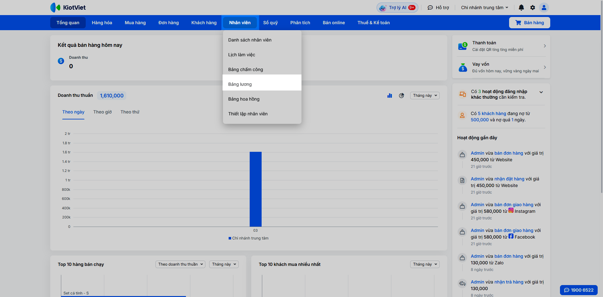

- **Bước 2:** Tìm kiếm ***Theo mã****, **tên bảng lương***, ***Theo mã, tên nhân viên*** hoặc sử dụng bộ lọc bên trái để tìm kiếm theo ***Chi nhánh***, ***Kỳ hạn***, ***Trạng thái***.

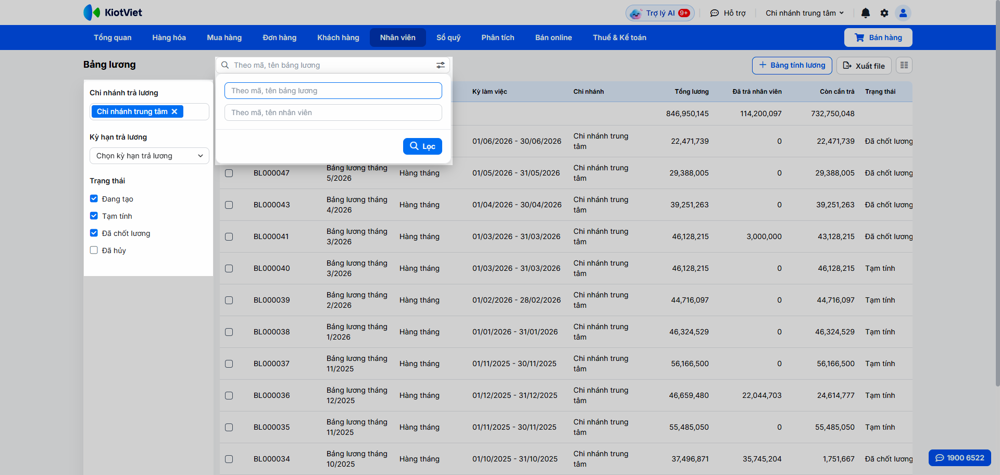

- **Thêm bảng lương (thủ công):**

- **Bước 1:** Nhấn nút ***+ Bảng tính lương***.
- **Bước 2:** Chọn ***Kỳ hạn trả lương*** (Hàng tháng/ Tùy chọn)
- **Bước 3:** Chọn ***Kỳ làm việc***.
- **Bước 4:** Chọn ***Phạm vi áp dụng***: ***Tất cả nhân viên*** hoặc ***Tùy chọn*** (chọn nhân viên/phòng ban cụ thể).
- **Bước 5:** Nhấn ***Lưu***.

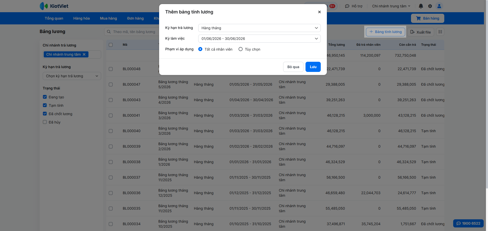

- **Bước 6:** Hệ thống sẽ tạo bảng lương với trạng thái **Đang tạo**, sau đó chuyển thành **Tạm tính** nếu thành công.

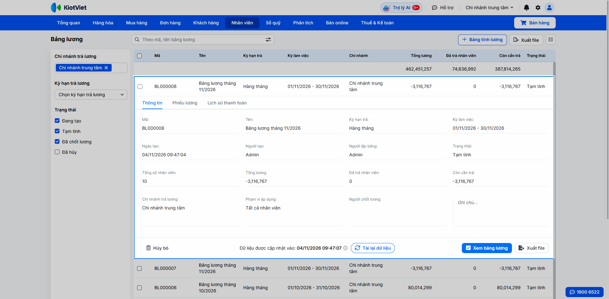

- **Xem và Cập nhật bảng lương (Trạng thái Tạm tính):**

- **Bước 1:** Tại danh sách, nhấn **Xem bảng lương** của bảng lương cần xử lý.

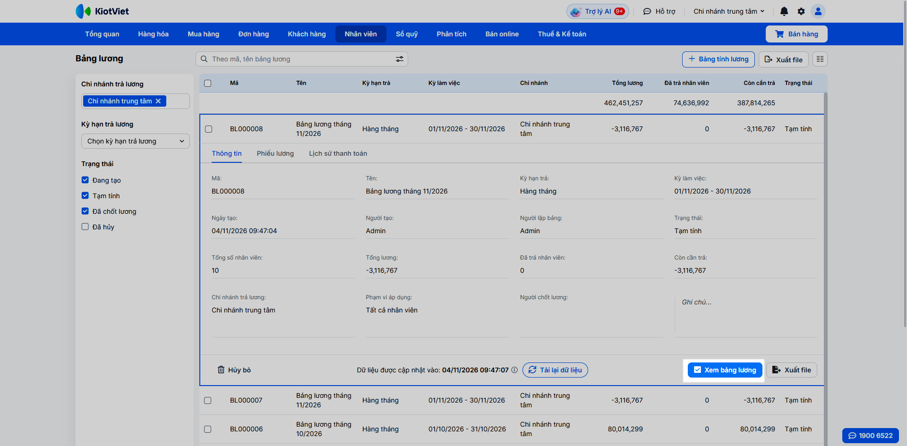

- **Bước 2:** Màn hình cập nhật hiển thị chi tiết lương của từng nhân viên (Lương chính, Làm thêm, Hoa hồng, Phụ cấp, Thưởng, Tổng thu nhập, Giảm trừ, Bảo hiểm bắt buộc, Thuế TNCN, Lương thực nhận, Đã trả, Còn cần trả). Dữ liệu được lấy tự động từ Chấm công, Thiết lập lương, thiết lập Thuế TNCN, thiết lập Bảo hiểm xã hội tương ứng của từng nhân viên.

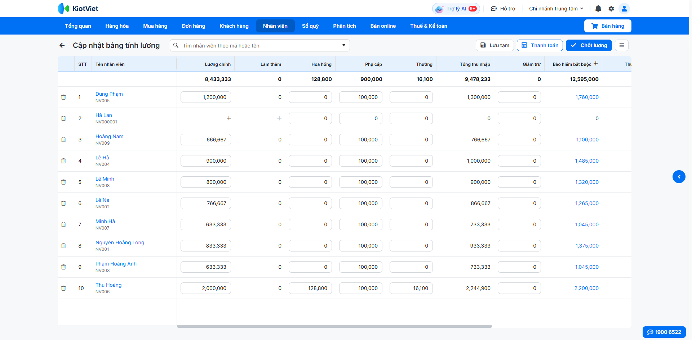

- **Bước 3:** **Kiểm tra chi tiết:**
  - Nhấn vào các giá trị (Lương chính, Làm thêm, Hoa hồng, Phụ cấp, Thưởng, Giảm trừ, Bảo hiểm bắt buộc, Thuế TNCN) để xem chi tiết tính toán.

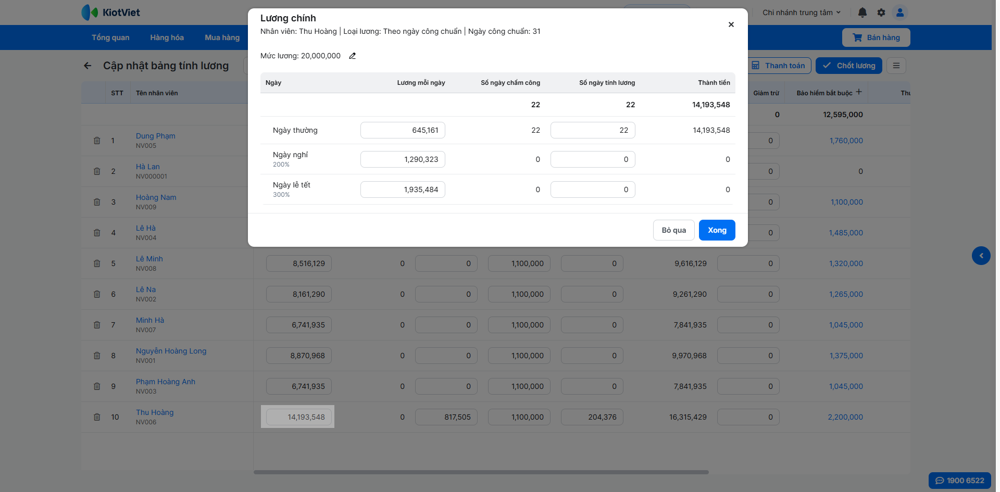

- Hoặc nhấn vào tên nhân viên để xem **Phiếu lương cá nhân**, **Chấm công chi tiết**.

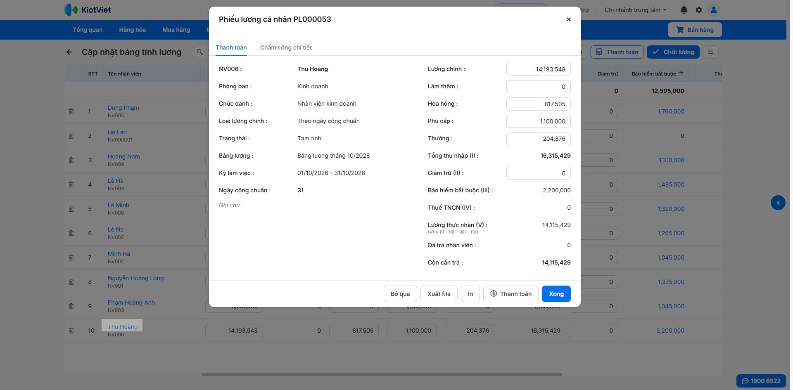

- **Bước 4:** **Cập nhật thủ công (nếu cần):** Bạn có thể sửa trực tiếp các giá trị → nhấn ***Xong***.

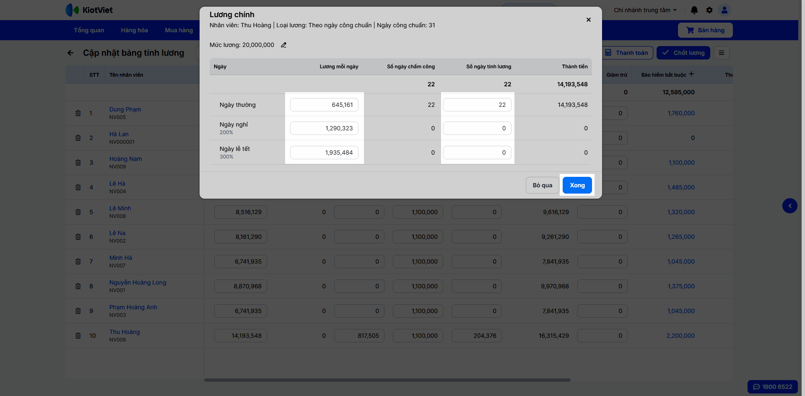

- **Bước 5:** **Tải lại dữ liệu:** Nếu có thay đổi về chấm công hoặc thiết lập lương, Bảo hiểm xã hội, Thuế TNCN sau khi tạo bảng lương, nhấn **Tải lại dữ liệu**. Chọn **Tải lại toàn bộ dữ liệu** hoặc **Chỉ cập nhật dữ liệu theo ngày làm việc** (chỉ cập nhật chấm công, doanh thu, phụ cấp/giảm trừ theo ngày).

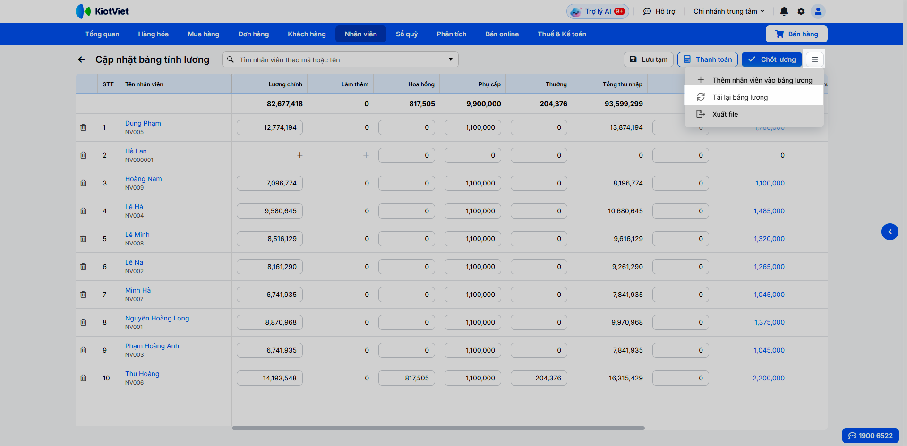

- **Bước 6:** Nhấn ***Lưu tạm*** để lưu các thay đổi mà chưa chốt lương.

- **Chốt bảng lương:**

- **Bước 1:** Sau khi kiểm tra và chắc chắn dữ liệu đã chính xác, nhấn ***Chốt lương***.

- **Bước 2:** Hệ thống hiển thị popup **Xác nhận chốt lương** → bạn chọn tháng để ghi nhận chi phí lương nhân viên → nhấn ***Xác nhận***.

- **Bước 3:** Bảng lương chuyển sang trạng thái ***Đã chốt lương***. Dữ liệu lương và chấm công trong kỳ sẽ bị khóa, không thể thay đổi. Hệ thống cũng ghi nhận giá trị tạm ứng (nếu có) vào bảng lương.

- **Hủy bỏ bảng lương:** Nhấn ***Hủy bỏ*** và xác nhận ***Đồng ý***.

- **Xuất file chi tiết bảng lương:**
  - Tại chi tiết bảng lương, nhấn ***Xuất file***.

- Hệ thống sẽ tự động xuất dữ liệu và tải file Excel bảng lương tháng tương ứng về máy tính của bạn.

### **6. Thanh toán lương**

**Tình huống:** Khi bạn cần thực hiện chi trả tiền lương cho các nhân viên nằm trong bảng lương của tháng đã được chốt số liệu.

**Thao tác thực hiện như sau:**

- **Bước 1:** Vào chi tiết bảng lương đang ở trạng thái ***Đã chốt lương***.
- **Bước 2:** Chuyển sang tab **Phiếu lương** và nhấn ***Thanh toán***.

- **Bước 3:** Trên pop-up **Thanh toán lương**, hệ thống hiển thị danh sách nhân viên và số tiền cần trả. Bạn có thể:
  - Thay đổi ***Thời gian***.
  - Chọn ***Phương thức*** thanh toán (Tiền mặt, Chuyển khoản...).
  - Sửa ***Tiền trả nhân viên*** (nếu trả một phần).
  - Thêm ***Ghi chú***.
- **Bước 4:** Nhấn ***Tạo phiếu chi***. Hệ thống sẽ tự động tạo các phiếu chi tương ứng trong **Sổ quỹ** và cập nhật trạng thái thanh toán cho bảng lương.

### **7. Xem Chi tiết Phiếu lương và Lịch sử trả lương**

**Tình huống:** Khi nhân viên có thắc mắc về số tiền nhận được trong tháng, bạn cần xem lại chi tiết phiếu lương cá nhân của họ hoặc rà soát lại lịch sử thanh toán nợ lương.

**Thao tác thực hiện như sau:**

- **Xem chi tiết phiếu lương:**
  - **Cách 1:** Trong tab **Phiếu lương** của **Bảng lương**, nhấn vào **Mã phiếu lương** của nhân viên.

- **Cách 2:** Vào **Nhân viên** → **Danh sách** **nhân viên**, chọn nhân viên, chuyển sang tab **Phiếu lương**, nhấn vào **Mã phiếu lương** cần xem.

- Chi tiết phiếu lương hiển thị đầy đủ các khoản thu nhập, giảm trừ (tab **Thanh toán**) và chi tiết chấm công trong kỳ (tab **Chấm công chi tiết**).
- Tại đây, bạn có thể ***In*** (Thông tin chung, Kèm bảng kê hoa hồng), ***Xuất file*** (Hoa hồng, Phiếu lương), hoặc ***Hủy*** (nếu chưa thanh toán hoặc hủy phiếu chi liên quan).

- **Xem Lịch sử trả lương (Nợ lương):**

- Vào **Nhân viên** → **Danh sách** **nhân viên**, chọn nhân viên.
- Chuyển sang tab **Nợ và tạm ứng**.
- Tab này hiển thị danh sách tất cả các Phiếu lương đã chốt và các lần Thanh toán/Tạm ứng lương của nhân viên đó.

### **8. Thanh toán/Ứng lương ngoài Bảng lương**

**Tình huống:** Khi nhân viên xin tạm ứng lương vào giữa kỳ làm việc, hoặc khi bạn muốn thực hiện thanh toán các khoản nợ lương từ tháng trước cho nhân viên.

**Thao tác thực hiện như sau:**

- **Bước 1:** Vào menu **Nhân viên** → **Danh sách nhân viên**, chọn nhân viên cần thao tác.
- **Bước 2:** Chuyển sang tab **Nợ và tạm ứng** → nhấn ***Thanh toán lương***.
- **Bước 3:** Nhập ***Số tiền chi***, chọn ***Thời gian***, ***Phương thức*** thanh toán và nhập ***Ghi chú***.
- **Bước 4:** Nhấn ***Tạo phiếu chi*** (hoặc ***Tạo phiếu chi & In***) để hoàn tất.

**Lưu ý:** Nếu nhân viên không còn phiếu lương nào cần thanh toán (Nợ cần trả = 0), phiếu chi này sẽ được hệ thống ghi nhận là tạm ứng lương. Khoản tạm ứng sẽ tự động được trừ vào kỳ lương tiếp theo khi bạn thực hiện chốt lương.

## **III. Các tính năng nâng cao**

### **1. Quản lý Lễ tết**

**Tình huống:** Khi bạn cần thiết lập các ngày nghỉ lễ, tết trong năm (như Tết Nguyên Đán, Lễ 30/4) để hệ thống tự động áp dụng các quy tắc tính lương đặc biệt hoặc chi trả thưởng lễ cho nhân viên.

**Thao tác thực hiện như sau:**

- **Bước 1:** Vào **Nhân viên** → **Thiết lập nhân viên** → chọn **Ngày làm & Nghỉ**.

- **Bước 2:** Nhấn ***+ Thêm kỳ lễ tết***.
- **Bước 3:** Nhập ***Tên kỳ lễ tết***, chọn ***Từ ngày bắt đầu***, ***Đến hết ngày***.
- **Bước 4:** Tùy chọn ***Thưởng lễ, tết →*** nhập mức thưởng cho nhân viên (kể cả không có lịch làm việc).
- **Bước 5:** Nhấn ***Lưu***.

- Bạn có thể nhấn vào biểu tượng cây bút/ thùng rác trên dòng kỳ lễ tết để cập nhật hoặc xóa.

### **2. Quản lý Ngày làm việc/không làm việc của Chi nhánh**

**Tình huống:** Khi cửa hàng của bạn có lịch nghỉ cố định hàng tuần (ví dụ: nghỉ ngày Chủ nhật), bạn cần thiết lập trên hệ thống để việc tính ngày công chuẩn của chi nhánh được chính xác.

**Thao tác thực hiện như sau:**

- **Bước 1:** Vào menu **Nhân viên** → **Thiết lập nhân viên** → chọn **Ngày làm & Nghỉ**.
- **Bước 2:** Tại khu vực **Ngày làm việc**, nhấn biểu tượng cây bút tại chi nhánh cần thiết lập.
- **Bước 3:** Bỏ chọn tại các ô tương ứng với ngày mà chi nhánh nghỉ cố định hàng tuần.
- **Bước 4:** Nhấn ***Lưu*** để ghi nhận thiết lập.

### **3. Thiết lập Mẫu lương**

**Tình huống:** Khi cửa hàng có nhiều nhân viên đảm nhận cùng một vị trí với chế độ trả lương giống nhau, bạn muốn tạo sẵn các mẫu lương chuẩn để áp dụng hàng loạt thay vì cài đặt thủ công cho từng người.

**Thao tác thực hiện như sau:**

- **Bước 1:** Tạo mẫu lương
  - Vào menu **Nhân viên** → **Thiết lập nhân viên** → **Tính lương**.
  - Tại mục **Thiết lập Mẫu lương** → nhấn ***mẫu lương***.

- Nhấn ***+ Thêm mẫu lương***.

- Nhập tên ***Mẫu áp dụng***.
- Tiến hành thiết lập các điều kiện: ***Thưởng***, ***Hoa hồng***, ***Phụ cấp***, ***Giảm trừ*** tương tự như luồng thao tác thiết lập lương cho một nhân viên.
- Nhấn ***Lưu***.

- Tại **Danh sách mẫu lương**, bạn có thể cập nhật (nhấn biểu tượng cây bút), xóa (nhấn biểu tượng thùng rác).

- **Bước 2:** Áp dụng mẫu lương cho nhân viên
  - Tại màn hình **Danh sách mẫu lương**, bạn nhấn ***nhân viên***.
  - Hệ thống hiển thị pop-up **Nhân viên áp dụng** → bạn nhấn ***Thêm nhân viên áp dụng*** → chọn các nhân viên tương ứng trong danh sách.
  - Nhấn ***Áp dụng***.

- Ngoài ra, khi **Thiết lập lương** cho nhân viên, bạn có thể chọn **Mẫu lương có sẵn** để áp dụng.

**Lưu ý***:* Sau khi áp dụng mẫu, bạn vẫn có thể chỉnh sửa/bật/tắt riêng lẻ các điều kiện cho nhân viên đó mà không ảnh hưởng đến mẫu gốc.

### **4. Chi tiết Bảo hiểm bắt buộc và Thuế TNCN**

**Tình huống:** Khi bạn cần kiểm tra chi tiết các khoản trích nộp bảo hiểm bắt buộc và thuế TNCN của nhân viên ngay trên màn hình bảng lương hoặc phiếu lương trước khi tiến hành chốt lương.

**Thao tác thực hiện như sau:**

- **Bước 1:** Tùy chỉnh hiển thị cột. Cột ***Bảo hiểm bắt buộc*** và ***Thuế TNCN*** có biểu tượng mở rộng/ thu gọn (+/-) ngay cạnh tên. Bạn nhấn vào biểu tượng này để hiện/ẩn các cột chi tiết liên quan.

- **Bước 2:** Kiểm tra các trường Bảo hiểm trên bảng lương.
  - Trên bảng lương, bạn nhấn dấu + tại cột ***Bảo hiểm bắt buộc***.

- Hệ thống hiển thị chi tiết các cột thông tin sau:
  - **Lương đóng BH:** Lấy mặc định từ hồ sơ nhân viên, cho phép bạn chỉnh sửa trực tiếp trên bảng lương.

- **Bảo hiểm bắt buộc:** Hiển thị tổng của **Bảo hiểm xã hội** + **Bảo hiểm y tế** + **Bảo hiểm thất nghiệp** + **Đoàn phí**, không cho phép chỉnh sửa. Bạn nhấn vào mức đóng để xem chi tiết các khoản phí.

- **Bước 3:** Kiểm tra các trường **Thuế TNCN** trên bảng lương (các trường này không cho phép chỉnh sửa trực tiếp).
  - Trên bảng lương, bạn nhấn dấu + tại cột ***Thuế TNCN***.

- Hệ thống hiển thị chi tiết các cột thông tin sau:
  - **Thu nhập chịu thuế** = Tổng thu nhập - Giảm trừ - khoản miễn thuế.
  - **Số người phụ thuộc:** Lấy từ hồ sơ nhân viên.
  - **Giảm trừ gia cảnh** = 15,500,000 + (Số người phụ thuộc x 6,200,000).
  - **Thu nhập tính thuế:** Thay đổi tùy theo nhóm đối tượng.
  - **Thuế TNCN:** Do hệ thống tự động tính.
  - **Lương thực nhận** = Tổng thu nhập − Giảm trừ − Bảo hiểm bắt buộc − Thuế TNCN.

- **Bước 4:** Thông tin trên **Phiếu lương cá nhân** (tab **Thanh toán**). Khi xem, xuất file hoặc in phiếu lương → hệ thống hiển thị số tiền ***Bảo hiểm bắt buộc (III)***, ***Thuế TNCN (IV)***.

### **5. Công thức tính Bảo hiểm bắt buộc và Thuế TNCN**

**Tình huống:** Khi bạn cần kiểm tra công thức hệ thống sử dụng để tự động tính toán các khoản Bảo hiểm bắt buộc, Thuế TNCN và Lương thực nhận của nhân viên.

Theo quy định hiện tại:

- **Mức trần đóng Bảo hiểm xã hội (BHXH), Bảo hiểm y tế (BHYT)**: Không vượt quá 50,600,000 đồng/tháng  (= 20 lần lương cơ sở 2,530,000 đồng).
- **Mức trần đóng Bảo hiểm thất nghiệp (BHTN)**: Không vượt quá 20 lần mức lương tối thiểu vùng:
  - Vùng I: 106.2 triệu.
  - Vùng II: 94.6 triệu.
  - Vùng III: 82.8 triệu.
  - Vùng IV: 74 triệu.
- **Mức trần đóng Đoàn phí**: Không quá 253,000 đồng/tháng (= 10% mức lương cơ sở).
- **Thu nhập chịu thuế** = Tổng thu nhập − Giảm trừ − Các khoản được miễn thuế.

  Trong đó: **Các khoản được miễn thuế** = Lương làm thêm giờ + Các khoản phụ cấp được bật ***Miễn thuế TNCN***.

  Hay có thể hiểu: **Thu nhập chịu thuế** = Lương chính + Hoa hồng + Thưởng + Phụ cấp không miễn thuế − Giảm trừ.

**Thao tác thực hiện như sau:**

- **Đối chiếu công thức Bảo hiểm bắt buộc**:
  - BHXH (8%) = MIN (Lương đóng BH; 50,600,000) × 8%
  - BHYT (1.5%) = MIN (Lương đóng BH; 50,600,000) × 1.5%
  - BHTN (1%) = MIN (Lương đóng BH; Trần vùng tương ứng) × 1%
  - Đoàn phí (0.5%) = MIN (Lương đóng BH × 0,5%; 253,000)

Tức là lấy 0,5% lương đóng BH, nhưng tối đa không quá 253,000đ (= 10% lương cơ sở 2,530,000đ).

- Bảo hiểm bắt buộc nhân viên đóng = BHXH + BHYT + BHTN + Đoàn phí.
- Ví dụ minh họa: Nhân viên Vùng I, Lương đóng bảo hiểm 30 triệu.
  - BHXH = 2,400,000 đồng
  - BHYT = 450,000 đồng
  - BHTN = 300,000 đồng
  - Đoàn phí = 150,000 đồng
  - Tổng bảo hiểm bắt buộc nhân viên đóng = 3,300,000 đồng.
- **Đối chiếu công thức tính Thuế TNCN**:
  - **Trường hợp Nhân viên Cư trú tại Việt Nam và Hợp đồng lao động từ 3 tháng trở lên**:
    - Thu nhập tính thuế (TNTT) = Thu nhập chịu thuế - Bảo hiểm bắt buộc nhân viên đóng - Giảm trừ gia cảnh. Thuế TNCN được tính theo biểu thuế lũy tiến từng phần:
      - Từ 10 triệu trở xuống: TNTT x 5%
      - Trên 10 triệu đến 30 triệu: 500,000 + (TNTT - 10 triệu) x 10%
      - Trên 30 triệu đến 60 triệu: 2,500,000 + (TNTT - 30 triệu) x 20%
      - Trên 60 triệu đến 100 triệu: 8,500,000 + (TNTT - 60 triệu) x 30%
      - Trên 100 triệu: 20,500,000 + (TNTT - 100 triệu) x 35%
    - Ví dụ minh họa: Nhân viên có 1 người phụ thuộc; Tổng thu nhập 37 triệu; Bảo hiểm nhân viên đóng 3,300,000 đồng; Giảm trừ gia cảnh 21,700,000 đồng.

TNTT = 37,000,000 - 3,300,000 - 21,700,000 = 12,000,000 đồng.

Thuế TNCN = 500,000 + (12,000,000 - 10,000,000) x 10% = 700,000 đồng.

- **Trường hợp nhân viên Cư trú tại Việt Nam và Hợp đồng lao động dưới 3 tháng →** Không được giảm trừ gia cảnh.
  - Nếu không có cam kết thu nhập: Thuế TNCN = Thu nhập dùng để khấu trừ x 10%. (Nếu Tổng thu nhập < 5,000,000 đ thì không khấu trừ).
  - Nếu có cam kết thu nhập (08/CK-TNCN): Không bị khấu trừ (Thuế TNCN = 0).
  - Ví dụ minh họa: Hợp đồng dưới 3 tháng; không cam kết thu nhập; Thu nhập chịu thuế 5 triệu, không tham gia BHXH. Thuế TNCN = 5,000,000 x 10% = 500,000 đồng.
- **Trường hợp nhân viên Không cư trú tại Việt Nam** → Không được giảm trừ gia cảnh.
  - Thuế TNCN = Thu nhập dùng để khấu trừ x 20%.

- **Đối chiếu công thức tính Lương thực nhận**:

Lương thực nhận = Tổng thu nhập - Tổng giảm trừ - Bảo hiểm bắt buộc nhân viên đóng - Thuế TNCN.

### **6. Xem Chi phí lương trên Báo cáo tài chính**

**Tình huống:** Khi bạn cần tổng hợp và rà soát lại toàn bộ chi phí trả lương cho nhân viên trong kỳ để nắm bắt tình hình hạch toán trên báo cáo tài chính của cửa hàng.

Bảng lương sau khi đã chốt sẽ được hệ thống tự động ghi nhận vào mục Chi trả lương NV trong báo cáo tài chính, theo tháng được lựa chọn khi chốt lương.

**Thao tác thực hiện như sau:**

- **Bước 1:** Vào menu **Phân tích**/ **Báo cáo** → **Tài chính**.
- **Bước 2:** Tìm đến mục ***Chi phí*** → ***Chi trả lương NV*** để xem tổng chi phí của tất cả các bảng lương đã chốt trong kỳ báo cáo.

***Cảm ơn bạn đã theo dõi bài viết!***

- Để tìm hiểu thêm về các nghiệp vụ quản lý bán hàng, mời bạn xem bài viết:  
  [**Tổng quan Các nhóm Giải pháp của KiotViet**](https://www.kiotviet.vn/huong-dan-su-dung-kiotviet/retail-lam-quen-voi-kiotviet/tong-quan-cac-nhom-giai-phap-kiotviet/)
- Để tham khảo thêm các video hướng dẫn sử dụng, mời bạn theo dõi kênh YouTube:  
  [**HDSD - Phần mềm KiotViet**](https://www.youtube.com/@HDSDPhanmemKiotViet)

***Chúc bạn kinh doanh hiệu quả cùng KiotViet!***

*Tài liệu được cập nhật mới nhất ngày 15/11/2026*
