# KiotViet Retail – Quản lý hoa hồng

Nguồn: https://www.kiotviet.vn/huong-dan-su-dung-kiotviet/retail-nhan-vien/quan-ly-hoa-hong/

---

# **Quản lý Hoa hồng**

*(Ngành Bán buôn, Bán lẻ)*

## **I. Giới thiệu chung**

Tính năng Quản lý hoa hồng trên KiotViet cho phép cửa hàng thiết lập và quản lý các bảng hoa hồng khác nhau cho từng sản phẩm hoặc nhóm sản phẩm. Điều này giúp tạo động lực cho nhân viên bán hàng và tính toán thu nhập một cách chính xác dựa trên doanh số bán hàng của từng mặt hàng cụ thể.

**Lợi ích nổi bật của tính năng:**

- **Thiết lập linh hoạt:** Cho phép tạo nhiều bảng hoa hồng khác nhau, áp dụng theo chi nhánh hoặc toàn hệ thống.
- **Tính toán hoa hồng đa dạng:** Hỗ trợ tính hoa hồng theo tỷ lệ phần trăm (%) doanh thu hoặc theo số tiền cố định (VNĐ) trên từng sản phẩm.
- **Quản lý dễ dàng:** Dễ dàng thêm mới, cập nhật, xóa bảng hoa hồng; thêm/xóa hàng hóa; cập nhật mức hoa hồng hàng loạt hoặc theo từng sản phẩm.
- **Cảnh báo thông minh:** Hiển thị cảnh báo nếu mức hoa hồng thiết lập cao hơn lợi nhuận tạm tính của sản phẩm.
- **Tích hợp tính lương:** Dữ liệu hoa hồng được tự động tổng hợp khi tính lương cho nhân viên (sẽ được đề cập chi tiết trong bài viết Quản lý Lương).

## **II. Các thao tác cơ bản**

Để dễ hình dung, các ví dụ dưới đây sẽ minh họa những tình huống thực tế trong ngành Bán buôn, Bán lẻ.

### **1. Thêm mới bảng hoa hồng**

**Tình huống:** Khi bạn muốn tạo một bảng hoa hồng mới cho chương trình khuyến khích bán hàng sắp tới.

**Thao tác thực hiện như sau:**

- **Bước 1:** Trên màn hình **Quản lý**, bạn chọn **Nhân viên** → **Bảng hoa hồng**.

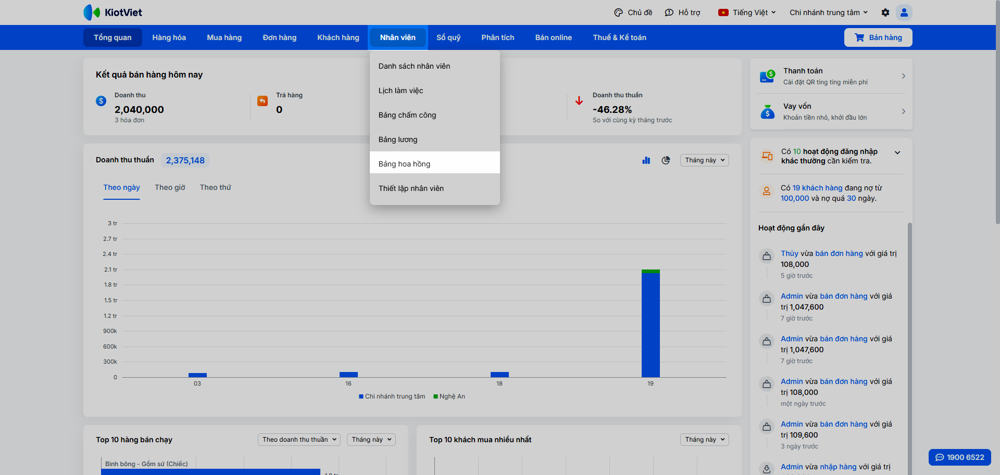

- **Bước 2:** Nhấn ***Thêm bảng*** bên trái màn hình → nhập các thông tin:
  - **Tên:** Tên bảng hoa hồng (bắt buộc).
  - **Phạm vi áp dụng:** Chọn **Toàn hệ thống** hoặc **Chi nhánh** cụ thể.
  - **Trạng thái:** Chọn **Áp dụng** hoặc **Ngừng áp dụng**.
  - Nhấn **Lưu**.

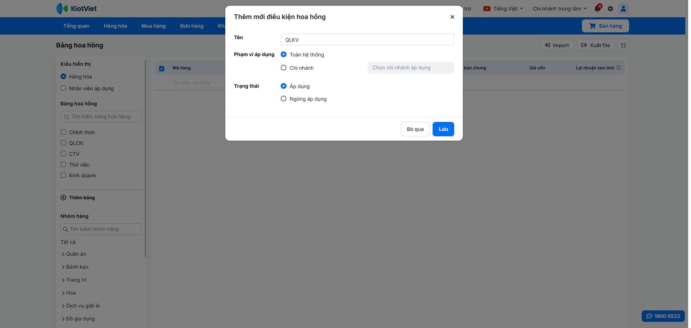

- **Bước 3:** **Thêm hàng hóa vào bảng:** Sau khi lưu bảng hoa hồng, bạn cần thêm hàng hóa:
  - **Thêm theo nhóm hàng:** Chọn nhóm hàng từ bộ lọc bên trái và nhấn biểu tượng mũi tên .

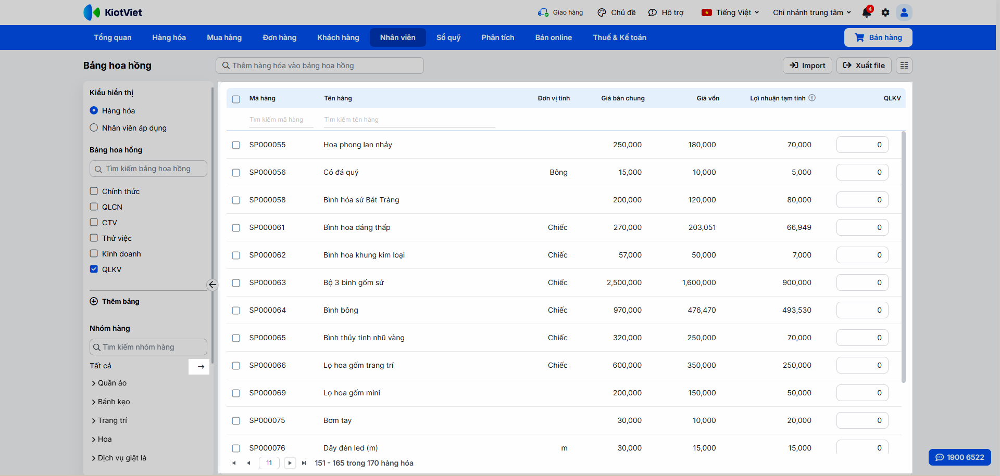

- **Thêm từng hàng hóa:** Nhấn nút **Thêm hàng hóa**, tìm và chọn các sản phẩm cần thêm.

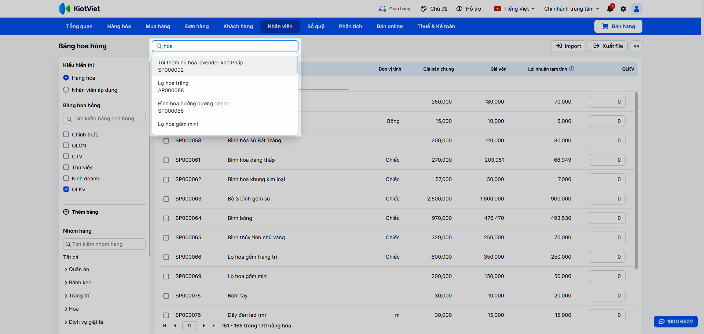

- **Import từ file Excel:** Nhấn nút **Import**, tải file mẫu về, điền thông tin (Mã hàng, mức hoa hồng theo % hoặc VNĐ cho từng bảng) và tải file lên. Hệ thống hỗ trợ import tối đa 5 bảng hoa hồng cùng lúc.

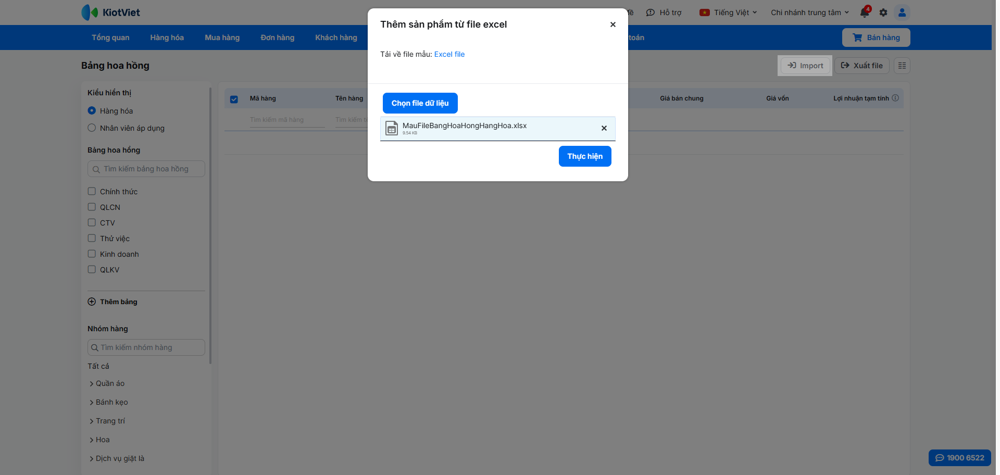

- **Bước 4:** **Thiết lập mức hoa hồng:**
  - **Nhập trực tiếp:** Nhấn vào ô hoa hồng của từng sản phẩm và nhập giá trị (% hoặc VNĐ). Hệ thống tự động lưu sau khi bạn thoát khỏi ô nhập liệu.

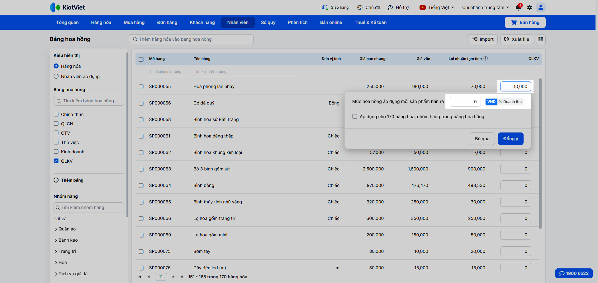

- **Áp dụng hàng loạt:** nhấn vào mức hoa hồng của một hàng hóa → pop-up hiện ra→ thiết lập mức hoa hồng theo VND hoặc % → tích chọn ***Áp dụng cho hàng hóa, nhóm hàng trong bảng hoa hồng*** → nhấn **Đồng ý**.

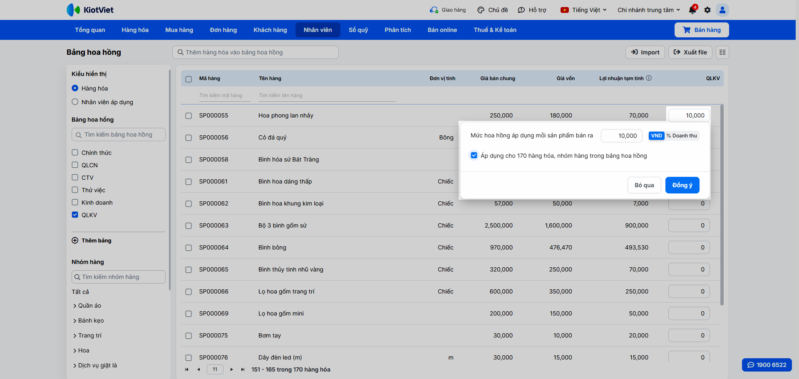

- **Cảnh báo***:* Nếu mức hoa hồng lớn hơn **Lợi nhuận tạm tính**, ô hoa hồng sẽ hiển thị màu đỏ.

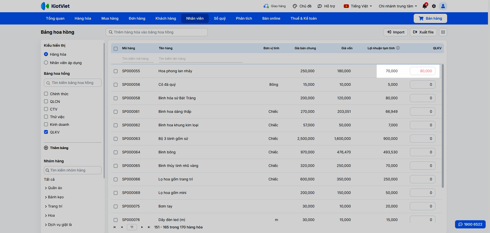

### **2. Xem bảng hoa hồng**

**Tình huống:** Khi bạn cần xem lại các bảng hoa hồng hiện có và mức hoa hồng đang áp dụng cho các sản phẩm.

**Thao tác thực hiện như sau:**

- **Bước 1:** Trên màn hình **Quản lý**, bạn chọn menu **Nhân viên** → chọn **Bảng hoa hồng** → hệ thống sẽ hiển thị danh sách hàng hóa và mức hoa hồng tương ứng.
- **Bước 2:** Chọn **Kiểu hiển thị**: Để xem theo ***Hàng hóa*** hoặc ***Nhân viên áp dụng***.
- **Bước 3:** Chọn **Bảng hoa hồng:** Sử dụng bộ lọc ở góc trái để chọn một hoặc nhiều bảng hoa hồng muốn xem (tối đa 5 bảng cùng lúc).
- **Bước 4:** **Tìm kiếm/Lọc:** Sử dụng ô tìm kiếm để lọc theo ***Nhóm hàng*** hoặc ***Mã/Tên hàng hóa*** cụ thể.
- **Bước 5:** **Tùy chọn hiển thị:** Nhấn vào biểu tượng tùy chọn ẩn/hiện các cột thông tin hoặc thay đổi số bản ghi trên một trang.

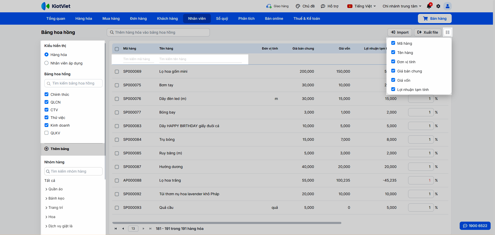

### **3. Cập nhật bảng hoa hồng**

**Tình huống:** Khi bạn cần thay đổi tên, phạm vi áp dụng, trạng thái hoặc mức hoa hồng của một bảng hoa hồng hiện có.

**Thao tác thực hiện như sau:**

- **Cập nhật thông tin chung:**
  - Chọn tên bảng hoa hồng muốn sửa.
  - Nhấn vào biểu tượng chỉnh sửa (hình cây bút) .

- Cập nhật lại thông tin (Tên, Phạm vi, Trạng thái).
- Nhấn ***Lưu***.

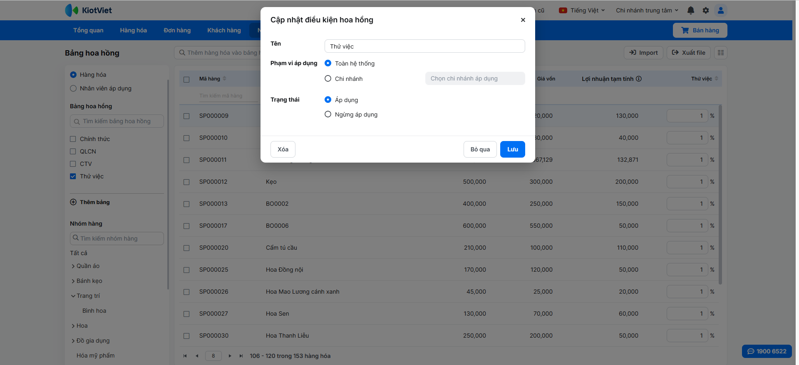

- **Cập nhật mức hoa hồng:** Thực hiện tương tự như bước **Thiết lập mức hoa hồng** khi thêm mới (nhập trực tiếp hoặc áp dụng hàng loạt).

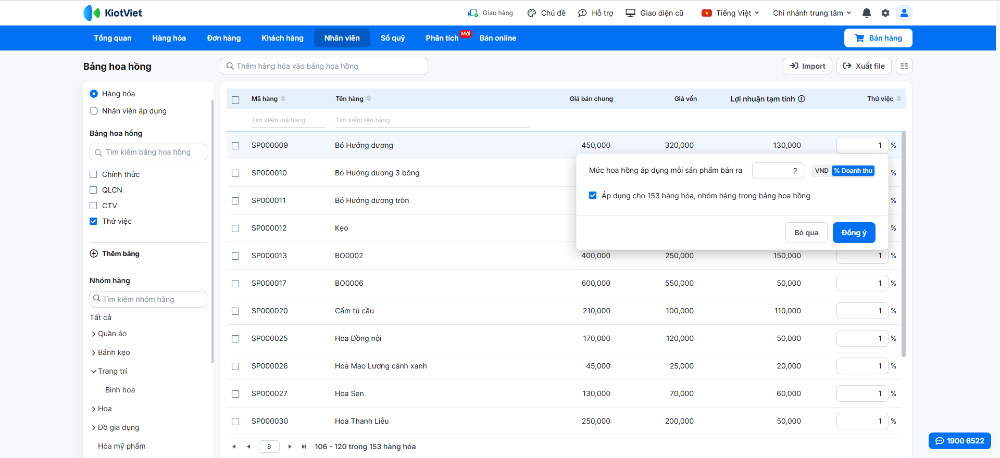

- **Xóa hàng hóa khỏi bảng hoa hồng:**
  - Tích chọn các mã hàng cần xóa trong danh sách.
  - Nhấn nút ***Thao tác***.
  - Chọn ***Xóa hàng hóa***.

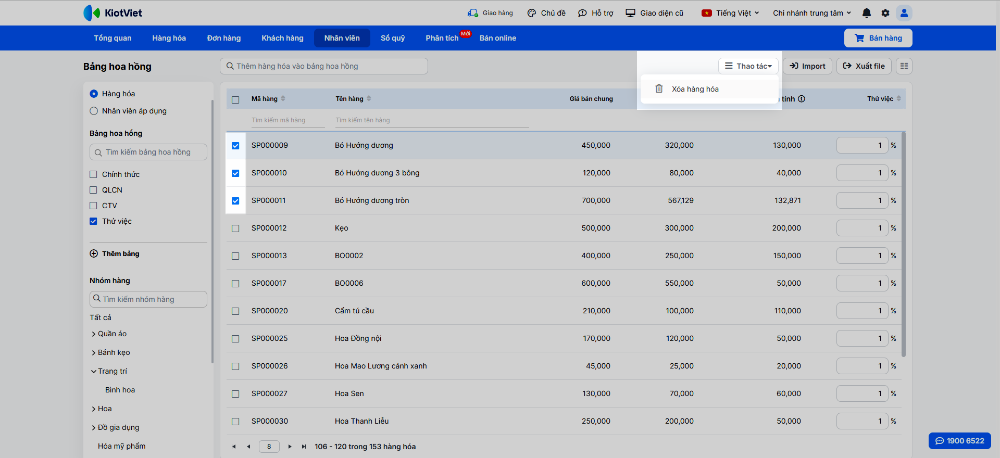

- Chọn ***Đồng ý*** để xác nhận.

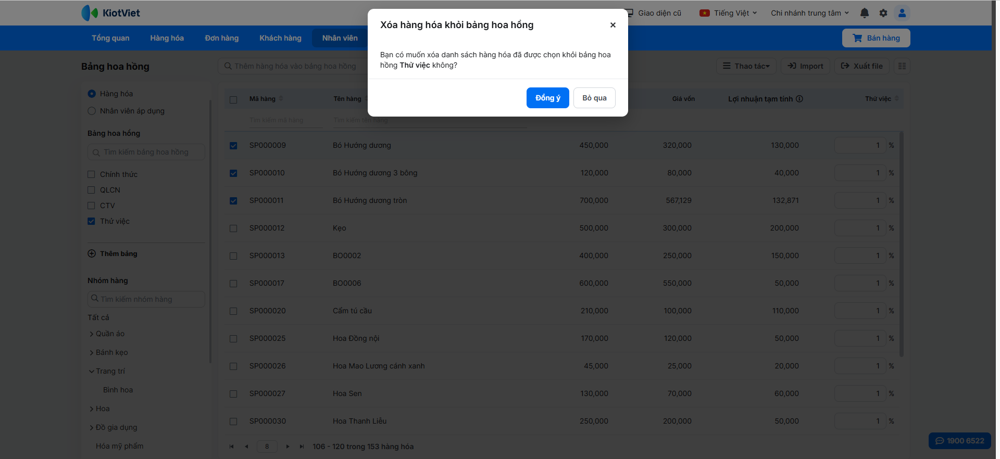

### **4. Xóa bảng hoa hồng**

**Tình huống:** Khi bảng hoa hồng không còn sử dụng và bạn muốn xóa khỏi hệ thống.

**Thao tác thực hiện như sau:**

- **Bước 1:** Chọn tên bảng hoa hồng cần xóa ở góc trái.
- **Bước 2:** Nhấn vào biểu tượng chỉnh sửa (hình cây bút).

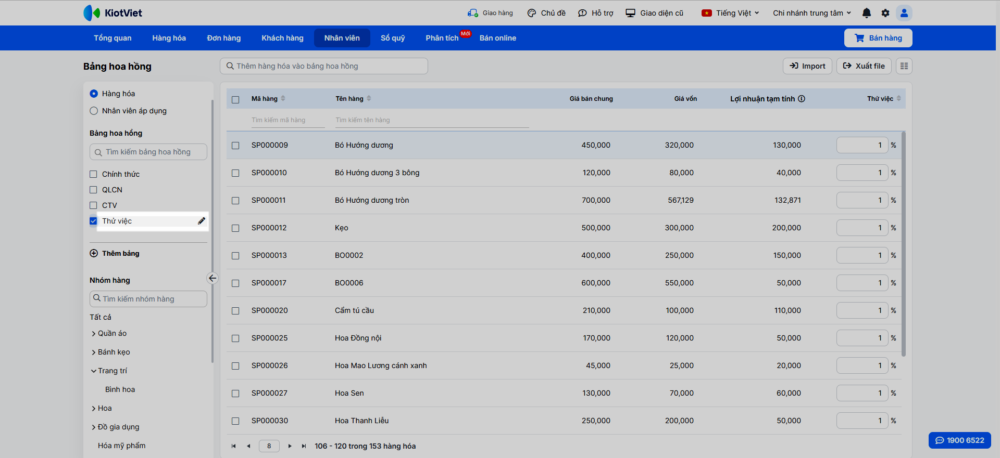

- **Bước 3:** Nhấn ***Xóa*** và chọn ***Đồng ý*** để xác nhận xóa bảng hoa hồng.

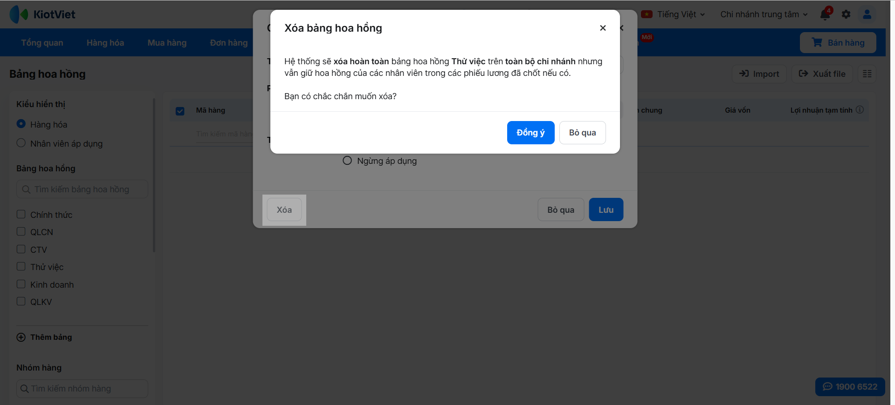

## **III. Các tính năng nâng cao**

### **Tính hoa hồng dựa trên thực thu**

**Tình huống:** Bạn muốn kiểm soát chi phí hoa hồng khi cửa hàng có các chương trình khuyến mãi, giảm giá sâu.

**Thao tác thực hiện như sau**:

- **Bước 1:** Trên màn hình **Quản lý**, bạn chọn **Nhân viên** → **Thiết lập nhân viên**.
- **Bước 2:** Chọn menu **Tính lương** → ***Thiết lập hoa hồng và thưởng*** → chọn 1 trong 2 cách ghi nhận doanh thu để tính hoa hồng và thưởng sau:
  - ***Doanh thu sau giảm***: Tính trên số tiền thực thu về (sau khi trừ chiết khấu, khuyến mãi). Lựa chọn này giúp bảo đảm lợi nhuận cho cửa hàng.
  - ***Thực thu***: Tính trên số tiền thực tế khách hàng đã trả.

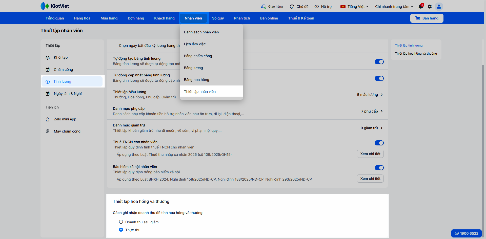

***Cảm ơn bạn đã theo dõi bài viết!***

- Để tìm hiểu thêm về các nghiệp vụ quản lý bán hàng, mời bạn xem bài viết:  
  [**Tổng quan Các nhóm Giải pháp của KiotViet**](https://www.kiotviet.vn/huong-dan-su-dung-kiotviet/retail-lam-quen-voi-kiotviet/tong-quan-cac-nhom-giai-phap-kiotviet/)
- Để tham khảo thêm các video hướng dẫn sử dụng, mời bạn theo dõi kênh YouTube:  
  [**HDSD - Phần mềm KiotViet**](https://www.youtube.com/@HDSDPhanmemKiotViet)

***Chúc bạn kinh doanh hiệu quả cùng KiotViet!***
