# KiotViet Retail – Thiết lập cửa hàng

Nguồn: https://www.kiotviet.vn/huong-dan-su-dung-kiotviet/retail-thiet-lap/thiet-lap-cua-hang/

---

# **Thiết lập cửa hàng**

(Ngành Bán buôn, Bán lẻ)

## **Giới Thiệu Chung**

Tính năng **Thiết lập cửa hàng** là trung tâm điều khiển toàn bộ hoạt động của gian hàng, nơi bạn có thể tùy chỉnh mọi cài đặt để phần mềm vận hành phù hợp nhất với mô hình kinh doanh của mình.

**Lợi ích nổi bật**:

- **Tùy chỉnh linh hoạt, phù hợp với mọi mô hình kinh doanh**: Cho phép bạn bật/tắt và cấu hình chi tiết hàng loạt tính năng từ quản lý hàng hóa, đối tác, đến các giao dịch, giúp phần mềm thích ứng hoàn hảo với quy trình vận hành đặc thù của bạn.
- **Tự động hóa và tối ưu hóa quy trình vận hành**: Bằng cách thiết lập các quy tắc và giá trị mặc định, bạn có thể tự động hóa nhiều tác vụ như tính giá vốn, áp dụng khuyến mại, cảnh báo công nợ, giúp tiết kiệm thời gian, giảm thiểu sai sót và nâng cao hiệu quả quản lý.
- **Quản lý tập trung, tăng cường bảo mật**: Tất cả các thiết lập quan trọng của gian hàng, từ thông tin, chi nhánh đến kết nối và bảo mật, đều được quản lý tại một nơi duy nhất, giúp bạn kiểm soát toàn diện và bảo vệ dữ liệu kinh doanh an toàn.

## **I. Thiết lập Quản lý**

Đây là khu vực xương sống, nơi định hình toàn bộ quy trình vận hành cốt lõi của doanh nghiệp trên nền tảng KiotViet. Mỗi một tùy chọn trong mục này đều có tác động trực tiếp đến cách bạn quản lý sản phẩm, xử lý đơn hàng, tương tác với khách hàng và làm việc với nhà cung cấp.

### **1. Hàng hóa**

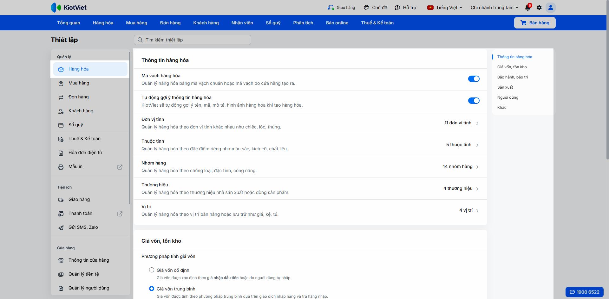

- **Thông tin hàng hóa**
  - **Mã vạch hàng hóa**: Cho phép cấu hình việc sử dụng mã vạch tiêu chuẩn hoặc mã do cửa hàng tự tạo để tự động hóa quy trình thanh toán và kiểm kho.
  - **Tự động gợi ý thông tin hàng hó**a: Cho phép bật/tắt tính năng tự động gợi ý tên, mã, mô tả sản phẩm khi tạo hàng hóa mới, giúp chuẩn hóa dữ liệu.
  - **Đơn vị tính**: Cho phép cấu hình nhiều đơn vị tính cho một sản phẩm (VD: thùng, lốc, chai) và thiết lập quy đổi giữa chúng để quản lý tồn kho chính xác.
  - **Thuộc tính**: Cho phép cấu hình các thuộc tính (VD: màu sắc, kích cỡ) để quản lý hiệu quả các sản phẩm có nhiều phiên bản.
  - **Nhóm hàng**: Cho phép tạo và quản lý các nhóm hàng để phân loại sản phẩm, làm cơ sở cho các báo cáo doanh thu, lợi nhuận chi tiết.
  - **Thương hiệu**: Cho phép tạo và quản lý danh sách các thương hiệu, giúp phân tích hiệu quả kinh doanh của từng nhãn hàng.
  - **Vị trí**: Cho phép cấu hình và gán vị trí lưu kho (VD: kệ A, tầng 2) cho hàng hóa để tối ưu hóa việc tìm kiếm và sắp xếp kho bãi.
- **Giá vốn, tồn kho**
  - **Phương pháp tính giá vốn**: Cho phép lựa chọn phương pháp tính giá vốn (cố định hoặc trung bình) và cấu hình việc phân bổ các chi phí phát sinh (vận chuyển, bốc xếp) vào giá trị sản phẩm.
  - **Quản lý tồn kho theo Lô - Hạn sử dụng**: Cho phép bật/tắt tính năng quản lý tồn kho chi tiết theo lô và hạn sử dụng, đặc biệt quan trọng với ngành thực phẩm, dược phẩm.
- **Bảo hành, bảo trì**
  - **Quản lý bảo hành, bảo trì, sửa chữa**: Cho phép thiết lập các chính sách bảo hành và quản lý lịch hẹn bảo trì, giúp theo dõi và nâng cao chất lượng dịch vụ sau bán hàng.
- **Sản xuất**
  - **Sản xuất hàng hóa**: Cho phép thiết lập định mức nguyên vật liệu để hệ thống tự động trừ kho khi sản xuất thành phẩm hoặc bán các combo sản phẩm.
- **Người dùng**
  - **Phân quyền người dùng theo nhóm hàng**: Cho phép phân quyền nhân viên chỉ quản lý các nhóm hàng cụ thể.Khi bật, bạn có thể thiết lập quyền truy cập chi tiết cho từng nhân viên trong **Quản lý người dùng**.

### **2. Mua hàng**

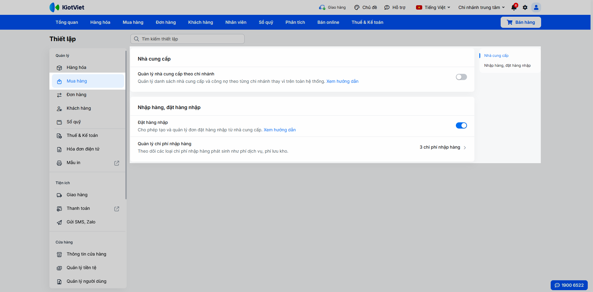

- **Nhà cung cấp**
  - **Quản lý nhà cung cấp theo chi nhánh**: Cho phép bật/tắt việc phân quyền quản lý danh sách nhà cung cấp và công nợ theo từng chi nhánh riêng biệt.
- **Nhập hàng, đặt hàng nhập**
  - **Đặt hàng nhập**: Cho phép bật/tắt tính năng tạo và quản lý đơn đặt hàng gửi đến nhà cung cấp để chuẩn hóa quy trình mua hàng.
  - **Quản lý chi phí nhập hàng**: Cho phép cấu hình các loại chi phí nhập hàng để ghi nhận và phân bổ chính xác vào giá vốn sản phẩm.
- **Mua dịch vụ**
  - **Mua dịch vụ**: Cho phép bật/tắt tạo phiếu mua dịch vụ để ghi nhận chi phí nhận hóa đơn, theo dõi công nợ phải trả nhà cung cấp và liên kết trực tiếp với hóa đơn đầu vào.

### **3. Đơn hàng**

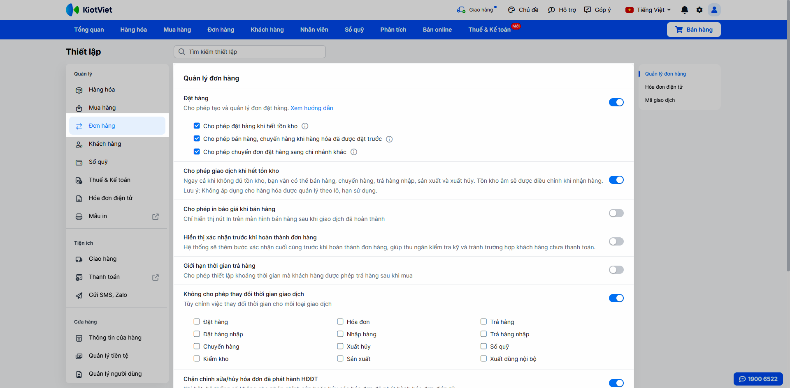

- **Đặt hàng**: Cho phép bật/tắt tính năng tạo và quản lý đơn đặt hàng của khách để ghi nhận nhu cầu và giữ hàng.
  - **Cho phép đặt hàng khi hết tồn kho**: Cho phép bật/tắt tùy chọn nhận đơn đặt hàng ngay cả khi sản phẩm không có sẵn trong kho.
  - **Cho phép bán hàng, chuyển hàng khi hàng hóa đã được đặt trước**: Nếu bỏ tùy chọn này thì khi Bán hàng hoặc Chuyển hàng hệ thống sẽ kiểm tra nếu số lượng cần Bán hoặc Chuyển vượt quá Tồn kho trừ Đặt hàng của sản phẩm thì sẽ không cho phép thực hiện giao dịch.
  - **Cho phép chuyển đơn đặt hàng sang chi nhánh khác**: Cho phép bật/tắt việc điều chuyển đơn hàng giữa các chi nhánh để tối ưu hóa tồn kho toàn hệ thống.
- **Cho phép giao dịch khi hết tồn kho**: Cho phép bật/tắt việc bán hàng âm kho. Việc bật tính năng này mang lại sự linh hoạt nhưng cần kiểm soát chặt chẽ.
- **In báo giá khi bán hàng**: Cho phép bật/tắt nút "In báo giá" trên màn hình bán hàng để hỗ trợ các giao dịch cần xác nhận chính thức.
- **Hiển thị xác nhận trước khi hoàn thành đơn hàng**: Cho phép bật/tắt hộp thoại xác nhận cuối cùng trước khi thanh toán, giúp nhân viên kiểm tra lại thông tin và giảm sai sót.
- **Giới hạn thời gian trả hàng**: Cho phép cấu hình chi tiết chính sách trả hàng, bao gồm số ngày được phép trả và các quy định xử lý khi trả hàng quá hạn.
- **Không cho phép thay đổi thời gian giao dịch**: Cho phép cấu hình không được quyền thay đổi thời gian trên từng loại giao dịch (hóa đơn, nhập hàng, sổ quỹ...) để ngăn chặn gian lận.
- **Chặn chỉnh sửa/hủy hóa đơn đã phát hành HĐĐT**: Không cho phép chỉnh sửa hoặc hủy các hóa đơn đã phát hành hóa đơn điện tử khi bật thiết lập này.
- **Quản lý thu khác**: Cho phép cấu hình các loại phí dịch vụ, phí giao hàng... để ghi nhận và hạch toán đầy đủ cơ cấu doanh thu.
- **Quy tắc tạo mã giao dịch**:
  - Cho phép gian hàng chủ động chọn quy tắc mà hệ thống dùng để tự động sinh mã cho các giao dịch (hóa đơn bán hàng, đặt hàng, trả hàng, đổi trả hàng), thay vì chỉ dùng kiểu tăng dần theo thứ tự tạo. Giúp gian hàng:
    - **Bảo mật thông tin kinh doanh:** mã ngẫu nhiên khiến đối thủ không thể dựa vào hiệu số mã phiếu để ước lượng số đơn/ doanh thu cửa hàng.
    - **Nhận diện thời gian giao dịch ngay trên mã:** kiểu "Theo thời gian" nhúng ngày/giờ tạo vào mã, tra cứu nhanh không cần mở hệ thống.
    - **Linh hoạt theo mô hình kinh doanh:** gian hàng chọn quy tắc phù hợp với nhu cầu đối soát hoặc bảo mật của mình.
  - Có 3 lựa chọn:
    - ***Tăng dần theo thứ tự tạo***:
      - Phù hợp với gian hàng cần đối soát, đếm phiếu theo thứ tự; quy mô vừa và nhỏ.
      - Cấu trúc mã: Tiền tố + 6 chữ số tự tăng.
      - VD: Hóa đơn HD000001, HD000002; Đặt hàng DH000001, DH000002; Trả hàng TH000001, TH000002.
    - ***Theo thời gian***:
      - Phù hợp với gian hàng muốn tra cứu nhanh theo mốc thời gian; nhiều chi nhánh.
      - Cấu trúc mã: Tiền tố + YY MM DD HH mm + 2 chữ số tự tăng trong cùng phút.
      - VD: Hóa đơn HD260521134001, HD260521134002; Đặt hàng DH260521134001, DH260521134002; Trả hàng TH260521134001, TH260521134002.
    - ***Ngẫu nhiên***:
      - Phù hợp với gian hàng cạnh tranh cao, muốn giấu số lượng giao dịch với đối thủ.
      - Cấu trúc mã: Tiền tố + 11 ký tự ngẫu nhiên.
      - VD: Hóa đơn HD40291F73580, HD7B350928146; Đặt hàng DH73509B28146; Trả hàng TH9028F371546.
  - Hệ thống mặc định ***Tăng dần theo thứ tự tạo.*** Bạn nhấn ***Chỉnh sửa*** để lựa chọn cách tạo mã giao dịch → nhấn ***Lưu*** để ghi nhận thông tin.

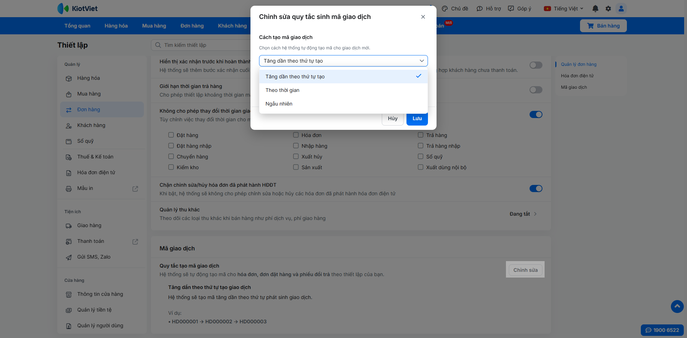

- **Lưu ý:**
  - Quy tắc tạo mã được áp dụng cho tất cả các cách tạo giao dịch. Cụ thể:
    - Giao dịch đã có sẵn mã (ví dụ: đơn hàng đồng bộ từ Shopee) → hệ thống sẽ giữ nguyên mã giao dịch và vẫn kiểm tra trùng mã như hiện nay.
    - Giao dịch chưa có mã → hệ thống sẽ tự động tạo mã theo quy tắc đã thiết lập.
  - Quy tắc mới chỉ áp dụng cho phiếu tạo mới sau khi lưu — toàn bộ mã phiếu cũ giữ nguyên.
  - Cửa hàng nhiều chi nhánh ở nhiều múi giờ (kiểu ***Theo thời gian***):
    - Phần thời gian trong mã được tạo theo giờ của máy chủ (GMT+7), không sử dụng giờ địa phương của từng chi nhánh.
    - Ví dụ: chi nhánh tại Nhật Bản tạo phiếu lúc 15:00 (GMT+9) thì mã phiếu sẽ hiển thị thời gian tương ứng là 13:00 (GMT+7). Trường hợp nhiều chi nhánh tạo phiếu trong cùng một phút theo giờ máy chủ, hệ thống vẫn đảm bảo mã không bị trùng nhờ 2 chữ số tự tăng ở cuối mã.

### **4. Khách hàng**

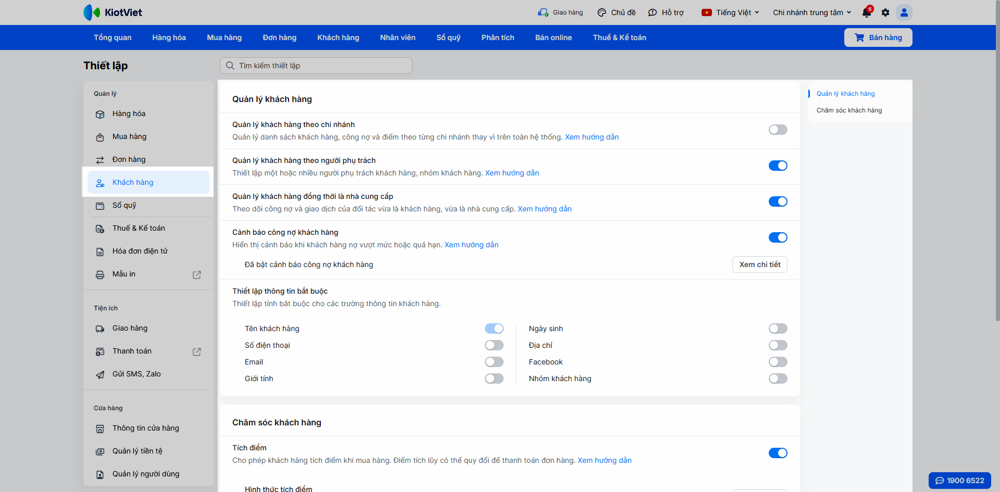

- **Quản lý khách hàng**
  - **Quản lý khách hàng theo chi nhánh**: Cho phép bật/tắt việc phân tách dữ liệu và công nợ khách hàng theo từng chi nhánh.
  - **Quản lý khách hàng theo người phụ trách**: Cho phép bật/tắt tính năng gán nhân viên cụ thể phụ trách chăm sóc từng khách hàng hoặc nhóm khách hàng.
  - **Quản lý đối tác (khách hàng & nhà cung cấp)**: Cho phép bật/tắt tính năng gộp mã đối tác để theo dõi công nợ hai chiều (phải thu - phải trả) trên một đối tượng duy nhất.
  - **Cảnh báo công nợ khách hàng**: Cho phép bật và cấu hình các cảnh báo tự động khi khách hàng nợ vượt mức hoặc quá hạn đã định.
- **Chăm sóc khách hàng**
  - **Tích điểm**: Cho phép bật và cấu hình chi tiết chương trình tích điểm cho khách hàng thân thiết.
  - **Khuyến mại**: Cho phép bật và tạo các chương trình khuyến mại đa dạng theo hàng hóa hoặc giá trị hóa đơn.
  - **Voucher**: Cho phép bật tính năng quản lý, phát hành và áp dụng các phiếu mua hàng (voucher).
  - **Coupon**: Cho phép bật tính năng quản lý, phát hành và áp dụng các mã giảm giá (coupon).

### **5. Sổ quỹ**

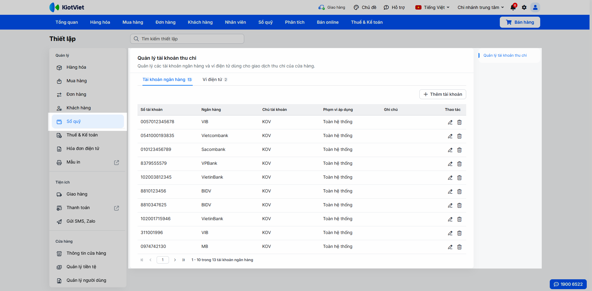

- **Quản lý tài khoản thu chi**: Cho phép thêm, sửa, xóa và quản lý danh sách các tài khoản ngân hàng, ví điện tử được sử dụng cho giao dịch của cửa hàng.

### **6. Thuế & kế toán**

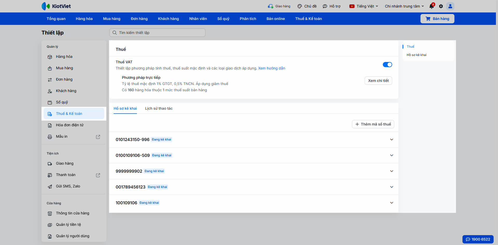

- **Thuế VAT**: Cho phép cấu hình phương pháp tính thuế và các mức thuế suất mặc định để hệ thống tự động áp dụng khi bán hàng.
- Thiết lập **Hồ sơ kê khai** và xem **Lịch sử thao tác** với các mã số thuế trên gian hàng.

### **7. Hóa đơn điện tử**

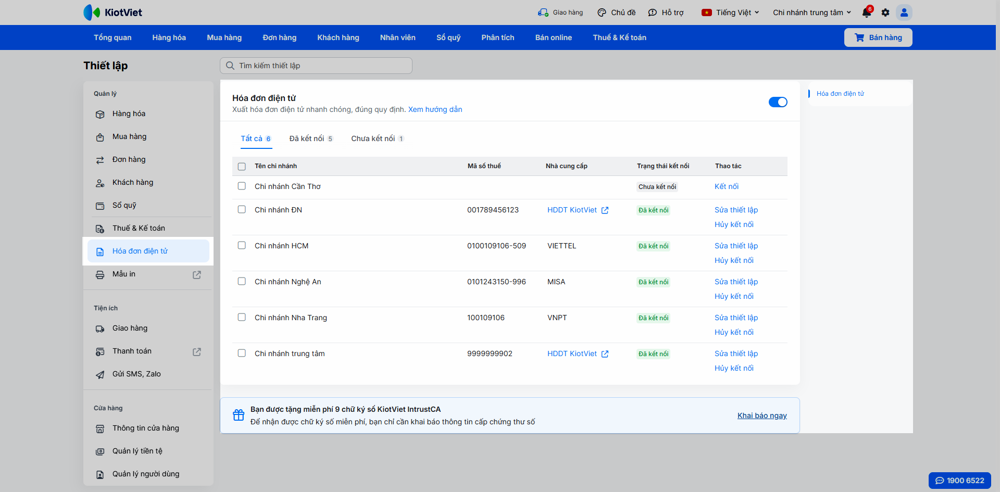

- **Hóa đơn điện tử**: Cho phép thực hiện kết nối với các nhà cung cấp hóa đơn điện tử để xuất hóa đơn trực tiếp từ phần mềm.

### **8. Mẫu in**

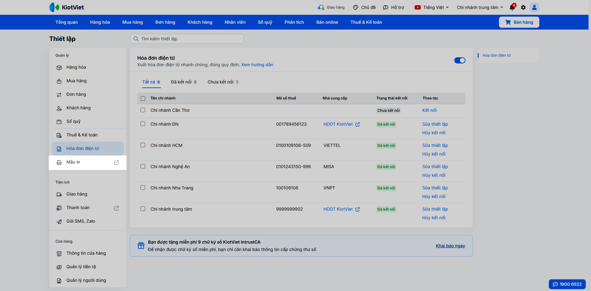

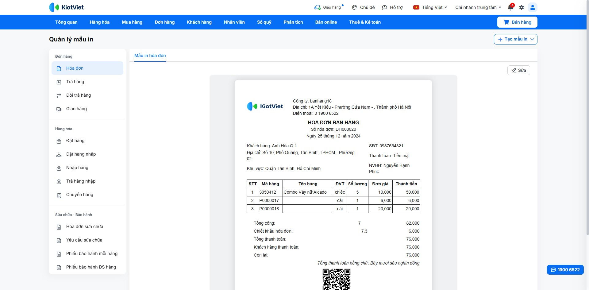

- **Thiết lập mẫu in**: Cho phép tùy chỉnh các mẫu in (hóa đơn, phiếu đặt hàng...) bằng cách thêm logo, thay đổi thông tin hiển thị.

## **II. Thiết lập Tiện ích**

Đây là khu vực tích hợp các dịch vụ bên ngoài, giúp tự động hóa các quy trình quan trọng như vận chuyển, thanh toán và giao tiếp với khách hàng.

### **1. Giao hàng**

Cho phép kết nối trực tiếp với các đối tác vận chuyển để tạo đơn, theo dõi hành trình và đối soát thu hộ (COD) tự động.

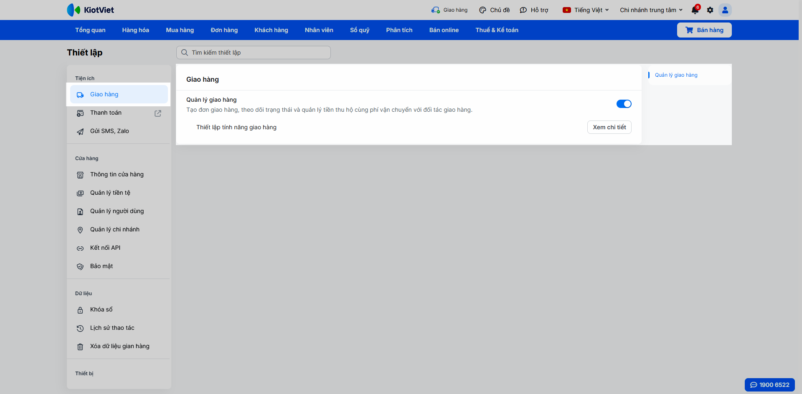

### **2. Thanh toán**

Cho phép cấu hình liên kết với ngân hàng và ví điện tử để nhận thông báo xác nhận chuyển khoản QR thành công ngay trên màn hình bán hàng.

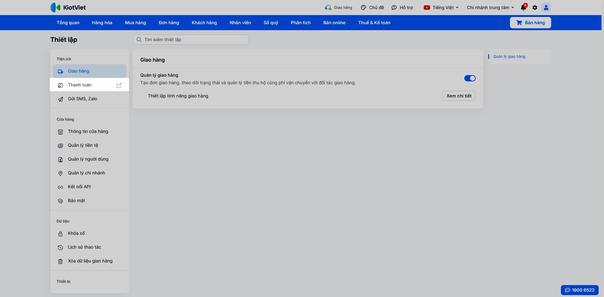

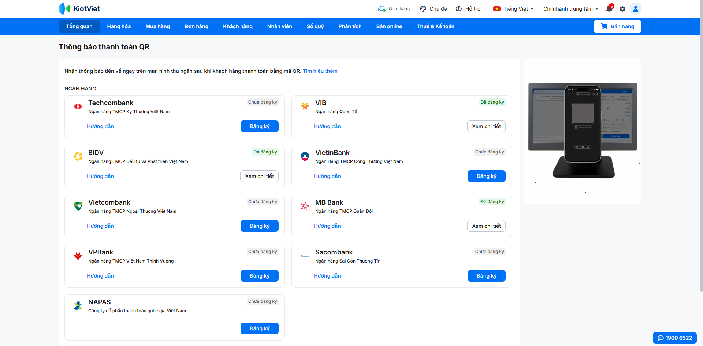

### **3. Gửi SMS, Zalo**

Cho phép kết nối các dịch vụ và quản lý các mẫu tin nhắn tự động (xác nhận đơn hàng, chúc mừng sinh nhật, thông báo khuyến mại...).

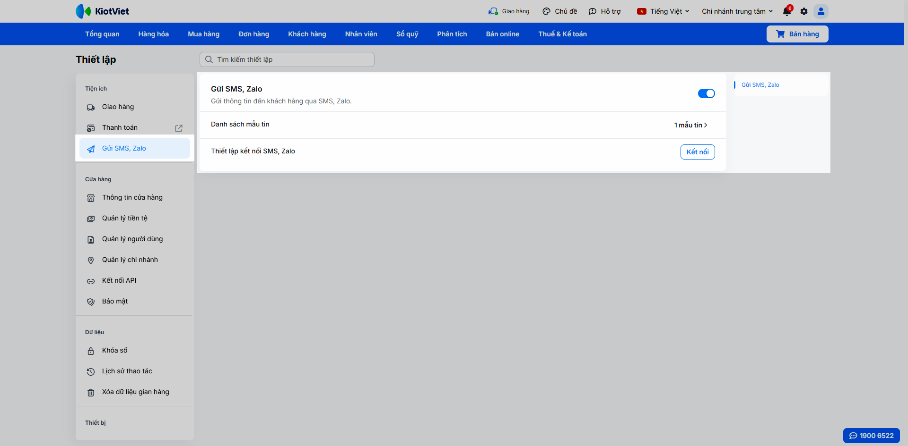

## **III. Thiết lập Cửa hàng**

Đây là nơi bạn định hình danh tính, cấu trúc tổ chức và các quy tắc bảo mật nền tảng cho toàn bộ gian hàng của mình trên hệ thống.

### **1. Thông tin cửa hàng**

Cho phép cập nhật các thông tin cơ bản như tên, địa chỉ, logo để hiển thị trên hóa đơn và các chứng từ.

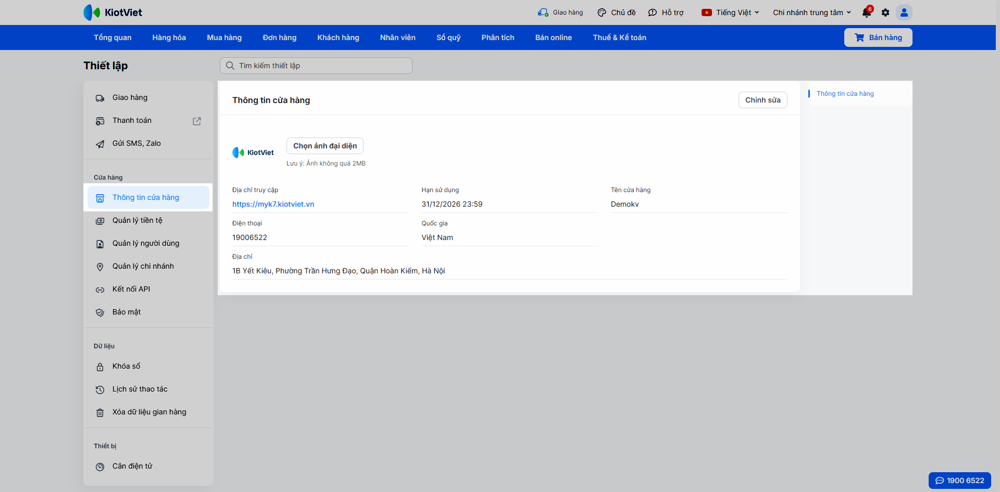

### **2. Quản lý Tiền tệ**

Cho phép thiết lập tiền mặc định cho hệ thống và cấu hình các loại ngoại tệ được chấp nhận thanh toán cùng tỷ giá quy đổi.

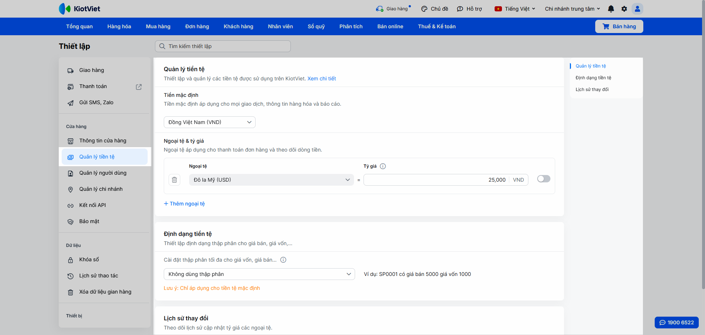

### **3. Quản lý người dùng**

Cho phép tạo tài khoản, phân chia vai trò và cấu hình quyền hạn chi tiết cho từng nhân viên, giới hạn các thao tác theo đúng chức năng.

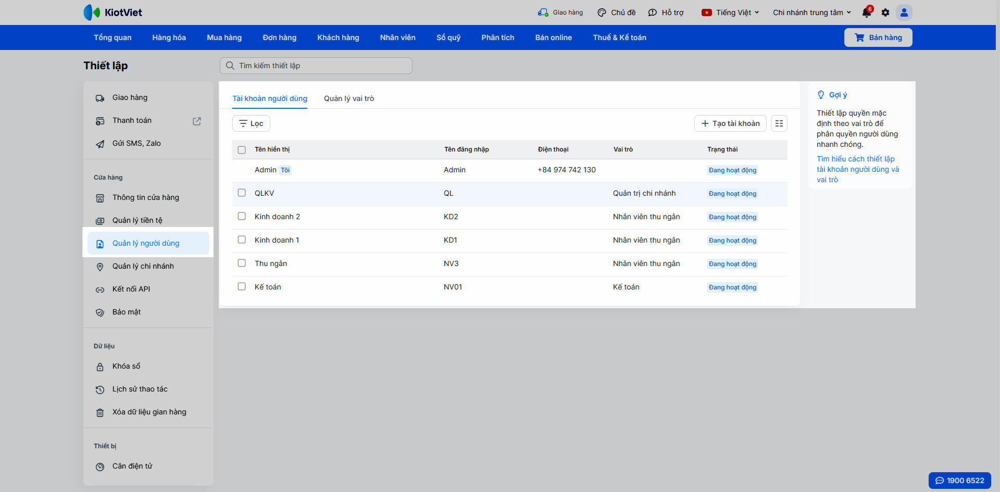

### **4. Quản lý chi nhánh**

Cho phép quản lý thông tin, phân bổ người dùng và thiết lập địa chỉ lấy hàng riêng cho từng chi nhánh trong chuỗi.

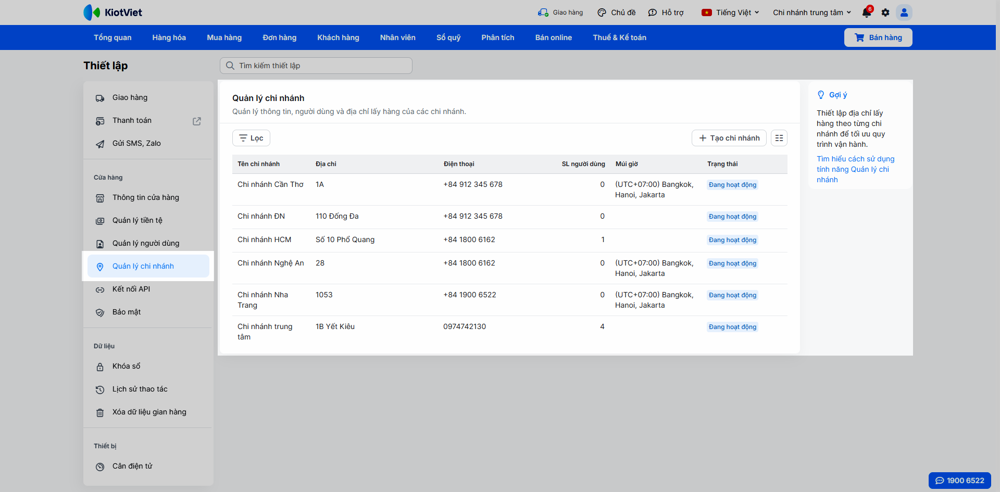

### **5. Kết nối API**

Cho phép gian hàng của bạn chủ động tích hợp dữ liệu với các hệ thống bên ngoài như website, sàn thương mại điện tử, CRM một cách linh hoạt và bảo mật.

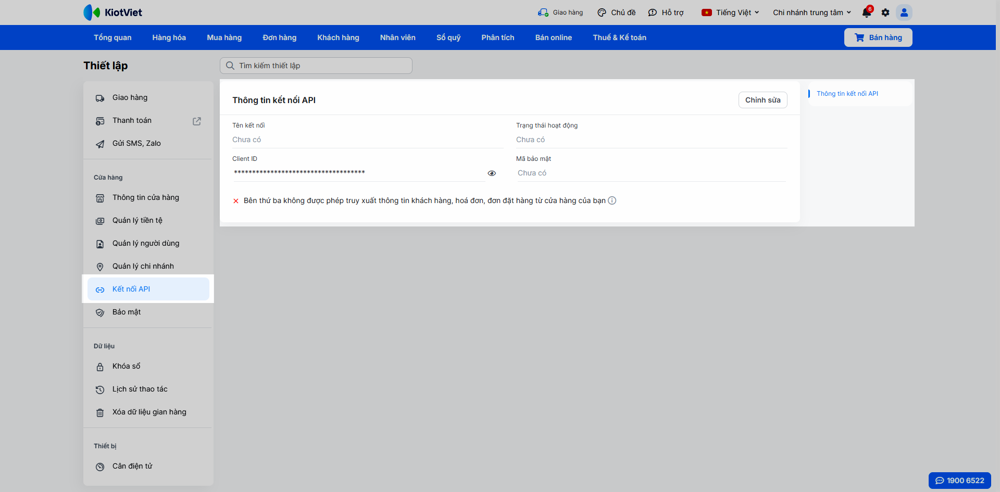

### **6. Bảo mật**

Cho phép bật các lớp bảo mật tăng cường như yêu cầu xác thực mật khẩu khi xuất file dữ liệu hoặc kích hoạt xác thực hai yếu tố (2FA) cho tài khoản.

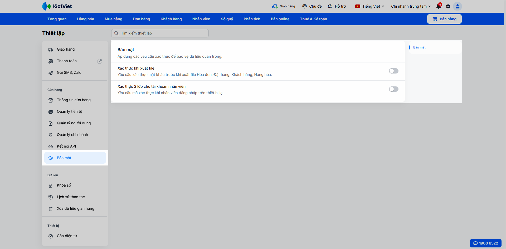

## **IV. Dữ liệu**

Đây là khu vực dành cho các nghiệp vụ quản trị cấp cao, giúp bảo vệ tính toàn vẹn của thông tin kinh doanh và cung cấp khả năng truy vết, kiểm soát.

### **1. Khóa sổ**

Cho phép bạn chốt dữ liệu đến một ngày nhất định để ngăn chặn mọi thay đổi giao dịch trong quá khứ, đảm bảo tính chính xác của báo cáo và hạn chế gian lận. Để sử dụng, bạn cần kích hoạt và đặt ngày khóa sổ cho từng chi nhánh trong menu **Thiết lập → Dữ liệu → Khóa sổ**. Sau khi thiết lập, hệ thống sẽ chặn các thao tác như tạo mới, sửa, xóa, hoặc thay đổi ngày giao dịch về trước ngày khóa sổ đối với hầu hết các loại chứng từ (Hóa đơn, Nhập hàng, Sổ quỹ, v.v.).

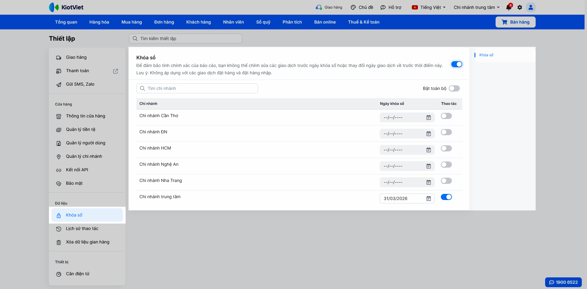

### **2. Lịch sử thao tác**

- Cho phép người quản lý theo dõi và kiểm tra lại toàn bộ hoạt động của từng nhân viên trên phần mềm để phát hiện sai sót hoặc gian lận.

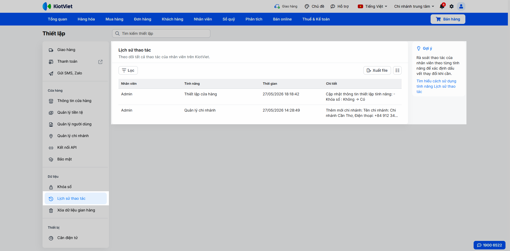

- Bạn nhấn vào biểu tượng ***Lọc →*** sử dụng bộ lọc bên trái màn hình để tìm kiếm thông tin.

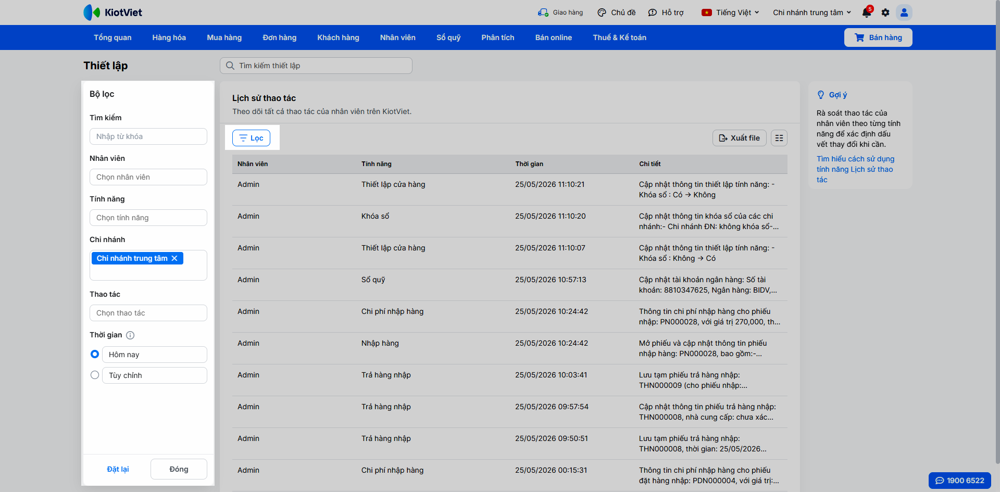

- Để hiển thị các cột thông tin mong muốn trên màn hình bạn nhấn biểu tượng tùy chọn → tích các cột thông tin cần hiển thị.

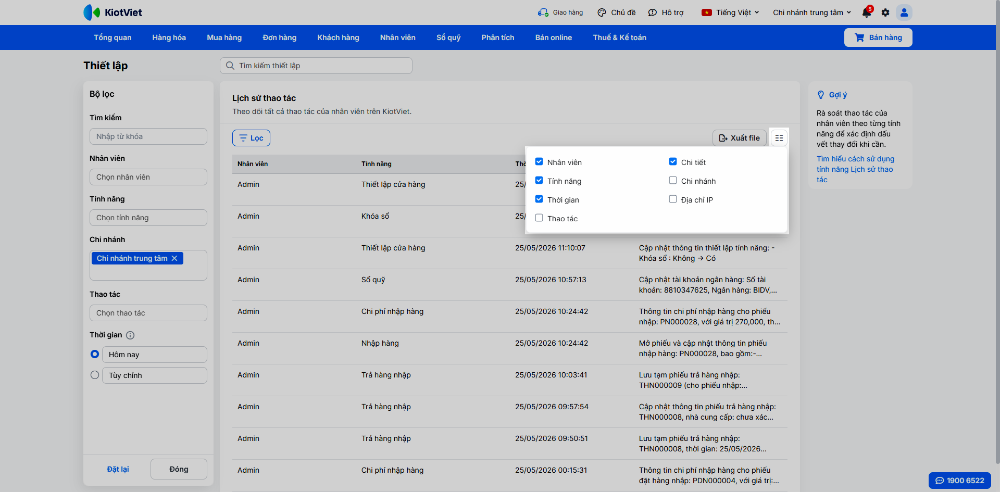

- Bạn nhấn ***Xuất file*** để lưu trữ dữ liệu trên thiết bị.

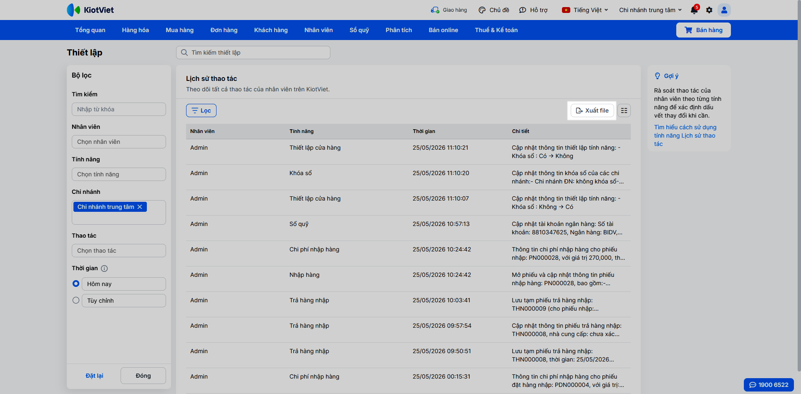

### **3. Xóa dữ liệu gian hàng**

Cho phép đặt lịch xóa các dữ liệu cũ không còn cần thiết, thường được sử dụng sau giai đoạn dùng thử hoặc khi cần tái cấu trúc hệ thống.

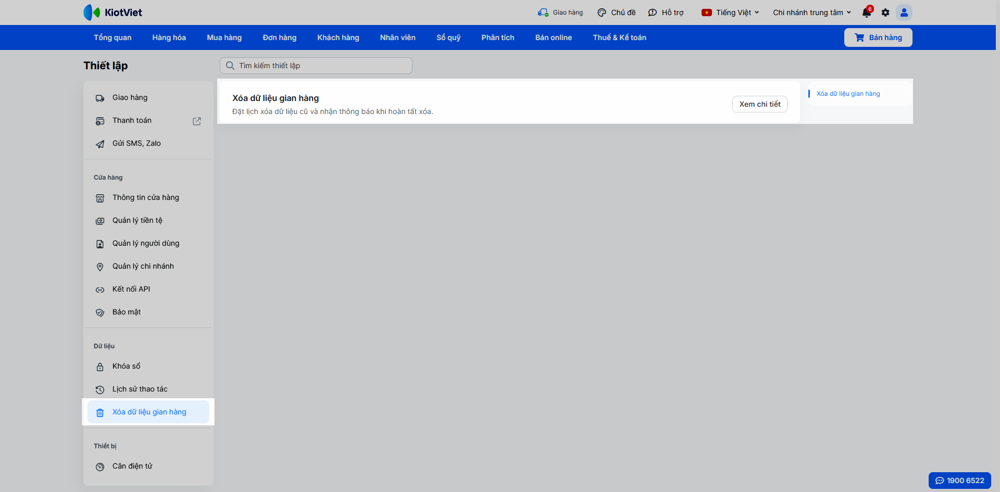

## **V. Thiết bị**

Đây là khu vực tích hợp các thiết bị phần cứng để tự động hóa, tăng tốc độ và nâng cao tính chính xác cho các thao tác tại quầy.

**Cân điện tử:** Cho phép kết nối phần mềm với cân điện tử để tự động lấy trọng lượng sản phẩm và tính tiền chính xác, loại bỏ sai sót nhập liệu thủ công.

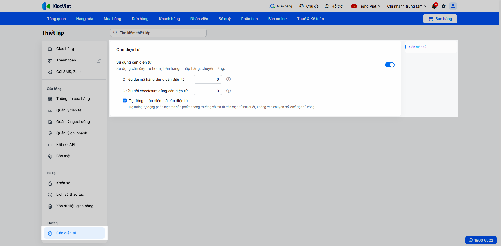

***Cảm ơn bạn đã theo dõi bài viết!***

- Để tìm hiểu thêm về các nghiệp vụ quản lý bán hàng, mời bạn xem bài viết:  
  [**Tổng quan Các nhóm Giải pháp của KiotViet**](https://www.kiotviet.vn/huong-dan-su-dung-kiotviet/retail-lam-quen-voi-kiotviet/tong-quan-cac-nhom-giai-phap-kiotviet/)
- Để tham khảo thêm các video hướng dẫn sử dụng, mời bạn theo dõi kênh YouTube:  
  [**HDSD - Phần mềm KiotViet**](https://www.youtube.com/@HDSDPhanmemKiotViet)

***Chúc bạn kinh doanh hiệu quả cùng KiotViet!***
