# KiotViet Retail – Quản lý người dùng

Nguồn: https://www.kiotviet.vn/huong-dan-su-dung-kiotviet/retail-thiet-lap/quan-ly-nguoi-dung/

---

# **Quản lý Người dùng**

*(Ngành Bán buôn, Bán lẻ)*

## **I. Giới thiệu chung**

Tính năng Quản lý Người dùng cho phép bạn tạo tài khoản, phân quyền và kiểm soát hoạt động của từng nhân viên trên phần mềm KiotViet. Việc này giúp đảm bảo an toàn dữ liệu, tối ưu hóa quy trình làm việc và tăng cường bảo mật cho cửa hàng.

**Lợi ích nổi bật của tính năng Quản lý Người dùng trên KiotViet:**

- **Bảo mật thông tin:** Giới hạn quyền truy cập của nhân viên vào các dữ liệu nhạy cảm như báo cáo doanh thu, giá vốn, thông tin khách hàng.
- **Phân công rõ ràng:** Mỗi nhân viên (thu ngân, nhân viên kho, quản lý) sẽ có tài khoản với các quyền hạn phù hợp với vai trò của mình, tránh các thao tác nhầm lẫn.
- **Kiểm soát hoạt động:** Dễ dàng theo dõi lịch sử thao tác, giới hạn thời gian truy cập, và quản lý hiệu quả hoạt động của từng nhân viên.
- **Linh hoạt trong quản lý:** Nhanh chóng thêm, xóa, hoặc khóa tài khoản khi có sự thay đổi về nhân sự.

## **II. Các thao tác cơ bản**

Để dễ hình dung, các ví dụ dưới đây sẽ minh họa những tình huống thực tế trong ngành Bán buôn, Bán lẻ.

### **1. Thêm mới người dùng**

- **Tình huống:** Bạn vừa tuyển một nhân viên thu ngân mới và cần tạo cho họ một tài khoản để đăng nhập vào hệ thống bán hàng.
- **Thao tác thực hiện như sau:**

1. Tại màn hình **Quản lý**, từ menu **Thiết lập**, bạn chọn **Cửa hàng**.

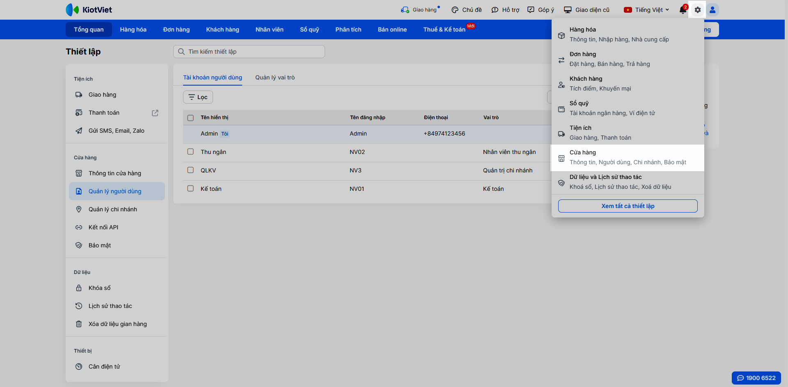

2. Trên menu bên trái, chọn **Quản lý người dùng**, bạn nhấn vào nút ***+ Tạo tài khoản***.
3. Điền các thông tin bắt buộc: ***Tên hiển thị***, ***Tên đăng nhập***, ***Mật khẩu***, ***Chi nhánh làm việc***, ***Vai trò***.

- Tùy chọn thiết lập:
- ***Xem thông tin chung của hàng hóa, giao dịch, đối tác***
- ***Xem, chỉnh sửa giao dịch và xem báo cáo cuối ngày của nhân viên khác***

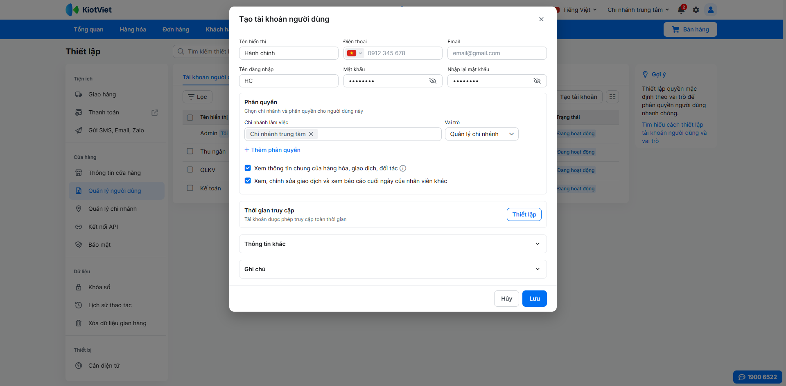

- ***Thời gian truy cập***: hệ thống mặc định người dùng có thể truy cập toàn thời gian. Nếu cần giới hạn, bạn nhấn ***Thiết lập*** → chọn ***Chỉ phép truy cập trong khung giờ cố định*** → tích chọn thứ trong tuần và điền thời gian cụ thể

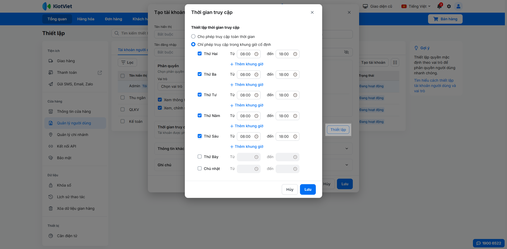

4. Nhấn ***Lưu*** để hoàn tất.

**Lưu ý**:

- 1 người dùng có thể được phân quyền trên nhiều chi nhánh.
- Trên 1 chi nhánh, 1 người dùng chỉ được phân quyền 1 vai trò.

### **2. Cập nhật thông tin người dùng**

- **Tình huống:** Một nhân viên của bạn thay đổi số điện thoại. Bạn cần cập nhật lại thông tin này trên hệ thống để tiện liên lạc.
- **Thao tác thực hiện như sau:**

1. Tại màn hình **Tài khoản người dùng**, tìm và chọn tài khoản của nhân viên cần thay đổi.

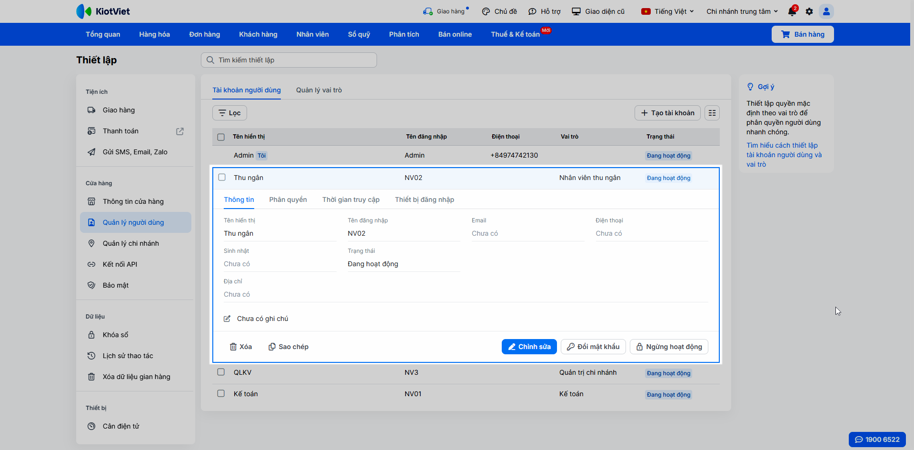

2. Nhấn nút ***Chỉnh sửa***.
3. Thay đổi các thông tin cần thiết (ví dụ: Tên hiển thị, Điện thoại, Email, Mật khẩu...).
4. Nhấn ***Lưu*** để xác nhận thay đổi.

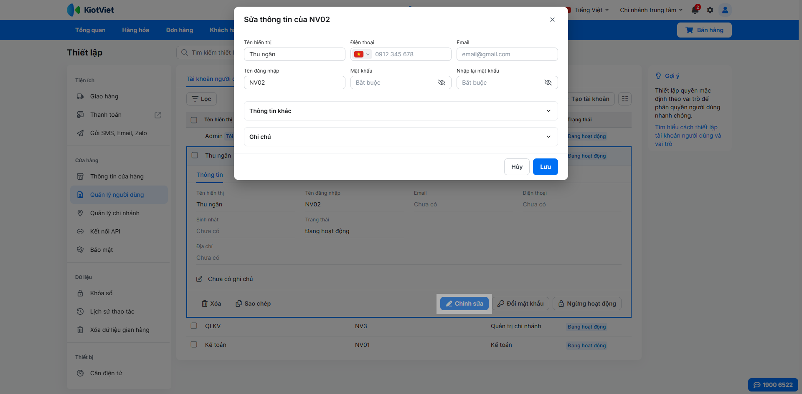

### **3. Phân quyền người dùng**

- **Tình huống:** Nhân viên bán hàng của bạn được thăng chức lên quản lý chi nhánh. Bạn cần cấp thêm cho họ các quyền xem báo cáo và quản lý nhân viên khác.
- **Thao tác thực hiện như sau:**

1. Tại màn hình **Tài khoản người dùng**, chọn tài khoản bạn muốn phân quyền và nhấn **Phân quyền → *Chỉnh sửa***.

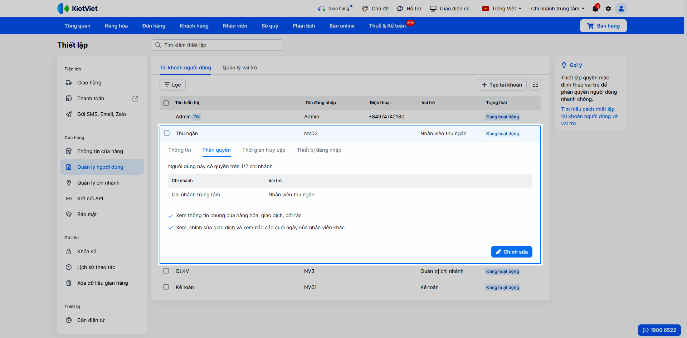

2. Chọn **Chi nhánh** cần phân quyền → trong mục **Vai trò**, bạn có thể chọn một vai trò có sẵn (ví dụ: Quản trị chi nhánh).
3. Hệ thống sẽ hiển thị danh sách các quyền mặc định của vai trò đó. Bạn có thể tùy chỉnh bằng cách tích hoặc bỏ tích các quyền cụ thể.
4. Nhấn ***Lưu*** để ghi nhận thông tin. Hệ thống sẽ yêu cầu xác nhận và người dùng sẽ bị đăng xuất để áp dụng quyền mới.

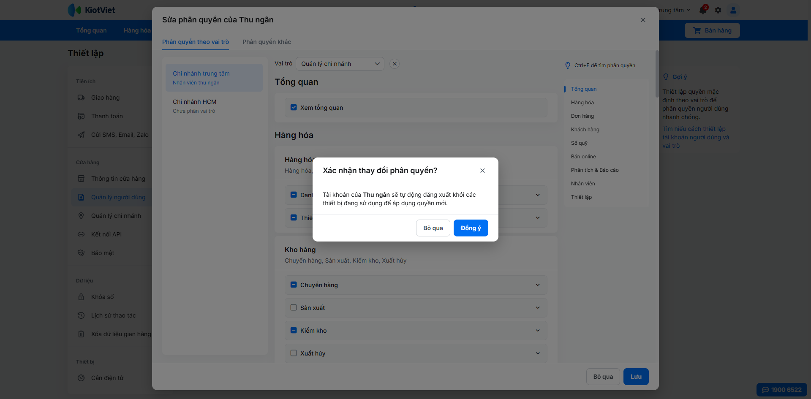

### **4. Ngừng hoạt động người dùng**

- **Tình huống:** Một nhân viên đã nghỉ việc. Để đảm bảo an toàn, bạn cần vô hiệu hóa tài khoản của họ để họ không thể truy cập vào hệ thống được nữa.
- **Thao tác thực hiện như sau:**

1. Tại màn hình **Tài khoản người dùng**, tìm và chọn tài khoản của nhân viên → nhấn ***Ngừng hoạt động***.
2. Chọn ***Đồng ý*** trong hộp thoại xác nhận.

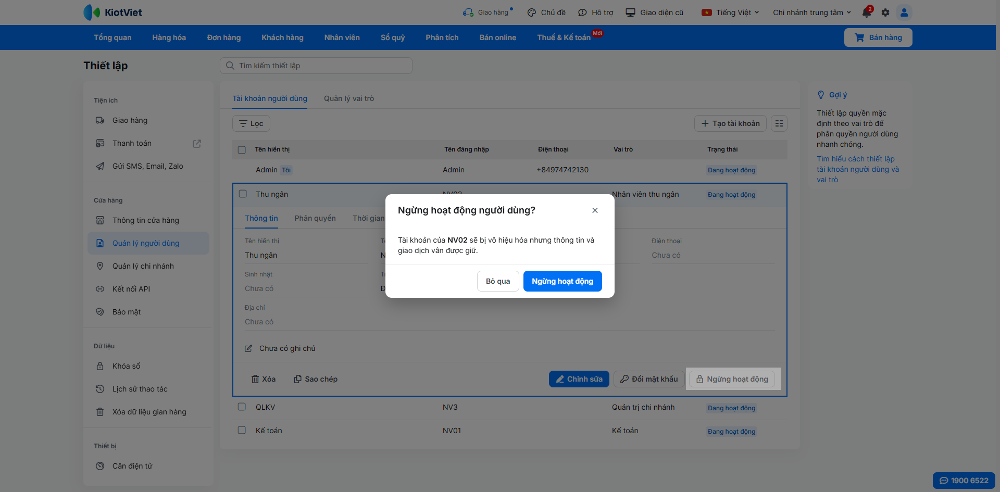

3. Để cho phép người dùng hoạt động trở lại, bạn chỉ cần chọn tài khoản đó và nhấn ***Cho phép hoạt động***.

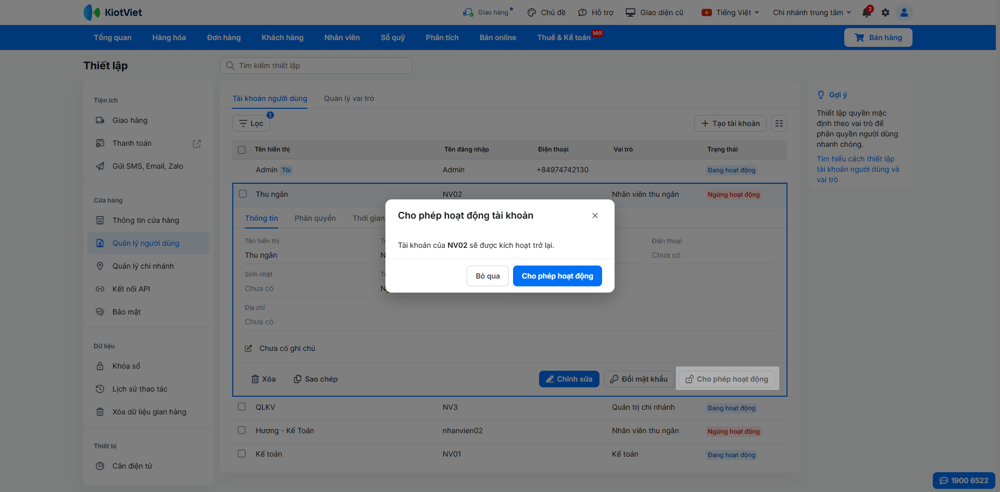

### **5. Xóa người dùng**

- **Tình huống:** Bạn vô tình tạo nhầm một tài khoản người dùng và muốn xóa hoàn toàn nó khỏi hệ thống.
- **Thao tác thực hiện như sau:**

1. Tại màn hình **Tài khoản người dùng**, tìm và chọn tài khoản bị tạo nhầm → nhấn ***Xóa***.
2. Tiếp tục chọn ***Xóa*** để xác nhận. *Lưu ý: Các giao dịch lịch sử (nếu có) liên quan đến người dùng này vẫn sẽ được giữ lại trên hệ thống.*

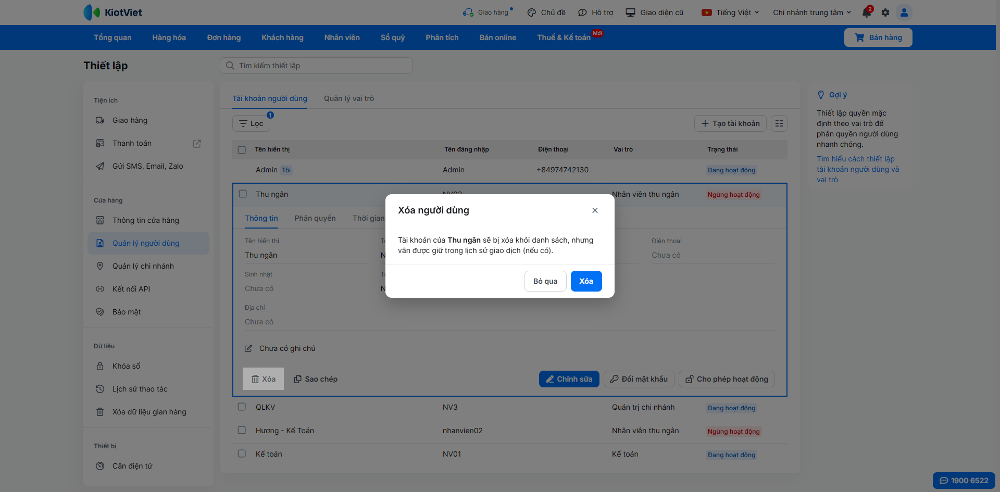

## **III. Các tính năng nâng cao**

### **1. Quản lý vai trò**

- **Tình huống:** Cửa hàng của bạn có một vị trí mới là "Nhân viên kiểm kho" với bộ quyền hạn riêng (được xem tồn kho nhưng không được xem giá nhập). Bạn cần tạo một vai trò mới cho vị trí này.
- **Thao tác thực hiện như sau:** 
  - **Để thêm vai trò mới:**

1. Tại menu **Quản lý người dùng**, bạn chọn **Quản lý vai trò** → nhấn ***+ Tạo vai trò***.

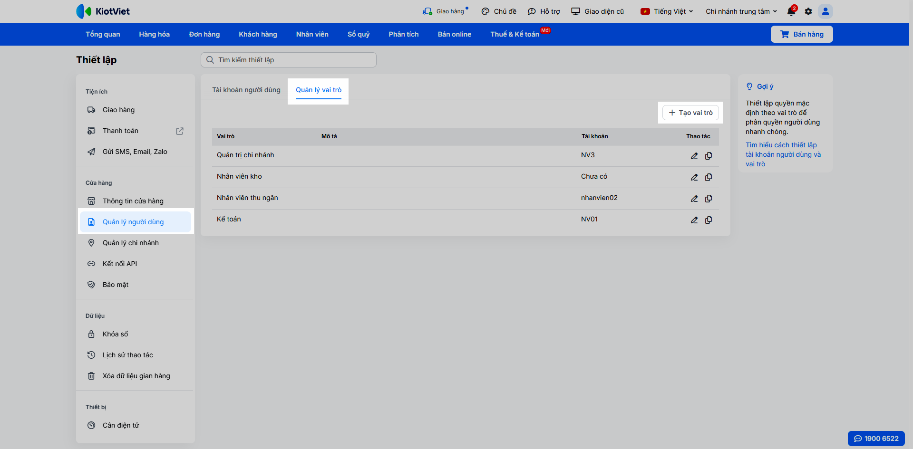

2. Đặt tên cho vai trò mới (ví dụ: "Nhân viên kiểm kho").
3. Tích chọn tất cả các quyền bạn muốn gán cho vai trò này.
4. Nhấn ***Lưu***.

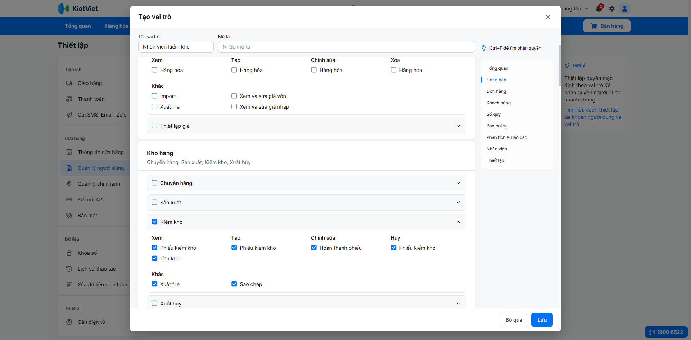

- **Để sửa hoặc xóa vai trò:**

1. Tại menu **Quản lý người dùng**, bạn chọn **Quản lý vai trò** → chọn vai trò cần chỉnh sửa và nhấn biểu tượng cây bút.

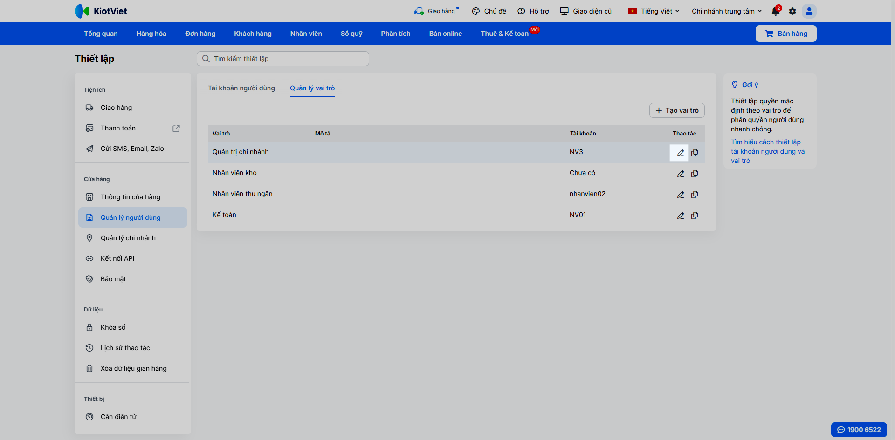

2. Để sửa, hãy thay đổi các quyền rồi nhấn **Lưu**.
3. Để xóa, hãy nhấn nút **Xóa** (chỉ thực hiện được khi không có người dùng nào đang được gán vai trò này).

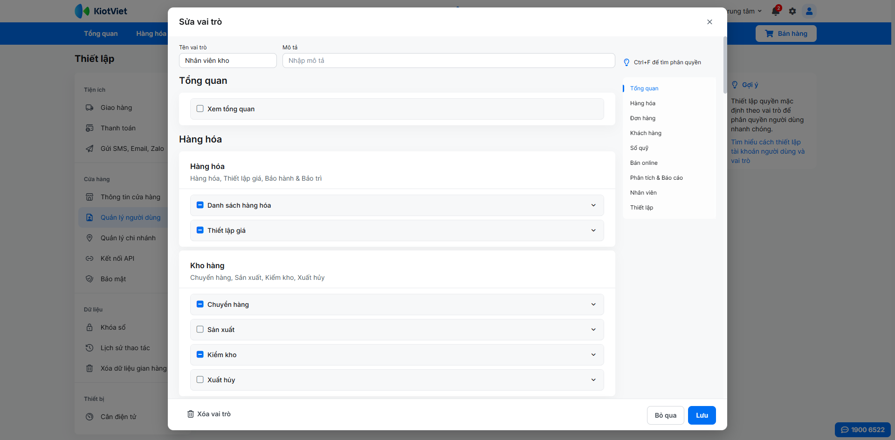

### **2. Sao chép người dùng**

- **Tình huống:** Bạn cần tạo tài khoản cho 5 nhân viên bán hàng mới có cùng vai trò, quyền hạn và thời gian truy cập. Để tiết kiệm thời gian, bạn có thể tạo một tài khoản mẫu rồi sao chép ra các tài khoản còn lại.
- **Thao tác thực hiện như sau:**

1. Tại menu **Quản lý người dùng**, bạn chọn Tài khoản người dùng → chọn một tài khoản mẫu và nhấn ***Sao chép***.
2. Màn hình sao chép sẽ hiện ra với các thông tin về quyền và thời gian truy cập đã được giữ lại.
3. Bạn chỉ cần điền thông tin mới cho người dùng (Tên người dùng, Tên đăng nhập, Mật khẩu).
4. Nhấn ***Lưu*** để tạo tài khoản mới.

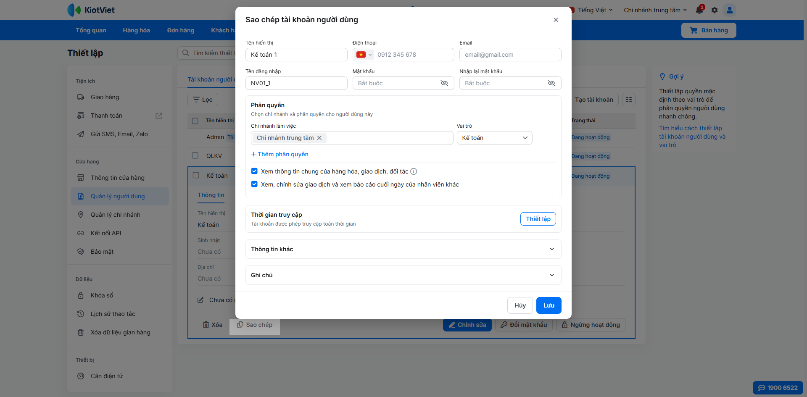

### **3. Tìm kiếm, sắp xếp người dùng**

- **Tình huống:** Cửa hàng của bạn có nhiều nhân viên và bạn cần nhanh chóng tìm ra tài khoản của một người hoặc xem danh sách tất cả nhân viên kho.
- **Thao tác thực hiện như sau:**

1. Sử dụng bộ ***Lọc*** để tìm kiếm danh sách theo Tên đăng nhập, Tên người dùng, SĐT, Email, Chi nhánh, Vai trò hoặc Trạng thái.

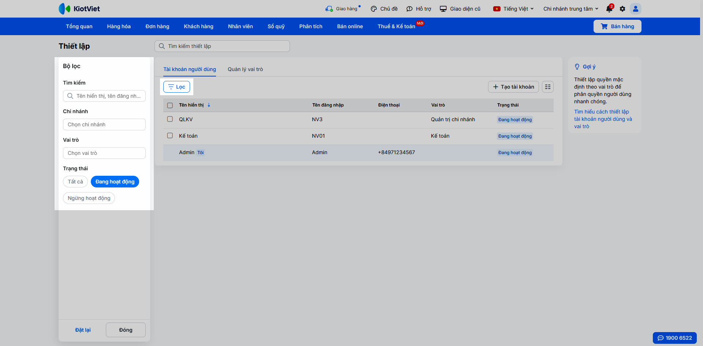

2. Để sắp xếp danh sách, nhấn vào tiêu đề của các cột (ví dụ: nhấn vào "Tên người dùng" để sắp xếp theo alphabet).
3. Để tùy chỉnh các cột thông tin hiển thị, nhấn vào biểu tượng bánh răng và tích/bỏ tích các cột mong muốn.

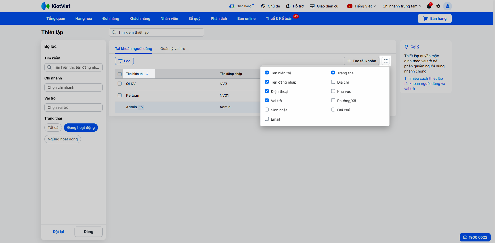

## **IV. Thao tác trên Điện thoại**

Tính năng Quản lý người dùng trên ứng dụng KiotViet hỗ trợ cửa hàng thực hiện các thao tác xem thông tin, thêm, sửa, ngừng hoạt động, cho phép hoạt động, xóa, tìm kiếm, và lọc người dùng.

- **Tình huống:** Khi bạn cần thực hiện nhanh các thao tác quản lý nhân viên như thêm người dùng mới, hoặc khóa/mở khóa tài khoản của ai đó ngay trên điện thoại di động mà không cần mở máy tính.
- **Thao tác thực hiện như sau:** 
  - **Để thêm người dùng mới:**

1. Trong menu **Nhiều hơn**, chọn **Quản lý** **người dùng**.
2. Nhấn vào biểu tượng dấu cộng (+) ở góc màn hình.
3. Điền thông tin, chọn vai trò và chi nhánh tương tự như trên máy tính.
4. Nhấn **Lưu** để hoàn tất.

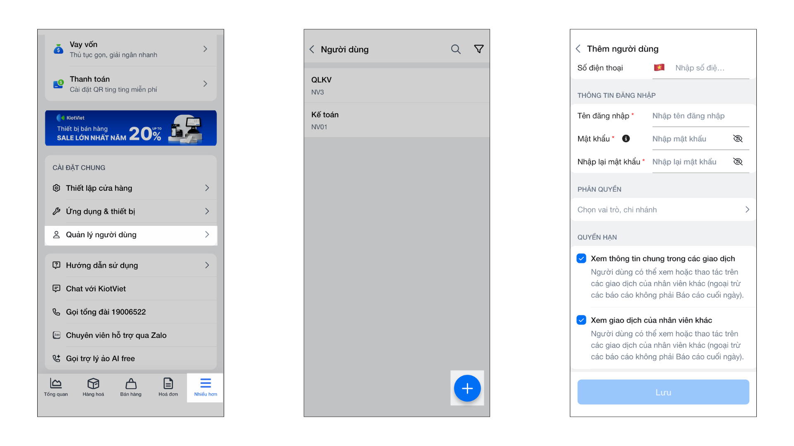

- **Để cập nhật tài khoản người dùng:** Trong màn hình chi tiết người dùng, bạn chọn biểu tượng cây bút để chỉnh sửa thông tin hoặc biểu tượng 3 chấm đế thực hiện các thao tác **Ngừng hoạt động**/ **Cho phép hoạt động** hoặc **Xóa người dùng**.

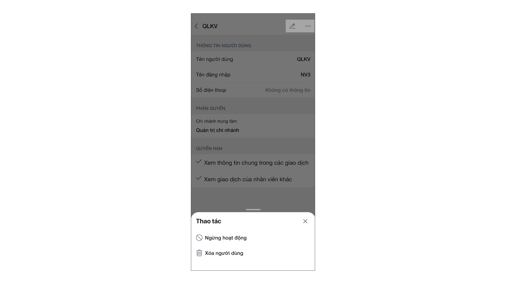

- **Để tìm kiếm người dùng:** Trong màn hình danh sách người dùng, bạn chọn biểu tượng kính lúp để tìm kiếm theo tên đăng nhập, tên người dùng hoặc biểu tượng phễu để lọc thông tin theo chi nhánh, vai trò, trạng thái hoạt động.

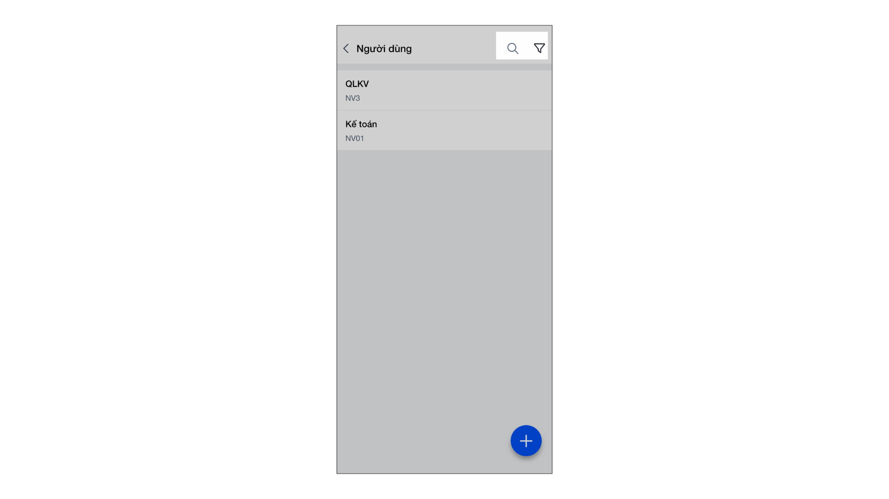

***Cảm ơn bạn đã theo dõi bài viết!***

- Để tìm hiểu thêm về các nghiệp vụ quản lý bán hàng, mời bạn xem bài viết:  
  [**Tổng quan Các nhóm Giải pháp của KiotViet**](https://www.kiotviet.vn/huong-dan-su-dung-kiotviet/retail-lam-quen-voi-kiotviet/tong-quan-cac-nhom-giai-phap-kiotviet/)
- Để tham khảo thêm các video hướng dẫn sử dụng, mời bạn theo dõi kênh YouTube:  
  [**HDSD - Phần mềm KiotViet**](https://www.youtube.com/@HDSDPhanmemKiotViet)

***Chúc bạn kinh doanh hiệu quả cùng KiotViet!***
