# KiotViet Retail – Phân quyền người dùng theo nhóm hàng

Nguồn: https://www.kiotviet.vn/huong-dan-su-dung-kiotviet/retail-thiet-lap/phan-quyen-nguoi-dung-theo-nhom-hang/

---

# **Phân quyền người dùng theo nhóm hàng**

*(Ngành Bán buôn, Bán lẻ)*

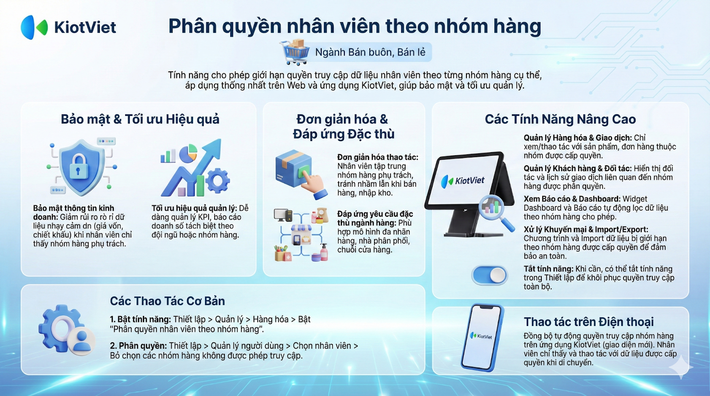

## **I. Giới thiệu chung**

Tính năng **Phân quyền người dùng theo nhóm hàng** cho phép chủ cửa hàng hoặc người quản trị hệ thống giới hạn quyền truy cập dữ liệu (hàng hóa, giao dịch, đối tác, báo cáo) của người dùng dựa trên các nhóm hàng cụ thể. Khi được kích hoạt, người dùng sẽ chỉ nhìn thấy và thao tác được với các thông tin thuộc phạm vi nhóm hàng mà họ được cấp quyền, áp dụng đồng bộ trên cả nền tảng website và ứng dụng di động.

**Lợi ích nổi bật của tính năng:**

- **Bảo mật thông tin kinh doanh:** Giúp bạn hạn chế rủi ro rò rỉ giá vốn, chính sách chiết khấu hay các thông tin nhạy cảm của các nhóm hàng không thuộc phạm vi quản lý của nhân viên.
- **Quản lý hiệu quả và chuyên sâu:** Hỗ trợ tách biệt chỉ số KPI và báo cáo doanh thu chính xác cho từng nhân viên hoặc đội nhóm phụ trách từng ngành hàng riêng biệt (ví dụ: nhân viên bán điện thoại không thấy số liệu của nhân viên bán điện lạnh).
- **Giảm thiểu sai sót trong vận hành:** Ngăn chặn tình trạng nhân viên thao tác nhầm lẫn trên các sản phẩm không thuộc trách nhiệm quản lý, đảm bảo quy trình bán hàng và nhập kho diễn ra chính xác.
- **Đáp ứng yêu cầu pháp lý:** Phù hợp với các mô hình kinh doanh đặc thù (như dược phẩm, phân phối đa nhãn) yêu cầu sự phân tách dữ liệu bắt buộc giữa các nhóm sản phẩm.

**Đối tượng thích hợp áp dụng tính năng**:Tính năng được thiết kế để đáp ứng nhu cầu quản lý chuyên biệt của nhiều ngành hàng, cụ thể:

- **Nhà phân phối đa nhãn hàng:** Nhân viên chỉ xem được nhãn hàng được giao, đảm bảo tuân thủ hợp đồng phân phối và tránh rò rỉ chính sách giá, chiết khấu giữa các nhãn.
- **FMCG – Nhà phân phối:** Nhân viên chỉ xem được nhóm sản phẩm phụ trách (như thực phẩm, đồ uống, đồ gia dụng,..), hạn chế lộ giá và hỗ trợ quản lý KPI theo tuyến bán hàng.
- **Điện tử – điện máy:** Nhân viên từng nhóm hàng chỉ xem được dữ liệu liên quan, giúp bảo mật giá và chiết khấu cũng như tách bạch KPI.
- **Thời trang – nhiều nhãn hàng:** Nhân viên từng thương hiệu chỉ quản lý sản phẩm thuộc thương hiệu đó, tránh nhầm lẫn và bảo vệ chiến lược giá của từng nhãn hàng.
- **Dược phẩm – mỹ phẩm:** Nhân viên bán hàng được tách quyền truy cập, phù hợp yêu cầu pháp lý và chính sách chiết khấu đặc thù.
- **F&B – chuỗi cửa hàng:** Nhân viên từng vị trí chỉ xem đúng danh mục sản phẩm (bán lẻ hoặc bán buôn), giúp tránh sai lệch giá giữa menu lẻ và combo thùng/lốc.
- **Trang sức – hàng giá trị cao:** Nhân viên từng dòng sản phẩm (như kim cương, vàng miếng) được phân tách quyền thao tác, đảm bảo bảo mật giá vốn và hạn chế rủi ro.
- **Nông sản – xuất khẩu:** Nhân viên chỉ xem được nhóm hàng phụ trách (gạo, trái cây, thủy sản), bảo mật dữ liệu liên quan đến hợp đồng xuất khẩu.

## **II. Các thao tác cơ bản**

Để dễ hình dung, các ví dụ dưới đây sẽ minh họa những tình huống thực tế trong ngành Bán buôn, Bán lẻ.

### **1. Kích hoạt tính năng**

- **Tình huống:** Bạn là chủ một siêu thị mini kinh doanh nhiều ngành hàng khác nhau. Để bắt đầu quản lý nhân viên theo từng nhóm hàng riêng biệt, bạn cần kích hoạt tính năng này trên hệ thống.
- **Thao tác thực hiện như sau:**

(1) Trên màn hình **Quản lý**, bạn truy cập vào menu **Thiết lập** → chọn **Hàng hóa**.

(2) Bật xanh tính năng ***Phân quyền người dùng theo nhóm hàng***.

(3) Hệ thống mặc định tất cả nhân viên hiện tại vẫn có quyền truy cập toàn bộ nhóm hàng cho đến khi bạn thực hiện phân quyền chi tiết.

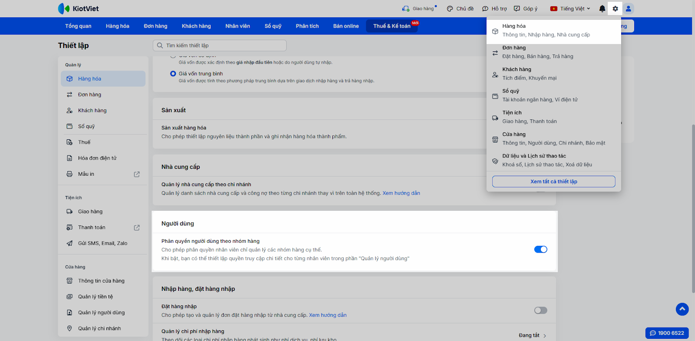

### **2. Phân quyền nhóm hàng cho nhân viên**

- **Tình huống:** Sau khi kích hoạt tính năng, bạn muốn tạo tài khoản cho một nhân viên mới chỉ phụ trách mảng "Mỹ phẩm", không được phép xem thông tin của mảng "Thời trang" và "Thực phẩm".
- **Thao tác thực hiện như sau:**

(1) Trên màn hình **Quản lý**, bạn truy cập vào menu **Thiết lập** → chọn **Cửa hàng → Quản lý người dùng**.

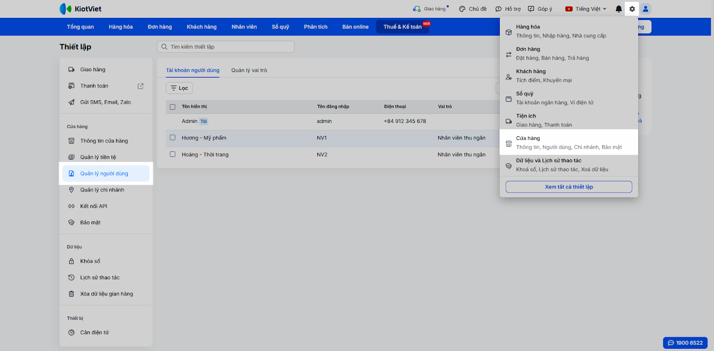

(2) Khi ***Tạo tài khoản*** (đối với nhân viên mới) hoặc ***Chỉnh sửa*** (đối với nhân viên cũ) → tại mục ***Nhóm hàng được phép truy cập***, hệ thống mặc định chọn ***Tất cả nhóm hàng***. Bạn chọn ***Nhóm hàng cụ thể →***  tích chọn các nhóm hàng người dùng này được phép truy cập (ví dụ: Mỹ phẩm,...).

- Hình minh họa khi ***Tạo tài khoản***:

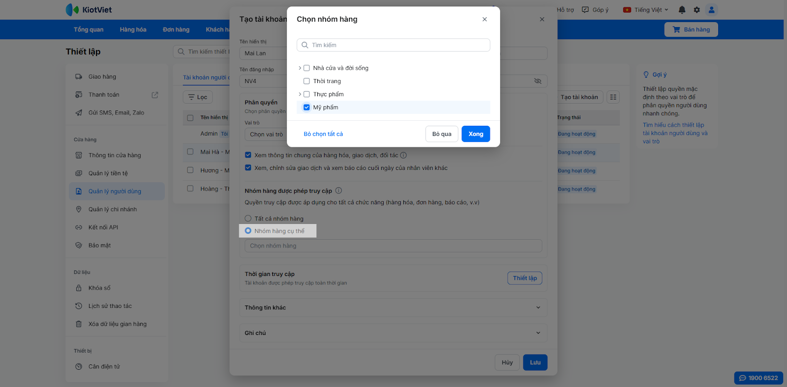

- Hình minh họa khi ***Chỉnh sửa*** tài khoản:

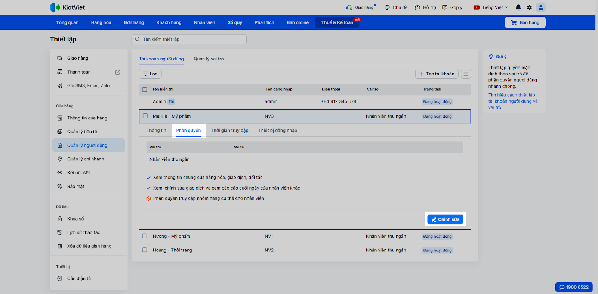

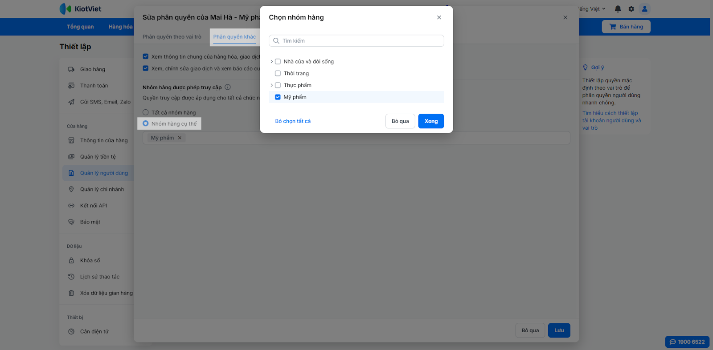

(3) Nhấn ***Lưu***.

**Lưu ý***:* Khi bạn giới hạn nhóm hàng, hệ thống sẽ hiển thị cảnh báo và **tự động bỏ chọn** các quyền: **Thiết lập giá**, **Khuyến mại**, **Voucher**, **Coupon** và **Báo cáo** (ngoại trừ Báo cáo cuối ngày). Bạn cần xác nhận đồng ý để hoàn tất việc tạo/chỉnh sửa tài khoản.

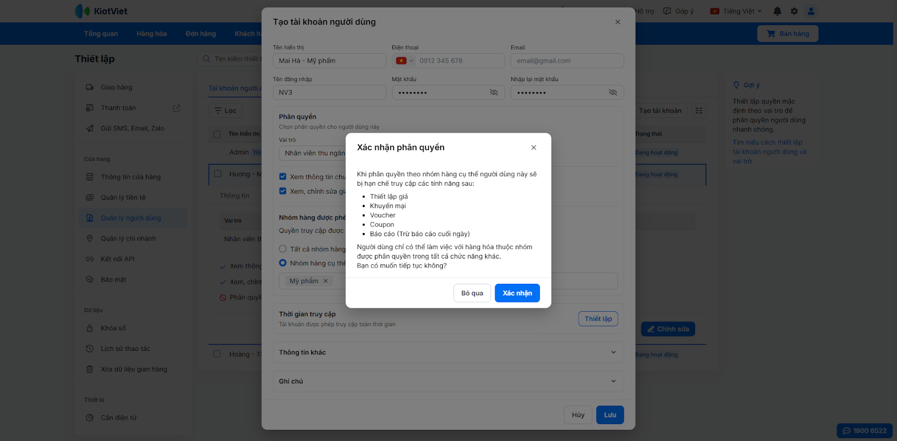

## **III. Các tính năng nâng cao**

### **1. Quản lý Hàng hóa theo phân quyền**

- **Tình huống:** Bạn là nhân viên kinh doanh được phân quyền quản lý nhóm hàng "Mỹ phẩm". Bạn cần kiểm tra danh sách hàng hóa và cập nhật thông tin sản phẩm.
- **Thao tác thực hiện như sau:** 
  - Khi truy cập vào **Hàng hóa → Danh sách sản phẩm**, bạn sẽ chỉ nhìn thấy danh sách các sản phẩm thuộc nhóm "Mỹ phẩm". Các sản phẩm thuộc nhóm hàng khác sẽ bị ẩn hoàn toàn.

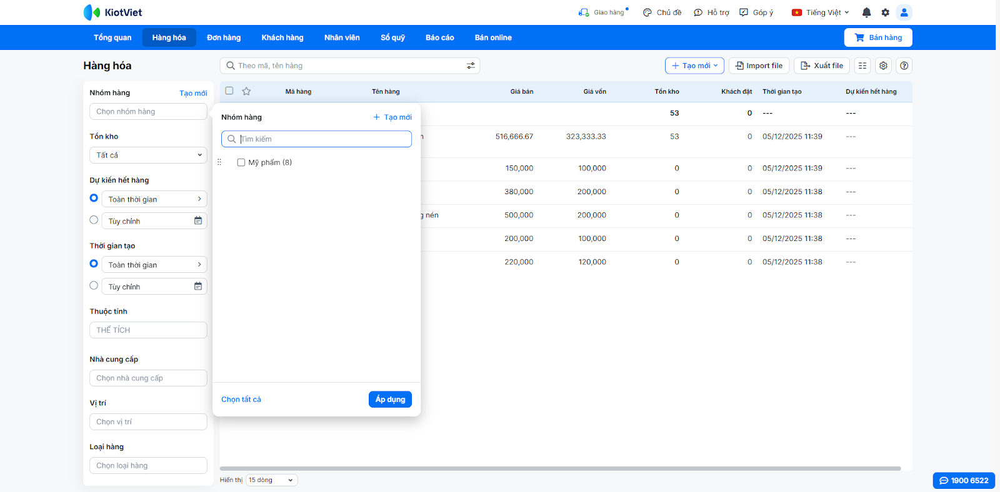

- Khi **Tạo mới** hoặc **Chỉnh sửa** hàng hóa, tại ô chọn **Nhóm hàng**, bạn chỉ có thể chọn được nhóm "Mỹ phẩm".

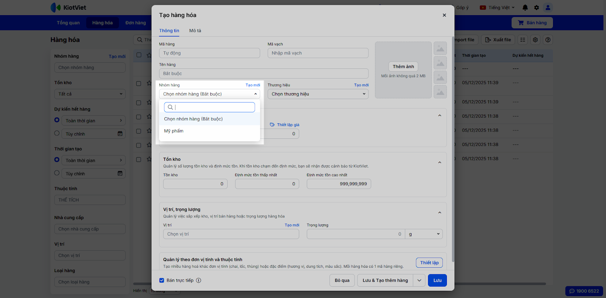

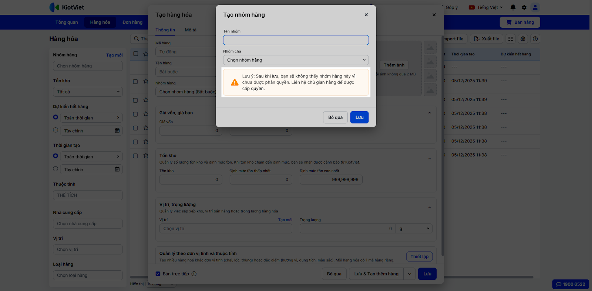

- Nếu bạn tìm kiếm hoặc quét mã vạch một sản phẩm không thuộc quyền quản lý, hệ thống sẽ báo lỗi không tìm thấy hàng hóa.

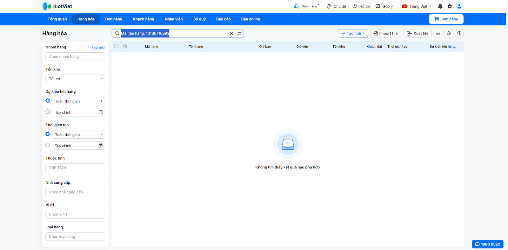

### **2. Xử lý giao dịch**

- **Phạm vi áp dụng:** Tính năng **Phân quyền người dùng theo nhóm hàng** hỗ trợ đầy đủ các loại giao dịch bao gồm: **Đặt hàng**, **Hóa đơn**, **Trả hàng**, **Chuyển hàng**, **Nhập hàng**, **Trả hàng nhập**, **Kiểm kho**, **Xuất hủy**, **Đặt hàng nhập**, **Sản xuất**.
- **Lưu ý ngoại lệ:** Các giao dịch **Bảo hành bảo trì** và **Yêu cầu sửa chữa** hiện tại **không** áp dụng phân quyền người dùng theo nhóm hàng.
- **Tình huống:** Bạn thực hiện tạo đặt hàng hoặc hóa đơn bán hàng cho khách.
- **Thao tác thực hiện như sau:** 
  - **Xem danh sách:** Bạn chỉ nhìn thấy lịch sử các giao dịch mà trong đó **100% sản phẩm** đều thuộc nhóm hàng bạn được phân quyền. Nếu giao dịch có chứa dù chỉ 1 sản phẩm ngoài quyền, giao dịch đó sẽ bị ẩn.
  - **Tạo giao dịch mới:** Bạn chỉ có thể tìm kiếm và thêm các sản phẩm thuộc nhóm hàng được phân quyền vào đơn hàng.

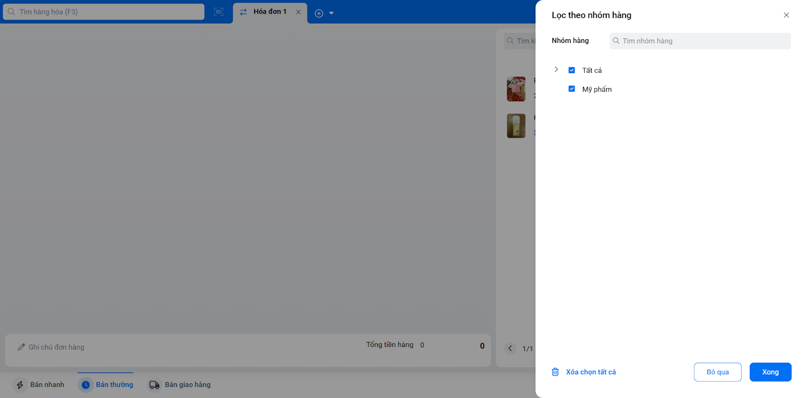

- **Lưu ý:** Nếu trong quá trình tạo/xử lý đơn, quyền của bạn bị người quản lý thay đổi, hệ thống sẽ chặn thao tác Lưu/Hoàn thành/ Thanh toán/ Đặt hàng và báo lỗi sản phẩm không còn trong phạm vi quyền hạn.

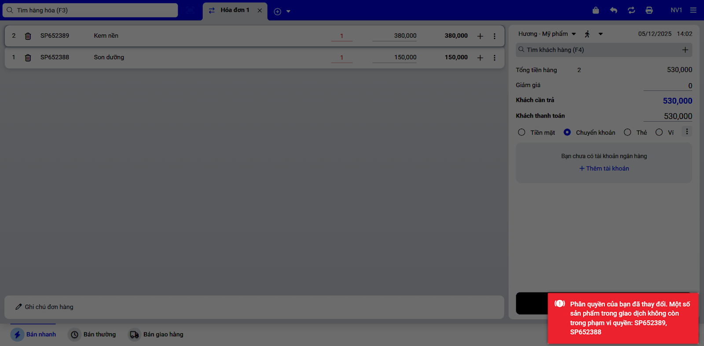

### **3. Quản lý Đối tác**

- **Phạm vi áp dụng:** Tính năng phân quyền áp dụng cho **Khách hàng, Nhà cung cấp, Đối tác giao hàng** và **Bác sĩ** (nếu có).
- **Tình huống:** Bạn cần tra cứu thông tin công nợ hoặc lịch sử mua hàng của một đối tác.
- **Thao tác thực hiện như sau:** 
  - **Danh sách Đối tác:** Hệ thống chỉ hiển thị những đối tác có phát sinh giao dịch với 100% hàng hóa thuộc nhóm hàng bạn được phân quyền. Đối tác giao dịch các mặt hàng ngoài phạm vi nhóm hàng được phân quyền sẽ không tìm thấy.

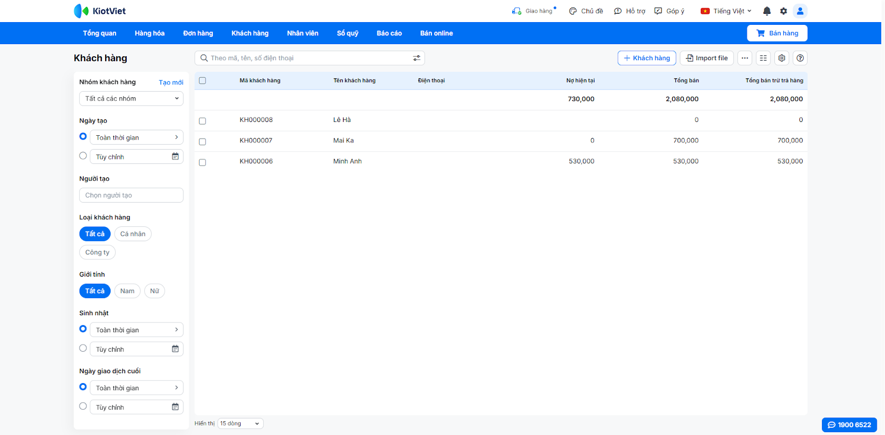

- **Tìm kiếm đối tác để tạo giao dịch**: 
  - Hệ thống vẫn cho phép tìm kiếm được thông tin đối tác (kể cả ngoài quyền) tại các màn hình tạo giao dịch (như Nhập hàng, Hóa đơn, Đặt hàng nhập, Đặt hàng...) để phục vụ việc tạo đơn.
  - **Xem chi tiết đối tác khi tìm kiếm:** 
    - **Dư nợ**: Hiển thị tất cả các giao dịch với đối tác nhưng không xem được thông tin chi tiết của giao dịch có chứa hàng hóa ngoài phạm vi nhóm hàng được phân quyền.

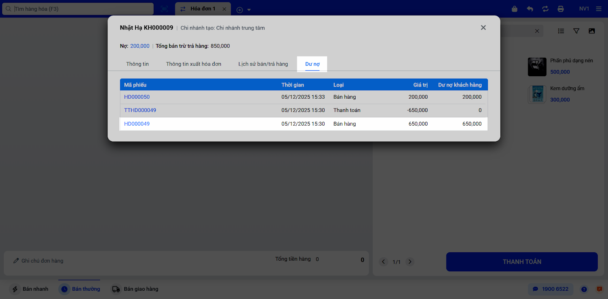

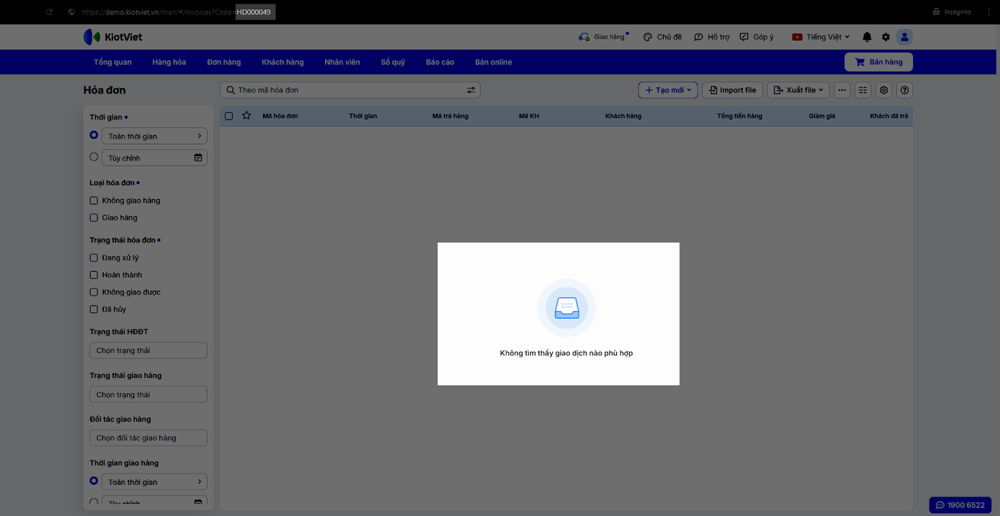

- **Lịch sử bán/trả hàng**: Chỉ liệt kê các giao dịch mà trong đó **100% sản phẩm** đều thuộc nhóm hàng bạn được phân quyền[.](https://demo.kvpos.com/sale/)

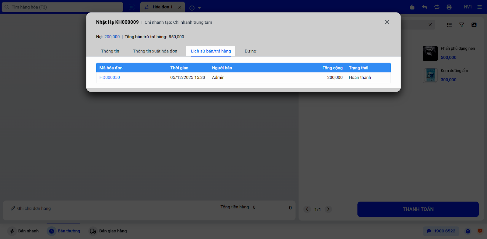

### **4. Tổng quan và Báo cáo**

- **Tình huống:** Cuối ngày, bạn cần xem báo cáo doanh thu để chốt ca làm việc.
- **Thao tác thực hiện như sau:** 
  - Trên màn hình **Tổng quan**: Các khối thông tin như Kết quả bán hàng, Doanh thu thuần, Top hàng bán chạy... sẽ tự động tính toán và chỉ hiển thị số liệu từ các nhóm hàng bạn được phân quyền. 
    - **Hiển thị theo quyền:** Các khối thông tin **Kết quả bán hàng hôm nay**, **Doanh thu thuần**, **Top 10 hàng bán chạy** sẽ chỉ tính toán và hiển thị số liệu từ các nhóm hàng bạn được phân quyền.
    - **Ẩn hoàn toàn:** Các khối thông tin **Top 10 khách mua nhiều** và **Khách hàng hoạt động gần đây** sẽ bị ẩn hoàn toàn trên giao diện.

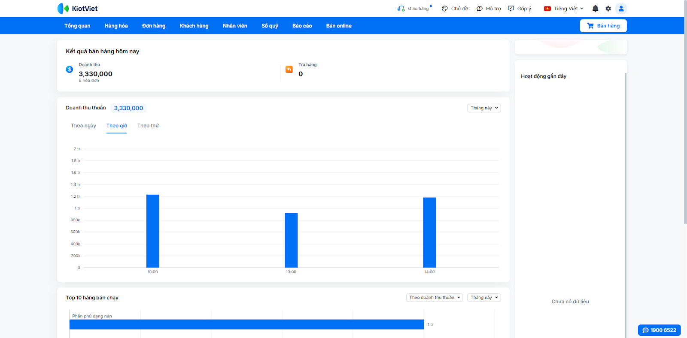

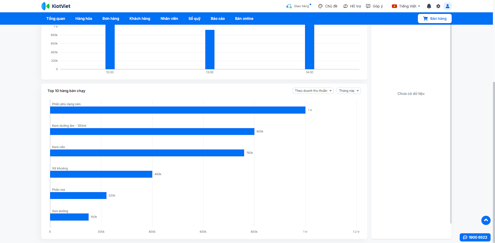

- Menu **Phân tích:** Sẽ bị **ẩn hoàn toàn** đối với nhân viên được phân quyền nhóm hàng.
- **Hệ thống báo cáo:** Bạn chỉ có thể xem **Báo cáo Cuối ngày** với dữ liệu đã được lọc theo các giao dịch với 100% hàng hóa thuộc nhóm hàng bạn được phân quyền.

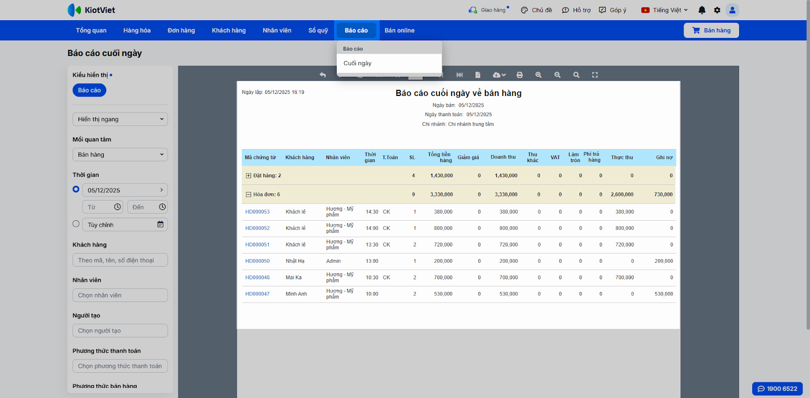

### **5. Xử lý Khuyến mại và Import/Export dữ liệu**

- **Tình huống:** Cửa hàng có chương trình khuyến mại hoặc bạn cần nhập liệu hàng hóa từ file Excel.
- **Thao tác thực hiện như sau:** 
  - **Khuyến mại:** Nếu chương trình khuyến mại có hàng khuyến mại nằm ngoài nhóm hàng bạn quản lý, chương trình đó sẽ bị ẩn hoặc hàng khuyến mại đó sẽ không hiển thị để chọn.
  - **Import (Nhập file):** Nếu file Excel chứa bất kỳ mã hàng nào không thuộc quyền quản lý, hệ thống sẽ báo lỗi và dừng toàn bộ quá trình nhập file.

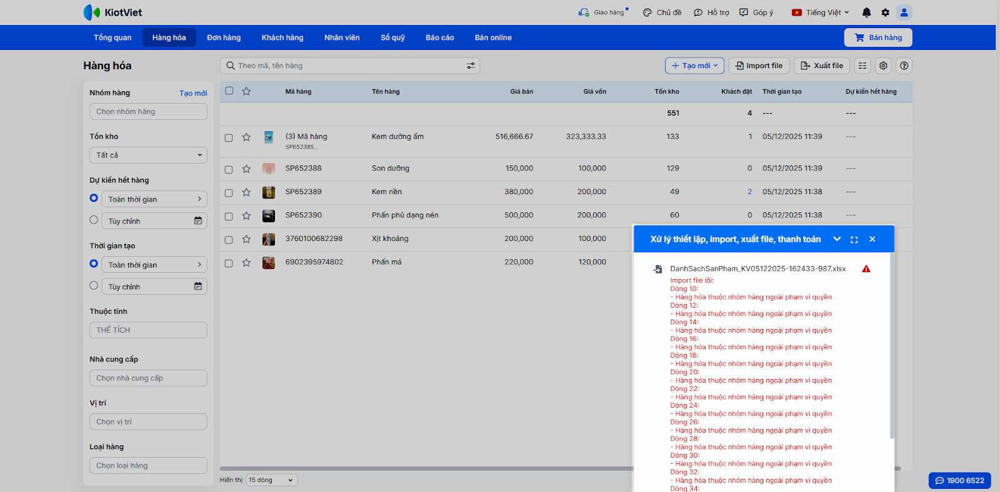

- **Export (Xuất file):** File xuất ra sẽ chỉ chứa dữ liệu của các nhóm hàng bạn được phép xem.

### **6. Quản lý Sổ quỹ**

- **Tình huống:** Bạn muốn kiểm tra dòng tiền hoặc lịch sử thu chi liên quan đến các giao dịch mình đã thực hiện.
- **Thao tác thực hiện như sau:** 
  - Khi truy cập vào **Sổ quỹ**, hệ thống sẽ tự động áp dụng bộ lọc theo nhân viên.
  - **Quy tắc hiển thị:** Bạn chỉ nhìn thấy các phiếu thu/chi của các giao dịch mà thông tin nhân viên (người thu/ người chi) trùng khớp với tài khoản bạn đang đăng nhập.
  - Các giao dịch của nhân viên khác sẽ bị ẩn hoàn toàn để đảm bảo tính riêng tư và bảo mật dữ liệu theo phân quyền.

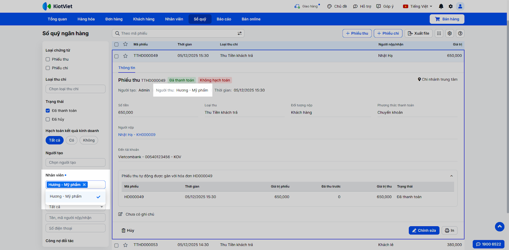

## **IV. Thao tác trên Điện thoại**

Hiện tại, ứng dụng **KiotViet** trên điện thoại chưa hỗ trợ thiết lập (bật tính năng, phân quyền) mà chỉ thừa hưởng cấu hình từ Web.

Ứng dụng tự động nhận diện và áp dụng quyền hạn ngay khi người dùng thực hiện đăng nhập, hỗ trợ thực hiện đầy đủ các giao dịch (được phân quyền): **Đặt hàng**, **Hóa đơn**, **Trả hàng**, **Chuyển hàng**, **Nhập hàng**, **Trả hàng nhập**, **Kiểm kho**, **Xuất hủy**, **Đặt hàng nhập**, **Sản xuất**.

**Nguyên tắc hoạt động**: Toàn bộ logic hiển thị và thao tác đối với **Hàng hóa**, **Giao dịch**, **Đối tác**, **Tổng quan** và **Báo cáo** đều tuân thủ chặt chẽ các nguyên tắc đã được mô tả chi tiết tại mục[**III. Các tính năng nâng cao**](#_III._Các_tính) trên giao diện Web.

**Lưu ý**: Tính năng chỉ hỗ trợ trên giao diện mới. Người dùng được phân quyền nhóm hàng sẽ không thể sử dụng hoặc quay lại giao diện cũ (ứng dụng sẽ yêu cầu cập nhật nếu đang ở phiên bản cũ).

***Cảm ơn bạn đã theo dõi bài viết!***

- Để tìm hiểu thêm về các nghiệp vụ quản lý bán hàng, mời bạn xem bài viết:  
  [**Tổng quan Các nhóm Giải pháp của KiotViet**](https://www.kiotviet.vn/huong-dan-su-dung-kiotviet/retail-lam-quen-voi-kiotviet/tong-quan-cac-nhom-giai-phap-kiotviet/)
- Để tham khảo thêm các video hướng dẫn sử dụng, mời bạn theo dõi kênh YouTube:  
  [**HDSD - Phần mềm KiotViet**](https://www.youtube.com/@HDSDPhanmemKiotViet)

***Chúc bạn kinh doanh hiệu quả cùng KiotViet!***

*Tài liệu được cập nhật mới nhất ngày 10/12/2025*
