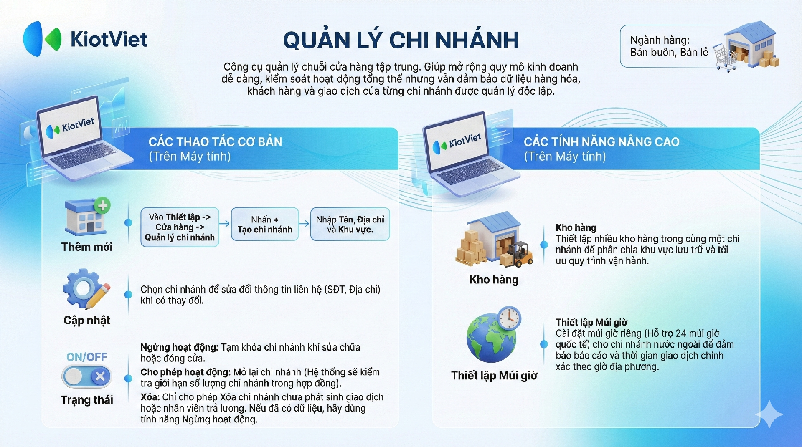
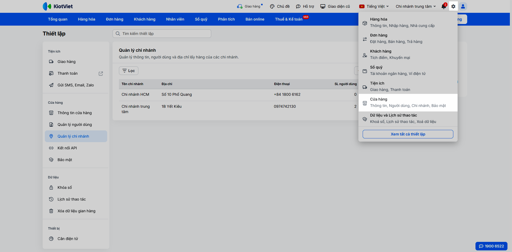
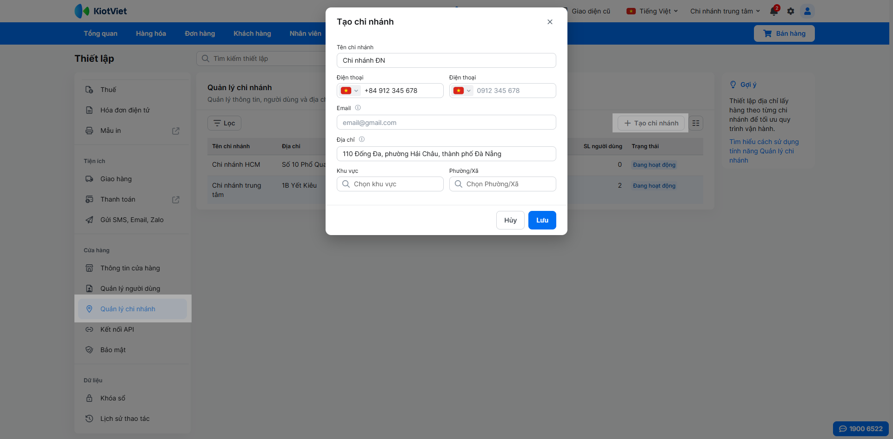
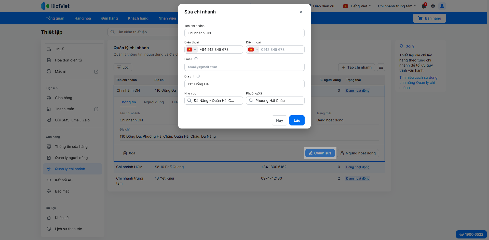
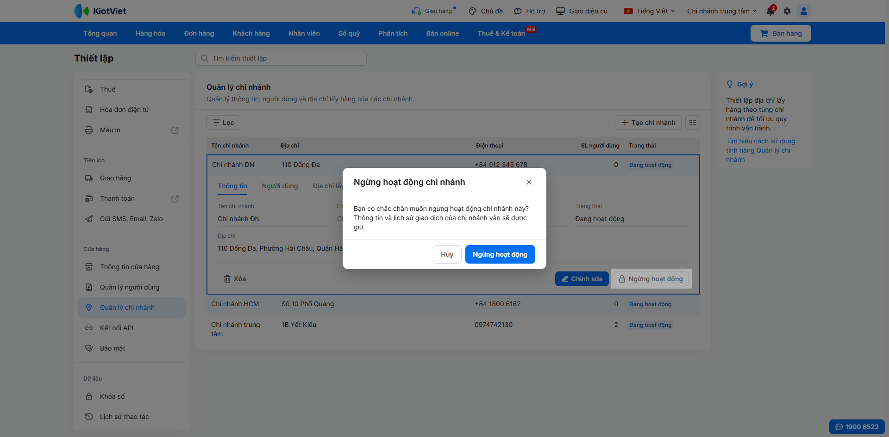
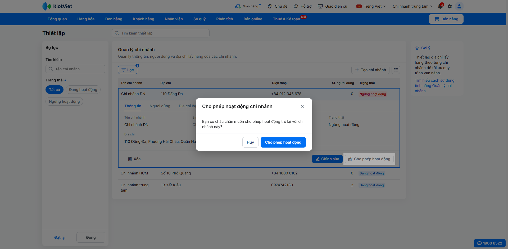
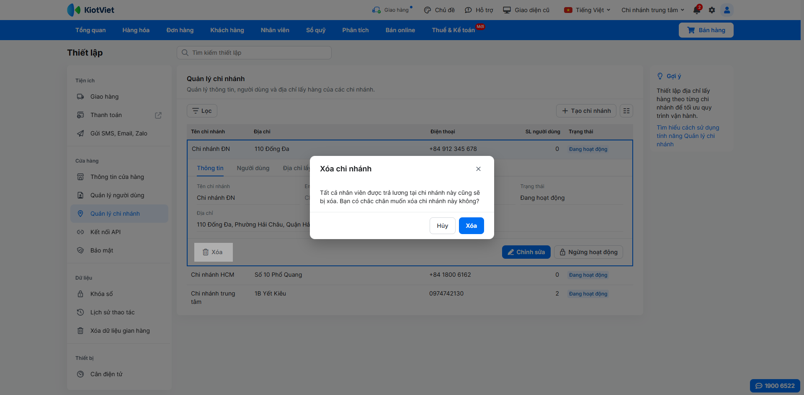
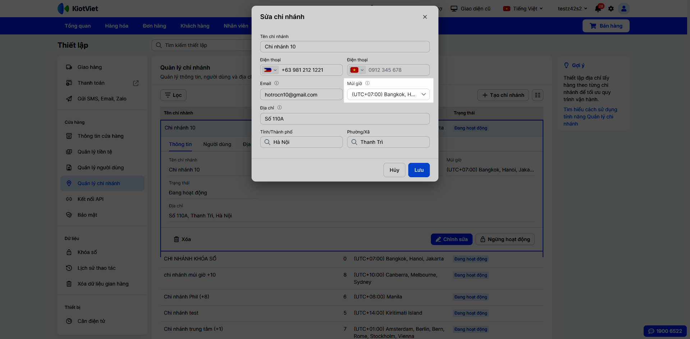

# KiotViet Retail – Quản lý chi nhánh

Nguồn: https://www.kiotviet.vn/huong-dan-su-dung-kiotviet/retail-thiet-lap/quan-ly-chi-nhanh/

---

# **Quản lý Chi nhánh**

*(Ngành Bán buôn, Bán lẻ)*

## **I. Giới thiệu chung**

Tính năng Quản lý Chi nhánh là công cụ cốt lõi giúp bạn dễ dàng mở rộng quy mô kinh doanh và kiểm soát hoạt động của toàn bộ chuỗi cửa hàng một cách tập trung và hiệu quả.

**Lợi ích nổi bật của tính năng Quản lý Chi nhánh trên KiotViet:**

- **Mở rộng kinh doanh dễ dàng:** Nhanh chóng thiết lập và đưa vào hoạt động các chi nhánh mới ở nhiều địa điểm khác nhau.
- **Quản lý tập trung, dữ liệu độc lập:** Theo dõi hoạt động kinh doanh tổng thể của toàn chuỗi nhưng vẫn đảm bảo dữ liệu (hàng hóa, khách hàng, giao dịch) của từng chi nhánh được quản lý riêng biệt.
- **Vận hành linh hoạt:** Dễ dàng thay đổi trạng thái hoạt động của chi nhánh (tạm ngừng, hoạt động trở lại) để phù hợp với tình hình kinh doanh thực tế.

## **II. Các thao tác cơ bản**

Để dễ hình dung, các ví dụ dưới đây sẽ minh họa những tình huống thực tế khi thao tác trên máy tính (Website).

### **1. Thêm mới chi nhánh**

- **Tình huống:** Bạn quyết định mở rộng kinh doanh và cần thiết lập một cửa hàng mới trên hệ thống KiotViet.
- **Thao tác thực hiện như sau:**

(1) Tại màn hình **Quản lý**, từ menu **Thiết lập**, bạn chọn **Cửa hàng**.

(2) Trên menu bên trái, chọn **Quản lý chi nhánh**, bạn nhấn vào nút ***+ Tạo chi nhánh***.

(3) Điền các thông tin bắt buộc, bao gồm: ***Tên chi nhánh***, ***Điện thoại***, ***Địa chỉ***, ***Khu vực***, ***Phường/Xã***.

(4) Nhấn ***Lưu*** để hoàn tất.

### **2. Cập nhật thông tin chi nhánh**

- **Tình huống:** Thông tin của một chi nhánh (ví dụ: số điện thoại, địa chỉ) có sự thay đổi và bạn cần cập nhật lại trên hệ thống.
- **Thao tác thực hiện như sau:**

(1) Trong danh sách chi nhánh, chọn chi nhánh → nhấn ***Chỉnh sửa***.

(2) Thay đổi các thông tin cần thiết.

(3) Nhấn ***Lưu*** để hoàn tất.

### **3. Ngừng hoạt động/Cho phép hoạt động chi nhánh**

- **Tình huống:** Một chi nhánh cần tạm ngưng hoạt động để sửa chữa hoặc vì lý do kinh doanh, sau đó cần hoạt động trở lại.
- **Thao tác thực hiện như sau:** 
  - **Để ngừng hoạt động:** Chọn chi nhánh và nhấn **Ngừng hoạt động**.

- **Để hoạt động trở lại:** Chọn chi nhánh đang ngừng hoạt động và nhấn **Cho phép hoạt động**.

**Lưu ý**: Hệ thống sẽ kiểm tra để đảm bảo tổng số chi nhánh hoạt động không vượt quá giới hạn trong hợp đồng của bạn.

### **4. Xóa chi nhánh**

- **Tình huống:** Bạn cần xóa một chi nhánh không còn hoạt động, muốn ẩn khỏi hệ thống.
- **Thao tác thực hiện như sau:**

(1) Chọn chi nhánh → nhấn **Xóa**.

(2) Xác nhận thao tác. Sau khi xóa thành công, thông tin chi nhánh sẽ bị khóa lại. Tất cả nhân viên được trả lương tại chi nhánh này (nếu có) cũng sẽ bị xóa.

## **III. Các tính năng nâng cao**

### **1. Thiết lập kho hàng**

Tính năng **Quản lý Kho hàng** cho phép bạn phân chia và kiểm soát hàng hóa theo từng khu vực lưu trữ riêng biệt trong cùng một chi nhánh, giúp tối ưu hóa quy trình vận hành và quản lý tồn kho.

Số lượng kho hàng được phép thêm và quản lý phụ thuộc vào gói dịch vụ mà gian hàng đang sử dụng.

Thông tin chi tiết về thao tác quản lý kho hàng được trình bày tại bài viết: [Quản lý kho hàng](https://www.kiotviet.vn/huong-dan-su-dung-kiotviet/retail-thiet-lap/quan-ly-kho-hang/).

### **2. Thiết lập múi giờ cho chi nhánh**

Hiện tại phần mềm KiotViet đang hỗ trợ thiết lập 24 múi giờ. Xem danh sách múi giờ tại [mục IV](#_18av9mxpvcb)

**Lưu ý**: Tính năng được tự động mở trên các gian hàng tạo sau ngày 25/4/2024. Với các gian hàng không hiển thị tính năng, vui lòng liên hệ KiotViet để được hỗ trợ.

- **Tình huống:** Bạn có chi nhánh hoạt động ở các quốc gia hoặc khu vực có múi giờ khác nhau. Bạn cần hệ thống ghi nhận thời gian giao dịch, báo cáo chính xác theo giờ địa phương của từng chi nhánh.
- **Thao tác thực hiện như sau:**

(1) Khi ***Thêm mới*** hoặc ***Chỉnh sửa*** một chi nhánh, bạn sẽ thấy mục **Múi giờ**. Hãy chọn múi giờ phù hợp cho chi nhánh đó.

(2) Nhấn ***Lưu*** để hoàn tất.

**Lưu ý**: Hiện tại, hệ thống chỉ hỗ trợ thiết lập múi giờ một lần duy nhất cho mỗi chi nhánh. Sau khi đã ***Lưu***, nếu cần thay đổi, bạn vui lòng liên hệ KiotViet để được hỗ trợ.

- **Hiển thị thời gian:** 
  - Mọi giao dịch và báo cáo tại một chi nhánh sẽ hiển thị thời gian theo múi giờ đã được thiết lập cho chi nhánh đó.
  - Khi bạn xem báo cáo gộp của nhiều chi nhánh có múi giờ khác nhau, hệ thống sẽ quy đổi và hiển thị tất cả dữ liệu theo múi giờ của chi nhánh bạn đang đăng nhập.

## **IV. Phụ lục: Danh sách múi giờ**

|  |  |
| --- | --- |
| **STT** | **Múi giờ** |
| 1 | (UTC-12:00) International Date Line West |
| 2 | (UTC-11:00) Coordinated Universal Time-11 |
| 3 | (UTC-10:00) Aleutian Islands |
| 4 | (UTC-10:00) Hawaii |
| 5 | (UTC-09:30) Marquesas Islands |
| 6 | (UTC-09:00) Alaska |
| 7 | (UTC-09:00) Coordinated Universal Time-09 |
| 8 | (UTC-08:00) Baja California |
| 9 | (UTC-08:00) Coordinated Universal Time-08 |
| 10 | (UTC-08:00) Pacific Time (US & Canada) |
| 11 | (UTC-07:00) Arizona |
| 12 | (UTC-07:00) La Paz, Mazatlan |
| 13 | (UTC-07:00) Mountain Time (US & Canada) |
| 14 | (UTC-07:00) Yukon |
| 15 | (UTC-06:00) Central America |
| 16 | (UTC-06:00) Central Time (US & Canada) |
| 17 | (UTC-06:00) Easter Island |
| 18 | (UTC-06:00) Guadalajara, Mexico City, Monterrey |
| 19 | (UTC-06:00) Saskatchewan |
| 20 | (UTC-05:00) Bogota, Lima, Quito, Rio Branco |
| 21 | (UTC-05:00) Chetumal |
| 22 | (UTC-05:00) Eastern Time (US & Canada) |
| 23 | (UTC-05:00) Haiti |
| 24 | (UTC-05:00) Havana |
| 25 | (UTC-05:00) Indiana (East) |
| 26 | (UTC-05:00) Turks and Caicos |
| 27 | (UTC-04:00) Asuncion |
| 28 | (UTC-04:00) Atlantic Time (Canada) |
| 29 | (UTC-04:00) Caracas |
| 30 | (UTC-04:00) Cuiaba |
| 31 | (UTC-04:00) Georgetown, La Paz, Manaus, San Juan |
| 32 | (UTC-04:00) Santiago |
| 33 | (UTC-03:30) Newfoundland |
| 34 | (UTC-03:00) Araguaina |
| 35 | (UTC-03:00) Brasilia |
| 36 | (UTC-03:00) Cayenne, Fortaleza |
| 37 | (UTC-03:00) Buenos Aires |
| 38 | (UTC-03:00) Greenland |
| 39 | (UTC-03:00) Montevideo |
| 40 | (UTC-03:00) Punta Arenas |
| 41 | (UTC-03:00) Saint Pierre and Miquelon |
| 42 | (UTC-03:00) Salvador |
| 43 | (UTC-02:00) Coordinated Universal Time-02 |
| 44 | (UTC-01:00) Azores |
| 45 | (UTC-01:00) Cabo Verde Is |
| 46 | (UTC) Coordinated Universal Time |
| 47 | (UTC+00:00) Dublin, Edinburgh, Lisbon, London |
| 48 | (UTC+00:00) Monrovia, Reykjavik |
| 49 | (UTC+00:00) Sao Tome |
| 50 | (UTC+01:00) Casablanca |
| 51 | (UTC+01:00) Amsterdam, Berlin, Bern, Rome, Stockholm, Vienna |
| 52 | (UTC+01:00) Belgrade, Bratislava, Budapest, Ljubljana, Prague |
| 53 | (UTC+01:00) Brussels, Copenhagen, Madrid, Paris |
| 54 | (UTC+01:00) Sarajevo, Skopje, Warsaw, Zagreb |
| 55 | (UTC+01:00) West Central Africa |
| 56 | (UTC+02:00) Athens, Bucharest |
| 57 | (UTC+02:00) Beirut |
| 58 | (UTC+02:00) Cairo |
| 59 | (UTC+02:00) Chisinau |
| 60 | (UTC+02:00) Damascus |
| 61 | (UTC+02:00) Gaza, Hebron |
| 62 | (UTC+02:00) Harare, Pretoria |
| 63 | (UTC+02:00) Helsinki, Kyiv, Riga, Sofia, Tallinn, Vilnius |
| 64 | (UTC+02:00) Jerusalem |
| 65 | (UTC+02:00) Juba |
| 66 | (UTC+02:00) Kaliningrad |
| 67 | (UTC+02:00) Khartoum |
| 68 | (UTC+02:00) Tripoli |
| 69 | (UTC+02:00) Windhoek |
| 70 | (UTC+03:00) Amman |
| 71 | (UTC+03:00) Baghdad |
| 72 | (UTC+03:00) Istanbul |
| 73 | (UTC+03:00) Kuwait, Riyadh |
| 74 | (UTC+03:00) Minsk |
| 75 | (UTC+03:00) Moscow, St. Petersburg |
| 76 | (UTC+03:00) Nairobi |
| 77 | (UTC+03:00) Volgograd |
| 78 | (UTC+03:30) Tehran |
| 79 | (UTC+04:00) Abu Dhabi, Muscat |
| 80 | (UTC+04:00) Astrakhan, Ulyanovsk |
| 81 | (UTC+04:00) Baku |
| 82 | (UTC+04:00) Izhevsk, Samara |
| 83 | (UTC+04:00) Port Louis |
| 84 | (UTC+04:00) Saratov |
| 85 | (UTC+04:00) Tbilisi |
| 86 | (UTC+04:00) Yerevan |
| 87 | (UTC+04:30) Kabul |
| 88 | (UTC+05:00) Ashgabat, Tashkent |
| 89 | (UTC+05:00) Ekaterinburg |
| 90 | (UTC+05:00) Islamabad, Karachi |
| 91 | (UTC+05:00) Qyzylorda |
| 92 | (UTC+05:30) Chennai, Kolkata, Mumbai, New Delhi |
| 93 | (UTC+05:30) Sri Jayawardenepura |
| 94 | (UTC+05:45) Kathmandu |
| 95 | (UTC+06:00) Astana |
| 96 | (UTC+06:00) Dhaka |
| 97 | (UTC+06:00) Omsk |
| 98 | (UTC+06:30) Yangon (Rangoon) |
| 99 | (UTC+07:00) Bangkok, Hanoi, Jakarta |
| 100 | (UTC+07:00) Barnaul, Gorno-Altaysk |
| 101 | (UTC+07:00) Hovd |
| 102 | (UTC+07:00) Krasnoyarsk |
| 103 | (UTC+07:00) Novosibirsk |
| 104 | (UTC+07:00) Tomsk |
| 105 | (UTC+08:00) Beijing, Chongqing, Hong Kong, Urumqi |
| 106 | (UTC+08:00) Irkutsk |
| 107 | (UTC+08:00) Kuala Lumpur, Singapore |
| 108 | (UTC +08:00) Manila |
| 109 | (UTC+08:00) Perth |
| 110 | (UTC+08:00) Taipei |
| 111 | (UTC+08:00) Ulaanbaatar |
| 112 | (UTC+08:45) Eucla |
| 113 | (UTC+09:00) Chita |
| 114 | (UTC+09:00) Osaka, Sapporo, Tokyo |
| 115 | (UTC+09:00) Pyongyang |
| 116 | (UTC+09:00) Seoul |
| 117 | (UTC+09:00) Yakutsk |
| 118 | (UTC+09:30) Adelaide |
| 119 | (UTC+09:30) Darwin |
| 120 | (UTC+10:00) Brisbane |
| 121 | (UTC+10:00) Canberra, Melbourne, Sydney |
| 122 | (UTC+10:00) Guam, Port Moresby |
| 123 | (UTC+10:00) Hobart |
| 124 | (UTC+10:00) Vladivostok |
| 125 | (UTC+10:30) Lord Howe Island |
| 126 | (UTC+11:00) Bougainville Island |
| 127 | (UTC+11:00) Chokurdakh |
| 128 | (UTC+11:00) Magadan |
| 129 | (UTC+11:00) Norfolk Island |
| 130 | (UTC+11:00) Sakhalin |
| 131 | (UTC+11:00) Solomon Is., New Caledonia |
| 132 | (UTC+12:00) Anadyr, Petropavlovsk-Kamchatsky |
| 133 | (UTC+12:00) Auckland, Wellington |
| 134 | (UTC+12:00) Coordinated Universal Time+12 |
| 135 | (UTC+12:00) Fiji |
| 136 | (UTC+12:45) Chatham Islands |
| 137 | (UTC+13:00) Coordinated Universal Time+13 |
| 138 | (UTC+13:00) Nuku'alofa |
| 139 | (UTC+13:00) Samoa |
| 140 | (UTC+14:00) Kiritimati Island |

***Cảm ơn bạn đã theo dõi bài viết!***

- Để tìm hiểu thêm về các nghiệp vụ quản lý bán hàng, mời bạn xem bài viết:  
  [**Tổng quan Các nhóm Giải pháp của KiotViet**](https://www.kiotviet.vn/huong-dan-su-dung-kiotviet/retail-lam-quen-voi-kiotviet/tong-quan-cac-nhom-giai-phap-kiotviet/)
- Để tham khảo thêm các video hướng dẫn sử dụng, mời bạn theo dõi kênh YouTube:  
  [**HDSD - Phần mềm KiotViet**](https://www.youtube.com/@HDSDPhanmemKiotViet)

***Chúc bạn kinh doanh hiệu quả cùng KiotViet!***
